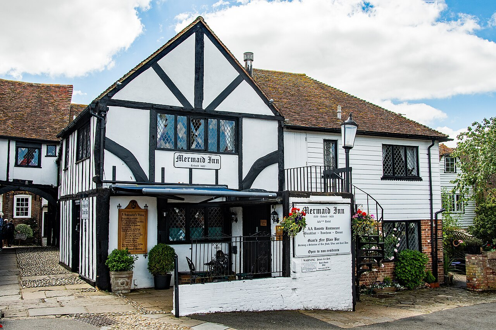

# The Mermaid Inn

The slope of Mermaid Street is the first warning that this is not a pub you drop into on the way somewhere else. Rye's old town sits on a hill, and the cobbled lane is narrow and steep; the Mermaid Inn's timber frontage is embedded halfway up it. The building is an inn, a restaurant and a bar at the same time, and its historical storytelling, its rooms and its visitors' expectations all overlap. That explains why the "drinks list" feels less like a city bar and more like the public sitting room of an old hotel.

Figure: The Mermaid Inn. Photograph: The Mermaid Inn, Rye - 20220620121757. Credit: Herman.vandenbroeck, CC BY-SA 4.0, via Wikimedia Commons ([source](https://commons.wikimedia.org/w/index.php?curid=122527773)).

## Place and history

The inn's official history dates the surviving cellars to 1156. On 22 June 1377, French raiders attacked Rye and burned several buildings in the town, including the inn. It was rebuilt on the same site in 1420, and that year is normally taken as the start of the main building seen today. A single "founding year" of either 1156 or 1420 therefore loses information: the first refers to the cellars, the second to the rebuilt structure. This page uses 1420 in its front matter as the beginning of the surviving building.

Rye was an important medieval port on the English Channel and part of the Cinque Ports system. After the harbour silted up, the town's economic centre shifted, and the old town kept its dense medieval street pattern and buildings. The Mermaid's later story is more legendary. In the 1730s and 1740s the Hawkhurst Gang operated across south-east England, and the inn is named as one of its secondary meeting and planning places. The official account also mentions a secret tunnel running from the cellars to the Old Bell. The specific people, the number of meetings and the length of the tunnels are partly legendary and should be read alongside other local history.

Since 1993 the inn has been run by two families, who have gradually turned a historic building into a place to stay, eat and drink. It now has 31 rooms spread across different floors and several staircases. That number is a useful reminder: this is first a working hotel, not a preserved monument.

## The rooms and the list

The interior is defined by layers: sloping ceilings, creaking floorboards, narrow staircases and constantly changing ceiling heights. Public spaces include the Giant's Fireplace Bar, the Tudor Bar, Dr Syn's Lounge and the Linen Fold Panelled Restaurant, with a walled patio outside. Some rooms and passages retain secret stairs, hidden panels and a priest hole, and the official tour links these features into a narrative.

The drinks offer is broad rather than cocktail-led. The official site mentions local ales, 52 gins and more than 90 whiskies. That combination fits an old English inn: gin and whisky for the fireplace, local ale for dinner, and a wine list for the restaurant. It does not chase a seasonal experimental menu, and it does not use elaborate garnishes to cover the drink itself.

The restaurant is rated 2 AA Rosettes and the hotel 3 AA Stars in the local tourism listing, which means dining is a serious part of the operation rather than an appendage to the bar. If you only want a drink, the Giant's Fireplace Bar has the strongest atmosphere. If you are eating, the Linen Fold Panelled Restaurant and the Dr Syn dining room feel different: the first is more formal, the second more private.

## How to drink

Decide what the visit is for. If you are passing through in the daytime, order a local ale or a gin and sit by the fireplace to look at the building. If you are staying overnight, have a drink in the Giant's Fireplace Bar before dinner, then move into the restaurant. The gin list is long: tell the server what style you usually like — floral, citrus-led, juniper-heavy or sweeter — rather than trying to work through the list. For whisky, ask by region or flavour rather than chasing age statements.

Book the restaurant and accommodation in advance through the official site or by phone. The bar usually accepts walk-ins, but the inn can be taken over by private events, weddings and resident dining, especially around holidays. Do not treat it as a "haunted house" with a drinks menu. The inn does collect many ghost stories, and rooms such as the Elizabethan Bedchamber and Dr Syn's Bedchamber are frequently mentioned, but that is storytelling and marketing, not verified history. Ghost stories make good after-dinner entertainment; they make a poor itinerary.

## Practical information

The address is Mermaid Street, Rye, East Sussex TN31 7EY, United Kingdom; the phone number is +44 (0)1797 223065 and the email is info@mermaidinn.com. From London, the usual route is a high-speed train to Ashford International and a connection on the Marshlink line to Rye, about 1.5 hours in total. The official site says Rye station is a five-minute walk from the inn; in practice it is uphill and cobbled, so luggage makes it feel longer. The inn has about 15 resident-only parking spaces inside the old town (including Blue Badge and four EV charging points, bookable through reception); public car parks nearby cover other visitors, and the streets are too narrow to bring a car to the door.

Opening hours: the official homepage does not publish day-by-day bar or restaurant hours, nor rules for non-resident bar access, so those remain unverified and are subject to the day's official notice. The restaurant and rooms can be booked through the website, by phone or via OpenTable; the bar is usually walk-in, but weddings, private events and resident dining can fill the space. Tickets: the inn itself charges no admission; the owner-led building tour runs on the last Sunday of each month, usually at 16:00 and 17:00, must be pre-booked through reception, and asks for a donation to Young Lives vs Cancer. Prices are upper-mid for south-east England: rooms and the restaurant are expensive, and bar drinks are above average. There is no formal dress code, though sensible shoes are advisable on the cobbles. The building has several staircases, low doorways and uneven floors, so visitors with limited mobility should discuss access before booking. Pets are not allowed in public areas and are permitted in rooms only by prior arrangement. This page was verified on 2026-11-08; opening status, prices and bookings are subject to official confirmation.

## Etiquette and common mistakes

The most common mistake is treating the inn as a public museum. The upper floors are guest rooms, and corridors and staircases are not a tour route; do not open doors to "look at the antique bed." The second mistake is taking ghost stories as fact. The inn itself trades on the stories, but historical research needs documents; a tale about a duel fought upstairs can be enjoyed as local legend without demanding proof.

The third mistake is expecting a city cocktail bar. The strengths here are gin, whisky, ale and the restaurant, not complex mixed drinks; at busy times the bar team is small, and the simpler the order the smoother it goes. Fourth, high heels on cobbles are hard work, and the stones are slippery in winter; allow extra time with children or a pushchair. Finally, if you want a quick dinner, this is the wrong place: it is a slow inn, not an efficient city restaurant.

## Around and routes

Walk down from Mermaid Street to Ypres Tower, the St Mary's Church and the High Street; about ten minutes west is Lamb House, a National Trust property once home to Henry James. With more time, continue to Rye Harbour or take a short drive to Winchelsea. The inn works best halfway through a walk around the old town: a drink, a look at the building, then onward, rather than a special detour.

## See also

To understand this kind of place, [Pub and city](ref:pub-and-city) provides the wider context, and the [beer](ref:beer) style entry is a useful companion.

Further reading: [Ye Olde Cheshire Cheese](ref:c-extra-1), [A Ginjinha](ref:c-extra-2), [À la Mort Subite](ref:c-extra-3).

**Short definition:** A historic inn on Mermaid Street in Rye, East Sussex, with cellars dating from 1156 and a building rebuilt in 1420; it was linked to the Hawkhurst smuggling gang in the 18th century.
