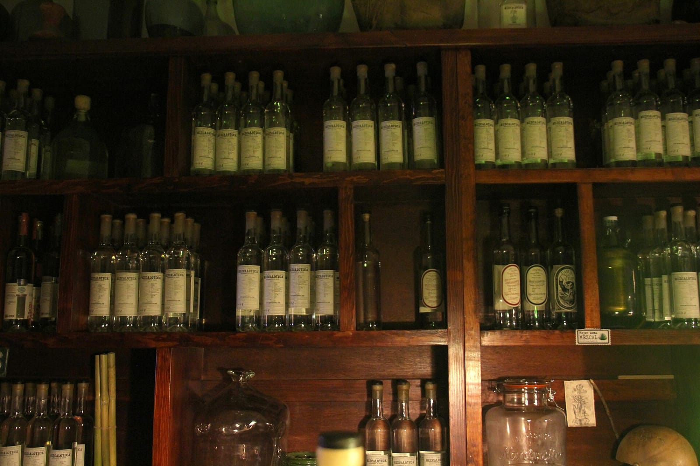
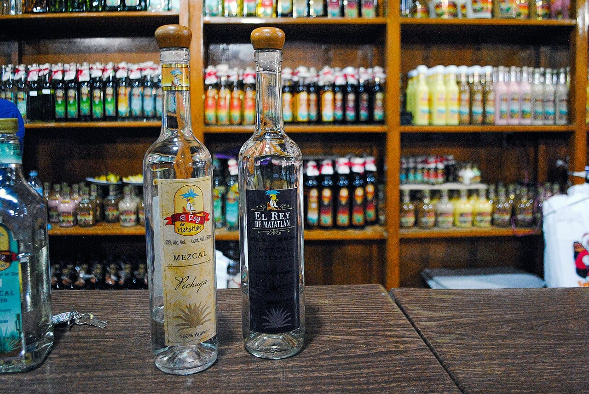

# Mezcaloteca: A Tasting Archive in Central Oaxaca

Mezcaloteca sits at Reforma 506 in the historic centre of Oaxaca de Juárez, on the Ruta Independencia stretch, postcode 68000. It is not a palenque and does not lean on a kitchen or cocktail list: it is a tasting room that puts [mezcal](ref:mezcal) from different states, villages, varieties and producers on one table so that comparison does the teaching. For a first day in [Oaxaca](ref:oaxaca), it is a better starting point than any drinks list.

Figure: Related photograph of Mezcaloteca: A Tasting Archive in Central Oaxaca. Image: https://www.flickr.com/photos/bexwalton/, CC BY 2.0, via Wikimedia Commons ([source page](https://commons.wikimedia.org/wiki/File:Mezcaloteca.jpg)).

## Reforma 506: A Tasting Room That Makes No Spirit

From the zócalo it is about ten minutes on foot, on a dense shopping stretch where the entrance is easy to miss. The address is Reforma 506, Ruta Independencia, Centro, 68000 Oaxaca de Juárez; this entry fixes no coordinates, so use official channels for the exact location. The telephone is +52 951 514 0082, and hours and sessions shift with holidays and private events, so confirm before setting out.

It does not work like a bar you drop into. Seating is mostly by reservation and session, so a small group can ask questions without noise. Bottle buyers can use the online shop, but the point is to sit, taste, listen and ask.

## A "Library" Open Since 2010

Mezcaloteca opened in 2010 with a clear brief: a tasting room devoted to preserving and spreading the diversity of traditional mezcal and its biocultural processes. "Library" is not a metaphor. It has a collecting logic; only the books are bottles and the index is village, variety, producer and batch.

The collection spans several Mexican states, not only Oaxaca. A bottle qualifies on method and traceability rather than price or rarity.

## How the Collection Is Edited

"Traditional" is a marketing word in much of the mezcal world. Here the approach is closer to editing: whether the [agave](ref:agave) ripened in a suitable place and way, whether roasting used an earth pit, whether fermentation relied on ambient yeast, and whether the still is clay, wood or copper. Different methods give different bodies: smoke, fruit and minerals all shift.

Variety is the second thread. Espadín is common and steady, Tobalá and Arroqueño rarer and dearer, and an ensamble ferments different varieties in one batch. Mezcaloteca does not treat rare as automatically good; it lets you taste the same variety from two villages or the same village from two producers.

## How a Cata Is Run

A tasting is built around contrast rather than praise. It starts with a clean glass and a little water, sets a baseline, then adds smoke, ripeness or variety; each pour raises three questions: what agave, where, and how fermented and distilled. The talk covers [fermentation](ref:fermentation), because many aroma differences are settled there rather than in the still.

The pace belongs to the guest. A newcomer can follow a line from light to heavy; a seasoned drinker can ask for a single village or variety and compare vertically. Do not order too many pours; the palate tires. Spitting is professional here, not rude.

## The Link to the Palenques

Mezcaloteca makes no spirit. Its role is editor, turning scattered village producers, varieties and methods into a story a visitor can follow. It also sells some bottles online, but selection still follows traditional method rather than distribution power.

That complements the production side. At [Real Minero](ref:real-minero), for example, you can see the earth pit, the wooden mallet and the clay pots, and smell fermenting must; back in town, Mezcaloteca puts the same bottles beside other villages and varieties, so you can judge what comes from method and what from place. The palenque gives depth, the tasting room gives a horizontal grid. To understand [place and process](ref:place-process), walk both.

## NOM-070 Is a Floor, Not a Verdict

Mezcal won its appellation in 1994, and the current standard is NOM-070-SCFI-2016: the raw material must be 100% agave, made inside the protected zone to the prescribed method. Age categories are Joven, Reposado and Añejo; production is classed as artesanal or ancestral. Compliance proves it is mezcal, not that it tastes good or that the producer was paid fairly.

Mezcaloteca selects above that floor: it cares about variety, village, distiller and batch, and about whether the method survived intact. For a shopper, check the NOM number and "100% agave" first, then variety, village and producer, and only then age and packaging. Reverse the order and the story starts leading the glass.

## Booking, Hours and Visitor Notes

**Booking**: sessions are mostly by reservation, so confirm one to several days ahead by the official site or telephone, especially at weekends. State group size, language needs and budget, and the venue will shape a flight.

**Hours**: the usual pattern runs from afternoon into evening, but confirm with the venue; private events can close the room.

**Budget**: tastings are priced by pour and bottle, and rare varieties cost clearly more. Agree a budget first and let the host build the flight.

**Arrival**: about ten minutes on foot from the zócalo; wear comfortable shoes and watch belongings in the busy centre. Do not drive after tasting.

**Etiquette**: ask before photographing other guests; do not request ice or cocktails, since neat pours respect the producer. Spitting is accepted.

Treat the room as the index page for choosing a palenque.

[Mezcal](ref:mezcal) and [Real Minero: Clay Pots and Seeds in Santa Catarina Minas](ref:real-minero) answer different questions about Mezcaloteca: address and space and operating status. Read them as a pair, not as alternatives.

**At a glance:** A tasting room opened in 2010 at Reforma 506 in Oaxaca de Juárez; it makes no spirit, curating a cross-state, cross-variety collection for comparative tastings and serving as an urban entry point to traditional mezcal and NOM-070. 

The usual confusion is to treat Mezcaloteca as a brand or a region. Check whether it is still open first, then whether it accepts visitors; the two need not agree.

**Key facts.**

| Item | Detail |
| --- | --- |
| In one line | A tasting room opened in 2010 at Reforma 506 in Oaxaca de Juárez; it makes no spirit, curating a cross-state, cross-variety collection for comparative tastings and serving as an urban entry point to traditional mezcal an… |
| Address | Reforma 506, Ruta Independencia, Centro, 68000 Oaxaca de Juárez, Oaxaca, Mexico |
| City and country | Oaxaca de Juárez / Mexico |
| Status | verified open |
| Official site | mezcaloteca.com |

**Sources and limits.** The key claims about Mezcaloteca: A Tasting Archive in Central Oaxaca are checked against the following sources: Mezcaloteca (Used to check that the tasting room currently operates alongside an online shop), Consejo Mexicano Regulador de la Calidad del Mezcal (Used to check the 1994 appellation, NOM-070-SCFI-2016, the 100% agave requirement and the category framework), Gobierno del Estado de Oaxaca (Used to check the Oaxaca mezcal route and the context of urban tastings). For current products, addresses or opening status, use mezcaloteca.com. Prices, batches and status change; the body is project-written and does not reproduce source text.

## Related images

Image: Mezcal. Credit: ProtoplasmaKid, CC BY-SA 4.0, via Wikimedia Commons ([source page](https://commons.wikimedia.org/wiki/File:Mezcal_bottles_.jpg)). Related image for Mezcaloteca: A Tasting Archive in Central Oaxaca.
