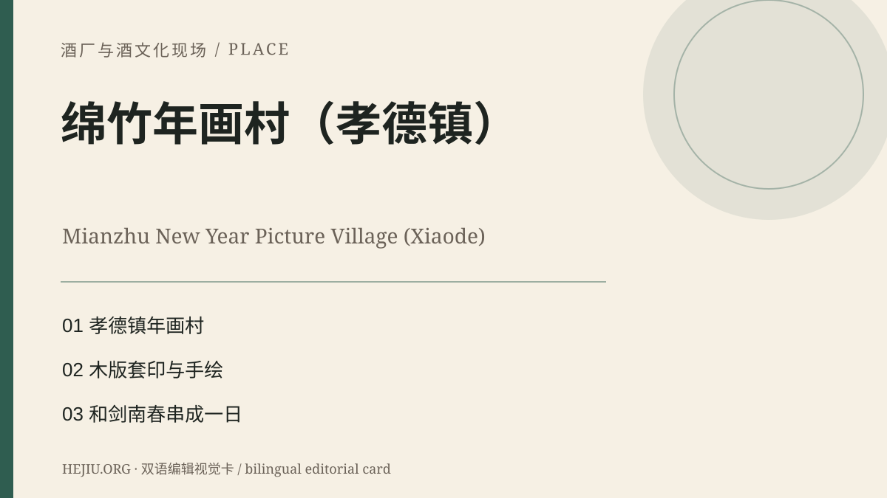

# Mianzhu New Year Picture Village (Xiaode)

Mianzhu New Year pictures are national intangible cultural heritage, and the village pulls the craft out of the museum case into workshops, courtyard walls and drying grounds. It is not an old town where every household paints: some courtyards are exhibitions, some workshops can be visited, some hands-on sessions carry an extra fee, and plenty of shops cater to groups. Decide what to see, do and buy before choosing two hours or half a day.

Figure: Mianzhu New Year Picture Village (Xiaode) bilingual editorial card. Project-created bilingual editorial card for topic identification, not a documentary photograph.

> **Quick verdict**
> **Best for:** travellers interested in woodblock prints, folk art and family workshops; pairs with the Jiannanchun site for a Mianzhu day.
> **Not for:** visitors expecting a “raw old town” or only wanting photo walls; the village is a cultural space, not a fake antique shopping street.
> **One line:** see the process and displays first, choose one hands-on activity, then buy a piece you actually understand.

## The village is not one shopping street

The core is the production and display of Mianzhu woodblock New Year pictures, spread across courtyards, workshops, galleries and hands-on areas rather than one continuous old street. Read the map first and separate public displays, paid experiences, workshops and shops; do not walk into every open gate, as some are private workrooms or booked group areas. Villagers still live here, so avoid faces and private items and do not chase older people or children for “authenticity”. Keep visiting and shopping apart: see the process first, then decide what to buy.

## The woodblock process

Mianzhu woodblock pictures typically pass through drafting, block carving, colour mixing, registration printing and hand-painted finishing. In a workshop, look less at “bright colours” and more at how blocks register, how pigment stays workable, how paper is laid flat, and where hand painting is added after printing. Techniques such as “filling the water feet” are known for quick, expressive strokes, but workshops differ widely in process and style, so do not reduce them to one template. If photography is allowed, ask before shooting hands and tools. For a hands-on session, ask whether you print an existing block or start from carving, whether the piece goes home, and whether materials cost extra.

## Getting there and time needed

The village sits in Xiaode, not far from central Mianzhu. From Chengdu, the usual route is the Chengdu–Mianyang expressway or high-speed rail to Mianzhu or Deyang followed by a local connection; check live schedules. Galleries and main workshops take about two hours; one experience plus lunch makes half a day; adding the Jiannanchun site fills a day. Most movement is on foot, so wear flat shoes; drying yards are hot in summer, so carry water and a hat. With public transport, return services are sparse, so ask about the last departure instead of looking for a car at dusk. Park where directed and do not drive into narrow courtyard lanes.

## Experiences and buying

Common activities include rubbing, colouring, painting a small print or watching a carving demonstration; price, duration and age range vary by shop, so ask first. Families should check whether pigments wash out and whether they irritate skin; young children should not handle carving knives alone. When buying, check paper and pigment stability, registration accuracy and workshop or author information; do not be swayed by the word “handmade” alone. Small prints, postcards and design objects travel easily; large originals need rolling, moisture protection and transport planning. If a price is implausibly low, ask whether it is machine-printed or a copy.

## Pairing with the liquor country

Mianzhu puts liquor and New Year pictures in one city: the Jiannanchun workshop site in the morning and the village in the afternoon is the smoothest day. The site is about pits, workshops and distillation; the village is about carving, printing and hand painting. Both are handwork, but one enters through production and the other through folk art. With children, keep the morning site to an hour and give the afternoon to experiences; with older relatives, reduce walking and choose galleries and workshops with seating. Eat rice noodles, preserved duck or home cooking in central Mianzhu, then return to the village outside the hottest hours.

## Turn “seeing pictures” into “reading one print”

Do not buy as soon as you enter. Choose one open gallery and follow a print from line drawing to registration printing to hand-painted faces; then choose a workshop and compare two works on the same theme for registration, colour and brushwork; only then go to the hands-on area and print a small sheet yourself. Two or three hours of this leaves you knowing whether you like traditional figures, door gods, opera scenes or modern design, and less likely to be swayed by “masterwork” talk. With only an hour, skip the experience and focus on the gallery and one workshop; with children, put the experience first before their patience runs out. With only an hour, skip the experience, see one gallery and one workshop, then buy a small print. Residents still live here; ask before photographing and do not block courtyard gates. Note the parking spot and last bus before returning, and ask whether the print is dry before packing it; keep voices low in the lanes. Ask about packaging, check the weather, and bring water and a hat. Bring water, check forecasts, and wear flat shoes.

## Check before you go

- Read the map; separate public displays from private courtyards
- Ask price, duration and materials before an experience
- Children do not handle carving knives alone
- Check registration, paper and author information when buying
- Ask the last public transport time in advance
- Do not enter booked group areas
- Avoid the drying yards at midday in summer
- Plan rolling and moisture protection for large works

## Limits and next steps

The New Year Picture Village is a community of workshops, painters and print-making experiences, not a distillery and not an enclosed attraction. Its interest lies in the studios, the artists, the printing sessions and the village space; events cluster around festivals, and some workshops open only half a day on ordinary days. Combining it with the Jiannanchun workshop site in one day is a common "wine plus prints" pairing, but a drive still separates them.

Respect the workshops' working rhythm: ask before photographing, book hands-on sessions ahead, and do not move wet prints. Food options in the village are limited, so book in peak season; with children, allow time for the hands-on session rather than rushing.

This page does not present the village as a "baijiu region sight". It is for understanding local craft and daily life, not a substitute for a distillery visit. If time allows only one, choose by your interest rather than squeezing it in because it is "on the way".

## References

- mz.gov.cn — official source — https://www.mz.gov.cn/meilimianzhu.htm (checked 2026-11-25)
- jnc.cn — official source — https://www.jnc.cn/about (checked 2026-11-25)
- deyang.gov.cn — official source — https://www.deyang.gov.cn/ (checked 2026-11-25)
- Official source — official source —  (checked 2026-11-25)

Related entries: [Jiannanchun workshop site](ref:cellars), [Mianzhu Jiannanchun route](ref:route), [Sichuan](ref:region), [China](ref:regioncn), [Wine and painting](ref:art), [History of Chinese wine](ref:history), [First baijiu guide](ref:guide), [Jiannanchun](ref:brand).

## Related images

Image: Sichuan. Credit: FISU, CC BY 3.0, via Wikimedia Commons ([source page](https://commons.wikimedia.org/wiki/File:%E9%9B%AA%E5%B1%B1%E4%B8%8B%E7%9A%84%E6%88%90%E9%83%BD%E5%B8%82%E5%A4%A9%E9%99%85%E7%BA%BF_Chengdu_skyline_with_snow_capped_mountains.jpg)). Related image for Mianzhu New Year Picture Village (Xiaode).

The administrative division reference is the 2007 edition of GB/T 2260.
