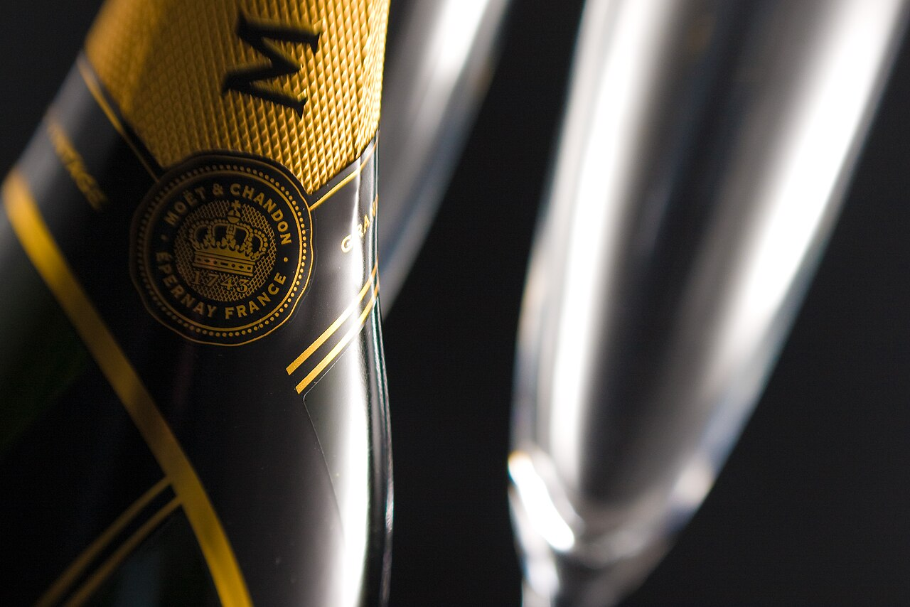

# Moët & Chandon

Moët & Chandon occupies a site on the Avenue de Champagne in Épernay. This street is the clearest expression of the relationship between Champagne houses and their town: mansion fronts open onto chalk cellars, the cellars hold millions of bottles, and the street level is given over to visitors, shops and restaurants. The Moët visitor entrance is not showy, but the underground scale is extraordinary. The house describes a network of about 28 kilometres of cellars, one of the largest in Champagne, and the site forms part of the UNESCO World Heritage listing of the Champagne hillsides, houses and cellars.

Figure: Moët & Chandon. Image: Andreas Levers from Potsdam, Germany, CC BY 2.0, via Wikimedia Commons ([source page](https://commons.wikimedia.org/wiki/File:Mo%C3%ABt_et_Chandon.jpg)).

> **Quick verdict**
> **In one line:** This entry helps you decide whether Moët & Chandon deserves a detour, and what to check before visiting.
>
> - **Best for:** Anyone planning a visit to Moët & Chandon who needs to decide whether it deserves a half-day or a full day.
> - **Not for:** If you want only want a must-visit list and will not check booking, transport or opening hours.
> - **Check first:**
>   - Claude Moët founded the house in Épernay in 1743.
>   - Visits are mainly by reservation, and the house recommends booking online in advance, especially at weekends and in high season.

## Place and history

Claude Moët founded the house in Épernay in 1743. His grandson Jean-Rémy Moët pushed the business into European courts and international markets and is often mentioned in the brand's stories because of his connection with Napoleon. It is worth separating brand narrative from verifiable fact: the 1743 foundation, the Moët family's operation in Épernay and the nineteenth-century international expansion are supported by official and corporate material; anecdotes about a particular banquet or an emperor's preference are often later retellings and need not be treated as history during a visit.

Moët & Chandon is now part of LVMH, alongside Champagne houses such as Dom Pérignon and Krug, though each has its own positioning and cellars. The core range is Moët Impérial and Rosé Impérial, with Grand Vintage above it; tours explain blending, dosage, ageing and disgorgement, the technical basis for understanding Champagne. Reducing Moët to a "big celebration brand" misses its historical role in standardising Champagne production and building international trade.

## Spaces and the list

The visitor entrance on the Avenue de Champagne leads underground into chalk cellars. The house states that the network runs for about 28 kilometres and stays cold all year, noticeably cooler than street level even in summer. The route passes stacked bottles, vaults and ageing spaces while guides explain the passage from base wine to blending, second fermentation, ageing and disgorgement. Above ground, the buildings handle reception, tastings and the bar, and some rooms look out onto the avenue. The two levels have different rhythms: the cellars are quiet, damp and dim, while the bar and tasting rooms are closer to a city social space.

The list centres on the core Moët range: Moët Impérial, Rosé Impérial, Grand Vintage and various vintage or limited releases. Tour packages usually include two or more glasses, with the wines depending on the package; rarer or older wines require a higher-tier experience, and a basic ticket should not be assumed to include the whole range. Champagne belongs to the wider tradition of [sparkling wine](ref:sparkling-wine), but its regulations, soils and blending set it apart from ordinary sparkling wine. Terms such as "cuvée," "dosage" and "dégorgement" heard on the tour are the technical language of that system.

## How to visit or order

Visits are mainly by reservation, and the house recommends booking online in advance, especially at weekends and in high season. A standard cellar tour with tasting lasts about 1 hour 30 minutes and is led by a house ambassador, usually in French or English; packages differ in the number and level of wines, as stated on the booking page. Arrive a few minutes early for admission and cloakroom, and bring a jacket because the cellars are cold even in summer. The official pages mention a lift and an accessible entrance, so visitors with limited mobility can explain their needs when booking.

If you do not want to go underground, you can visit the bar or tasting space on the Avenue de Champagne and order by the glass or bottle; bar hours and booking are separate from the tour, and it is wise to confirm in high season. For a first visit, choose a package that includes the cellar tour rather than only a glass at the bar. Half of Moët's value is the underground space and the scale of ageing; the bar provides the wine but not that experience. If time is short, take the shortest tour rather than the most expensive vintage package.

## Practical information

Address: 18 Avenue de Champagne, 51200 Épernay, France (coordinates 49.04307, 3.95968). The official visit page gives number 18 in 2026, while some older pages and third-party listings still say 20, so the booking confirmation and on-site signs take precedence.

Transport: direct trains from Paris Gare de l'Est reach Épernay in about 80 minutes, and the station is a five-minute walk from the door. By car, allow about 90 minutes from Paris via the A4 motorway. Parking in central Épernay is limited, so in high season use a public car park on the edge of the avenue and walk.

Opening hours: daily 9:30–17:00 for tours and reception, with the shop open until 18:00. Public holidays and special events can change this, and tour places are released by departure time.

Booking and prices: tours can be booked online through the official site or its ticket page, and walk-in tickets are possible, but capacity is limited and high season often sells out, so book ahead. The packages listed in November 2026 were Impérial Moment at €48 (1 h 30, two glasses: Impérial and Rosé Impérial), Signature at €65 (1 h 30, two glasses: Impérial and Grand Vintage), Grand Vintage at €85 (1 h 30, two glasses of white or rosé vintage Champagne), and Moët Collection at €190 and Haute Œnologie at €220 (about two hours each, with older or top-tier cuvées). Tours normally run in French and English, so check the language and length when booking.

The cellars have a lift and an accessible entrance, and visitors with limited mobility should say so when booking; the cellars are cold all year, so bring a jacket even in summer. Do not overfill the day: a cellar tour and tasting take at least half a day, and if you plan to visit another Champagne house, leave time for lunch and movement. Several houses on the avenue are within walking distance, but two or three in one day are enough.

Page checked on 2026-11-08; operating status, prices and bookings are subject to official channels.

## Etiquette and common mistakes

The first mistake is to treat Moët as a bar you can walk into for a glass at any time. Cellar visits require booking and often sell out in high season; without a reservation you may only be able to try the bar, and you should not assume access to the cellars. The second mistake is to confuse Moët with Dom Pérignon. Dom Pérignon is a separate brand within the same group, with its own wines and story; hearing the name on a Moët tour does not mean the ticket includes a Dom Pérignon tasting.

The third mistake is to dress too lightly. Champagne cellars are cold and humid all year, and short sleeves and sandals are uncomfortable underground; a jacket and non-slip shoes are more practical. When photographing, do not use a flash directly on bottles and labels, and do not touch stacked bottles; the cellars are a working space, not a studio. In a tasting, do not swallow the whole glass at once, because the bubbles can mask aromatic detail: smell first, take a small sip and let the wine warm in the mouth. If you are driving, use the spittoon or abstain; "Champagne is low in alcohol" is not a reason to take the risk.

A further common confusion is to assume that all houses on the Avenue de Champagne are the same. Moët's scale, route and brand narrative differ greatly from smaller family houses or art-led spaces. If you pair Moët with [Perrier-Jouët](ref:perrier-jouet) on the same day, see Moët for scale and process and Perrier-Jouët for art and Chardonnay style; going from the large house to the smaller one avoids visual fatigue.

## Around and routes

The Avenue de Champagne itself deserves a slow walk: beyond Moët there are Perrier-Jouët, Mercier, Pol Roger and other houses, along with the town architecture and street life. Épernay is compact, and the station is within walking distance of the avenue. To go further, take the train to Reims, about 40 minutes away, for the cathedral and another group of Champagne houses. The Champagne hillsides, houses and cellars are a World Heritage property, but the listed area is spread across villages and slopes and cannot be seen from one street.

For a one-day trip, leave Paris in the morning, reach Épernay around midday, take the Moët cellar tour in the afternoon, and walk the avenue and visit the bar in the evening. With an overnight stay, add Perrier-Jouët or Reims the next day. Moët is a good first stop because its tour explains the "standard process" of Champagne, making later comparisons easier. The town belongs to the [Champagne](ref:champagne) region, but the avenue is not the whole region; the vineyards lie on slopes and in villages and need a separate half-day.

## See also

- [Champagne](ref:champagne): the region's regulations, villages and hillsides.
- [Sparkling wine](ref:sparkling-wine): how Champagne differs from other sparkling wines.
- [Perrier-Jouët](ref:perrier-jouet): another Champagne visit in the same town.
- [Place and process](ref:place-and-process): a basis for understanding terroir, blending and ageing.
- [LVMH](ref:lvmh): the brand group behind the house.

Moët & Chandon is best read by starting with the address, moving to the current opening status, and ending with what the place is known for.
