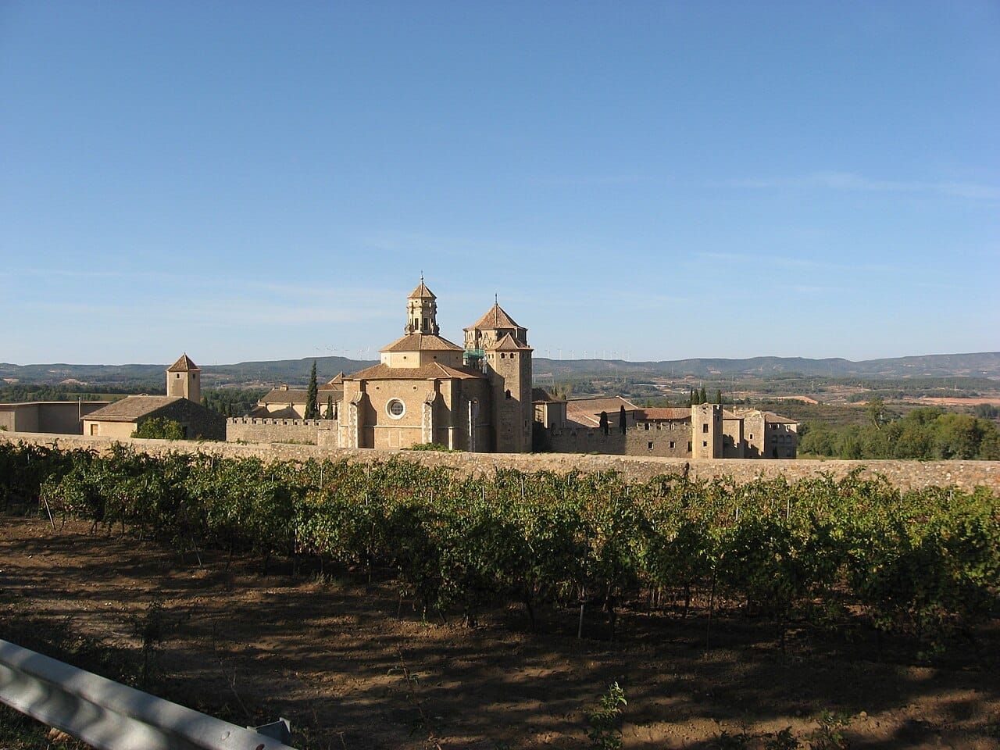

# Monastery of Poblet

Poblet stands in the municipality of Vimbodí i Poblet, in the province of Tarragona, at the foot of the Prades mountains. Ramon Berenguer IV, Count of Barcelona, gave the site to the Cistercian order in 1151, and the monastery grew into a royal pantheon for the Crown of Aragon. Its main buildings date from the 13th to the 15th century, and it was inscribed on the UNESCO World Heritage list in 1991. It is the largest of the three monasteries on the Cistercian Route, alongside Santes Creus and Vallbona de les Monges, and it is still home to a Cistercian community, not a ruin or a theme park.

Figure: Monastery of Poblet. Image: Sergi Esteve (sel_commons), CC BY-SA 3.0, via Wikimedia Commons ([source page](https://commons.wikimedia.org/wiki/File:Monestir_de_Poblet.JPG)).

## Setting and history

Poblet has two histories. The first is religious and royal: the Cistercians came from Burgundy with an emphasis on simplicity, labour and self-sufficiency, and the kings of Aragon chose Poblet as their burial place, turning a rural abbey into one of the most important religious centres of the kingdom. The second is agricultural: Cistercian monks, together with the Templars of Barberà de la Conca, helped spread vine growing in the Conca de Barberà in the 12th century, and the vineyard landscape around the monastery still reflects that work.

The monastery was dissolved and abandoned in the 19th century and restored in the 20th, when a Cistercian community returned. That matters for visitors: the buildings are restored, but they are not an empty museum. The church, cloister and parts of the living quarters still serve a religious function, and the silence, barriers and liturgical objects are not stage sets.

## Space and displays

A visit has three parts: the monastic buildings, the museum and the interpretation centre opposite. The buildings include the church, cloister, royal tombs, dormitory and kitchen, with a transition from Romanesque to Gothic; the cloister capitals and the church altarpiece are highlights. The museum holds religious art and objects from the monastery's history, while the interpretation centre uses film to explain Cistercian life and architecture. The official Poblet guide app is used for the visit, and headphones are compulsory so that visitors do not disturb the monks or each other.

Three things repay attention when reading the buildings. The church is the core of the complex, with restrained proportions and far less ornament than a contemporary Benedictine abbey, reflecting the Cistercian rule of simplicity. The cloister links worship, reading and daily life, and its capitals, carved between the 13th and 15th centuries, are worth examining one by one. The royal tombs are a reminder that this was also a seat of Aragonese royal power, not only a monks' residence. The interpretation centre opposite uses models and film to explain how the complex was extended century by century; seeing the models first makes the plan and axes easier to read.

Abadia de Poblet sits inside the monastery complex. It is the only winery in Catalonia located within a monastery, belongs to the Raventós Codorníu group and works under the DO Conca de Barberà. It uses local varieties such as trepat, garrut and garnatxa, continuing the Cistercian role in spreading viticulture from the 12th century. The winery and the monastery are neighbours but separate operations: the monastery ticket covers religion and architecture, while the winery covers grapes and winemaking, so do not expect one ticket to cover both.

## Visiting and tasting

The monastery visit is self-guided with the app after buying a ticket. Tickets are €8 standard and €6 reduced (over 65, students, Carnet Jove, disability card, children aged 7 and over, large families and the unemployed, with proof); the price of the combined Cistercian Route ticket was not verified on this pass. Tickets are sold at the monastery shop until 30 minutes before closing, and capacity is capped at about 100 visitors at a time. Hours are Monday to Saturday 10:00–12:30 and 15:00–17:30, Sunday 10:30–12:30 and 15:00–17:30; the monastery is closed on 1 and 6 January and 25–26 December, with changes around Holy Week and special concerts.

Winery visits and tastings are a separate product, not included in the monastery ticket, and must be arranged with Abadia de Poblet; availability, language and price should be confirmed directly. If wine is the main reason for coming, check that the winery is receiving visitors before planning the monastery. If architecture and history are the main reason, the monastery alone fills half a day. When doing both, put the winery after the monastery so that you are not carrying a glass through religious spaces.

## Practical information

**Address:** Plaça de la Corona d'Aragó, s/n, 43448 Poblet, Vimbodí i Poblet, Tarragona, Spain (the Catalan government's Patrimoni page also gives Zona del Monasterio, 43448 Vimbodí i Poblet).

**Getting there:** by car from Barcelona, take the AP-7 and AP-2 and exit at 9 towards l'Espluga de Francolí; from Lleida, take exit 8 of the AP-2; from Tarragona, use the A-27 and N-240, about 45 minutes. The nearest train station is l'Espluga de Francolí, about 3 km from the monastery, so a taxi or a walk is needed for the last stretch; taxis are limited, especially at weekends and on holidays, so book ahead.

**Opening hours** (verified 8 November 2026): Monday to Saturday 10:00–12:30 and 15:00–17:30; Sunday 10:30–12:30 and 15:00–17:30. Ticket sales stop 30 minutes before closing, and capacity is capped at about 100 visitors at a time. Closed on 1 and 6 January and 25–26 December; in 2026 also closed on the afternoons of 2 and 3 April and all day on 6 April; on special days the first visit starts at 10:45.

**Tickets and reservations:** €8 standard, €6 reduced (over 65, students, Carnet Jove, disability card, children aged 7 and over, large families and the unemployed, with proof). Individual visitors normally buy on site; the official information does not require advance booking, but you must enter before ticket sales close. Groups and school parties should contact the monastery in advance. The monastery ticket does not include a visit or tasting at Abadia de Poblet, which must be booked separately.

**Practical notes:** there are steps and cobbled paths, so wear comfortable shoes, and carry water in the hot summer months.

Page verified 8 November 2026; opening status, prices and reservations are subject to the official channels.

## Etiquette and misconceptions

This is a working monastery, not simply a monument. Keep quiet in the church and cloister, cover shoulders and knees, do not use a flash, do not eat or drink, and do not bring pets except assistance dogs. Headphones are compulsory during the visit; that is a house rule, not unfriendliness. The first misconception is to treat Poblet as a winery: it is first a monastery, and the winery is one part of it. The second is to assume Abadia de Poblet belongs to Priorat or Rioja; it is in the Conca de Barberà. The third is to expect the monastery ticket to include a tasting, which it does not.

Another practical misconception is underestimating the transfer. After the train to l'Espluga de Francolí there are still about 3 km, and taxis are limited, especially at weekends and on holidays. Drivers should not park on the narrow approach road but use the designated car park. During religious services, do not photograph or walk around; wait until the service ends before continuing.

## Surroundings and itineraries

The monastery sits at the edge of the Prades mountains and the Poblet natural park, making a good day with the monastery, vineyards and a village. About 3 km north-east is l'Espluga de Francolí, with prehistoric caves, a modernist wine cellar and the Museu Terra; further north are Vimbodí and Montblanc. Following the Cistercian Route, Santes Creus and Vallbona de les Monges can be added, but the three are spread out and need at least two days. For a half-day, give the monastery and the winery an hour to ninety minutes each rather than rushing to a second monastery.

Barcelona is feasible as a day trip, but most of the day goes to the road. A more comfortable plan is to stay overnight in l'Espluga or Montblanc and continue through the vineyards the next morning. Priorat and Penedès lie further inland and belong to a different wine route; they should not be squeezed into the same day as Poblet.

## See also

Poblet places [wine](ref:wine) inside the daily life and ritual of a monastery, and shows that [Spain](ref:spain) is not only Rioja and Priorat; [wine and ritual](ref:ritual) offers another way into the relationship between the Cistercians and wine.

Further reading: [A concise history of world alcohol: from fermented drinks to a global industry](ref:c-extra-1), [A Ginjinha](ref:c-extra-2).
