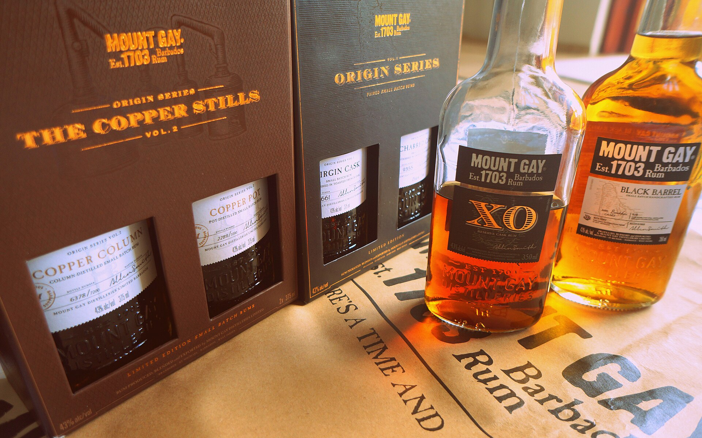

# Mount Gay Distillery

Mount Gay Distillery stands in Saint Lucy, the northernmost parish of Barbados, not at the visitor centre near Bridgetown that many people also call "Mount Gay". The southern site in Saint Michael is close to the coast and convenient for a short tasting; the northern site is the working distillery, where the great house, old well, fermentation house, still house and ageing bonds form one continuous tour. The brand dates its origins to 1703 and calls itself the longest continuously operating rum distillery. Such claims belong to brand history; what matters on a visit is how molasses, pot and column distillation and tropical ageing produce a consistent house style.

Figure: Related photograph of Mount Gay Distillery. Image: Aneil Lutchman, CC BY-SA 2.0, via Wikimedia Commons ([source page](https://commons.wikimedia.org/wiki/File:Mount_Gay_Distilleries_Origin_Series,_Black_Barrel_and_XO.JPG)).

## Saint Lucy in the North: Distillery Versus Visitor Centre

The address is Mount Gay, Saint Lucy, Barbados, with no street number, so do not set the navigation to "Mount Gay Visitor Centre". That centre lies at Brandons in Saint Michael, close to Bridgetown, with short drives and frequent slots; the distillery is in the north, roughly an hour by car from Bridgetown, past cane fields, villages and narrow country roads. The official tour page states that transport is not included and recommends a taxi or a private driver with a fixed return time.

This entry fixes no coordinates; use official channels for the exact location. The gate and meeting point follow the booking confirmation. Food is not available on site, so eat before arrival; anyone who cannot walk far or stand for long should choose the southern visitor centre instead.

## The 1703 Deed and the Limits of "Oldest"

Distilling at Mount Gay is documented from 1703, the year the brand uses as its starting point. In the 18th century Sir John Gay Alleyne managed the estate, and the brand later took his name; this local history explains both the name and why the northern site is presented as the place where it all began. It is more accurate to read 1703 as a traceable deed and business starting point than as the day a brand suddenly appeared.

"Longest continuously operating" is a phrase used by the brand and by tourism material. It describes continuity, not a quality ranking. Barbados also has Foursquare, St Nicholas Abbey and the West Indies Rum Distillery, each with a different history and style. Use the timeline as a way into the region: first see how [Barbados](ref:barbados) linked sugar, the port and rum, then return to the glass.

## From Molasses to Double Distillation

The standard tour begins at the Great House and continues through the Well House, Fermentation House, Distillation Room and Aging Bonds. Water from the old well is filtered through coral limestone and is low in minerals, a concrete part of the brand's terroir story; [molasses](ref:molasses) comes from the island's sugar industry, is diluted with water and fermented with yeast. The wash is then distilled on both copper [pot stills](ref:pot-still) and a [column still](ref:column-still): the pot still keeps more esters and a heavier body, the column gives a cleaner, lighter spirit, and the two are blended into the house style.

The still house makes the difference visible without requiring technical detail. Eclipse, for example, is distilled in copper pot and column stills and then matured in American whiskey casks. Seeing equipment, raw material and bottles on one route explains "balanced Barbadian rum" better than reading a label.

## Tropical Ageing and the Angels' Share

The warehouses are not climate-controlled. Heat speeds the exchange between spirit and oak, humidity affects evaporation, and a share of the liquid is lost through staves and bungs every year: the angels' share. In the Caribbean this loss is generally higher than in temperate climates, though the exact figure depends on warehouse position, cask type and vintage, and distilleries do not always publish it.

Mount Gay uses American whiskey, bourbon and cognac casks. XO is officially aged between 5 and 17 years before blending. Tropical ageing brings vanilla, caramel, dried fruit and spice at a different pace from a cool cellar: the result is not "more wood with age" but deeper colour and a rounder palate within a relatively short time. Read the basics of [oak ageing](ref:oak-ageing), then look at the casks and racks in the warehouse.

## The Bottles: Eclipse, XO and Black Barrel

Eclipse is the reference point for the house style: copper pot and column distillation, American whiskey casks, and notes of vanilla, almond, ripe banana and dark chocolate. It works neat and in cocktails. XO is rounder and more complex, aged for 5 to 17 years in American whiskey, bourbon and cognac casks; brand material also calls it the first XO in the rum category, created by master blender Jerry Edwards in 1991. Black Barrel is matured in American whiskey casks and finished for six months in heavily charred bourbon casks, giving a woodier, more robust profile.

The 1703 Master Select and limited releases show the blending team's cask selection. Current master blender Trudiann Branker is Barbados' first female master blender, and brand material notes that she composes blends from dozens of rums. Names set expectations, but they are not a hierarchy: within the house, Eclipse and XO differ more in style and use than in a simple "entry" versus "premium" ranking. The [rum](ref:rum) category pages are worth reading first.

## Booking, Dress Code and House Rules

Distillery visits must be booked in advance on the official site. The standard tour lasts about two hours and was listed at USD 60 per person in 2026, including a welcome drink, a guided walk, the production areas and warehouses, and a tasting of several signature rums. Hours are usually Monday to Saturday 10:00–16:30, closed on Sundays and bank holidays; prices, slots and languages change, so check the official site before travelling. A three-hour Discovery Experience and a Storied Dinner Tour are also offered.

The rules are stricter than at the southern visitor centre: all guests must be 18 or over, and children and babies are not allowed, without exception. Tops must cover the arms and footwear must be closed and practical; sandals may mean renting shoes. The route covers about one mile of walking and long periods standing, and is not suitable for people with mobility issues, pregnant guests or wheelchairs. Food and transport are not provided, and guests should arrive 15 minutes early. Cancellations two days before the start receive a 50% refund; after that there is none, though the distillery may reschedule or refund if weather or force majeure closes the site.

## Putting the Stop into a Barbados Rum Route

The northern distillery can be combined with St Nicholas Abbey on the east coast and [Foursquare Rum Distillery](ref:foursquare-rum-distillery) in the south-east, but the three are far apart and public transport is limited, so hire a car and driver. For a light tasting, stay at the southern visitor centre; for working equipment and warehouses, the northern site is irreplaceable. Always appoint a driver who is not drinking; spitting is normal at tastings, and Barbados has clear drink-drive limits.

Set Mount Gay beside Foursquare and two versions of Barbados appear: one tells continuity through an old estate, an old well and double distillation, the other tells modernity through a converted sugar factory, open-house visits and a "no additives" stance. Read both, then return to the [rum](ref:rum) and [Barbados](ref:barbados) pages, and the route becomes more than a checklist.
