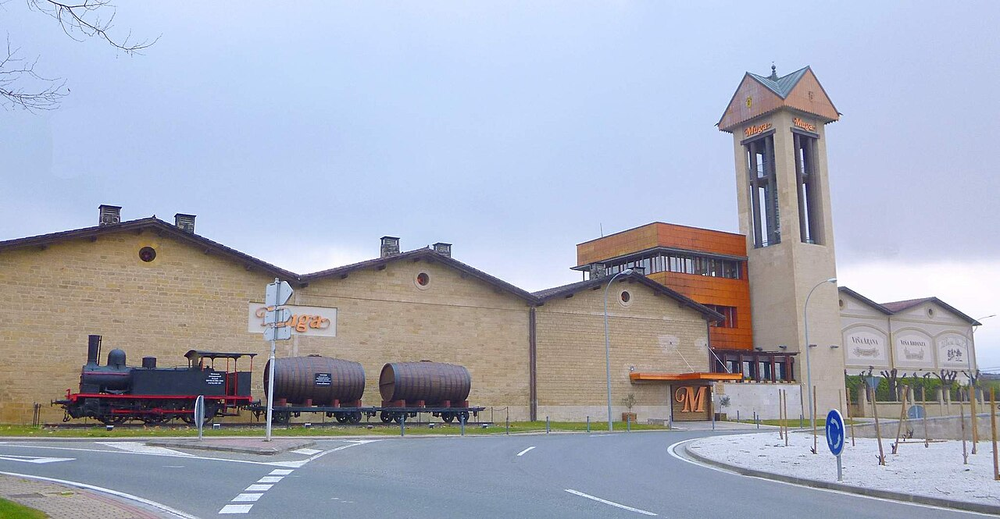

# Bodegas Muga

Barrio de la Estación in Haro is a short street packed with some of Rioja’s densest historic bodegas. Muga’s front is a 200-year-old stone house with no flashy sign; in the yard there are barrels and cooper’s tools. It does not pull the eye with a Gehry titanium wave like Riscal. It puts the barrel first: it selects wood, makes barrels, repairs them, and even ferments in oak vats. To understand Muga, start with its obsession with wood.

Figure: The Muga building and barrels in Haro’s station district. Image: Zarateman, CC0, via Wikimedia Commons ([source page](https://commons.wikimedia.org/wiki/File:Haro_-_Bodegas_Muga_1b.jpg)).

## Location and history

In 1932 Isaac Muga and Aurora Caño founded the winery in Haro. They began as a small bodega and gradually bought the old house and plots in the station district. Today the third generation runs it, still family-owned and family-managed. Muga is not Rioja’s largest house, but it is one of the clearest places to see the whole craft chain in one yard: grapes, pressing, fermentation, ageing, cooperage and barrel repair.

Muga is often linked with “tradition” in Rioja, but tradition is not standing still. In the 1990s it began making the more modern Torre Muga and Aro while keeping Prado Enea’s long ageing. It did not turn the old cellar into a museum; it still uses large oak vats, egg-white fining and gravity racking. These methods are slow and labour-heavy, and they are part of the style.

## Architecture and spaces

The old house and cellars are typical of Haro’s station district: stone walls, timber beams, vaulted underground passages and narrow corridors. The fermentation room has huge oak vats rather than stainless steel; the cellar has rows of barrels, some very old, inspected, repaired or replaced. The cooperage is next door, with staves in the yard and a cooper toasting, binding and testing barrels. The air mixes new wood, old wood, wine and damp stone; this is Muga’s real architecture.

The station district itself is also architecture: the nineteenth-century railway linked Haro to Bilbao and Madrid, and bodegas built warehouses and cellars along the tracks for easy loading and export. The old station remains, and the cluster of bodegas beside the rails is now a core of Rioja wine tourism. Muga does not win with a single spectacle but with a group of old buildings that still work.

## The wines and palate

Muga Reserva is the entry: mainly Tempranillo with Garnacha, Graciano and Mazuelo, aged in oak, balanced, with red cherry, vanilla, tobacco and leather. Selección Especial is a stricter selection with more concentration. Prado Enea Gran Reserva is the classic: only in good years, long oak and bottle ageing, with dried fruit, cedar, mushroom, leather and spice, fine tannin and a fifteen-to-twenty-five-year horizon. Torre Muga, begun in the 1990s, is the modern line from old vines, with more new oak, darker blackberry and spice. Aro is a later limited line, tiny in quantity and the most concentrated.

Muga’s whites also matter: mainly Viura, partly fermented in oak, with citrus, white flowers, nuts and mineral, good with seafood. Do not treat Muga as a red-only house; its whites and sweet wines also show its control of wood and time.

## How to drink

Serve reds at 16–18°C. Open Reserva 30 minutes ahead; Prado Enea an hour ahead, or decant once; young Torre Muga one to two hours; Aro needs longer but not violent decanting. Serve whites at 10–12°C, not below 8°C.

Pair Reserva with roast lamb, ham, mushrooms and stewed beans; Prado Enea with aged beef, game and hard cheese; Torre Muga with roast meat and rich sauces; Aro with red meat and truffle. Pair the white with seafood, roast fish and soft cheese. Avoid very hot dishes; Rioja oak and spice need fat in the food.

## Practical information

Address: Calle Barrio de la Estación s/n, 26200 Haro, La Rioja. The tour lasts about 90 minutes and includes cellars, cooperage and a two-wine tasting, at €30; it is offered in Spanish and English, for up to ten people, minimum age 12, with 48-hour cancellation. Book ahead; times are on the official site. It is about 30 minutes by car from Logroño, 1 hour 15 minutes from Bilbao and 45 minutes from Vitoria-Gasteiz; parking in the station district is tight, so arrive early.

Link the [Haro station bodegas route](ref:route): Muga, [López de Heredia](ref:lopez) and [CVNE](ref:cvne) are within walking distance. To compare Rioja tradition and modernity, add [Riscal](ref:riscal) and Gehry’s hotel on another day; do not book three deep tastings in one day.

## Etiquette and common misreadings

First, the cooperage is not a photo prop; wood, fire and tools are hazardous, so stay with the guide and do not touch half-finished barrels. Second, egg-white fining is not a “backward” technique; it is a traditional way to control tannin and clarity, and “modern” is not automatically better. Third, Prado Enea is not a second wine of Muga; it is a separate Gran Reserva line with different vintage selection and ageing.

Fourth, the minimum age of 12 is a house rule, not discrimination; families with younger children can eat in town or visit separately. Fifth, do not ask to add people at the last minute or arrive late; the groups are small and the cellars are tight, and lateness delays everyone. Sixth, Rioja oak is not better the stronger it is; barrel age, toast and time all change the style.

## Around and routes

The station district can be walked as a chain: Muga, [López de Heredia](ref:lopez) and [CVNE](ref:cvne); south is Haro’s old town and vineyards, north the medieval village of Briones, east Logroño. Half a day is enough for Muga and a station-district walk; a full day can add Briones or Laguardia. Put [Riscal](ref:riscal) on another day so architecture and tasting are not rushed.

Never taste before driving; the Haro–Logroño road is busy and country roads are poorly lit at night. If arriving by train, Haro station is beside the bodega district and walkable, but services are infrequent, so check times.

## Further reading and see also

- Rioja comparisons: [Riscal](ref:riscal), [López de Heredia](ref:lopez), [CVNE](ref:cvne), [Haro station bodegas route](ref:route).
- Background: [Rioja](ref:rioja).
- This page provides no map; tour prices, times and rules should be checked with official channels.

**Short definition:** A family winery in Haro’s station district, founded in 1932 by Isaac Muga and Aurora Caño. It keeps a 200-year-old house, large oak vats and its own cooperage, and works with egg-white fining, gravity racking and long oak ageing; its wines include Reserva, Prado Enea, Torre Muga and Aro.

For Bodegas Muga, begin with the address, then the current opening status, and finish with what the place is known for; that order keeps the account grounded.

Setting [Marqués de Riscal](ref:riscal)'s address and space beside [CVNE](ref:cvne)'s operating status makes the boundary between them visible.
