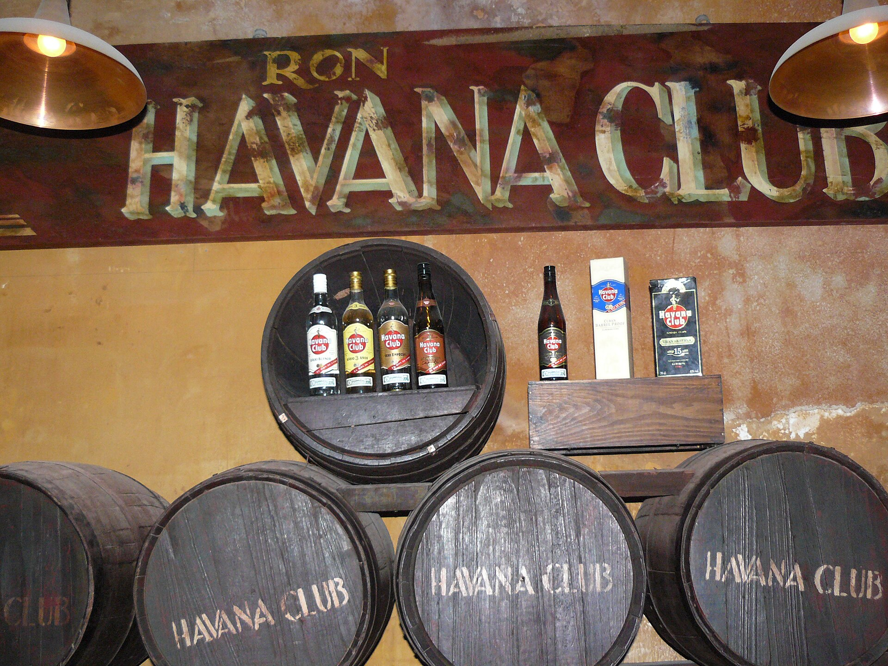

# Museo del Ron Havana Club

The Museo del Ron Havana Club occupies an 18th-century colonial mansion at 262 Avenida del Puerto, on the corner of Sol in Old Havana. Run by the Havana Club brand, it opened on 31 March 2000. The route begins with cane, molasses and fermentation, continues through distillation and ageing, and ends at a bar and shop. For a first visit to Cuba it is not a distillery tour but a museum that puts rum back into the sugar industry, the port and city life.

Figure: Related photograph of Museo del Ron Havana Club. Image: Antonio Bermudez Chi, CC BY 3.0, via Wikimedia Commons ([source page](https://commons.wikimedia.org/wiki/File:Museo_Havana_Club_-_panoramio.jpg)).

## 262 Avenida del Puerto: An 18th-Century Mansion

The museum stands on the harbour-side avenue in the north of Old Havana, a short walk from the Plaza de San Francisco area. The building is a classic colonial mansion: thick walls, tall windows, a courtyard and arcades, with a yellow façade that is easy to spot from the street. Exhibits are spread across several rooms, so the visit moves constantly between interior galleries and open spaces; that rhythm is part of the exhibit, since this is not a new hall filled with bottles but an old house telling an old industry's story.

This entry fixes no coordinates; use official channels for the exact location. Sources give the address as both 262 and 162; this entry follows Havana Club's official site and the 2026 Agencia Cubana de Noticias report, which give 262. Check the door number and an official map on arrival. The museum sits in a walkable part of the old city, so wear comfortable shoes and do not overfill the day.

## Opening in 2000 and the Role of Havana Club

The museum opened on 31 March 2000 and is operated by Havana Club. It tells brand history and Cuban rum history together: on one side cane, sugar mills, distillation and ageing; on the other Havana Club's range and Cuban cocktail culture. For the brand it is a brand museum; for the visitor it is also one of the easiest introductions to Cuban rum. Both things are true, but it helps to notice the narrative position.

Cuba's rum tradition and the knowledge of the Maestros del Ron Cubano were inscribed on UNESCO's Representative List of the Intangible Cultural Heritage of Humanity in 2022. Exhibits and tastings refer to this lineage of masters, stressing sensory judgment and the transmission of experience between generations rather than equipment and recipes alone. Keeping that in mind makes the visit more rewarding than simply collecting brand names.

## The Route: Cane, a Model Sugar Mill and Ageing Cellars

The route starts with [sugarcane](ref:sugarcane): how it reached Cuba, how it is crushed, and how [molasses](ref:molasses) becomes rum's raw material. A large scale model of a sugar mill, complete with miniature steam engines and drive mechanisms, explains the journey from field to factory; it is one of the most popular displays for children and photographers. Fermentation, distillation and ageing follow, with old stills, oak casks and coopers' tools showing how molasses becomes spirit and then enters the barrel.

The ageing section explains the [angels' share](ref:angels-share): in a tropical warehouse part of the liquid evaporates each year, leaving a darker, more concentrated rum. The museum uses casks, tools and images rather than rows of bottles alone. The last stop is usually the bar and shop: classic Cuban cocktails at the bar, the full Havana Club range and special bottlings in the shop. Linking the route to a glass is the most effective way to visit.

## The Bar, the Shop and Friday's Rum and Tradition

The bar is not an ordinary museum café but an extension of the exhibit: bartenders mix classic and contemporary Cuban cocktails with Havana Club, and visitors can sit down after the tour. The shop concentrates the Havana Club range, from everyday 3-year-old and 7-year-old expressions to the more premium Selección de Maestros. The choice is broader than in an ordinary supermarket, but prices and stock change, so do not treat it as a duty-free outlet.

On Fridays from 3 p.m. the museum holds "Tardes de Ron y Tradición", with live music, Havana Club cocktail competitions and prize draws. On 10 and 12 November 2026 it will also run the third edition of "El alma del Ron", two two-hour sessions on the history of cane and rum, demonstrations with molasses and fresh cane spirit, the changes brought by ageing, and tastings of premium Havana Club; the fee is 3,000 CUP and reservations are taken on 52858630. Details change, so confirm with the museum before attending.

## Experiences from 45 Minutes to Almost Two Hours

The museum packages the visit in different lengths. The basic guided tour lasts about 45 minutes and ends with a Havana Club tasting. "Los Pilares" runs about 1 hour 15 minutes and tastes three benchmark rums: Añejo 3 Years, Añejo 7 Years and Selección de Maestros. "Shaker" runs about 1 hour 30 minutes and teaches two classic Cuban cocktails with a bartender. "Los Reyes de la Habana" runs about 1 hour 40 minutes and pairs rum with Cuban cigars. "Prestige" runs about 1 hour 45 minutes and tastes premium limited releases. "Embotellado" runs about 1 hour 40 minutes and lets you bottle and take away a bottle signed by you.

For a first visit, the 45-minute tour is enough; to drink seriously, choose Los Pilares or Prestige; for cocktails choose Shaker; for cigars choose Los Reyes. Names and prices change, so check the museum's ticket page. Do not assume that one ticket includes every tasting: the number and level of pours differ by experience.

## Booking, Hours and Practical Advice

The museum is open daily, usually from 9:00 to 16:30, though sessions and closing days should be checked on the official site and on site. Book ahead in high season, on cruise-ship days and on weekend afternoons, when slots fill. If you only want a drink, the bar may work, but events can take it over. Groups, private tastings and cigar pairings need more notice.

Bring a passport or ID and follow the photography rules. Some galleries are dim and have steps, so wear non-slip shoes. Do not taste on an empty stomach; nose first, sip slowly, and leave what you do not want in the glass. If you are driving, do not drink at all. Old Havana is walkable, but the afternoon heat makes water and a hat more useful than rushing between stops.

## Beyond the Museum: Rum in Cuban Drinking Culture

A good day might combine a morning tour and tasting, lunch in the old city, an afternoon [mojito](ref:mojito) or [daiquiri](ref:daiquiri) at a bar associated with Hemingway, and an evening walk back along Avenida del Puerto. The museum explains how rum is made; the bar explains how it is drunk. Together they form Cuban rum culture. For a quick stop, 45 minutes is enough; to understand flavour, allow at least two hours and keep the tasting and the bar visit separate.

Havana's museum is organised around a brand and a capital city; Santiago's is organised around the eastern industry and local memory. Together they show two narratives of Cuban rum. Whichever you visit first, read the basics of [rum](ref:rum) beforehand and go in with questions; the visit will give more than a passive walk through the galleries.

[Rum](ref:rum) and [Molasses](ref:molasses) are the nearest useful comparisons: one clarifies address and space, the other tests operating status.
