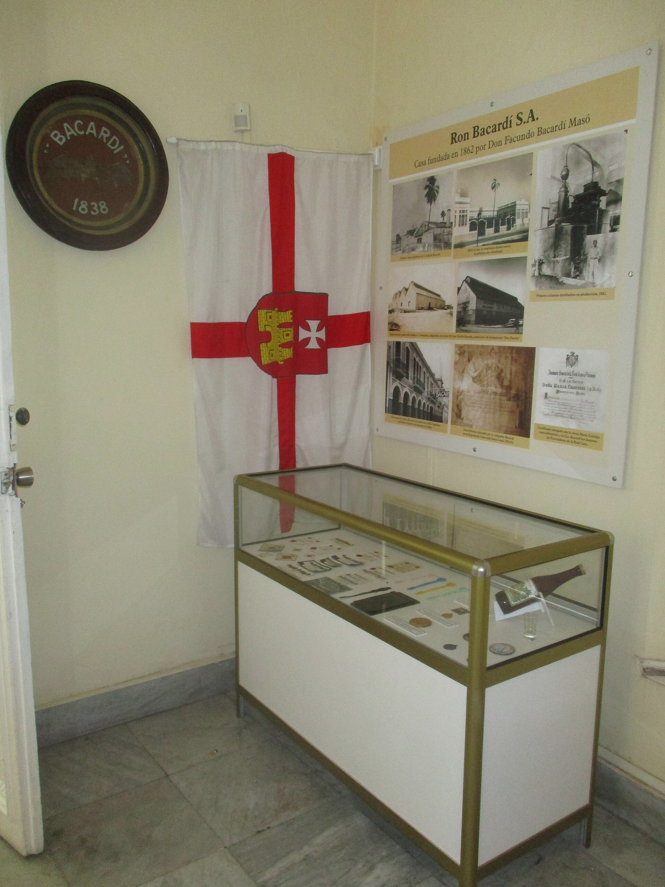

# Museo del Ron Santiago de Cuba

The Museo del Ron stands at 358 San Basilio Street in the historic centre of Santiago de Cuba, between Pío Rosado and San Félix. It occupies a two-storey mansion built in 1889 and opened as a rum museum on 24 June 1996. Six rooms, an old bottling line and a tavern tell the story of the rum industry in eastern Cuba, and especially in Santiago. Compared with Havana's brand-run Havana Club museum, it is smaller, more local and closer to a civic museum of industry and memory.

Figure: Related photograph of Museo del Ron Santiago de Cuba. Image: Pintolin, CC BY-SA 4.0, via Wikimedia Commons ([source page](https://commons.wikimedia.org/wiki/File:Espacio_Bacard%C3%AD.jpg)).

## An Old House at 358 San Basilio Street

The museum is in the historic centre, within walking distance of Parque Céspedes and Calle Heredia. The building mixes eclectic and neoclassical elements, with a fence and small garden at the street and a neoclassical still at the entrance; these details make it easy to recognise. It was built for the officer Kindelán Mozo de la Torre and later belonged to Mariano Gómez Villasana, a Bacardí treasurer, before passing through several uses in the mid-20th century.

This entry fixes no coordinates; use official channels for the exact location. Street and number appear in several forms: San Basilio 358 and Bartolomé Masó 358 are different names for the same street, so navigating to "Museo del Ron Santiago de Cuba" is safer than entering a street alone. The old centre has narrow one-way streets, so allow time to park or, better, walk or take a taxi. Some travel pages also place the museum at the Ronera Santiago de Cuba in the east of the city; public sources disagree on whether the old house and the distillery display are one site or two, so confirm before setting out.

## The 1889 Mansion and the 1996 Museum

The house was built in 1889 as a private residence. After the 1959 revolution it served in 1972 as the Cuba–USSR Friendship House and in 1994 as the "La Quinta Esperanza" cultural space. On 24 June 1996 it opened formally as the Museo del Ron. The sequence matters: this is not a purpose-built gallery but an old house with several former identities turned into an industry museum, and the relationship between building and display is as revealing as the bottles.

Santiago's rum history reaches back to 1862, and local material calls the city the "cradle of light rum" (Cuna del Ron Ligero). Catalan and French immigrants, the port, the railway and the sugar mills brought distilling equipment to the east, giving Santiago an industrial tradition distinct from Havana's. With that in mind, the old equipment and brand stories here do not read as a branch office of the Havana museum.

## Six Rooms: From Cane to the Bottling Line

Room one covers the origin of [sugarcane](ref:sugarcane), its arrival in Cuba and sugar making. Room two uses a production diagram to explain rum. Room three displays contemporary bottles, including several Havana Club expressions. Room four, in the courtyard, shows coopering and the casks used for ageing and is the most complete cooperage display in the museum. Room five holds a 1930s bottling line with seven original machines still on show. Room six covers the Santiago rum industry, with models of the old Ron Caney and Matusalén plants and pre-1959 factory photographs and labels.

The route links raw material, production, brands, ageing, bottling and local history, and is denser in local detail than the Havana museum. Do not look only at bottles: the casks in the courtyard, the machines on the bottling line and the old photographs are the key to the eastern industry. The collection includes more than eighty Cuban and Caribbean rums, many donated by foreign visitors, so the displays change with donations rather than following a fixed checklist.

## Why Santiago Calls Itself the Cradle of Rum

Cuban rum origin stories usually put the east first: cane growing, sugar mills and distilling equipment reached scale there earlier, and 1862 is treated as an important date for Santiago's rum industry. The city's line of rum masters extends more than eight generations and stresses sensory judgment and transmission between generations; in 2022 the knowledge of the Maestros del Ron Cubano was inscribed on UNESCO's Representative List of the Intangible Cultural Heritage of Humanity, giving the local tradition international recognition.

"Cradle" is a local narrative, not an exclusive legal conclusion. Havana, San José and other places also have important distilleries, and Cuban rum's overall style is shaped by several producers. Placing Santiago inside the history of [rum](ref:rum) and the Cuban sugar economy is more useful than arguing about who came first. The museum's value lies less in "earliest" than in the local memory of the eastern industry it preserves.

## Bottles and Tastings: From Matusalén to Ron Santiago

The displays include vanished brands such as Matusalén and surviving ones such as Ron Santiago, Caney and Caribbean Club. Santiago is the home of Ron Santiago de Cuba, a brand known for an eastern identity and a lighter body; Caney is another local historical line. The museum tavern offers rum tastings and cocktails, and the ticket usually includes a guide and a pour, with the exact rums and prices set on site.

For tasting, compare "light" and "heavy": many Santiago rums are cleaner and more citrus- or cane-driven, good neat and in cocktails, while high-ester Jamaican rums are heavier and more solvent-like. Understand [molasses](ref:molasses), [distillation](ref:distillation) and the [pot still](ref:pot-still), then take a sip, and it becomes clear why one island can produce such different styles.

## Tickets, Hours and Getting There

The usual opening hours are Monday to Saturday 9:00–17:00, with a ticket of about EUR 2 including a guide and a tasting; the tavern stays open later, which suits a drink after the visit. Prices, languages and session times change, so check on site or through official Cuban tourism channels. Groups should call ahead; the museum number appears in sources as +53 22 62 3737, so confirm the area code and line before dialling.

The museum sits in the historic centre, near Parque Céspedes, the cathedral, the Casa de la Trova and the Diego Velázquez house, which makes a half-day walking route. A morning visit, lunch in the old city and music in the afternoon suit the place better than rushing between stops. With children, the bottling line and models usually beat the labels, but the tasting should follow age rules and local practice.

## How It Differs from the Havana Museum

Havana's Museo del Ron Havana Club is brand-run, more international in display, richer in tasting flights and stronger in bar and shop. Santiago's Museo del Ron starts from local industry memory, with more miscellaneous and older exhibits and a closer relationship to the building and the city. They are not substitutes but two ends of the Cuban rum story: one speaks of a brand and a national market, the other of eastern industry and immigrant technology.

If you visit only one, Havana is the quicker way to build a framework on a first trip to Cuba; if you are in the east and want to know why Santiago calls itself the cradle, come here. Read [place and process](ref:place-and-process) before the visit, and the route from cane and molasses through distillation and ageing becomes easier to follow.
