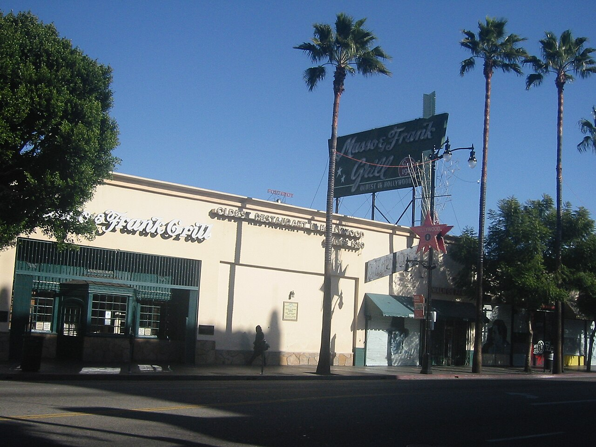

# Musso & Frank Grill

On Hollywood Boulevard, east of the Walk of Fame crowds, a dark green awning and a simple sign mark a restaurant that has been in business since 1919. The windows are old, the waiters wear jackets and ties, and the menu still includes flannel cakes, sand dabs and a proper martini. Musso & Frank Grill is not a museum of old Hollywood, although it can feel like one. It is a working restaurant where the past survives because the routines have not been replaced.

Figure: The full storefront and rooftop sign of Musso & Frank Grill on Hollywood Boulevard; the restaurant opened in 1919 as Frank's Café at 6669 Hollywood Boulevard and later moved next door to the present 6667 address. Image: Gary Minnaert, Public domain, via Wikimedia Commons ([source page](https://commons.wikimedia.org/wiki/File:Musso%26Franks_05.jpg)).

## Location and history

The restaurant began in 1919 as Frank's Café at 6669 Hollywood Boulevard, opened by Frank Toulet. Within a few years Toulet partnered with Joseph Musso, and the restaurant became Musso & Frank's Grill; the French chef Jean Rue created the menu. In 1927 Toulet and Musso sold the business to Joseph Carissimi and John Mosso, who later moved it next door to 6667, the present address. The name “Musso & Frank” combines the partner's name with the earlier Frank's Café, a practical compromise that became one of the most recognizable restaurant names in Los Angeles.

The 1920s and 1930s were the restaurant's formative years. Hollywood was becoming an industry town, and Musso's was close to the studios, the newspapers and the apartment hotels where writers lived. The back room became a gathering place for novelists, screenwriters and actors; the bar was where deals were made and gossip exchanged. The official history notes the addition of the Back Room in 1934 and the New Room in 1955, which gave the restaurant its long, divided layout: a front room, a bar, and a deeper dining room behind.

The literary reputation is real but should be handled carefully. William Faulkner, F. Scott Fitzgerald, Ernest Hemingway, Raymond Chandler and Charles Bukowski are among the writers associated with the restaurant in different periods. The strength of the association varies by person and by decade; some were regulars, others visited, and some stories have grown in the retelling. What is certain is that the restaurant became a social institution for the Hollywood writing and film community, not that every famous name had a fixed table.

Family succession is another part of the story. John Mosso's descendants have continued to run the restaurant, and the house has changed hands within the family rather than through a corporate sale. The restaurant's own site names the three granddaughters of John Mosso and their children as the owners. That continuity helps explain the waiter culture: many staff members have worked there for decades, and the service style is formal without being stiff.

## Space and drinks

The building is low and long, with a green facade and a modest entrance. Inside, the front room has leather banquettes, brass rails, wood panels and a warm, low light. The bar is to one side, with a counter and a few tables; the Back Room and New Room lie farther back. The rooms are not huge, but the division creates a sense of privacy that modern open-plan restaurants often lack. The dress of the staff, the paper menu and the old telephone booth are part of the atmosphere.

The menu is a deliberately old-fashioned mix: steak, roast beef, chicken, fish, sand dabs, liver and onions, flannel cakes, crab Louis and classic desserts. The bar makes a proper dry martini, Manhattans, whiskey highballs and other pre-1980s standards. There is a full wine list, but the bar is the more distinctive experience. This is not a place for experimental cocktails or a light, modern small-plates meal; the pleasure comes from execution and ritual.

## How to drink

Start with a martini or a Manhattan at the bar, then move to a table for a full meal. The martini here is cold, strong and served in a stemmed glass; if you want it less dry, say so before the bartender starts. For a first visit, the bar and the front room give the strongest sense of the place; the Back Room is quieter and better for a long dinner. The waiters are professional and know the menu; ask them what is fresh and what they would eat, rather than treating the menu as a checklist.

Lunch is easier than dinner and cheaper; the afternoon light through the front windows shows the room's age better than the night lighting. Dinner is more formal and busier, especially on weekends. The restaurant is closed on Monday, so do not plan a Monday visit.

## Practical information

The address is 6667 Hollywood Boulevard, Los Angeles, CA 90028. It is near the Hollywood/Vine Metro station and the Pantages Theatre, a short walk from the Walk of Fame. Official hours are Tuesday–Saturday 17:00–23:00 and Sunday 16:00–22:00; closed Monday. The bar opens at the same time as the restaurant; holidays and private events can change the schedule.

Reservations are recommended for dinner and essential for weekends and groups. The restaurant accepts credit cards. Dress is smart casual to formal; jackets are not required for men, but the room rewards effort. Tipping 18%–20% of the pre-tax bill is standard. Parking in the area is difficult; ride-sharing or transit is easier than circling the block.

## Etiquette and common misconceptions

The first misconception is that Musso & Frank is only a tourist attraction. It is a working restaurant with a large local clientele and a long staff tenure, and the food is cooked to order. The second is expecting a “movie star” experience; celebrities may visit, but the restaurant does not guarantee sightings, and asking staff about them is inappropriate. The third is treating the literary history as exact: Faulkner, Fitzgerald and Hemingway were associated with the place, but their frequency and favorite tables are not all documented. The fourth is ordering a modern, complicated cocktail and expecting the bar to improvise; the strength here is classic drinks. The fifth is ignoring the Monday closure.

## Nearby and routes

Leave the restaurant and walk west along Hollywood Boulevard to the Walk of Fame, the Chinese Theatre and the Pantages; north is the Hollywood Hills, south is Melrose Avenue. Musso & Frank pairs naturally with a classic-martini theme: read [The Dry Martini](ref:martini) and [Bar Hemingway at the Ritz Paris](ref:hemingway), then compare [Green Mill](ref:green-mill) in Chicago and [Buena Vista Café](ref:buena) in San Francisco for three very different versions of the historic American bar. For the larger question of why old bars survive, read [Understanding a City Through Its Pub](ref:pub-city).

## Further reading and see also

- [Bar Hemingway at the Ritz Paris](ref:hemingway)
- [The Dry Martini](ref:martini)
- [Green Mill Cocktail Lounge](ref:green-mill)
- [Buena Vista Café](ref:buena)
- [Understanding a City Through Its Pub](ref:pub-city)

Checked on 2026-11-21 against the Musso & Frank Grill official page. Hours are Tuesday–Saturday 17:00–23:00 and Sunday 16:00–22:00, closed Monday; dinner and weekends are best booked, while the bar usually keeps room for walk-ins. The "oldest in Hollywood" qualifier cannot be dropped, the red uniforms are a service tradition rather than a themed performance, and a drier Martini is not automatically better; the body explains each point. The image shows the full Hollywood Boulevard storefront and roof sign, not the interior.
