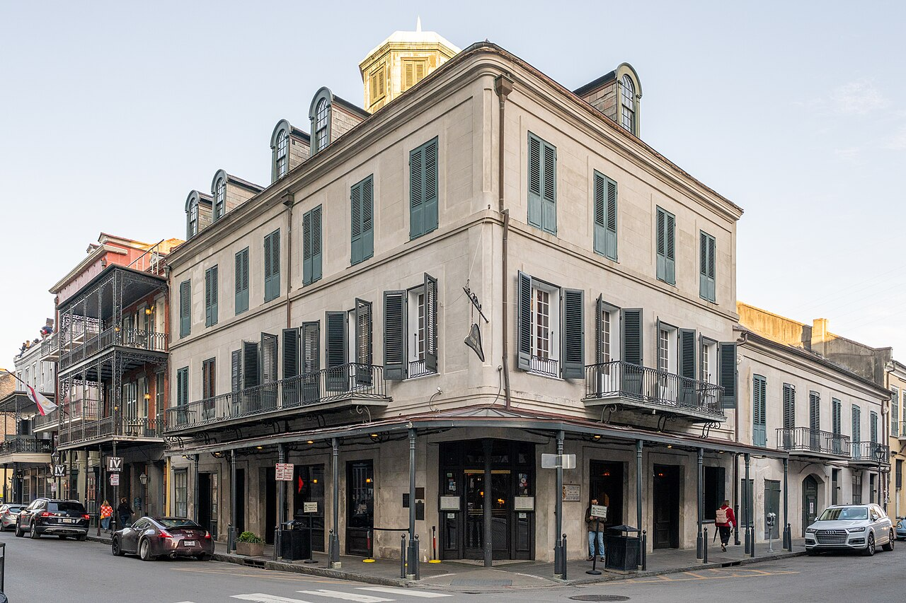
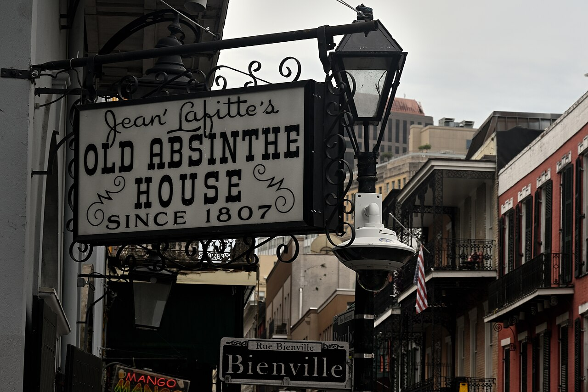

# Napoleon House

At the corner of Chartres and St. Louis streets in the French Quarter, a three-storey building with grey-white stucco walls and a small cupola cuts the intersection at an angle. It is not remotely palace-like. It looks more like a Caribbean creole house that has been rubbed by damp, rain and time. The flag outside says "Napoleon House Since 1797," but the real story is more crooked: Napoleon never lived here, yet a plan to offer him refuge permanently renamed the building.

Figure: Napoleon House at the corner of Chartres and St. Louis streets, New Orleans; the sign reads 1797, while Girod enlarged the main house in 1814. Image: ajay_suresh, CC BY 4.0, via Wikimedia Commons ([source page](https://commons.wikimedia.org/wiki/File:The_Napoleon_House_-_New_Orleans_February_2026.jpg)).

## Location and history

The official account dates the building to 1797, when it was the home of Nicholas Girod; Girod was mayor of New Orleans from 1812 to 1815. In 1821 he proposed giving the exiled Napoleon refuge here. The plan never came off: Napoleon died that year, but the house kept the name. Local architectural history notes that the "1797" on the sign may refer to a two-storey annex built by Girod's brothers, while the main house was enlarged in 1814, so 1797 and 1814 are not contradictory dates but refer to different parts. In the 19th century the building served as a residence, grocery and import business. In 1914 the Impastato family took over, and Uncle Joe turned the ground-floor store into a restaurant and bar. In 2015 Ralph Brennan bought it from the Impastato family and promised to keep the old walls, floors and classical music. In 1970 the building was designated a National Historic Landmark.

The building's timeline deserves another layer. The official date is 1797; local architectural history holds that Girod enlarged the main house in 1814, while the sign kept the earlier annex date. Girod was mayor from 1812 to 1815 and, after leaving office, concentrated on the Chartres Street property; in 1821 he joined the plan to invite Napoleon to New Orleans, and Napoleon died the same year, ending it. In the 19th century the building was a grocery, import house and residence. In 1914 the Impastato family bought it, and Uncle Joe played opera records on a Victrola and gradually turned the ground floor into a restaurant. It became a National Historic Landmark in 1970. After Ralph Brennan took over in 2015, the classical music, old bar and muffuletta method were retained. In 2019 Tales of the Cocktail gave it a "Timeless American" award, not for novelty but for long-run local character.

## Space and drinks

Inside, the most striking features are the mottled stucco walls, the old wooden bar, the uneven floor tiles and the flags hanging from the ceiling; paintings and objects linked to Napoleon, the French Revolution and New Orleans history cover the walls. Both the main dining room and the courtyard are used for meals, and in good weather the courtyard feels like a terrace enclosed by old walls. The signature drink is the Pimm's Cup: the restaurant says Uncle Joe encountered the low-alcohol summer drink in England, brought it back to New Orleans, and that this was the first place in the United States to serve it. The recipe is Pimm's No. 1, lemonade, 7-Up and a slice of cucumber. The best-known food is the muffuletta, bread filled with cured meats, cheese and olive salad and heated before serving; there are also jambalaya, gumbo and red beans and rice.

## How to drink

For a single drink, order a Pimm's Cup and sit in the courtyard or by a window, letting the cucumber and lemonade cut the New Orleans humidity; for something stronger, ask the bar for a Sazerac or a local craft beer. For a meal, two people can share a muffuletta and add gumbo or jambalaya rather than ordering several starch-and-cured-meat dishes at once. The restaurant does not take reservations, and lunch or early evening is easier than Jazz Fest, Mardi Gras or a weekend night. Classical music is the house soundtrack; do not ask for pop.

## Practical information

The address is 500 Chartres Street, New Orleans, LA 70130, in the centre of the French Quarter and walkable to Jackson Square and St. Louis Cathedral. The nearest streetcar is the Canal Street line; get off near Canal and Bourbon and walk a few minutes. French Quarter streets are narrow, so walking beats driving. It is open daily 11:00–22:00 and does not take reservations; check the official site for holiday arrangements. Dress is casual, but the French Quarter is hot and damp in summer and interiors are air-conditioned, so a light layer helps. Prices are moderate; the Pimm's Cup and muffuletta are the usual combination.

## Etiquette and common misconceptions

First, Napoleon never came here; the "refuge" was a historical plan and a city legend, not a room he occupied. Second, the 1797 sign and the 1814 enlargement are not a contradiction, so do not explain the difference as "the official story is fake." Third, Pimm's Cup recipes vary; the official version uses Pimm's No. 1, lemonade, 7-Up and cucumber, and there is no need to invent a "secret ingredient" as the only truth. Fourth, this is a restaurant and bar, not a Napoleon museum: look at the objects but do not touch them or hold a table for a long photo session. Fifth, the olive salad in a muffuletta is salty; first-timers may want a half portion.

## Surroundings and routes

From Napoleon House, Jackson Square and St. Louis Cathedral are two blocks south, the French Market is east, and the [Old Absinthe House](ref:old-absinthe) and [Carousel Bar](ref:carousel) are northwest along Bourbon Street. The three make a good French Quarter historic-bar half-day: eat a muffuletta here, drink an Absinthe Frappé at the Old Absinthe House, then finish with a Vieux Carré at the Carousel Bar. For the relationship between bars and urban space, read [A history of taverns](ref:taverns) and [A city through its pubs](ref:pub-city); for how Prohibition changed the local bar ecology, see [Prohibition](ref:prohibition).

## Further reading and see also

- [A history of taverns: from alehouses and inns to bars](ref:taverns)
- [A city through its pubs](ref:pub-city)
- [Prohibition: banning supply does not abolish demand](ref:prohibition)
- [The Old Absinthe House](ref:old-absinthe)
- [The Carousel Bar](ref:carousel)

**Short definition:** A historic building and bar at 500 Chartres Street in the French Quarter, built in 1797, named for the 1821 plan to give Napoleon refuge, and run by the Impastato family from 1914. 

Read Napoleon House through the address, then the current opening status, and finally what the place is known for. The sequence matters.

Checked on 2026-11-21 against the Napoleon House official page. The bar opens daily 11:00–22:00 and does not take reservations; queues lengthen during Carnival and Jazz Fest, so confirm before visiting. Construction in 1797, expansion in 1814 and family operation from 1914 are three separate timelines; Napoleon never came here, the refuge invitation is city legend, and Pimm's Cup recipes vary. The image shows the corner exterior and cupola, not the interior or menu.

## Related images

Image: The hanging sign of the Old Absinthe House at Bourbon and Bienville streets, lettered "Since 1807"; the building was begun in 1798 and completed in 1806, with its bar function developing after 1835.. Credit: Tom Hilton, CC BY 2.0, via Wikimedia Commons ([source page](https://commons.wikimedia.org/wiki/File:Old_Absinthe_House,_New_Orleans,_August_2022.jpg)). Related image for Napoleon House.

The Carousel Bar reference notes the bar installed in 1949 and the current carousel canopy added in 1992.
