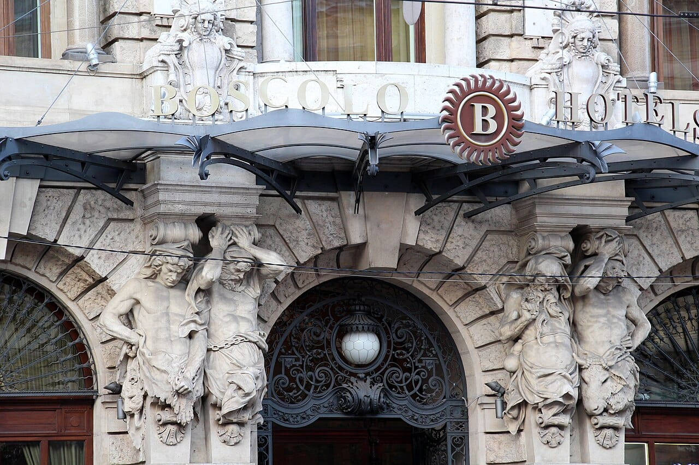
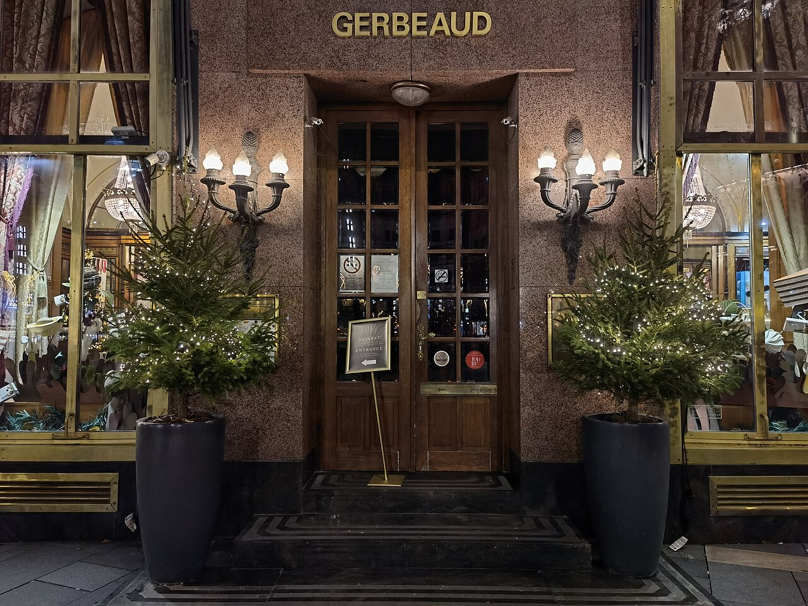

# New York Café

From Blaha Lujza tér metro station, walk three minutes along Erzsébet körút and the dark façade and gold “NEW YORK CAFÉ” lettering of the New York Palace appear. Inside, the first thing you see is not a table but the ceiling: gilded stucco, frescoes, chandeliers, and marble columns turn the room into an opera house. Waiters carry silver trays through the crowd, and piano music expands under the vault. It is called “the most beautiful café in the world,” a title that is both praise and burden—because more people come to see the ceiling than to drink coffee.

Figure: The gilded main hall and ceiling of New York Café. Image: Fred Romero from Paris, France, CC BY 2.0, via Wikimedia Commons ([source page](https://commons.wikimedia.org/wiki/File:Budapest_-_New_York-palota_(37595301645).jpg)).

## Location and history

New York Café opened on 23 October 1894 with the New York Palace, on the building’s ground floor. The palace was designed by Alajos Hauszmann, with Flóris Korb and Kálmán Giergl contributing, and it was one of Budapest’s most ambitious turn-of-the-century commercial buildings. The café quickly became a meeting place for writers, editors, poets, painters, and actors. The official account says the most influential newspapers were edited in the gallery above while writers drank, argued, and filed copy below. The Nyugat (The West) circle—Mihály Babits, Dezső Kosztolányi, Frigyes Karinthy, and others—used the marble tables as an office.

The most famous legend is that the owner threw the key into the Danube at the opening, declaring that the café would never close. The story is hard to verify, but it captures the café’s self-image: not a place that closes on schedule, but an engine of Budapest’s literary and night life. After World War II, the café was badly damaged and used as a sporting-goods shop. It reopened as Hungária in 1954, but decayed during the socialist period. In the early 2000s, the New York Palace and café underwent extensive restoration, and in 2006 the New York Café reopened. Today it is part of a hotel complex, with the café, restaurant, and Nyugat bar sharing the building.

## Architecture and space

The interior mixes Italian Renaissance Revival with Budapest’s fin-de-siècle taste: a gilded ceiling, frescoes, marble columns, mirrors, chandeliers, red velvet seating, and dark wood. Gusztáv Mannheimer’s frescoes and Károly Senyei’s gilded stucco are the two visual pillars; stand in the centre and look up, and the layered vaults and lights resemble a cut-open cathedral. The space is divided into the ground-floor hall, a mezzanine/gallery, and a restaurant area. The gallery seats by the railing look down on the hall and are the best place to photograph and people-watch.

It is not quiet. Tourists, groups, birthdays, weddings, and business dinners share the room, and piano or string music appears in the afternoon and evening. For an empty shot, arrive right after opening; for a quiet conversation, book a corner in the gallery or the restaurant. Do not stand on chairs, cross the railing, or push a phone under the chandeliers for a photo; the hall’s circulation belongs to waiters and guests, not photographers.

## The drinks

The menu combines Hungarian classics with Austro-Hungarian nostalgia: beef goulash, fisherman’s soup, chicken leg paprikash, Wiener schnitzel, grilled foie gras, and Dobos, Sacher, and Eszterházy cakes. The most famous drink is the “24-karat gold cappuccino,” with gold leaf on the foam, around €13; it is more a drinkable souvenir than a complex coffee. Among desserts, try Somlói Galuska (sponge cake, walnuts, raisins, and chocolate cream) and the New York chocolate cake.

The drinks list covers champagne, wine, Hungarian Tokaji, cocktails, and coffee cocktails. The Nyugat bar is the quieter evening option for a cocktail or Tokaji with a snack. By day, coffee and cake; by night, full meals and wine. Dinner after 18:00 is best reserved, while daytime seating is walk-in. Prices are in Budapest’s high-end tourist-café range, with the gold cappuccino and afternoon-tea packages as the main premiums.

## How to drink

The best times are 07:30–09:30 or after 16:30. In the morning the hall is nearly empty and the frescoes are easy to study; in the afternoon tour groups queue to the street. From 11:00 to 15:00 is peak; if you do not want to wait, try the restaurant or return in the evening. After 18:00 only dinner reservations are accepted, for up to ten people; groups and events should contact the restaurant in advance.

Decide first whether you are there for coffee and cake or a full meal. For coffee, sit in the hall with a cappuccino or Melange and a piece of Somlói Galuska; for a meal, sit in the restaurant with goulash or paprikash and a Hungarian red. The gold cappuccino is a photo drink—one is enough. Service is usually included; a small tip is still appropriate.

## Practical information

- Address: Erzsébet körút 9-11, 1073 Budapest.
- Hours: Monday–Wednesday 07:00–24:00; Thursday–Sunday 07:00–01:00 (official About page).
- Transport: M2 Blaha Lujza tér, 3 minutes on foot; trams 4 and 6 stop at Blaha Lujza tér.
- Reservations: dinner after 18:00, up to ten people; daytime is walk-in.
- Prices: coffee and cake are in the high-end tourist range; the gold cappuccino is about €13; full meals and wine are higher.
- Dress: smart casual; no strict dress code, though evening and performance guests may dress up.
- Accessibility: steps at the main entrance and crowded circulation; call ahead about the entrance and lift.

## Etiquette and common misconceptions

First, do not treat “the most beautiful café in the world” as décor only; it is a working café and restaurant, and guests need the aisles. Second, do not stand on chairs or cross the railing for a ceiling shot; the gallery and stairs are not a viewing platform. Third, do not occupy a dining table with only a glass of water; the restaurant requires a meal at lunch and dinner. Fourth, do not present the key-in-the-Danube story as fact; it is an opening legend, not an archive record. Fifth, do not conflate the 1954 Hungária reopening with the 2006 New York Café restoration; they belong to different political and commercial eras. Sixth, do not expect a quiet historic café; the sound level is that of a tourist city, so book a gallery corner or visit the Nyugat bar at night if you want quiet.

## Nearby and routes

Ten minutes west are Astoria and Deák Ferenc tér; south are Rákóczi út and Blaha Lujza tér; north-west are the Hungarian National Museum and Andrássy út. A good sequence is: breakfast at New York Café, the National Museum, Andrássy út, Heroes’ Square, and Gerbeaud for dessert in the evening. For a Budapest café route, start at [Gerbeaud](ref:gerbeaud) for traditional pastries, then come to New York Café for the ceiling; Vienna’s [Café Central](ref:central), [Café Hawelka](ref:hawelka), and [Café Sperl](ref:sperl) place the Austro-Hungarian café in a wider lineage. For a full Vienna evening, see the [Vienna coffee-house evening route](ref:vienna-route).

## Further reading and see also

- New York Café official home: <https://newyorkcafe.hu/en/>, for the address, current dining, and the “most beautiful café” positioning.
- New York Café About page: <https://newyorkcafe.hu/en/cafe-about-us/>, for 1894, the sporting-goods years, 1954 Hungária, 2006 restoration, hours, and reservation rules.
- Accor Limitless’s New York Café article: <https://all.accor.com/a/en/limitless/thematics/food-drink/new-york-cafe-budapest.html>, for the frescoes, gilded stucco, Nyugat writers, and gold cappuccino.
- The nearby `place:gerbeaud` is Budapest’s other royal-patisserie narrative; `place:cafe-central`, `place:cafe-hawelka`, and `place:cafe-sperl` are different Vienna café types.
- For a Central European café route, read `route:vienna-coffee-house-evening` and `place:gerbeaud`.
- Related entries: [Gerbeaud](ref:gerbeaud), [Café Central](ref:central), [Café Hawelka](ref:hawelka), [Café Sperl](ref:sperl), [Vienna coffee-house evening route](ref:vienna-route)

**In brief:** New York Café at Erzsébet körút 9–11 opened with the New York Palace in 1894. Its gilded ceiling, frescoes, marble columns, and chandeliers turned it into Budapest’s “most beautiful café”; the legend of the key thrown into the Danube, the Nyugat writers’ tables, the postwar Hungária years, and the 2006 restoration make its history more complicated than its décor.

## Related images

Image: The Gerbeaud facade on Vörösmarty tér 7–8, with its Christmas tree. Credit: Random photos 1989, CC0, via Wikimedia Commons ([source page](https://commons.wikimedia.org/wiki/File:Budapest,_V%C3%B6r%C3%B6smarty_t%C3%A9r_7-8,_Gerbeaud-h%C3%A1z,_kar%C3%A1csonyfa,_1.jpg)). Related image for New York Café.
