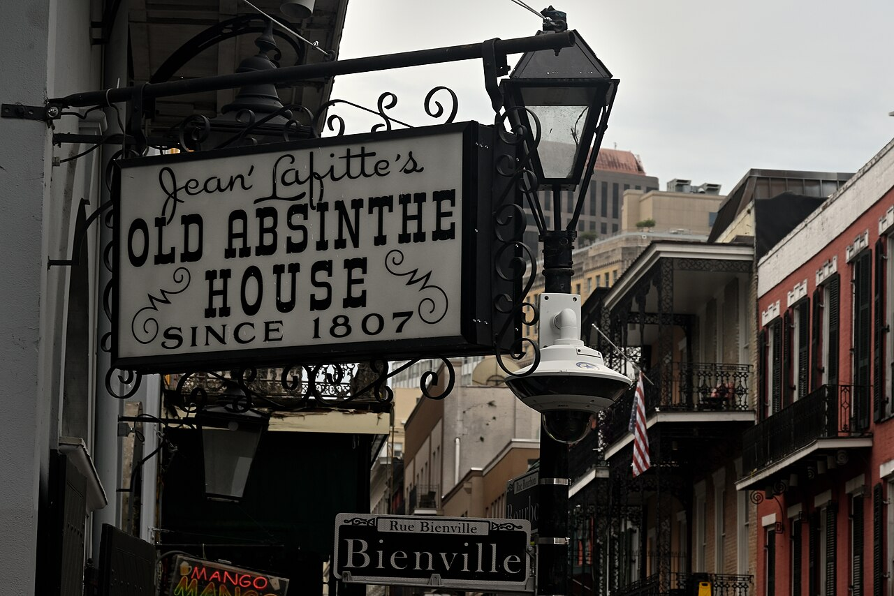
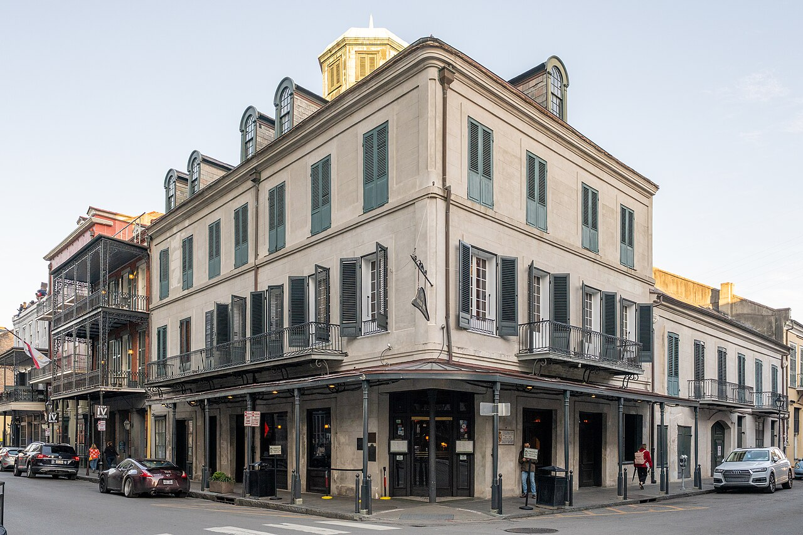

# The Old Absinthe House

At the corner of Bourbon and Bienville streets, a two-storey stucco building cuts the intersection at an obtuse angle. By day it looks like any historic building in the French Quarter surrounded by tourist shops; at night the neon and flags outside make "Old Absinthe House" glow. Its story is not the urban legend about whether absinthe drives people mad. It is a more concrete timeline: import house, coffee house, absinthe room, Prohibition, restaurant and bar, all compressed into the same floor tiles.

Figure: The hanging sign of the Old Absinthe House at Bourbon and Bienville streets, lettered "Since 1807"; the building was begun in 1798 and completed in 1806, with its bar function developing after 1835. Image: Tom Hilton, CC BY 2.0, via Wikimedia Commons ([source page](https://commons.wikimedia.org/wiki/File:Old_Absinthe_House,_New_Orleans,_August_2022.jpg)).

## Location and history

The building was begun in 1798 and completed in 1806 as the property of the Spanish import firm Font & Juncadella. The ground floor sold food, tobacco, shoes, cloth and Spanish wine in barrels. It obtained its first liquor licence in 1835; around 1846 the ground floor became Aleix's Coffee House, "coffee house" being a New Orleans euphemism for a bar. In 1874 Cayetano Ferrer, a Catalan from Barcelona, leased the building, renamed it the Absinthe Room and created the Absinthe House Frappé: absinthe, syrup and crushed ice, diluted slowly through the marble drip fountain. The United States banned absinthe in 1912, Prohibition followed in 1920, and the building was at one point slated for demolition before surviving as a restaurant and nightclub. Owen Brennan bought it in 1943; it later changed hands and is now run by Rue Bourbon.

The building's early history has another layer. It was begun in 1798 and completed in 1806 for the Catalan firm Font & Juncadella; it was not a bar at first but an import and commission house, selling food, tobacco, shoes, cloth and wine by the barrel on the ground floor. It obtained its first liquor licence in 1835, and around 1846 the Aleix family turned the ground floor into Aleix's Coffee House. In 1874 Cayetano Ferrer leased it, renamed it the Absinthe Room and created the Absinthe House Frappé. The United States banned absinthe in 1912; Prohibition began in 1920, and the building was at one point scheduled for demolition before surviving as a restaurant and nightclub. Owen Brennan bought it in 1943, and Rue Bourbon now operates it; the pair of marble drip fountains on the bar is one of the few physical traces of that history, not a modern prop.

## Space and drinks

The building has two storeys of stucco over brick, an iron balcony on the upper floor and a corner that faces the street. Inside, the old wooden bar, mottled walls and a large collection of objects linked to absinthe, jazz, boxing and French Quarter history remain. The highlight is the pair of marble absinthe drip fountains on the bar: water drips from a tap onto a sugar cube and then into the glass, a remnant of 19th-century Parisian drinking practice. The drinks list centres on the Absinthe Frappé, Sazerac, Pimm's Cup and classic New Orleans cocktails, with ordinary beer and wine. It is not a serious absinthe tasting room; its strength is drinking a drink with absinthe in its name in a historic space.

## How to drink

For a first visit, order an Absinthe Frappé and ask for it the traditional way, with crushed ice and mint; if you want a stronger absinthe, ask the bar for the "drip" version and watch how they balance water and sugar. Do not start with a high-proof neat absinthe; the herbal bitterness is not friendly to the unaccustomed. The Sazerac suits anyone wanting a short, strong drink, while the Pimm's Cup fits New Orleans heat. Daytime is better for looking at the building and the bar; night is livelier. If you only want photographs, take the exterior from the street rather than setting up a tripod on the corner and blocking pedestrians.

## Practical information

The address is 240 Bourbon Street, New Orleans, LA 70130, at the corner of Bourbon and Bienville. The French Quarter is walkable; the nearest streetcar is the Canal Street line, about ten minutes on foot from Canal and Bourbon. Hours are posted on the official site and door, usually from daytime into late night; drinking is 21-and-over. Dress is casual, but Bourbon Street is crowded and often wet at night, so grippy shoes beat heels. Prices are moderate; the Absinthe Frappé usually costs more than a standard cocktail, and it is worth confirming whether a souvenir glass is included.

## Etiquette and common misconceptions

First, absinthe does not produce the "cut off an ear" hallucination; the legend grew from 19th-century medical and moral panic, and modern research links the effects more to high alcohol, impurities and the way it was drunk. Second, the traditional method is not "set the sugar on fire"; the drip fountain and sugar are for dilution and aroma, while flaming sugar is a later bar stunt, not a 19th-century standard. Third, the building was completed in 1806, but its bar function developed only after 1835/1836; do not write "a bar since 1806." Fourth, Absinthe House Frappé recipes vary, and official and archival sources attribute it to Cayetano Ferrer in 1874, but no single bar's version is the only correct one. Fifth, this is a working bar, not an absinthe museum; the drip fountains are old objects, so do not turn the taps.

## Surroundings and routes

From the Old Absinthe House, Bourbon Street runs northeast to Jean Lafitte's Blacksmith Shop and the old Lafitte house, while [Napoleon House](ref:napoleon) is northwest and [the Carousel Bar](ref:carousel) at Hotel Monteleone is further north. The three make a French Quarter historic-bar route: eat a muffuletta at Napoleon House, drink an Absinthe Frappé here, and finish with a Vieux Carré at the Carousel. For how Prohibition changed the supply of bars like this, see [Prohibition](ref:prohibition); for the relationship between bars and urban space, read [A history of taverns](ref:taverns) and [A city through its pubs](ref:pub-city).

## Further reading and see also

- [Prohibition: banning supply does not abolish demand](ref:prohibition)
- [A history of taverns: from alehouses and inns to bars](ref:taverns)
- [A city through its pubs](ref:pub-city)
- [Napoleon House](ref:napoleon)
- [The Carousel Bar](ref:carousel)

**Short definition:** A historic bar at the corner of Bourbon and Bienville in New Orleans, in a building completed in 1806, licensed in 1835, and associated with Cayetano Ferrer's 1874 Absinthe House Frappé.

Read The Old Absinthe House through the address, then the current opening status, and finally what the place is known for. The sequence matters.

Checked on 2026-11-21 against the Old Absinthe House official page. Hours usually run from daytime into late night, drinking is 21+, and Bourbon Street is crowded and often wet at night, so check the official site and the door notice before visiting. The building was completed in 1806, the liquor licence dates to 1835, and the Absinthe House Frappé was created in 1874; the body keeps those timelines separate. The hallucination legend and the fire-and-sugar ritual are not the 19th-century standard method. The image shows the hanging sign, not the bar interior.

## Related images

Image: Napoleon House at the corner of Chartres and St. Louis streets, New Orleans; the sign reads 1797, while Girod enlarged the main house in 1814. Credit: ajay_suresh, CC BY 4.0, via Wikimedia Commons ([source page](https://commons.wikimedia.org/wiki/File:The_Napoleon_House_-_New_Orleans_February_2026.jpg)). Related image for The Old Absinthe House.
