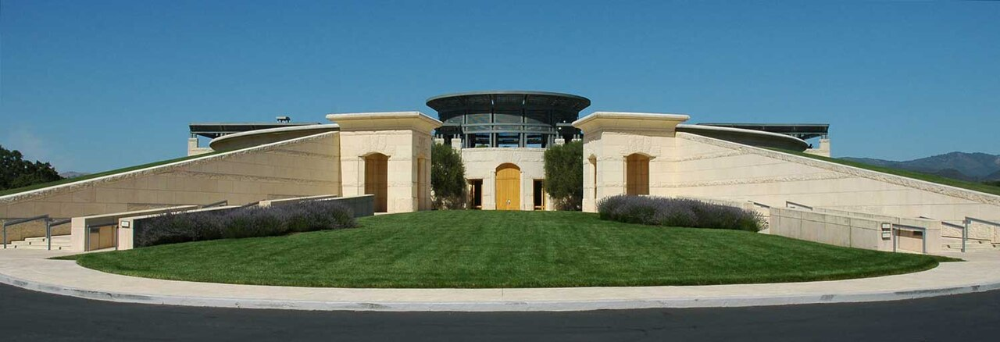

# Opus One Winery

Opus One Winery stands in Oakville, Napa Valley, across Highway 29 from Robert Mondavi Winery. Robert Mondavi and Baron Philippe de Rothschild founded it in 1979 with a single purpose: to make one Bordeaux-style blend each vintage. That is unusual in Napa, where most estates produce Cabernet, Chardonnay, Sauvignon Blanc and several other lines. Opus One compresses the brand, the wine and the vintage into one thread, and the visit is built around that one wine.

Figure: Opus One Winery. Image: No machine-readable author provided. Cszmurlo assumed (based on copyright claims)., CC BY 2.5, via Wikimedia Commons ([source page](https://commons.wikimedia.org/wiki/File:Opus-One-Szmurlo.jpg)).

> **Quick verdict**
> **In one line:** This entry helps you decide whether Opus One Winery deserves a detour, and what to check before visiting.
>
> - **Best for:** Anyone planning a visit to Opus One Winery who needs to decide whether it deserves a half-day or a full day.
> - **Not for:** If you want only want a must-visit list and will not check booking, transport or opening hours.
> - **Check first:**
>   - The collaboration is usually dated to 1978.
>   - Opus One is appointment-only and does not accept walk-in visitors.

## Place and history

The collaboration is usually dated to 1978. The official account says the two founders settled the plan in an hour at Château Mouton Rothschild: not a copy of a French wine, and not a California varietal manifesto, but Napa grapes handled with Bordeaux blending logic to make a wine that could stand between the two worlds. The winery was founded and the first vintage made in 1979; the wine was released in 1984. The gap shows that this was not an overnight success: the wine waited in barrel and bottle.

The founders' identities shaped the house. Baron Philippe de Rothschild owned Mouton Rothschild and had lived through its promotion from second to first growth in 1973. Robert Mondavi was a driver of modern Napa wine, having founded his own winery in 1966. Their venture joined Old World ideas of classification, blending and ageing with New World vineyard management and marketing. The winery is now owned by Baron Philippe de Rothschild S.A. and Constellation Brands; the shareholding changed, but the one-wine strategy did not.

The 1976 Judgment of Paris is the backdrop. The blind tasting brought California into international view and pushed European estates to take Napa seriously; without that shock, the Mouton-Mondavi joint venture would not have been discussed so quickly. Opus One was not a direct product of the tasting, however. It was an institutional experiment in whether a long-term partnership could work: equity, winemaking, brand and sales all had to be written down, not left to friendship.

The winery building opened in 1991, set among the Oakville vineyards, with classical proportions meeting modern materials. Unlike Mondavi's open arches, it draws visitors into a quieter space. That restraint matches the single-wine strategy. The building is not the main attraction, but it explains why the pace here is slower than at neighbouring estates.

## Space and wine list

There is one main wine: Opus One. It is a Cabernet Sauvignon-led Bordeaux blend, usually with Merlot, Cabernet Franc, Petit Verdot and Malbec, in proportions that change by vintage. The winery does not publish a fixed formula because ripeness and structure differ each year; that is why vintage variation is more visible here than in a single-varietal wine. A second label, Overture, is a non-vintage blend drawn from different years to keep a consistent style, produced since 1993.

The visit includes a reception area, an underground cellar and a terrace facing the vines. The cellar is cool and dim, used for ageing and blending, and the tour explains oak proportions, racking and fining. The terrace is used for tasting, with views over Oakville in good weather. The route is short and centred on explanation and tasting rather than a walk through the whole production line. Anyone expecting large stainless tanks and a bottling line will be disappointed; Opus One keeps production backstage and puts the wine and the view in front.

Tastings usually centre on the main wine, with some programmes adding Overture or a comparison of vintages. The estate does not offer a long list of a dozen wines, because the portfolio is narrow. For a first encounter, one tasting is enough to understand the house style; for anyone who has drunk several vintages, the value lies in vintage difference and ageing potential rather than in drinking more labels.

## How to visit

Opus One is appointment-only and does not accept walk-in visitors. The official site states that tastings and experiences require a booking, available up to two months ahead, with new dates released on the first of each month. Hours are generally 10 am to 4 pm daily, with closures around New Year, several days in January, Easter, Thanksgiving and Christmas. Dates change annually, so the booking calendar is authoritative. The rule is stricter than at Mondavi: arriving without a reservation may mean seeing the building from outside.

Book through the official reservation system, choosing a date, time and party size, with prepayment or a card guarantee. Cancellation terms vary by experience and late cancellation can be charged. Guests under 21 cannot join wine experiences, and there is no child-focused tour, so families should ask in advance whether waiting in a non-tasting area is possible.

Ordering happens during the tasting, with staff pouring in sequence rather than guests queueing at a bar. To compare vintages, choose a programme that includes several years at the time of booking. Single-glass options are limited because the estate does not operate as a bar. Bottles can be bought at reception, with rare vintages subject to stock. Do not expect discounts or impromptu extra pours; the service is built around reservations.

## Practical information

The address is 7900 St. Helena Highway, Oakville, CA 94562, USA; the coordinates are 38.44149, -122.39963. The winery is on the east side of Highway 29, very close to Robert Mondavi Winery; the two are walkable in distance but there is no proper footpath, so driving or a taxi is safer. It is about 20 minutes from downtown Napa, 10 minutes from Yountville and about 1.5 hours from San Francisco via Highway 29. Parking is limited, and arrival and parking instructions come with the booking.

Public transport depends on the infrequent VINE bus along Highway 29. Ride-hailing (Uber/Lyft) works, but return cars can be scarce on this stretch, so book ahead. The realistic option is a car with a designated driver, or a hired car; do not schedule anything tight around a tasting, since arriving late can shorten the experience.

Visits must be booked: the official site says all tastings and experiences are by appointment, up to two months ahead, with new slots released on the first of each month. Hours are generally 10 am–4 pm daily, with closures around New Year, several days in January, Easter, Thanksgiving and Christmas; the booking calendar is authoritative. The legal drinking age in the United States is 21, and ID is checked for wine experiences; a foreign licence or passport is acceptable. There is no child-focused tour, so families should ask in advance.

Prices by programme (2026 reference): Estate Tasting about $150 for 60 minutes, including two Opus One wines and Overture; Opus One Experience about $250 for 90 minutes; Art of the Table about $793 for 2.5 hours (including 22% service, Monday to Friday, minimum four guests, booked at least 14 days ahead). Programmes and prices change, so treat these as reference figures and check the official booking page. `operating_status` is `verified`, meaning the official site and booking channel were live on 2026-11-08 with no closure notice; it does not guarantee availability on a given day. Visits are mostly indoors and on a terrace, so formal dress is unnecessary, but the cellar is cold and a jacket helps. Page verified 2026-11-08; opening status, prices and reservations are subject to official channels.

## Etiquette and misconceptions

The first misconception is to call Opus One "the Lafite of Napa" or "America's first growth". It is a Bordeaux-style blend, and the Rothschild family is genuinely involved, but Napa has no official classification comparable to Bordeaux; "first growth" is a marketing analogy, not a legal rank. The second is to treat Overture as a reject: it is a multi-vintage second label made for consistency, not the leftovers of the main wine.

The third misconception is that one wine means one recipe. The blend changes each year, the grapes come from different Oakville parcels, and the oak regime is adjusted; assuming a fixed industrial formula misses the point of vintage. The fourth is to ignore the appointment system: there is no walk-in tasting and no large public courtyard as at some neighbours, so a spontaneous arrival yields very little.

At the tasting, do not down the wine or talk with it in your mouth; spitting is normal, especially across a line-up of vintages. Do not cup the bowl in your palm, and do not add ice or soda. Photography is allowed, but the cellar is dim and flash is not; do not touch bungs or labels. If you are driving, say so in advance; the estate may provide a spittoon or a bag, but responsibility rests with the driver.

## Neighbourhood and routes

Opus One faces Robert Mondavi Winery across the road, making the pair the classic Oakville comparison: Mondavi's estate and To Kalon in the morning, an Opus One tasting in the afternoon. Both sit along Highway 29, with Oakville Grocery between them for lunch. North are Rutherford and St. Helena, south is Yountville, and the wineries are close enough that three in a day becomes a rush.

From San Francisco, stay a night in Napa if possible, taste in the morning and spend the afternoon looking at vineyards along the Silverado Trail rather than drinking more. Traffic is heavy at weekends and during harvest from August to October, so allow time between Highway 29 and the Silverado Trail. Keeping drinking and driving separate is the one rule that cannot be compromised.

## See also

Opus One is a case study in how [Napa Valley](ref:napa) and [wine](ref:wine) went international: one wine ties two families and two regions' reputations together. For the 1976 blind tasting that first brought Napa into view, read [The 1976 Judgment of Paris](ref:judgment-of-paris).

Further reading: [United States](ref:c-extra-1), [Robert Mondavi Winery](ref:c-extra-2).
