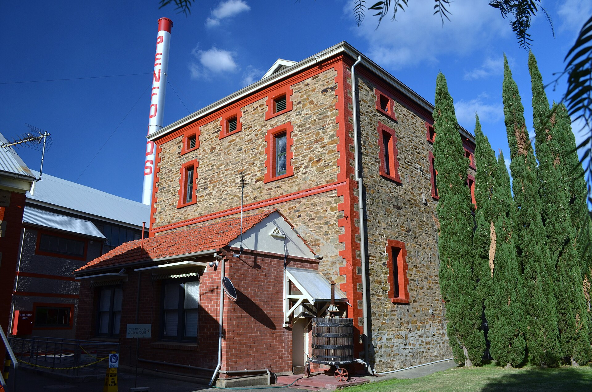

# Penfolds Magill Estate

Magill Estate is Penfolds' birthplace and the easiest wine-history site to reach in the city of Adelaide. It lies about 8 km from the centre, with vines, Grange Cottage and stone cellars still on the original ground, surrounded by housing and foothill roads. This is not a rural estate behind a fence; it is an urban single vineyard at the city's edge. In the time it takes to have a meal, you can trace the 1844 founding, the Grange experiments of the 1950s and the way Penfolds turned experiment into a product range.

Figure: Related photograph of Penfolds Magill Estate. Image: Bahnfrend, CC BY-SA 3.0, via Wikimedia Commons ([source page](https://commons.wikimedia.org/wiki/File:Penfolds_Magill_Estate,_2014(2).JPG)).

## 1844: an urban single vineyard

In 1844 Christopher and Mary Penfold planted vine cuttings brought from Europe at Magill and established Penfolds. The company began with fortified wines, clarets and Riesling, with the vineyard and cellars growing around what is now Grange Cottage; after Christopher's death in 1870, Mary took control and pushed the winery from a family operation toward one of South Australia's largest wine businesses. Walking from the cellar door to the vineyard edge today still shows the scale of the slope: modest, but large enough to carry a brand's founding myth.

"Urban single vineyard" is easy to misread. It does not mean the vines are surrounded by city blocks, nor that all Penfolds wine comes from here; it means the Magill site still produces grapes at the city's edge and is physically connected to the winery buildings, cellars and historical rooms. Keep that distinction in mind, and Magill stops being a pure house museum and Penfolds' entire output stops being attributed to this one slope.

## From Grange Cottage to the underground cellars

Grange Cottage was the Penfolds' first home, and the stone cellars were the core of early winemaking and storage. Today's visit places both inside one narrative: the founders' living space first, then the expansion of the cellars, then the tasting room. The buildings are not scenery. They explain why Magill survived urban growth: cellar, house and vineyard formed a complete production unit rather than an isolated monument.

Watch the distances during the visit. Cellar door to vineyard, and cellar to restaurant, are short walks, but each segment has a different function: the cellar door receives and sells, the cellars store and age, the restaurant returns the wine to the table. Walking all three makes the working life of the estate clearer than any timeline on a wall.

## Grange and the Bin series: how experiment became product

Penfolds' experimental tradition has a clear timeline. In 1948 Max Schubert became chief winemaker; in the 1950s he began the long-ageing Grange experiment, comparing regions, cask types and vintages inside one system. In 1959 the first Bin wine took its name from a cellar storage area, with Bin 28 starting the series; in 1960 the board told Schubert to restart Grange production officially, and the experiment became a flagship. "Experiment" here is not a one-off marketing story but a continuing product-development method.

[Shiraz](ref:shiraz) supplies the frame, and [oak ageing](ref:oak-ageing) writes time into the wine. Grange's style is not the product of a single year but of multi-region fruit selection, cask blending and long observation; the Bin series pushes that capability into more everyday price points. Read the Magill wine list with this in mind, and Grange stops being merely an expensive bottle and becomes visible as the outcome of a method.

## Cellar door, restaurant and experiences

The cellar door opens seven days, 10:00–17:00, with tours, tastings and experiences of different lengths. Published prices include AUD 60 for Magill Heritage and AUD 175 for Ultimate Penfolds; collector, signature and platinum formats require separate booking or enquiry. For a first visit, choose a tour with history and cellar access and connect the 1844, 1948 and 1959 markers; for returning visitors, focus on older vintages, experimental releases or restaurant pairings.

Magill Estate Restaurant serves fine dining, while Magill Estate Kitchen is more relaxed and suits a lunch or a glass after the tour. Restaurant and cellar door run separate bookings, so confirm both if you want both; menus, prices and times should be checked on official pages. Magill's value is not only the wine but the chance to see a complete winery inside the city, so leave time to walk and look at the buildings.

## Hours, booking and getting there

The address is 78 Penfold Road, Magill, South Australia 5072, Australia. It is about 15 minutes by car from central Adelaide; public transport reaches the area, but transfers and walking lengthen the trip, so driving is most direct, with a taxi or designated driver for the return after tasting. Follow on-site parking instructions and keep out of vine rows and cellar working areas. Coordinates should be taken from official channels; for navigation, use the address.

Book through the official experiences page, choosing date, time and party size; cancellation rules and meeting points vary by format. Weekends, holidays and the approach to vintage fill fastest, and cellar tours or restaurant seats need earlier confirmation. Cellar door hours are relatively stable, but restaurant and special experiences change; check the official page again before going, especially on public holidays.

## Common misconceptions

First, Magill is not Penfolds' only vineyard. It is the founding site and urban single vineyard, while Penfolds draws fruit from multiple regions. Second, the cellar door is not a full production-line tour; the focus is historical space, cellars and tasting, and not every winemaking stage is open. Third, Grange was not an immediate success; it was a secret experiment in the 1950s and was officially restarted only in 1960. Fourth, restaurant and cellar door are separate bookings. Fifth, Magill is not the Barossa. It sits in the Adelaide foothills and is not administratively part of the Barossa Valley, even though its grapes and history are closely tied to [Barossa](ref:barossa).

[Barossa](ref:barossa) and [Red wine](ref:red-wine) are the two useful reference points for Penfolds Magill Estate. [Barossa](ref:barossa) sets out address and space; [Red wine](ref:red-wine) brings in operating status. Read them together.

**In brief:** Penfolds' founding site in the Adelaide foothills, established in 1844 about 8 km from the city centre and one of the world's few urban single vineyards; the cellar door opens seven days 10:00–17:00 with cellar tours, tastings and restaurant experiences, and the Grange and Bin experimental tradition is clearly traced here.

## References

This page was checked against Penfolds' official Magill Estate cellar door, contact, history and booking pages, plus Wine Australia's Barossa Valley material. Page verified 2026-11-09. To place this stop in a day, see the [Barossa wine trail](ref:route); for variety and technique background, see [Shiraz](ref:shiraz), [red wine](ref:red-wine) and [oak ageing](ref:oak-ageing). Opening hours, prices and booking rules are subject to official channels.
