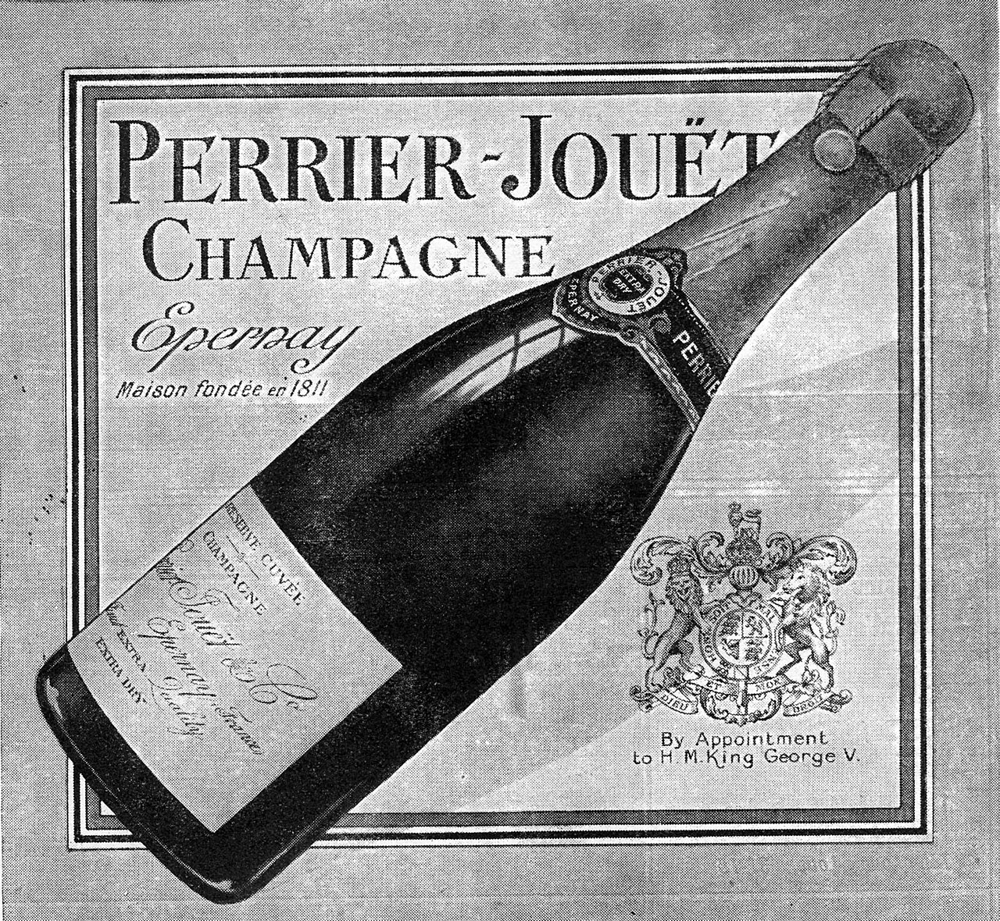
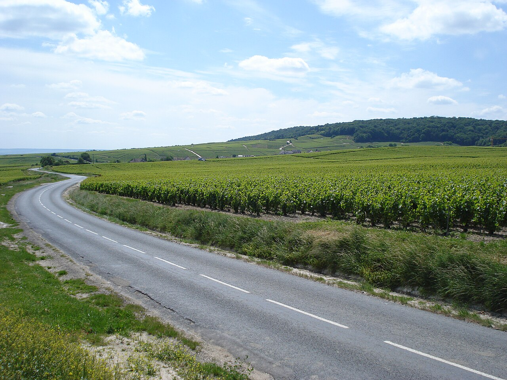

# Perrier-Jouët

Perrier-Jouët occupies two addresses on the Avenue de Champagne in Épernay: Cellier Belle Epoque at 26 Avenue de Champagne, and Maison Belle Epoque at 11 Avenue de Champagne. The first is a restaurant, Champagne bar and boutique; the second is the founding family's former home, now used for an art collection and fine dining. This is not a house built around a conventional underground cellar tour. The official pages state that some tasting experiences do not include a cellar visit, and the visit is centred on Chardonnay, Art Nouveau and the table.

Figure: Perrier-Jouët. Image: unknown (no credits), Public domain, via Wikimedia Commons ([source page](https://commons.wikimedia.org/wiki/File:Champagne_Perrier-Jou%C3%ABt-1923.jpg)).

## Place and history

Pierre-Nicolas Perrier and Rose-Adélaïde Jouët founded the house in Épernay in 1811. They married in 1810 and, the following year, combined their interests in wine, nature and art into a single brand. From the start the house made Chardonnay its signature grape, and the floral, light, delicate style associated with Perrier-Jouët owes much to that choice. The house states that Chardonnay accounts for 56% of its own vineyard, against about 30% for Champagne as a whole, which explains its leaning in blending.

In 1846 the house created Cuvée K for the British market's preference for a drier taste; the house describes it as the world's first lightly dosed Champagne in the style now called "brut," and remaining bottles are kept in the Épernay cellars alongside the 1825 vintage. In 1902 Octave Gallice asked Émile Gallé to design a bottle, and four magnums decorated with Japanese white anemones were delivered, later becoming the Belle Epoque series. In 1964 Belle Epoque became the emblem of the house; Belle Epoque Rosé followed in 1983 and Belle Epoque Blanc de Blancs in 1998; Grand Brut was launched in 1971, Blason Rosé in 1985 and Blanc de Blancs in 2017. Maison Belle Epoque reopened after restoration in 2017; in 2020 Séverine Frerson became the house's eighth cellar master and its first woman in the role; in 2021 the house began an experimental viticulture programme.

## Spaces and the list

Cellier Belle Epoque at 26 Avenue de Champagne works as an all-day restaurant, Champagne bar and boutique. It can be entered without booking and suits a glass of Champagne, a simple meal or a bottle purchase. Maison Belle Epoque at 11 Avenue de Champagne is the founders' former home. The house describes it as holding the largest private collection of French Art Nouveau in Europe, with works by Hector Guimard, Louis Majorelle, Émile Gallé and Henri de Toulouse-Lautrec, alongside contemporary commissions. The building has UNESCO World Heritage status, and visits and meals require booking; it is not a museum that can be walked into at will.

The list is built around Chardonnay: Grand Brut, Blanc de Blancs, Belle Epoque, Belle Epoque Rosé and Belle Epoque Blanc de Blancs. The anemone bottle is the most recognisable symbol of the brand, but the wines are not limited to a single floral dimension; vintage, disgorgement timing and dosage change the palate. Champagne belongs to the wider tradition of [sparkling wine](ref:sparkling-wine), and Perrier-Jouët leans towards lightness and acidity, which suits seafood, white meat and light sauces. For a single glass, Blanc de Blancs best explains the Chardonnay line; for a comparison, start with Grand Brut and then Belle Epoque, where the difference is clearer.

## How to visit or order

Perrier-Jouët offers several experiences rather than one standard cellar tour. The official "The Art of Chardonnay" is a one-hour guided tasting with two wines, booked in advance at Cellier Belle Epoque, and the house explicitly says it does not include a cellar tour. Maison Belle Epoque offers a five-course lunch or dinner by reservation, suitable for combining a visit with a meal. The all-day menu and Champagne bar at Cellier Belle Epoque do not require booking and suit a spontaneous stop, though it is still wise to confirm seats and hours at weekends and in high season.

For Perrier-Jouët, begin with the address. Then look at the current opening status, and finally ask what the place is known for. The answers point to different choices, not to a single score.

## Practical information

Address: 26 Avenue de Champagne, 51200 Épernay, France, for Cellier Belle Epoque (coordinates 49.04252, 3.96104); Maison Belle Epoque is at 11 Avenue de Champagne. The two are a short walk apart.

Transport: Épernay station is about a 10-minute walk from the avenue; Reims is about 40 minutes by train and about 30 minutes by car. There is no on-site parking, so in high season use a public car park and walk; the building offers free Wi-Fi and step-free access.

Opening hours: Cellier Belle Epoque opens from 11:30 to 20:30 from Sunday to Thursday and from 11:30 to 22:00 on Friday and Saturday, with all-day dining and the Champagne bar requiring no booking; Maison Belle Epoque serves lunch from Tuesday to Saturday and dinner from Tuesday to Thursday, all by reservation. Public holidays and special events can change this, so check the official site before travelling.

Tickets and booking: The Art of Chardonnay is a one-hour guided tasting at €95 with two cuvées, explicitly without a cellar tour, booked online; the Cellier's three-Champagne pairing menu is €130; the five-course Maison Belle Epoque experience is €390 and must be reserved. A single glass at the bar is charged from the list and needs no package. Session times, language (French or English) and available dates are set on the official booking page.

The avenue is walkable, but shade is scarce in summer and wind is strong in winter, so leave time for indoor breaks. Page checked on 2026-11-08; operating status, prices and bookings are subject to official channels.

## Etiquette and common mistakes

The first mistake is to treat Perrier-Jouët as a cellar you can wander through. Its visitor offer is based on tastings, dining and the old house, and some experiences do not include a cellar tour. Anyone who wants to go underground should choose a product explicitly labelled as a cellar tour rather than assuming all tickets are the same. The second mistake is to treat Maison Belle Epoque as a museum. It is a private house and dining space, and access and hours are controlled by booking; it does not follow museum opening patterns.

The third mistake is to recognise only the anemone bottle. The Belle Epoque bottle is distinctive, but the house's everyday style is clearer in Grand Brut and Blanc de Blancs; tasting only a limited bottle can obscure the Chardonnay line. The fourth is to treat the Art Nouveau collection as decorative background. If design history interests you, confirm when booking whether the relevant rooms can be seen, because dining and events affect the route.

During a tasting, avoid strong perfume; Champagne aromas are delicate, and scent can cover the floral and yeast notes. Do not use a flash directly on bottles or artworks. At Maison Belle Epoque, furniture and decoration are collectibles and should not be touched. If you are driving, use the spittoon or choose a non-alcoholic drink; the bubbles make it easy to underestimate the pace of alcohol. Families should check whether the restaurant suits children; the old house is not a play space.

## Around and routes

The Avenue de Champagne is Épernay's densest concentration of Champagne houses, and Perrier-Jouët can be combined with [Moët & Chandon](ref:moet-et-chandon), Mercier, Pol Roger and others on the same day. A good order is Moët's cellar tour in the morning to understand process and underground scale, lunch at Cellier Belle Epoque, then Maison Belle Epoque or a walk along the avenue in the afternoon. The reverse also works: start with the smaller, art-led Perrier-Jouët to establish a style, then go to the larger house for scale, which makes the contrast clearer.

With an overnight stay, take the train to Reims the next day for the cathedral and another group of houses, or drive into the Champagne villages and vineyards. Perrier-Jouët belongs to the [Champagne](ref:champagne) region, but the avenue is only the urban showcase; the vineyards are on the slopes and need a separate half-day. Seeing Perrier-Jouët alongside art and design history makes it easier to understand why the anemone, the table and the house are told as one story, a thread that also connects to the wider topic of [wine and painting](ref:wine-and-painting).

## See also

- [Champagne](ref:champagne): the region's regulations, villages and hillsides.
- [Sparkling wine](ref:sparkling-wine): how Champagne differs from other sparkling wines.
- [Moët & Chandon](ref:moet-et-chandon): another Champagne visit in the same town.
- [Pernod Ricard](ref:pernod-ricard): the group behind the house.
- [Wine and painting](ref:wine-and-painting): labels, art and consumer culture.

## Related images

Image: Vineyard at Trépail on the Montagne de Reims, a typical Champagne landscape of chalk soil and slope aspect. Credit: Havang(nl), CC0, via Wikimedia Commons ([source page](https://commons.wikimedia.org/wiki/File:Tr%C3%A9pail,_vignes_au_pied_de_la_Montagne_de_Reims.JPG)). Related image for Perrier-Jouët.
