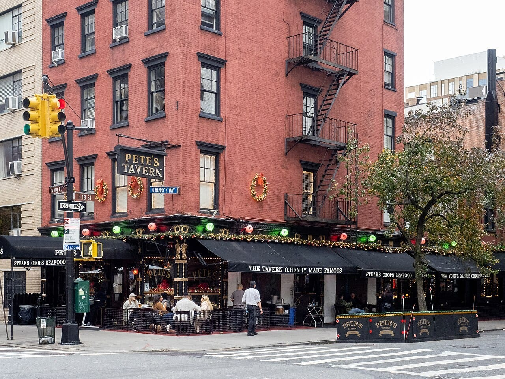

# Pete's Tavern

Pete's Tavern stands at the corner of East 18th Street and Irving Place in New York, at 129 East 18th Street, in the Gramercy Park area. It calls itself the city's oldest continuously operating restaurant and bar: the building went up in 1851, and the first drinking establishment on its ground floor opened in 1864. Inside, a long rosewood bar, a pressed tin ceiling and old tiled floors explain the place's survival better than any plaque.

Figure: Pete's Tavern. Photograph: Pete's Tavern (51708610272). Credit: ajay_suresh, CC BY 2.0, via Wikimedia Commons ([source](https://commons.wikimedia.org/w/index.php?curid=112875512)).

## Place and history

The building was originally the Portman Hotel, and in 1864 a "grocery and grog store" opened on the ground floor, selling both groceries and drink; this is the starting point the house uses. In 1899 Tom and John Healy bought it and renamed it Healy's Café. In 1922 Peter D'Belles took over, and the name Pete's Tavern stuck. The name changed three times, but the layout stayed recognisably that of a tavern: bar, booths, back bar and rooms above.

The house puts O. Henry near the front of its story. William Sydney Porter, a neighbourhood regular, is said to have written "The Gift of the Magi" in the second booth in 1903; he lived at 55 Irving Place from 1903 to 1907 and mentioned Healy's in the short story "The Lost Blend". New York City's tourism office gives 1905 and the first booth, which does not match the house account. Treat the detail as tavern lore rather than a precise literary record.

During Prohibition the storefront was disguised as a florist, with flowers outside; regulars came through a side door, gave a password and were led to a dummy refrigerator door to drink. The hinges of that door are still there, according to the house. Prohibition was repealed on 5 December 1933 and the florist signs came down. The "oldest" claim depends on definition: by continuous operation at the same address the house has a strong case; by building age or brand continuity, New York has other contenders. Reading it as "an old tavern that still works" is closer to the experience than arguing about a ranking.

## The room and the list

The main room is built around a rosewood bar about forty feet long; the back bar, tin ceiling, tiled floor, booths and cabinets above them are all described by the house as original. Two dining rooms keep their old layout, with walls covered in photographs of locals, celebrities and the bar's own past. Upstairs there is a party room with hardwood floors, brick walls and its own bar. The outdoor café is one of the older al fresco dining areas in the city, dated by the house to the early 1950s.

The drinks list is not built around complex cocktails. It is a full tavern bar: a house beer called 1864 House Ale, draught options such as Guinness Stout, a long whisky and bourbon list, and classic cocktails. The official spirits list runs from Buffalo Trace and Eagle Rare to different ages of Pappy Van Winkle, with prices spread wide; the bar serves everyday drinkers and people willing to pay for rare bottles. Food is American and, according to the city's tourism office, also Italian; the menu changes with the season. For a first visit, a glass of 1864 House Ale explains the place's identity most directly; for spirits, ask the server to recommend within your budget.

## How to drink

Decide first where you want to sit: the bar for drinking and people-watching, a booth or dining room for a meal, the outdoor café in good weather. To feel the history, walk the length of the bar and look at the back bar rather than hunting for the "O. Henry booth"; that table is usually occupied, and the house does not keep it empty for legend.

Start with 1864 House Ale and a bar snack; if you want a full meal, the American and Italian dishes show the restaurant side better than a single drink. The whisky list is long, so tell the server your budget and direction — bourbon, single malt or Irish — instead of picking by age alone. Cocktails are classic rather than experimental, a good second drink; do not ask for molecular theatre.

The best time is a weekday afternoon into early evening, when light falls on the old wood and the staff have time to talk. Weekend nights and holidays are much louder, and anyone wanting a quiet meal should avoid them. The official page lists a Monday to Friday 16:00–18:00 happy hour; the drinks and prices on offer should be checked on site.

## Practical information

The address is 129 East 18th Street, New York, NY 10003, USA, on the corner of East 18th Street and Irving Place beside Gramercy Park; the coordinates are 40.73653, -73.98672. The 4, 5, 6, L, N, Q, R and W trains stop at 14th Street–Union Square, about a 4–6 minute walk; 23rd Street is also close.

Hours are commonly recorded as 12:00 to 02:00 daily, with the kitchen closing at about 23:00 Sunday to Thursday and at midnight on Friday and Saturday. Sources differ slightly on the late end (an older Time Out page gives an 11:00 opening), and the official site did not publish a full schedule on the check date, so confirm exact times and holiday arrangements on official channels. `operating_status` is `verified`, meaning the official site and booking channel were live on 2026-11-08 with no closure notice. There is no cover charge. Full meals can be booked through the official reservation link (Resy), with dining-room slots from about 12:00 to 22:45; the Bar Room and heated patio are walk-in only. Guests under 21 may sit at restaurant tables but not in the bar area, so say so when booking. The telephone is 212-473-7676, and there is no car park, so the subway is the practical choice. Prices are mid-range for Manhattan, with the city's tourism office giving it two dollar signs; rare whisky is the exception. There is no hard dress code; casual is right. The historic building's entrance and passage may not suit everyone, so visitors with mobility needs should call ahead. Page verified 2026-11-08; opening status, prices and reservations are subject to official channels.

## Etiquette and common mistakes

First, treat this as a working restaurant and bar, not a museum. Seats at the bar belong to people who are drinking, so do not hold one for a photo of the old wood; do not stand by a booth waiting for a "clean shot" while others are eating. Second, do not present "New York's oldest" as settled fact. The house has a case, but "oldest" depends on what is counted, and scholars and the press have not agreed on one answer; saying so is more honest than announcing a winner.

Third, the O. Henry story is house narrative: the year and booth number differ between sources, so listen rather than correct the next table. Fourth, the Prohibition florist story is also inherited lore, vivid but without independent archival proof; treat it as tavern memory, not an exam answer. Fifth, tip according to American custom, but check the bill first because large parties may already have service added. Finally, do not expect a quiet, polished or experimental cocktail experience; the sound and crowd are part of a New York tavern.

## Around and routes

From Union Square station, look at the square and its bookshops and subway entrances, then walk one block north along Irving Place. Gramercy Park itself is private, open only to residents with keys, though visitors can look through the railings; Theodore Roosevelt Birthplace is two blocks east, and the Flatiron Building and Madison Square Park are about ten minutes south. To link New York's old taverns, continue on foot or by subway to McSorley's Old Ale House in the East Village, or to the White Horse Tavern in the West Village. Each "old" is different: Pete's is a restaurant and tavern combined, McSorley's turned an ale-only list into a system, and the White Horse carries a literary myth.

## See also

Pete's Tavern is best compared with McSorley's Old Ale House: both claim deep history, but one survives on a full restaurant and a long drinks list while the other survives on a very narrow list and a sense of ritual. For New York's literary tavern narrative, read the White Horse Tavern. Putting all three into one trip explains more about how history is operated in this city than checking off any one of them.

## See also

- [New York historic pubs: East Village to Gramercy](ref:new-york-historic-pubs)
- [Employees Only](ref:employees-only)
- [McSorley’s Old Ale House](ref:mcsorleys-old-ale-house)

Further reading: [A Ginjinha](ref:c-extra-1), [À la Mort Subite](ref:c-extra-2).

## Related images

