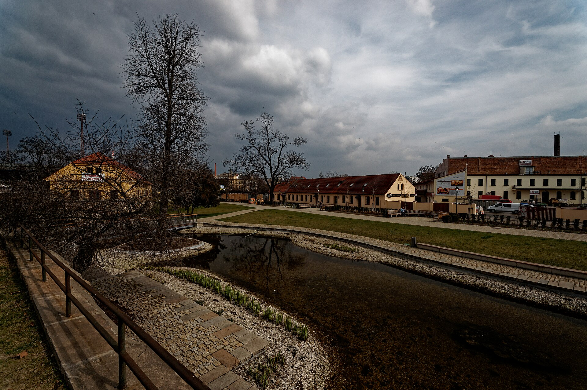

# Pilsner Urquell Brewery: Where the Golden Lager Was Born

The Pilsner Urquell brewery stands at U Prazdroje 7 in Plzeň, western Czechia. It is not a preserved ruin but a working site: tours pass the historic brewhouse, modern equipment, the bottling line and underground cellars, ending with unfiltered beer. The point is less age than survival: a nineteenth-century method became the template for pale lager worldwide.

Figure: Related photograph of Pilsner Urquell Brewery: Where the Golden Lager Was Born. Image: Txllxt TxllxT, CC BY-SA 4.0, via Wikimedia Commons ([source page](https://commons.wikimedia.org/wiki/File:Plze%C5%88_-_Sady_5._kv%C4%9Btna_-_View_East_over_Ml%C3%BDnsk%C3%A1_strouha_towards_Plze%C5%88sk%C3%BD_Prazdroj_(Pilsner_Urquell_Brewery).jpg)).

## A city and a style

Plzeň lies about 90 kilometres west of Prague and received city rights in 1295. Brewing here is tied to water: the local supply is soft, low in minerals and suited to a pale, bottom-fermented beer with clear bitterness. In the early nineteenth century Bohemian beer was still mostly top-fermented, darker and inconsistent, so the citizens' brewery brought in a Bavarian brewer. That decision produced the story that follows.

Brewery and city shaped each other. The brewery used local water, labour and railway, turning Plzeň into a beer city; the city's name then became a style name. The old town and the working brewery are still different things.

## What the 1842 brew changed

On 5 October 1842, Josef Groll brewed the first golden bottom-fermented beer in Plzeň. The combination was pale malt, Saaz hops, soft water, cool fermentation and cold maturation. Malt supplied clean sweetness and colour, Saaz gave a fine herbal bitterness, soft water made it taste clear, and cool fermentation kept the body clean. The recipe became known as Pilsner and was copied everywhere.

Style and brand must be separated. Pilsner is a pale lager style brewed worldwide; Pilsner Urquell is this brewery's brand, meaning "the original source of Pilsen". The brewery states it brews only in Plzeň, which fixes this brand's production site, not the style.

## Three layers of time in the brewery

The tour starts in the historic brewhouse, where copper kettles, wooden fermenters and old cooling equipment survive at a scale unlike today's plant. It then moves to modern mashing and fermentation, where pipes, tanks and control systems dominate, and finally to the bottling hall. Three layers of time overlap on one site.

The brewery still uses triple decoction: part of the mash is separated, heated and boiled, then returned, three times. It costs energy and time but brings deeper malt flavour and fuller body. Official material calls it part of "parallel brewing"; the parameters are production details, and the reason for the step matters more than the numbers.

The guided tour lasts about 100 minutes, with language slots confirmed at booking. The site is large and part of the route uses a brewery bus; whether bottling is open depends on the day's production. Visitors stay with the guide rather than entering the works.

## The original wort in the cellars

The underground cellars are the most persuasive part. Sandstone vaults, cold humid air and rows of oak barrels create a space unlike the halls above. A small amount of barrel maturation is kept for display and tasting; visitors usually taste unfiltered, unpasteurised beer from the barrel, with thick foam, fresh aroma and a direct balance of bitterness and malt sweetness.

Unfiltered is not automatically better, only different: yeast and particles give fuller texture and shorter shelf life, while filtration and pasteurisation buy stability. The cellars are cold, so bring a jacket; the sample is small, and alcohol and low temperature affect judgement.

## Pilsner style and protected names

Colour, bitterness and original gravity are the usual measures of Pilsner. Colour runs from pale to deep gold, bitterness is expressed in [IBU](ref:ibu) and varies by brewery and batch, and original gravity shapes body and alcohol potential but cannot judge bitterness alone. The core is the combination of pale malt, Saaz hops, soft water, bottom fermentation and cold maturation.

Regulation adds another layer: the EU has protected "Czech Beer / České pivo" as a Protected Geographical Indication since 2008, with rules on origin, ingredients and methods. It protects the name "Czech Beer", not a monopoly on Pilsner. Read [Pilsner](ref:pilsner), [lager](ref:lager) and [Czechia](ref:czechia) together to keep style, brand and origin apart; [malting](ref:malting) also shapes whether the malt can support a pale but structured beer.

The Pilsner Urquell brewery in Plzeň is the home of the original pale lager and a working brewery with visitor tours. The tour covers the brewhouse, the cellars and the cooperage, and explains the local soft water, Saaz hops and bottom-fermenting yeast. “Pilsner” is a style name with a protected origin, while this site is a specific producer. A brewery visit is not proof that every pilsner is made the same way.

## Before you go

The address is U Prazdroje 7, 301 00 Plzeň. Trains from Prague take about an hour to the main station, from where the brewery is a walk or short bus ride. Book through Prazdroj Visit and book ahead at weekends and in high season; English tours are limited, and times, prices and languages are confirmed online. Production can close parts of the route.

Afterwards, eat at the brewery restaurant or return to the centre to compare pubs. To link Pilsner style with Czech pub culture, [U Fleku](ref:u-fleku) in Prague is a useful contrast: a brewpub there, large-scale production and the source of the style here. Wear closed shoes, stay with the guide, do not touch equipment, and do not drive after tasting. Opening status and tickets follow official channels; page verified 2026-11-08.

**At a glance:** The Pilsner Urquell brewery in Plzeň has brewed the first golden lager in 1842 under Josef Groll and still uses triple decoction, soft water and Saaz hops; tours enter the historic brewhouse and cellars and end with unfiltered beer. 

Pilsner Urquell Brewery is best read by starting with the address, moving to the current opening status, and ending with what the place is known for.

It is tempting to treat Pilsner as Urquell Brewery: Where the Golden Lager Was Born a brand or a region. Its identity and use are separate questions.

**Key facts.**

| Item | Detail |
| --- | --- |
| In one line | The Pilsner Urquell brewery in Plzeň has brewed the first golden lager in 1842 under Josef Groll and still uses triple decoction, soft water and Saaz hops; tours enter the historic brewhouse and cellars and end with unfi… |
| Address | U Prazdroje 7, 301 00 Plzeň, Czechia |
| City and country | Plzeň / Czechia |
| Status | verified open |
| Official site | pilsnerurquell.com |

**Sources and limits.** The key claims about Pilsner Urquell Brewery: Where the Golden Lager Was Born are checked against the following sources: Plzeňský Prazdroj (Used to check the U Prazdroje 7 address, tour booking and visitor programmes), Czech Tourism. For current products, addresses or opening status, use pilsnerurquell.com. Prices, batches and status change; the body is project-written and does not reproduce source text.
