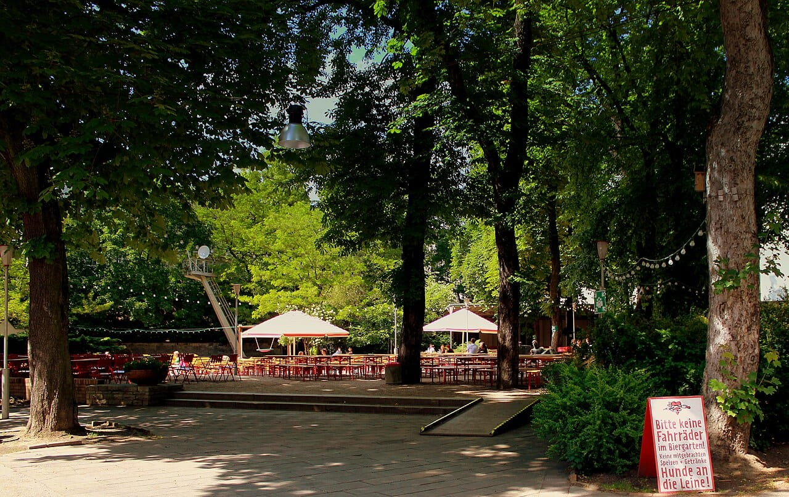
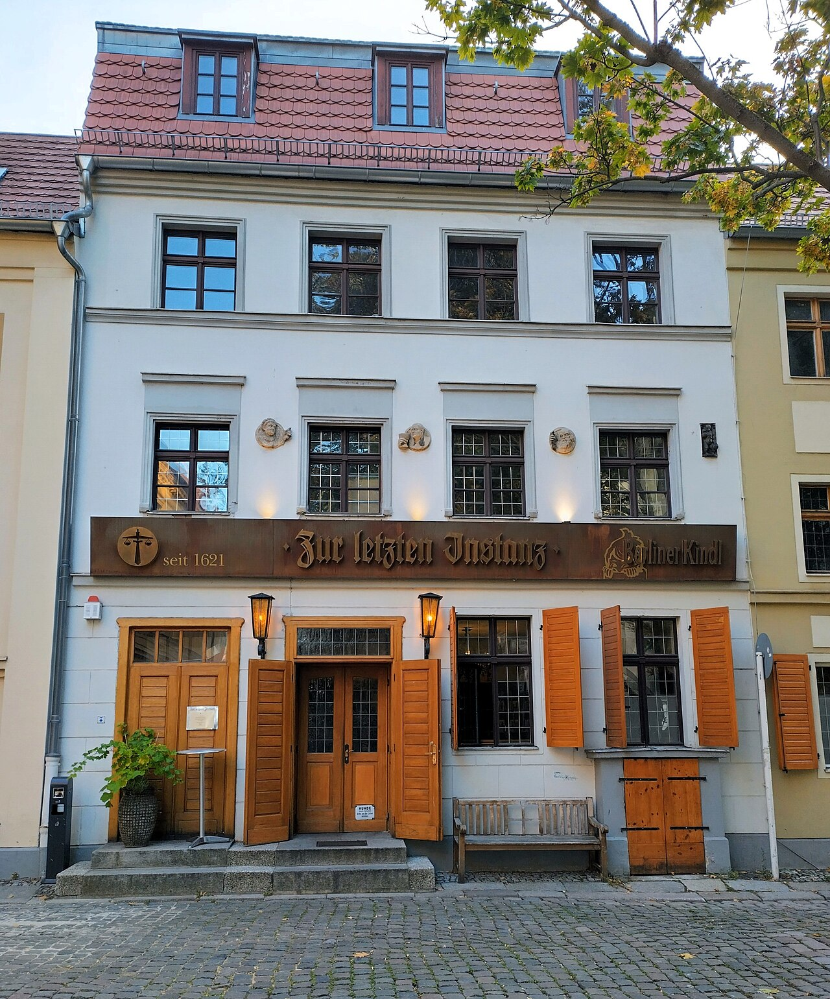

# Prater Garten

From U2 Eberswalder Straße, walk two minutes along Kastanienallee and an old Berlin Rundbogen building appears, red “PRATER” letters on its façade. Behind the gateway is not another street but a whole courtyard shaded by chestnut trees: long wooden tables, red-and-white parasols, gravel, and the clatter of beer glasses. It is minutes from Mauerpark and the cafés of Kastanienallee, yet feels like a piece of countryside the city forgot to build over. This is the everyday life of Berlin’s oldest beer garden.

Figure: The chestnut shade and long tables of Prater Garten in Prenzlauer Berg. Image: calflier001, CC BY-SA 2.0, via Wikimedia Commons ([source page](https://commons.wikimedia.org/wiki/File:PRATERGARTEN_BIER_GARTEN_NEAR_TO_ELBERWALDER_STRASSE_U_BAHN_STATION_BERLIN_GERMANY_JUNE_2013_(9058790131).jpg)).

## Location and history

Prater Garten’s official starting date is 1837; Monumente’s heritage research says it took shape “around 1830.” The two are not contradictory: in the 1830s the area still lay outside Berlin’s walls, and a tavern first offered simple beer and coffee; 1837 is the documented operating point. In 1852, the Kalbo family took over and expanded it into an entertainment venue. In 1856/1857, a two-storey building with a ballroom and event hall rose along the street—the structure behind today’s red “PRATER” façade. In 1867, the owner named it “Prater” after Vienna’s Prater amusement park, not because of a direct Viennese connection but because “Prater” had become shorthand for “fun, drinking, and promenading.”

The twentieth century layered functions onto the site: in 1871 the General German Workers’ Association held its founding meeting here; Rosa Luxemburg and August Bebel spoke in the Prater-Saal; an open-air stage followed in 1905; from 1949 it served as a DEFA cinema; it closed in 1991 and the beer garden reopened in 1996. Since 2017 the building has been under extensive restoration, and the Volksbühne uses it as a second stage. Today Prater is a composite of beer garden, restaurant, and theatre: the courtyard is everyday, the building is monumental, and both share one gate.

## Architecture and space

The core is the courtyard: tall chestnut trees, gravel, rows of long wooden tables, and red parasols. Tables have no cloths, chairs are benches, guests find their own seats and carry their own beer, and sharing with strangers is normal. At the edge of the courtyard are the order and pickup points, with two queues at peak times; the indoor restaurant is a different rhythm of dark wood, old pendant lights, Berlin food, and table service. The red brick, round arches, and “PRATER” letters are the easiest landmark; the gateway separates the street from the courtyard, and walking through feels like changing cities.

The system is “find a table, then get beer.” At peak times do not stand in the aisle waiting for friends or reserve a whole bench with a bag; sharing is the default. For quiet, sit at the courtyard edge or in the restaurant; for Berlin’s summer public life, sit at a central table and share a jug of water, a basket of bread, and an accidental conversation.

## The drinks

Prater’s list is Berlin and German beer: Pils, Helles, Weizen, Radler, and seasonal brews, plus soft drinks, coffee, and simple cocktails. Beer comes in 0.5L or 1L measures; Pils and Radler are the summer defaults. Food is Berlin pub fare: pretzels, sausages, sauerkraut, potato salad, roast chicken, meatballs, and seasonal dishes; asparagus season brings a dedicated Spargel menu. It is not a fine-dining restaurant but a beer-garden kitchen for drinking and eating.

For a serious beer, order a Pils with a pretzel or sausage; for something lighter, a Radler or Weizen suits the afternoon. Berlin summer sun is strong, so drink the beer cold; under the chestnuts the temperature drops a few degrees and the beer holds better. Restaurant portions are large; one main plus one small dish usually feeds two. Prices are mid-range for Berlin, cheaper than central tourist restaurants.

## How to drink

The best time is a dry day from April to September, between 15:00 and early evening. Weekday afternoons are quieter; Saturdays and Sundays fill from midday. Rain or cold closes the garden or leaves only the restaurant. The official site says the beer garden opens daily at 12:00 in good weather, while the restaurant runs Monday–Saturday from 17:00 and Sunday from 12:00; check the day’s notice for seasonal changes. For an empty shot, arrive within half an hour of opening; for atmosphere, come after 18:00.

Find a table, note the number if there is one, then order. Some areas are pay-first, others settle at the table; ask if unsure. Return empty glasses to the designated crates and do not take them away. The courtyard tap is for washing hands, not for rinsing glasses or pouring beer. Families and dogs are common; if noise is not your thing, sit in the restaurant.

## Practical information

- Address: Kastanienallee 7-9, 10435 Berlin.
- Hours: beer garden daily from 12:00 in good weather, April–September; restaurant Monday–Saturday from 17:00, Sunday from 12:00. Winter and rain follow the official notice.
- Transport: U2 Eberswalder Straße, 2 minutes on foot; trams M1 and M10 stop at Eberswalder Straße.
- Reservations: the beer garden is walk-in; the restaurant takes phone bookings, and groups should call ahead.
- Prices: beer and simple food are mid-range for Berlin; restaurant mains are higher.
- Payment: bring cash or an EC card; peak-season networks can be slow.
- Accessibility: the courtyard is gravel, difficult for wheelchairs and strollers; the restaurant entrance has steps, so call ahead.

## Etiquette and common misconceptions

First, do not confuse Prater Garten with Vienna’s Prater amusement park; the Berlin name comes from Vienna, but the place is a Prenzlauer Berg beer garden. Second, do not assume every building dates to 1837; the street-front restaurant is 1856/1857, and the courtyard is older. Third, do not reserve a whole bench with bags at peak times; sharing is the rule. Fourth, do not leave glasses on the table and walk away; there are designated return crates. Fifth, do not expect table service in every corner of the courtyard; peak areas are often self-service. Sixth, do not push large luggage or strollers through the gravel at the busiest weekend hour; the gateway is slow.

## Nearby and routes

North of Prater are Mauerpark’s Sunday flea market and open-air karaoke; south are the cafés and shops of Kastanienallee; west are Arkonaplatz and Weinbergspark. A good sequence is: Mauerpark Sunday market, lunch at Prater, coffee on Kastanienallee, sunset in Weinbergspark. For a Berlin beer route, start at [Zur letzten Instanz](ref:instanz) for traditional Berlin food, then Prater for a Pils; Munich’s [Hofbräuhaus](ref:hofbrauhaus) and [Augustiner-Bräu](ref:augustiner) are another “grand beer hall” tradition, Bamberg’s [Schlenkerla](ref:schlenkerla) represents smoked beer, and Bruges’s [De Halve Maan](ref:halve-maan) is a brewery-plus-tavern model.

## Further reading and see also

- Prater Garten official home: <https://pratergarten.de/>, for the address, seasonal/weather rules, and restaurant hours.
- Monumente Online’s Prater article: <https://www.monumente-online.de/de/ausgaben/2024/3/Prater.php>, for the “around 1830” origin, 1856 building, 1871 workers’ association, 1949 DEFA, 1996 reopening, and 2017 restoration.
- Top10 Berlin’s Prater page: <https://www.top10berlin.de/de/cat/essen-267/spargelessen-3104/prater-gaststatte>, for current dining and the asparagus menu.
- Berlin.de’s Prater Garten page: <https://www.berlin.de/restaurants/biergarten/9241029-3621819-prater-garten.html>, for “Berlin’s oldest beer garden”, the chestnut tables and the address.
- The nearby `place:zur-letzten-instanz` is an old Berlin tavern; `place:hofbrauhaus`, `place:augustiner-braeu`, `place:schlenkerla`, and `place:de-halve-maan` represent other German/Belgian beer cultures.
- Related entries: [Zur letzten Instanz](ref:instanz), [Hofbräuhaus](ref:hofbrauhaus), [Augustiner-Bräu](ref:augustiner), [Schlenkerla](ref:schlenkerla), [De Halve Maan](ref:halve-maan)

## Related images

Image: Zur letzten Instanz in Berlin. Credit: Julia Roessing, CC0, via Wikimedia Commons ([source page](https://commons.wikimedia.org/wiki/File:Zur_letzten_Instanz_Restaurant_Berlin_2026-09-29.jpg)). Related image for Prater Garten.
