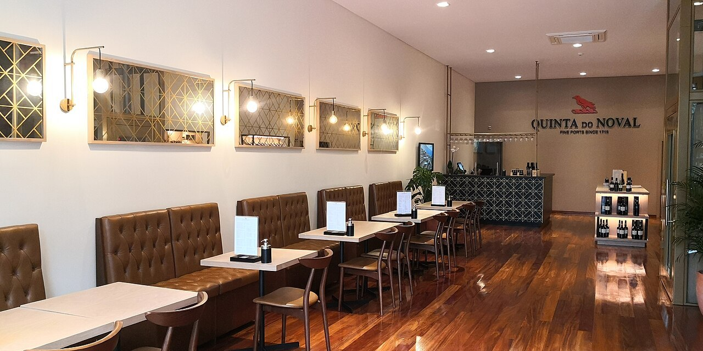

# Quinta do Noval

Quinta do Noval stands at Vale de Mendiz near Pinhão in Portugal's Douro Valley, at 5085-110 Pinhão. It is a Port house named after its vineyard, which it calls the only historic Port shipper to do so. The name appears in land records in 1715, but the estate people discuss today is largely the post-1894 rebuilding: schist terraces, foot treading in stone lagares, long cask ageing, and a small ungrafted plot called Nacional.

Figure: Quinta do Noval. Photograph: Quinta do Noval wine shop 1. Credit: sanjorgepinho, CC BY-SA 4.0, via Wikimedia Commons ([source](https://commons.wikimedia.org/w/index.php?curid=94306217)).

## A valley above Pinhão

From Pinhão the road climbs through vineyards laid out in schist terraces; Vale de Mendiz sits in this valley. Douro summers are hot and dry, schist holds little water, and old roots must search the rock, so yields are low and fruit concentrated. The old house, winemaking room, lagares and ageing cellar remain a working estate, not a visitor centre.

Take the train from Porto to Pinhão, then a taxi or transfer; by car the lanes are narrow and winding. There is no published walk-in slot, so the gate and meeting point come with the booking. The estate publishes no citable coordinates, so this entry leaves latitude and longitude empty; use official channels.

## 1715 and 1894: two timelines

1715 is the first year the name appears in land records. José Maria Rebello Valente replanted old vines and built the house and cellar, but phylloxera then destroyed the Douro vineyards. In 1894 the Porto shipper António José da Silva bought Noval while it was still marked by phylloxera, replanted and revived it; after his death his son-in-law Luiz Vasconcelos Porto continued the investment. Nacional was first produced in 1923.

In 1967 a fire in the Vila Nova de Gaia cellars destroyed archives and part of the lodges, and the Port stock moved back to the Douro. In 1993 the Van Zeller family sold to AXA Millésimes with Christian Seely as managing director, accelerating replanting and renovation.

## Nacional, the ungrafted plot

Nacional is not a separate winery but a plot at the heart of the Noval vineyard, planted with ungrafted old vines of local varieties. It is made like the rest: foot trodden in stone lagares, then aged in wood. Christian Seely has said the difference lies in the grapes and the place, not in any special technique.

In a declared year Nacional fills 200 to 250 cases; Noval Vintage in the same year is about 1,200 to 5,000 cases, and Vintage is only around a tenth of production in a declaration year. Since 1994 the house has declared Nacional only when its quality is indisputable. In 1996 Nacional was declared when the rest of the estate was not; in 2007 the reverse happened.

Ungrafted means the vine grows on its own roots rather than an American rootstock. Phylloxera pressure makes such vines rare and riskier to farm; it is not automatically better, but old vines and low yields can give more concentrated aromatics.

## Stone lagares and the making of Port

Port's sweetness comes from stopping fermentation, not from adding sugar. Grapes ferment with skins in stone lagares; when enough sugar has become alcohol, grape spirit is added, the yeast dies and fermentation stops. The fortified wine is usually 19% to 22% alcohol, and sweetness depends on when fermentation was halted.

Top Noval wines are still foot trodden: workers walk through the granite trough, extracting colour and tannin gently without crushing stalks and seeds too hard. After the 1967 fire the house aged its stocks in the Douro. Casks are never full, so the wine oxidises slowly and some evaporates as the angels' share.

Cask time defines the style: Vintage spends about two years in wood before bottling, LBV four to six years, and Colheita at least seven.

## Reading the range: Vintage, LBV, Colheita

Noval's range can be read on two axes: whether a year is declared, and how the wine is aged. Quinta do Noval Vintage Port is made only in declared years, deep and tannic and built for the long term; Nacional Vintage is the small-plot version, rarer, dearer and often more closed when young. LBV Unfiltered keeps more colour and tannin and throws sediment. Colheita is one harvest, long cask ageing, ready to drink.

Since 2004 the estate has also made unfortified Douro DOC wines: Cedro do Noval, a varietal Touriga Nacional, and Vinhas do Passadouro from a plot acquired in 2019.

Serve Vintage at about 16 to 18 °C, LBV and Colheita at 14 to 16 °C. Vintage needs decanting.

## Booking, seasons and practicalities

Every visit must be booked in advance. Telephone +351 22 377 0270 or email noval@quintadonoval.pt; the contact address is the Gaia office, while visits take place at Vale de Mendiz. State the number of people, language and whether you drive; content, length and price depend on the party and season, and no fixed public tariff is published.

Harvest usually runs from September to October, when slots are scarce and roads busier; ask earlier to see the lagares working.

Douro roads are narrow: do not drive after tasting. Trains from Pinhão are infrequent, so check times. `operating_status: verified` means the estate is trading, not that walk-ins are welcome.

Compare [Quinta do Crasto](ref:crasto) downstream and read the [Douro](ref:douro) and [Porto](ref:porto) entries; on process, see [Port](ref:port), [fortification](ref:fortification) and [angels' share](ref:angels).

**Short definition:** A historic Port estate at Vale de Mendiz near Pinhão in Portugal's Douro Valley, recorded in land registers in 1715, rebuilt from 1894 by António José da Silva and known for the ungrafted Nacional plot and foot treading in stone lagares; visits are by reservation.

Begin with the address, move on to the current opening status, and finish with what the place is known for. That order keeps the reading of Quinta do Noval practical.

Read [Quinta do Crasto](ref:crasto) for the address and space side of Quinta do Noval, and [Porto](ref:porto) for the operating status side. Together they locate it.

A common mistake is to treat Quinta do Noval as a brand or a region. Start with what it is, then check where it belongs. If they conflict, trust the more specific source.

**Key facts.**

| Item | Detail |
| --- | --- |
| In one line | A historic Port estate at Vale de Mendiz near Pinhão in Portugal's Douro Valley, recorded in land registers in 1715, rebuilt from 1894 by António José da Silva and known for the ungrafted Nacional plot and foot treading … |
| Address | Quinta do Noval, Vale de Mendiz, 5085-110 Pinhão, Portugal |
| City and country | Pinhão / Portugal |
| Status | verified open |
| Official site | quintadonoval.com |

**Sources and limits.** The key claims about Quinta do Noval are checked against the following sources: Quinta do Noval Vinhos, S.A., Instituto dos Vinhos do Douro e Porto. For current products, addresses or opening status, use quintadonoval.com. Prices, batches and status change; the body is project-written and does not reproduce source text.

## Related images

Image: Category image for Quinta do Crasto. Credit: Vitor Oliveira from Torres Vedras, PORTUGAL, CC BY-SA 2.0, via Wikimedia Commons ([source page](https://commons.wikimedia.org/wiki/File:Rio_Douro_-_Portugal_(32615481975)_(cropped).jpg)). Related image for Quinta do Noval.
