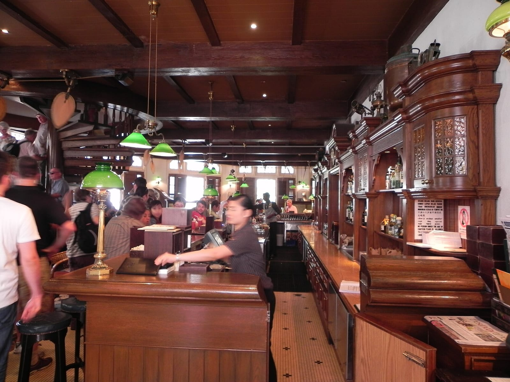

# Raffles Long Bar

Long Bar sits on the second floor of Raffles Arcade, next to Raffles Hotel Singapore rather than inside the hotel lobby. The hotel opened in 1887; the bar is famous for the Singapore Sling, first mixed there in 1915. Its reputation is now so large that queues, photographs and the peanut-shell ritual can overshadow the drink itself. Understanding how the bar acquired its present form is more useful than memorising a recipe.

Figure: Related photograph of Raffles Long Bar. Image: Hajotthu, CC BY 3.0, via Wikimedia Commons ([source page](https://commons.wikimedia.org/wiki/File:Raffles_Hotel_Long_Bar_A.JPG)).

> **Quick verdict**
> **In one line:** This entry helps you decide whether Raffles Long Bar deserves a detour, and what to check before visiting.
>
> - **Best for:** Anyone planning a visit to Raffles Long Bar who needs to decide whether it deserves a half-day or a full day.
> - **Not for:** If you want only want a must-visit list and will not check booking, transport or opening hours.
> - **Check first:**
>   - Raffles Hotel is one of Singapore's colonial-era landmarks, and Long Bar began as its social bar.
>   - The room is built around a long counter, with dark wood, aged textures and tropical plantation motifs wrapping the space.

## Place and history

Raffles Hotel is one of Singapore's colonial-era landmarks, and Long Bar began as its social bar. The official account places it in Cad's Alley in the early 1900s, when it was known as "the rendezvous of planters", with tables facing Bras Basah Road. At the time, women were not expected to drink alcohol in public and were usually served tea or fruit juice instead.

In 1915 the Raffles bartender Ngiam Tong Boon combined gin, pineapple juice, lime juice, curaçao, Bénédictine, grenadine and cherry liqueur into a pink, fruit-juice-like long drink. The disguise made it socially acceptable for women, and the formula became an instant success. That social context explains why the Singapore Sling is sweet, long and relatively low in alcohol rather than a spirit-forward modern cocktail.

The bar now occupies a two-storey space in Raffles Arcade, decorated in a style inspired by Malayan plantation life in the 1920s. It is still operated by Raffles Hotel, but the move from the hotel's main building to the adjoining arcade matters to visitors: the entrance is not the hotel lobby.

## Space and drinks

The room is built around a long counter, with dark wood, aged textures and tropical plantation motifs wrapping the space. Two levels give it the feel of a staged colonial interior rather than a quiet hotel lounge. Seating is dense, tourists dominate at most hours, and places near the bar or the windows are the most sought after.

The menu revolves around the Singapore Sling, with a non-alcoholic Singapore Sling Zero alongside. The official page says today's Sling uses locally distilled Brass Lion Singapura Gin, with orange peel, mandarin peel and warm spice rounding out the flavour. This is a contemporary version, not the 1915 formula. Classic cocktails and bar snacks are also available; the exact list changes.

Peanuts are the other exhibit. The official account dates the shell-on-the-floor habit to the 1900s, when rubber and plantation owners from Malaya gathered at the bar at weekends. Peanuts were offered, the shells were brushed onto the ground, and the casual habit became a tradition. The bar now explicitly invites guests to do the same — possibly the only place in Singapore where littering is encouraged.

Prices sit at the high end of the Singapore hotel-bar market. The exact price of a Singapore Sling changes with the menu, so this entry does not hard-code a figure; budget for a hotel-bar spend rather than a neighbourhood-bar one. Page verified 2026-11-08.

## How to drink

Long Bar is walk-ins only. There are no reservations. The official page suggests arriving at 11:00–11:30, during the 14:00–15:30 lull, or after 21:00 on weekdays. When tour groups and hotel guests overlap in the early evening, waits grow quickly. If your schedule is tight, make this the first stop of the day rather than the last.

For a first visit, order the standard Singapore Sling and decide whether the sweet, long, low-alcohol style suits you. If it is too sweet, switch to the Sling Zero or a sharper, shorter gin cocktail; do not force down a second drink just because you have travelled there. Peanuts are a snack, not a meal, and two long drinks on an empty stomach can catch up with you.

There are no complicated rules of consumption: sit, sip slowly, do not take the glass away, and do not sweep shells outside the bar or into the hotel courtyard. The littering permission applies only inside the bar. On 27 June, Singapore Sling Day, the official page says the first 100 guests who bring a whole pineapple can exchange it for a complimentary Sling; details can change from year to year, so check the current announcement.

Smart casual is recommended. Singapore is hot, but the hotel and bar are strongly air-conditioned, so a light layer is more practical than a vest and flip-flops. Parts of the hotel have basic dress expectations, and dressing too casually may limit where you can go.

## Practical information

The address is #02-01 Raffles Arcade, 328 North Bridge Road, Singapore 188719. The North Bridge Road entrance is more direct than walking through the hotel's main entrance at 1 Beach Road; the two are close, but do not assume the bar is visible from the hotel lobby. The bar's telephone number is +65 6412 1816.

Official hours are Sunday to Wednesday 11:00–22:30 (last seating) and Thursday to Saturday 11:00–23:30 (last seating); holidays, private events and temporary changes still override this (rechecked 2026-11-08). The bar is walk-in only and takes no reservations. The official page suggests 11:00–11:30, the 14:00–15:30 lull, or after 21:00 on weekdays, though actual waits vary with the crowd.

There is no admission fee; drinks are charged per glass. Prices sit at the high end of the Singapore hotel-bar market, and the Sling's price changes with the menu, so budget for a hotel-bar spend rather than a neighbourhood-bar one.

By MRT, Esplanade, City Hall and Bras Basah stations are all within walking distance; follow live navigation for the best exit. A taxi can drop you at Raffles Arcade or the North Bridge Road entrance. In the evening peak around Marina Bay, the MRT is usually more reliable than driving.

Page verified 2026-11-08; opening status, prices and reservations are subject to official channels.

## Etiquette and common misconceptions

The first misconception is that this is a quiet hotel lounge. It is a high-profile tourist site; noise, queues and photography are normal. If you want a calm conversation, choose another bar in the hotel or a nearby neighbourhood bar instead of waiting for an empty room that will not appear.

The second is that peanut shells may be dropped anywhere. The permission is limited to the bar interior and exists to keep a historical habit alive. Carrying shells out of the door, dropping them in the hotel garden or stuffing them into planters is not local custom; it simply creates work for the cleaning staff.

The third is that the Singapore Sling is a strong drink. It is a long, sweet, relatively low-alcohol cocktail designed to look like fruit juice. Anyone expecting a short, potent drink will be disappointed. Nor should anyone insist on the "original 1915 recipe": the base and proportions have changed repeatedly, and today's version uses a different gin.

The fourth is about reservations. The bar is explicitly walk-in only, and the telephone number is not a booking line. Hotel guests or diners at the adjacent restaurant may get practical help, but that is not a guarantee of a table.

This is a poor fit for tight budgets, people who hate queues, quiet business conversations, or drinkers who only want modern, spirit-forward cocktails. It remains worthwhile for anyone interested in colonial urban life, cocktail history and how a single drink became a city symbol.

## Neighbourhood and routes

The bar sits on the edge of Raffles City and the City Hall district. Chijmes, the Bras Basah area, the National Museum of Singapore and the Peranakan Museum are all walkable. South of the hotel are the Singapore River and Marina Bay; northeast are Bugis and the Kampong Glam area.

A half-day route works well: arrive before 11:00, have one drink, then walk through Raffles Hotel's arcade and courtyards; lunch at Raffles City or Chijmes; visit the National Museum or Peranakan Museum in the afternoon; finish with the Singapore River, Merlion Park or Marina Bay in the evening. This avoids the bar's early-evening crush and links heritage, museums and the waterfront.

Do not try to pair Long Bar with a Marina Bay bar crawl on the same evening. Both involve queues, and the movement between them eats time. Treat Long Bar as a daytime stop and save the evening for somewhere else.

## See also

To place this bar in its urban setting, read [Pub and city](ref:pub-and-city), which compares pubs, coffee houses, bars and beer halls. This entry covers Long Bar as a place only; the full history of the Singapore Sling belongs elsewhere.

Further reading: [Singapore Sling](ref:c-extra-1), [Gin](ref:c-extra-2), [A Ginjinha](ref:c-extra-3), [À la Mort Subite](ref:c-extra-4).

**Short definition:** The storied bar on the second floor of Raffles Arcade in Singapore, where the Singapore Sling was first mixed in 1915, known for its peanut-shell tradition and 1920s Malayan plantation-inspired interior. 
