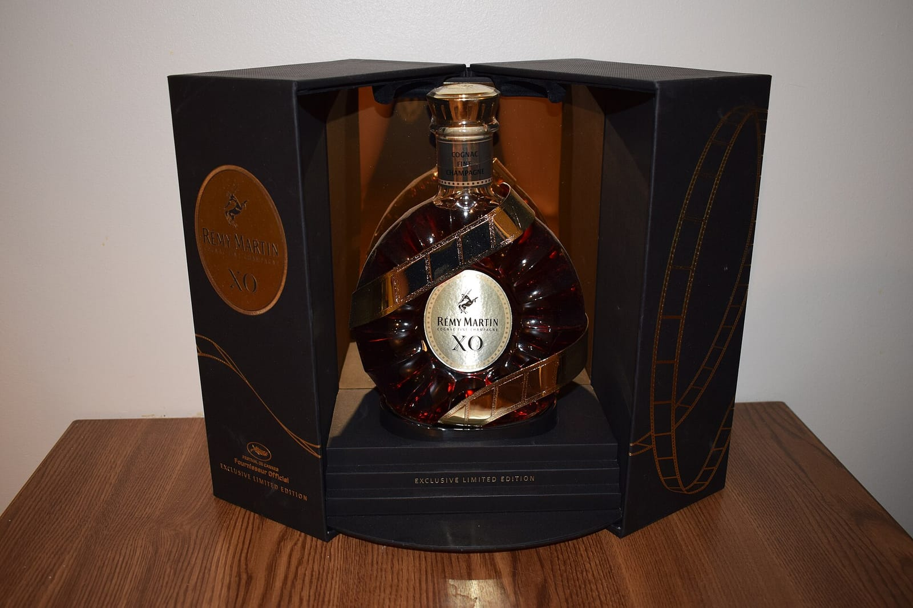

# Rémy Martin in Cognac

Rémy Martin is a cognac house founded in 1724 by a winegrower of the same name, and one of the few major brands to build its identity on Fine Champagne: it uses only eaux-de-vie from Grande Champagne and Petite Champagne, at least half of them from Grande Champagne. Its visits are split across three places, the historic house in Cognac, the Merpins production site and the Juillac-le-Coq vineyard distillery, which makes a visit feel like tracing a supply chain rather than touring a single brand centre.

Figure: Related photograph of Rémy Martin in Cognac. Image: Erko, CC BY-SA 4.0, via Wikimedia Commons ([source page](https://commons.wikimedia.org/wiki/File:R%C3%A9my_Martin_XO_Cannes_2016_Special_Edition_Cognac.jpg)).

## 1724: a winegrower selling under his own name

In 1724 the young Cognac winegrower Rémy Martin began selling cognac under his own name. In 1738 King Louis XV, recognising the quality of his spirits, granted him the rare right to plant new vines, an episode later commemorated in the 1738 Accord Royal. In 1830 the house released its first Grande Champagne cognac; in 1870, as exports grew, it adopted the Centaur as its emblem, the Sagittarius sign of Paul-Émile.

In 1924 André Renaud became the house's first Cellar Master and later its chairman; in 1927 the house blended Petite and Grande Champagne into a VSOP Fine Champagne; in 1938 Fine Champagne gained legal recognition; from 1948 it made only cognacs from the two Champagne crus; and in 2024 it marked 300 years. The sequence matters: the house fixed its sourcing rule first, then built vineyards, grower partnerships and blending around that promise.

## Only Grande and Petite Champagne

Cognac is divided into six growing regions, or crus. Rémy Martin takes fruit only from Grande Champagne and Petite Champagne, and Fine Champagne requires that every eau-de-vie come from those two crus, with at least 50% from Grande Champagne. The limestone soils and slopes of Grande Champagne are generally associated with longer ageing potential and finer aromatics, while Petite Champagne adds structure and fruit. Read alongside the [Cognac](ref:cognac) region entry, the label becomes clear: Fine Champagne is a legal geographic and blending term, not sparkling wine.

The main grape is Ugni Blanc, twice distilled in copper pot stills and aged in French oak. The house does not aim at the character of one plot but at a stable, recognisable blend of the two crus: fruit, vanilla and spice, with a round palate. Understanding the division of labour between [distillation](ref:distillation) and [blending](ref:blending) is more useful than memorising the age of any single bottling.

## Three visit sites: the house, Merpins and Juillac

The historic house at 20 rue de la Société Vinicole holds the brand story and the LOUIS XIII experiences: the Anniversary Tour at 35 euros for two hours covers 300 years; a cocktail workshop costs 35 euros for 1 hour 15 minutes; LOUIS XIII The Introduction is 300 euros for two hours; lunch is 110 euros for four hours. The house carries a Tourism and Disability label, with a lift and a wheelchair available.

The Merpins production site outside Cognac is toured on an electric train through the vast cellars, 1 hour 30 minutes for 25 euros, with the emphasis on the scale of ageing and bottling. Juillac-le-Coq sits in the Grande Champagne vineyards and houses the new distillery: on foot or by electric bike, two hours for 60 euros, from vines to still. A Day at Rémy Martin, combining the house and the production site, costs 55 euros. Prices and schedules change, so check the official site before booking.

## A different visit logic from Hennessy

Hennessy concentrates visits at a single centre on the Quai Richard Hennessy, using ten tours from a 19-euro flash tour to a 550-euro private tour; Rémy Martin spreads its visits over three sites, starting at 25 euros and rising to the 1500-euro and 3580-euro LOUIS XIII experiences, the latter at the Grollet estate. The first feels like a brand flagship, the second like an origin trail: you move between vines, cellars and stills to assemble the production chain.

On the business side, Rémy Martin belongs to the Rémy Cointreau group, while Hennessy belongs to LVMH. Their ranges also differ: Rémy Martin concentrates on Fine Champagne and on the LOUIS XIII tier, whereas Hennessy rests on VS, VSOP and XO in the mainstream and gift market. None of this settles which cognac is better, but it explains what you will be shown, sold and told at each site.

## Practical information: address, booking and access

The historic house address is 20 rue de la Société Vinicole, 16100 Cognac, France; Merpins and Juillac-le-Coq need separate navigation, so confirm the meeting point on the official site first. Visits and the boutique run Monday to Saturday, 10:00–18:00, and should be booked online; reservations can be changed or cancelled free of charge up to 72 hours ahead; the telephone is +33 5 45 35 76 66. Children may join most tours, but tastings are for visitors aged 18 and over. Coordinates should be taken from official channels.

The historic house is within walking distance of Cognac station; the two out-of-town sites have visitor parking, and a car is more flexible. Match the site to your interest: history and brand at the house, scale and ageing at Merpins, vines and distillation at Juillac-le-Coq. With half a day, the 35-euro house tour plus the boutique is the efficient choice; to see the whole chain from grape to spirit, reserve a separate half-day for Juillac-le-Coq.

## Reading the Fine Champagne label

Fine Champagne on a label describes provenance, not grade. VSOP has a minimum age of four years, XO ten years, raised from six in 2018, and XXO fourteen years. A higher grade does not mean you will like it more; it only means a higher minimum. Rémy Martin's range runs from VSOP and 1738 Accord Royal to XO, Tercet and LOUIS XIII, at very different prices, so a tasting ordered by fruit, then spice, then age teaches more than one ordered by price.

Finally, keep the house and the brand apart: Rémy Martin owns vineyards and works with growers around Cognac, but its core skill remains blending and long ageing. Hold the wider category of [brandy](ref:brandy) in mind, then return to the rules of [Cognac](ref:cognac); widening the view once more to the French appellation system described under [France](ref:france) shows how a place name, a method and a market reputation are tied together.

**In brief:** A cognac house founded in 1724 that works only with Grande Champagne and Petite Champagne eaux-de-vie, spreading its visits across the historic house in Cognac, the Merpins site and the Juillac-le-Coq distillery, with tours from 25 euros.

Start with the address. From there, consider the current opening status, then what the place is known for. That is how a practical judgment about Rémy Martin in Cognac is built.

**Key facts.**

| Item | Detail |
| --- | --- |
| In one line | A cognac house founded in 1724 that works only with Grande Champagne and Petite Champagne eaux-de-vie, spreading its visits across the historic house in Cognac, the Merpins site and the Juillac-le-Coq distillery, with to… |
| Address | 20 rue de la Société Vinicole, 16100 Cognac, France |
| City and country | Cognac / France |
| Status | verified open |
| Official site | remymartin.com |

**Sources and limits.** The key claims about Rémy Martin in Cognac are checked against the following sources: Rémy Martin, BNIC (Used to check the appellation and the rules for double distillation in Charente stills), INAO (Used to check the French framework for origin-labelled products). For current products, addresses or opening status, use remymartin.com. Prices, batches and status change; the body is project-written and does not reproduce source text.

## Related images

Image: Cognac. Credit: Didier Descouens, CC BY-SA 3.0, via Wikimedia Commons ([source page](https://commons.wikimedia.org/wiki/File:Cognac_glass.jpg)). Related image for Rémy Martin in Cognac.
