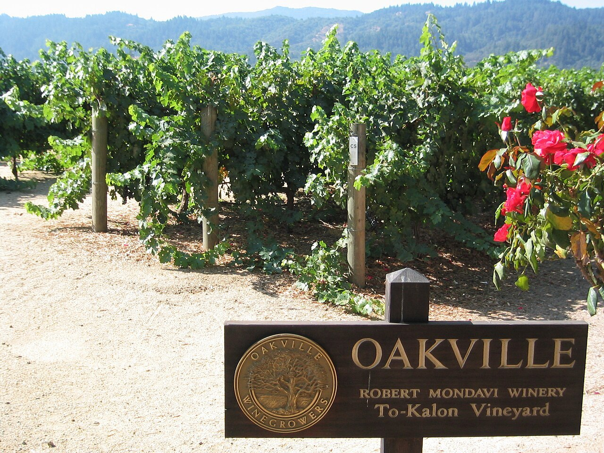

# Robert Mondavi Winery

Robert Mondavi Winery stands in Oakville, Napa Valley, close to Highway 29, and its arch and tower are among the most recognisable silhouettes on the road. Robert Mondavi founded it in 1966, and the winery describes itself as the first major new winery in Napa after Prohibition. It closed for a transformation beginning in 2023 and reopened on 20 April 2026, its 60th anniversary. What visitors see today keeps the 1966 Cliff May arch and tower while adding a new hospitality space beside them.

Figure: Robert Mondavi Winery. Photograph: Robert Mondavi winery. Credit: Greg Dunham from Kirkland, WA, USA, CC BY 2.0, via Wikimedia Commons ([source](https://commons.wikimedia.org/w/index.php?curid=2945111)).

## Place and history

Robert Mondavi was not Napa's first winemaker, but he turned "Napa can make world-class wine" from a claim into an industry consensus. In 1966, after splitting from his family's business, he bought land in Oakville and built his own winery around the To Kalon Vineyard. The official account stresses that he opened the first large winery locally after Prohibition; at the time, the idea was not widely accepted, since fine wine meant Europe.

The building is tied to that argument. Cliff May's Mission-style design, with arches, a bell tower, white walls and a courtyard, made the winery a public space rather than a walled factory. Napa County Landmarks lists the 1966 building as a landmark and describes its style as Spanish Colonial Revival. The point was not only appearance: Mondavi put tasting rooms, art events and food at the winery, turning a visit into a cultural outing rather than a wholesale transaction.

To Kalon is the other key. The vineyard lies in Oakville, with soils and microclimates suited to Cabernet Sauvignon and enough old vines and parcel variation to sustain several wines. Mondavi is not the sole owner of To Kalon; several wineries hold parts of the historic vineyard today. But Mondavi did much to make the name familiar, and the Reserve Cabernet, the To Kalon range and the Napa Valley Cabernet are built on different parcels of it.

The 1976 Judgment of Paris is often used to explain Napa's rise. The blind tasting brought California wine into international view, and Mondavi was among the California entrants. Explaining Napa's success by that single event, however, ignores the long work of the 1960s and 1970s in viticulture, temperature-controlled fermentation, French oak and marketing. Mondavi's larger contribution was to establish the grammar of modern American wine: varietal labels, winery visits and food-and-wine culture.

## Space and wine list

The transformed estate is organised around a central courtyard and the arch, with tasting spaces indoors and on terraces looking towards the vineyards and To Kalon. The new hospitality building does not copy the old architecture; it sets an inverted gable roof against the original arch. Whether that works is a matter of taste, but the 1966 facade has not been demolished and replaced.

The wine list can be read in three tiers. The first is the Napa Valley range of Cabernet Sauvignon and Sauvignon Blanc, relatively accessible and a baseline for the house style. The second is the Estates and To Kalon ranges, which emphasise parcel and vintage differences and carry more concentration. The third is the Reserve and limited wines, usually small in quantity and shown at the end of a visit. Mondavi popularised oak-aged Sauvignon Blanc under the name Fumé Blanc in the late 1960s, a term later widely used by American wineries; the wine remains on the list, though the style is more restrained than the early versions.

Experiences are tiered by depth: the 60-minute Pioneer Tasting in the Vineyard Room or on its terraces; the 90-minute Legend Tasting and Tour, focused on Reserve wines from To Kalon and ending in private spaces of the renovated estate; the 90-minute Mondavi Table, a food-and-wine pairing offered at 11:30 and 13:30 daily; and the 120-minute To Kalon Collective, which compares Schrader, To Kalon Vineyard Company, Double Diamond and Robert Mondavi expressions of the same vineyard. Names and prices change, so the booking page is authoritative.

## How to visit

The winery recommends booking ahead. Its FAQ says reservations are advised because the estate often fills, though walk-ins are accepted when space allows. Book through the official site by choosing a date, time and experience; larger groups need separate arrangements. Guests under 21 cannot join wine tastings, so families should check whether non-alcoholic options exist before booking.

A practical order is white before red, lighter before heavier. The Pioneer Tasting suits a first visit and builds a baseline in an hour. Anyone already familiar with Napa Cabernet will learn more from the Legend or the To Kalon Collective. The food pairing works as lunch, not as an add-on to a tightly scheduled day. Do not stack every experience into one day: alcohol, driving and time all distort the visit.

During the transformation, tastings moved to Arch & Tower in downtown Napa. After the April 2026 reopening, whether that location continues and in what form should be checked on the official site. "Reopened" does not mean every old experience returned unchanged; the route and the programme have been redesigned.

## Practical information

The address is 7801 St. Helena Highway, Oakville, CA 94562, USA; the coordinates are 38.44149, -122.40939 (OpenStreetMap node 4344574800). The winery is on the east side of Highway 29, about 20 minutes by car from downtown Napa, 10 minutes south of Yountville and about 1.5 hours from San Francisco via Highway 29. Parking is near the entrance and fills at midday in high season.

Public transport in Napa Valley is limited. The VINE bus runs along Highway 29 but not frequently; taxis and ride-hailing are more realistic, and a return car should be booked ahead. A tasting requires a designated driver. California enforces drink-driving strictly, with 0.08% blood alcohol as the legal limit.

The estate reopened on 20 April 2026 after its transformation. The official FAQ lists hours of 10:00 to 16:00 daily, subject to holidays and events; the booking calendar is the reliable guide. Booking is advised rather than compulsory: the FAQ says reservations are recommended because the estate often fills, but walk-ins are accepted when space allows. Book through the official site by choosing a date, time and experience; groups of more than six should contact reservations@robertmondaviwinery.com or (888) 766-6328 ext. 2. Wine tastings are for guests 21 and over, with ID checked; a foreign licence or passport is accepted.

Prices by experience (2026 reference): Pioneer Tasting about $60 for 60 minutes; The Mondavi Table food-and-wine pairing about $95 for 90 minutes (daily at 11:30 and 13:30); Legend Tasting and Tour about $150 for 90 minutes; To Kalon Collective about $180 for 120 minutes. Names and prices change, so the official booking page is authoritative. `operating_status` is `verified`, meaning the official site and booking channel were live on 2026-11-08 with no further closure notice; it does not guarantee availability on a given day. Page verified 2026-11-08; opening status, prices and reservations are subject to official channels.

## Etiquette and misconceptions

The first misconception is that "Mondavi" means one winery. Robert Mondavi Winery, Woodbridge by Robert Mondavi and Robert Mondavi Private Selection are different ranges with different origins and positioning; the inexpensive bottle in a supermarket is not the Oakville estate wine. The second is that To Kalon belongs exclusively to Mondavi: the historic vineyard has several owners, and a To Kalon label does not mean the same producer.

On etiquette, spitting is normal and not wasteful; wineries provide dump buckets, especially during a sequence of tastings. Hold the stem or the base, not the bowl, and do not add ice or cola. Photographs are fine, but do not block other guests or take glasses out of the tasting room. There is no dress code, but the estate involves walking outdoors, and smart shoes are uncomfortable on gravel.

A third misconception is that "reopened" means "walk in any time". Reservations are tight in the first season after reopening, especially at weekends and during harvest from August to October; arriving without a booking may mean a visit to the shop only. A fourth is to forget identification: the legal drinking age in the United States is 21, and tastings check ID. A foreign driving licence or passport works, but an expired document does not.

## Neighbourhood and routes

Oakville is the core stretch of Highway 29, with wineries close together. A few hundred metres north stands Opus One, whose architecture and appointment-only model make an interesting contrast with Mondavi's open Mission-style estate. South is Yountville, with restaurants and hotels; north are Rutherford and St. Helena, suitable for a second day.

A half day might combine a Legend Tasting at Mondavi in the morning, lunch in Yountville and one more winery in the afternoon. For a single day, do not exceed two wineries and a proper meal. Traffic on Highway 29 and the Silverado Trail is heavy at weekends and in harvest, so allow time to move between stops. Keeping drinking and driving separate is the first rule of any Napa itinerary.

## See also

Robert Mondavi Winery is an entry point for understanding [Napa Valley](ref:napa) and the industrialisation of [wine](ref:wine); it places vineyard, architecture, marketing and food culture on one estate. For the 1976 blind tasting that changed Napa's standing, read [The 1976 Judgment of Paris](ref:judgment-of-paris).

Further reading: [United States](ref:c-extra-1), [Opus One Winery](ref:c-extra-2).
