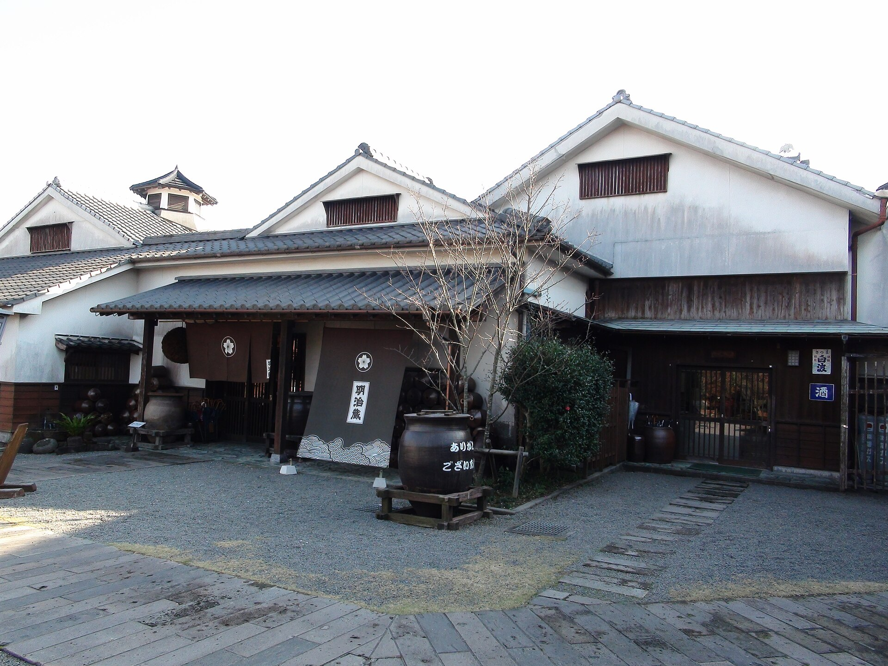

# Satsuma Shochu Meijigura

Satsuma Shochu Meijigura stands at 26 Tategamihonmachi in Makurazaki, Kagoshima Prefecture, [Japan](ref:japan), and its official name is the Hanatogawa Distillery Meijigura. It preserves brewery buildings and techniques carried on from the Meiji era, and today its head brewer and crew still make honkaku shochu by the traditional route, so visitors can watch koji, fermentation and distillation up close rather than read panels behind glass. Admission is free, opening hours are 9:00–16:00, and the site is closed from 30 December to 3 January; the shop sells 25-degree products such as Satsuma Shirohaku Meijigura and Kurohaku Meijigura, as well as a 37-degree Meijigura genshu.

Figure: Related photograph of Satsuma Shochu Meijigura. Image: Sakaori ( talk ), CC BY 3.0, via Wikimedia Commons ([source page](https://commons.wikimedia.org/wiki/File:Satsuma_Shuzo%27s_Kedogawa_Shochu_factory_and_museum,_Meijigura.JPG)).

## Makurazaki harbour and the Hanatogawa

Makurazaki sits at the southern tip of the Satsuma Peninsula, facing the East China Sea, with strong wind and high humidity; fishing and shochu are two industries running side by side. Meijigura stands beside the Hanatogawa, the river that gives the distillery its name. It is about sixty minutes by car from central Kagoshima along the Nansatsu expressway, about five minutes by car from JR Makurazaki Station, about one hundred minutes by car from Kagoshima Airport, about sixty minutes from Ibusuki and about thirty minutes from Chiran. That position means it is not a city museum you can drop into at any hour; it fits a day combining the harbour, Ibusuki or Chiran.

Put the brewery back into the harbour and the link between raw material and transport becomes clearer. Sweet potatoes are grown in the prefecture and need handling soon after harvest, so distance between field and brewery affects freshness; rice koji, bottles and finished goods move by road. Makurazaki is not the easiest tourist stop, but it keeps the scale of production and brewery in one place, with the harbour a few lanes away.

## Buildings and technique since the Meiji era

The name Meijigura refers to buildings and a method that can be traced to the Meiji era, when the rules of honkaku shochu were gradually settled. The visit is not a reconstruction: artisans still work in the hall, and tools, wooden tubs, steamers and pipes sit where the process needs them. Some areas cannot be entered for long because of safety and hygiene. Understanding that stops the old brewery from being read as a static ruin.

Under the Liquor Tax Law, honkaku shochu is single-distilled shochu: raw materials go through koji making, a first fermentation, a second mash and [distillation](ref:distillation) in a [pot still](ref:potstill), which is a different route from continuous-still shochu. The aroma and raw-material character of [shochu](ref:shochu) come largely from that combination. The equipment looks simple, but fire control and cutting the distillate depend on experience, and the displays turn that experience into visible actions.

## White koji, black koji and jar fermentation

Kagoshima shochu uses white koji and black koji. White koji originated in Kagoshima, produces citric acid strongly, ferments cleanly and gives a lighter aroma and a cleaner finish; black koji came earlier through the Okinawan awamori tradition, with a different enzyme profile and acidity, producing a heavier spirit with more earth and richness. Meijigura's Shirohaku and Kurohaku put the two koji routes side by side on the shelf: both use sweet potato and [rice](ref:rice) koji, both are 25 degrees, and the difference comes from koji and fermentation management.

Jar fermentation is the other thread. Meijigura uses ceramic jars for mashing and storage; the walls breathe and conduct heat slowly, so temperature swings are gentler than in stainless steel. The jars are small, and washing and moving them depend on labour, which makes them less efficient than large tanks, but the roundness and sweet-potato aroma they bring are why the brewery keeps them. A row of jars is not set dressing: it is a process choice and a limit on capacity.

## The visit: from koji to still

The visit usually starts with the history of the hall and the Hanatogawa, then moves into koji making and fermentation. Sweet potatoes are steamed, cooled and mixed with koji; the first fermentation happens in jars or tanks, the second mash is added, and the ripe mash goes to the single still. The distillation area carries a strong sweet-potato and alcohol smell, and the route keeps a distance from hot steam pipes and cooling tanks.

Tasting and the shop come at the end. There is a tasting space where white koji and black koji can be compared, and non-drinkers can read the panels and buy souvenirs. The shop sells the 25-degree regular products and the 37-degree genshu; the higher strength brings more heat and a denser aroma, and water or ice changes it again. Anyone driving should not taste at all; anyone on public transport should take a small sip of the two styles before deciding which bottle to buy.

## Degrees, tax and jar storage

The liquor tax on shochu is based on 20 degrees: 200,000 yen per kilolitre, plus 10,000 yen for each degree above 20. 25 degrees is the long-standing standard bottle strength for honkaku shochu and the main specification for most breweries; 20 degrees sits at the tax base, with a lighter body that suits food. The price gap between the two comes not only from materials and labour but from this per-degree addition. Reading the strength tells you more about the tax and the style than the word genshu.

Jar storage gives the spirit a slow integration before bottling. The micro-oxygen exchange and temperature buffer of the ceramic soften the sharp edges of new shochu and round out the sweet-potato sweetness; but longer is not always better, because the aroma moves from fresh to matured and can lose the most appealing side of sweet-potato shochu. The brewery decides jar time by product, not by a blanket rule that long storage is good.

## Transport, opening and visiting notes

The address is 26 Tategamihonmachi, Makurazaki. Opening hours are 9:00–16:00, admission is free, and the site closes from 30 December to 3 January. Call ahead to confirm visits and group reception, especially around the New Year and typhoon season; both the Kagoshima tourism page and the brewery site list telephone numbers, and temporary closures should be checked against the official notice. Parking is free and large coaches can be received.

From Kagoshima Chuo Station, take the JR Ibusuki-Makurazaki Line to Makurazaki and then about five minutes by car; from Kagoshima Airport it is about one hundred minutes by car, longer than it looks, so leave time for the return. Take coordinates from official channels; this entry gives none. Some floors are wet and steam is obvious, so wear grippy shoes and keep away from running equipment; ask about the permitted area before bringing children.

To combine a brewery visit with the producing landscape, put Makurazaki harbour, Ibusuki's sand baths and Chiran's samurai gardens in one day. With only half a day, come to Meijigura alone and take time over the tasting and shop. This is not a large theme park; its value is a working set of jars and stills and a process that the tourist route has not rewritten.

**In brief:** A shochu brewery at 26 Tategamihonmachi, Makurazaki, Kagoshima Prefecture, officially the Hanatogawa Distillery Meijigura; it keeps Meiji-era buildings and jar fermentation, offers free visits through koji, fermentation and distillation, and sells 25-degree Shirohaku and Kurohaku plus a 37-degree genshu.

## References

- [Hanatogawa Distillery Meijigura](https://www.meijigura.com/), Satsuma Shuzo, checked for the address, hours, free admission, closure dates and product strengths.
- [Frequently asked questions](https://www.satsuma.co.jp/con-qanda.html), Satsuma Shuzo, checked for Meijigura's visit hours and telephone.
- [Satsuma Shuzo Meijigura](https://www.kagoshima-kankou.com/cn/attractions/11074), Kagoshima Prefectural Visitors Bureau, checked for the address and opening hours.
- [Table 5, liquor tax rates](https://www.nta.go.jp/taxes/sake/shiori-gaikyo/shiori/2026/pdf/05_01.pdf), National Tax Agency, checked for the shochu tax base at 20 degrees.
- [The kingdom of shochu](https://www.kagoshima-kankou.com/gourmet/shochu/siru), Kagoshima Prefectural Visitors Bureau, checked for Kagoshima shochu culture and production background.

Page verified on 2026-11-09; hours, visit arrangements and product information are subject to official channels.

## Related images

Image: Rice. Credit: China News Service, CC BY 3.0, via Wikimedia Commons ([source page](https://commons.wikimedia.org/wiki/File:20201102.Hengnan.Hybrid_rice_Sanyou-1.6.jpg)). Related image for Satsuma Shochu Meijigura.
