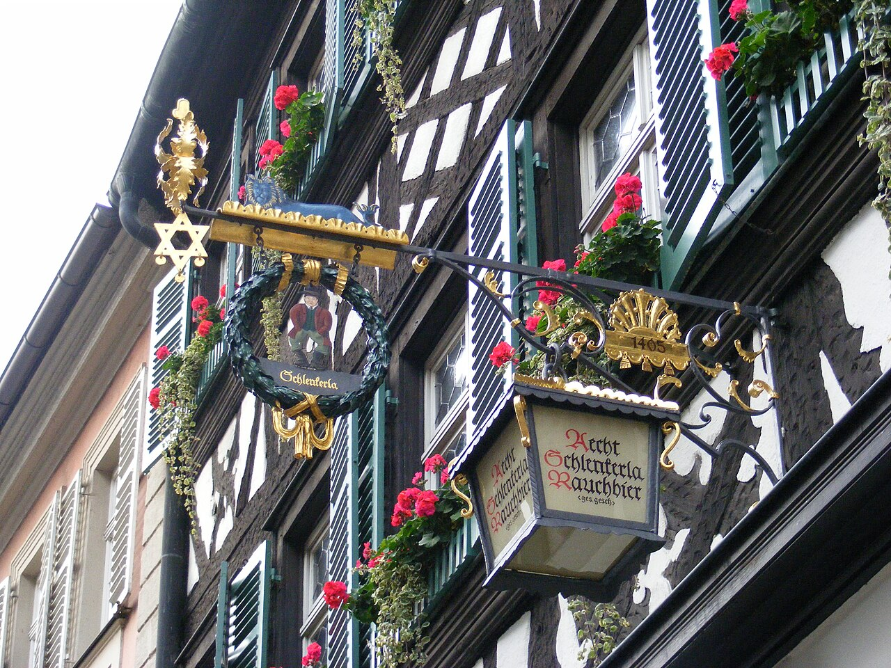

# Schlenkerla

Figure: Schlenkerla. Image: User:Mattes, Public domain, via Wikimedia Commons ([source page](https://commons.wikimedia.org/wiki/File:Schlenkerla_-_Nasenschild_in_Bamberg.JPG)).

## Setting and history

Schlenkerla stands at Dominikanerstraße 6 in Bamberg's old town, in a lane below the cathedral. A document of 1405 first mentions the property, and Bamberg's tourist board treats that year as the earliest trace of the inn. The building changed hands several times before the Trum family took it on; the family now runs it in its sixth generation. It is first of all a historic brewery taproom (Historischer Brauereiausschank), not simply a restaurant: the beer is brewed on the premises and drawn from wooden barrels.

The name "Schlenkerla" comes from the Bamberg dialect and is related to "schlenkern", to swing or sway. Two explanations circulate: one says the early beer carriers walked with a sway, the other links it to the layout of the old building. There is no single answer, so treat the etymology as local lore rather than fact. What is certain is that the nickname is far more common locally than the inn's formal name.

Bamberg is known for its high density of breweries, and smoked beer (Rauchbier) is the city's most distinctive product. Schlenkerla's label reads "Aecht Schlenkerla Rauchbier"; "Aecht" means genuine or authentic and serves as a brand distinction, not a suggestion that other brewers are fake. Placing the inn in the wider [history of taverns](ref:history-of-taverns) makes it easier to see why it is at once a brewery, a tavern and a piece of local memory.

## The rooms and the beer

The inn keeps wooden panelling, old lights and dark furniture; the space is divided into rooms of different sizes, with closely packed tables and objects related to brewing and the family on the walls. It is not a museum reconstruction but a working old house, and the worn floors, door frames and stairs are part of the history.

The key to the beer is smoked malt. Before mashing, the malt is smoked over beechwood logs, so the smoke enters the malt and then the beer. The smoke is not a flavouring added at the tap but a result of how the raw material was treated. The range can be remembered like this: Rauchbier Märzen is the flagship, dark and medium-bodied, with smoke and malt sweetness at once; Rauchbier Weizen is the wheat version, banana and clove aromas layered over smoke, softer in texture; Rauchbier Lager is paler and more lightly smoked, the best first try; Rauchbier Urbock is a seasonal strong beer with heavier smoke and a fuller body.

Food is Franconian home cooking: Schäuferle (roast pork shoulder) with sauerkraut and bread, Bratwurst with sauerkraut, roast pork with onions, rye bread and butter. The menu does not aim at refinement; salt, acidity, roast meat and smoked beer are the point. Dishes change with the season, so check what is on at the table.

## What to order on a first visit

For a first visit, order a small Rauchbier Lager or Märzen, confirm that you can take the smoke, and then decide whether to move to Weizen or a larger glass. Smoke aromas are suppressed when the beer is too cold; it is traditionally served warmer than an ice-cold lager, so do not ask for "as cold as possible" and do not rinse your mouth with ice water before drinking.

For food, Märzen with roast pork shoulder or sausage is the safest pairing: smoke, roast meat and the acidity of sauerkraut support one another. Weizen suits lighter dishes or a glass on its own, while Urbock belongs to cold weather and strong food. If someone in your group cannot take smoke at all, this is not the place: there is no unsmoked alternative, and another Bamberg smoked-beer brewery, Spezial, is different in intensity but still in the smoke family.

Midday and early afternoon are easier for finding seats; in the evening both locals and visitors fill the rooms. In high season at weekends, allow for a wait. The inn does not work as a place to look around without buying anything for a long time; if you want photographs, order first and do not photograph other guests.

## Practical information

**Address:** Dominikanerstraße 6, 96049 Bamberg, Germany.

**Getting there:** from Bamberg Hauptbahnhof it is a 15–20 minute walk into the old town; once inside, head towards the cathedral. Buses and taxis reach the edge of the old town, but the last stretch is on foot. The cobbles are uneven, so wear shoes you can walk in.

**Opening hours:** the official page states daily 9:30–23:30 all year, with a continuous kitchen 11:00–22:00 and Frühschoppen from 9:30. In good weather the Dominikanerhof beer garden opens from Easter to October. Christmas and New Year have special arrangements, so check the official notice. The tourist board's former 10:00–24:00 listing is out of date and has been corrected here.

**Reservations and tickets:** there is no admission charge; you pay for what you order. Walk-ins find seats and share tables; same-day reservations are taken on +49 951 56050, while other dates should use the official reservation form or email. Groups, the beer garden and the Christmas season are best enquired about in advance.

Prices are mid-range for Bamberg and a little higher in the tourist core; beer is charged by the glass and portions are generous, with one main and two beers usually enough for two people. Dress is casual. Many old German places still prefer cash, so carry some.

Page verified 8 November 2026; opening status, prices and reservations are subject to the official channels.

## Etiquette and common mistakes

Ask before sharing a table, and do not cover a whole bench with coats and bags. Clink glasses while looking the other person in the eye, a common German-speaking habit. When you want to leave, call the waiter and state a total that includes the tip; tipping is usually rounded up or 5%–10%, and cash left on the table is not the local convention. Do not bring food or drink in, and do not put glasses or barrel souvenirs in your bag.

Four myths are worth correcting: that smoke means "burnt" or "poor quality"; that 1405 means "brewing continuously for six centuries" (it is the first documentary mention of the property and inn); that "Aecht" is a slur on competitors; and that this is a quiet café for working. In the evening it is loud, the tables are hard and the light is dim; it is for eating and talking, not for a laptop.

The people this place does not suit are equally clear: anyone who dislikes smoke, anyone wanting a broad range of pale beers, and anyone in a hurry for a single quick drink. Its value lies in doing one flavour properly, not in offering choice.

## Around and routes

Walk up and you reach Bamberg Cathedral, the Old Palace and the New Residence; walk down and you come to the Old Town Hall and the buildings on the bridge, then the old fishermen's houses of Klein-Venedig along the river. Put Schlenkerla at midday: roast pork shoulder and smoked beer first, then the cathedral on the hill, and a walk back through the old town in the evening.

Bamberg's old town is a World Heritage site, with narrow lanes and steep stretches, so the route is mostly on foot. To make the beer theme fuller, look for another brewery taproom in the old town as a contrast, but two smoked beers in one day dull the palate; separate them. At weekends and on holidays the old town's restaurants are generally full, so go early or off-peak.

## See also

- [Beer](ref:beer): where smoked beer sits in the family of beer styles.
- [Pub and city](ref:pub-and-city): how taverns use space, menus and hours to organise public life.
- [History of taverns](ref:history-of-taverns): the longer story of inns, brewhouses and bars.

Further reading: [A Ginjinha](ref:c-extra-1).

Read Schlenkerla through the address, then the current opening status, and finally what the place is known for. The sequence matters.

[Beer](ref:beer) explains address and space; [A history of taverns: from wine shops and inns to bars](ref:history-of-taverns) adds operating status. Put Schlenkerla between them before deciding what it is.
