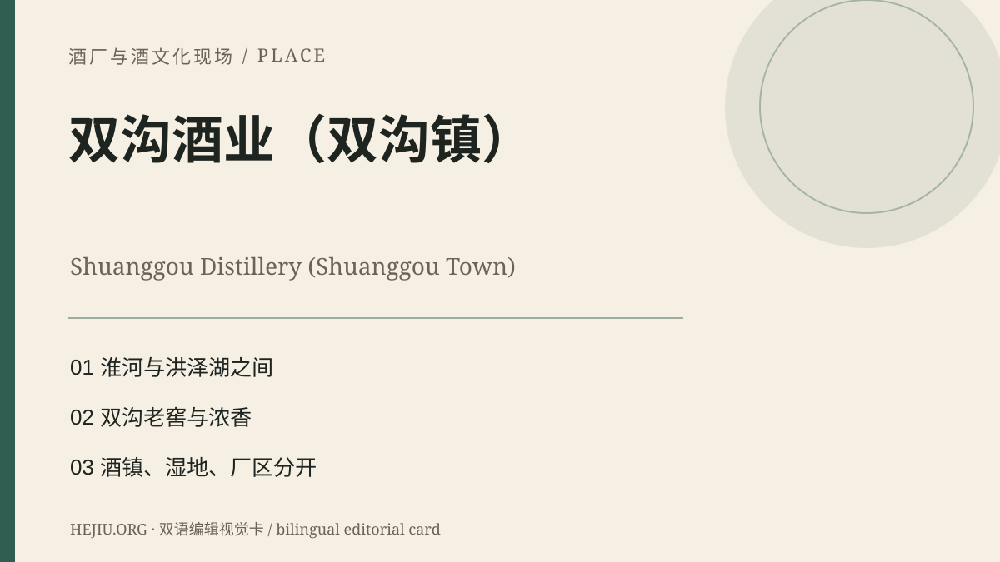
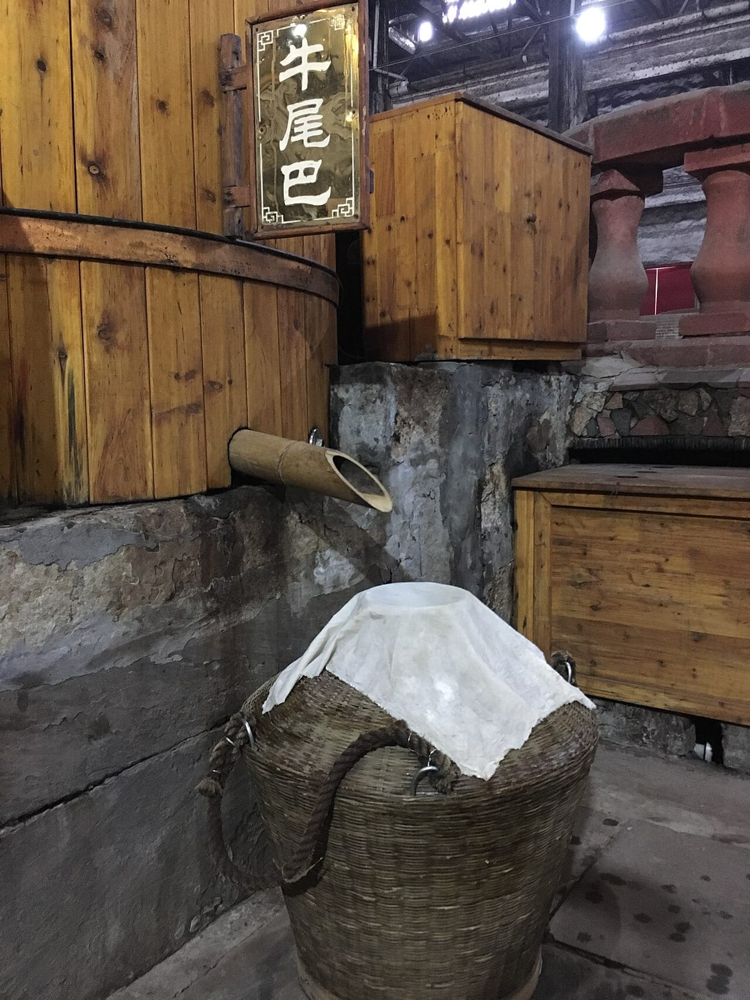

# Shuanggou Distillery (Shuanggou Town)

Shuanggou Town sits in the water country between the Huai River and Hongze Lake, with the distillery, town and wetlands next to one another. Many visitors come from Yanghe and treat Shuanggou as “one more plant on the way”, leaving with only a gate photo. Its value is that strong-aroma old pits, starter culture, distillation and liquor-town life share one water network. Separate plant, exhibition and town before choosing a half-day stop or a full day with Sihong’s wetlands.

Figure: Shuanggou Distillery (Shuanggou Town) bilingual editorial card. Project-created bilingual editorial card for topic identification, not a documentary photograph.

> **Quick verdict**
> **Best for:** travellers on a northern Jiangsu liquor route who want strong-aroma old pits and water-town context; pairs with Yanghe and Hongze Lake.
> **Not for:** gate-photo stops or visitors who will not book; production areas have gates and safety boundaries.
> **One line:** exhibition and old pits first, then town and waterways, with tasting kept separate from buying.

## Liquor town, wetlands and plant

Shuanggou is a market town where daily life and liquor mix: homes, a wet market, small restaurants, plant shuttles and freight. The Shuanggou distillery is a separate industrial space with starter culture, pits, distillation, ceramic warehouses and packaging logistics. The Huai River and Hongze Lake wetlands are a third system, handling water, shipping and migratory birds. The three are neighbours but not one ticket. In town, ask for the visitor entrance, exhibition location and parking; do not drive to a workshop door. Keep birdwatching and plant visiting separate or both get rushed.

## What the distillery shows

Shuanggou focuses on strong-aroma baijiu. Look at old pits, mud maintenance, starter rooms, distillation and ceramic storage. Strong-aroma ferments in solid state in mud pits; the longer a pit is used continuously, the more stable its microbial community and the more reliable the pit aroma and ethyl caproate. Check wall thickness, bottom mud, ventilation and drainage in the workshop; block arrangement, temperature and turning in the starter room; capacity, numbering, humidity control and fire safety in the jar warehouse. Do not just repeat “old pit”; see how it is maintained daily.

## Getting there and time needed

Shuanggou lies in southern Sihong County, usually approached from Suqian, Sihong or Huai’an. High-speed rail to Suqian or Sihong needs a local connection; check live schedules. Exhibition and plant exterior take about two hours; old pits, tasting and town make half a day; adding Hongze Lake wetlands fills a day. The town is walkable, but plant and wetlands need a taxi or car. Wetlands have mosquitoes in summer, so bring repellent; after rain, wear non-slip shoes. From Yanghe, put Shuanggou in the morning and the wetlands in the afternoon to avoid a late return.

## Booking and tasting boundaries

Plant visits are usually organised by group, time slot and route; availability, photography and charges follow official notices. Working workshops contain steam, machinery, forklifts and spent grain, so do not enter or climb fences. Ask about strength, volume and charge before tasting; sip slowly, not on an empty stomach. The driver abstains and does not drive after. Buy from official or authorised shops and keep receipts; do not treat “internal” or “reception” liquor as a bargain, and avoid unclear bottles in the car. With older relatives, shorten workshop walking and start with the exhibition models.

## Hongze Lake and Sihong

Shuanggou is more than liquor: Hongze Lake wetlands, Sihong old town and Huai River scenery complete the water-town picture. A half-day can run exhibition, town and wetland birdwatching; another day allows the Hongze Lake wetland scenic area, Mudun Island or Linhuai, though the wetland is large and drives between points are long. For food, try Sihong crayfish, Hongze Lake fish, noodles and home cooking, keeping strong-aroma liquor modest. With children, wetlands before the distillery; with older relatives, the exhibition before long wetland trails.

## Put Shuanggou into a water-country day

Start at the distillery in the morning with the exhibition and old pits, understanding strong-aroma pits, starter culture and storage. Eat in town at noon, then visit Hongze Lake wetlands or Sihong old town in the afternoon and return toward evening. This puts indoor exhibits in the morning and outdoor wetlands after lunch, avoiding midday heat and tour-group peaks. With only two hours, choose exhibition and town and skip the wetlands; with older relatives, shorten workshop walking, understand the models first, then compare them at the pits. Buy liquor before departure, not from “internal channel” offers at the gate. If you do one thing, see the exhibition and old pits in the morning, following mud-pit fermentation, starter culture and ceramic storage; leave the afternoon for wetlands or the old town, and do not fill one day with plant, wetlands and the far lake. The wetland is large and drives are long, so one birdwatching point is enough; bring repellent in summer and non-slip shoes after rain. Town restaurants follow local meal times and thin out after lunch; ask about the return bus early rather than at dusk. Ask about toilets, avoid overtaking on bends, keep water in the car, check the weather, wear a hat, bring cash and ask about card payment; note the parking spot, check the return route and opening hours, keep booking codes and arrive early.

## Check before you go

- Confirm visitor entrance and exhibition location
- Plan wetlands and plant separately
- Do not drive after tasting
- Buy only from official or authorised shops
- Bring mosquito repellent in summer
- Wear non-slip shoes
- Check connections when coming from Yanghe
- Shorten workshop walking for older relatives
- Ask talk times at the exhibition
- Do not touch pit walls
- Bring binoculars for wetland birdwatching
- Ask about heat when eating in town
- Confirm the last bus before returning
- Check batch codes when buying liquor
- Wear long trousers against mosquitoes

## Limits and next steps

Shuanggou Distillery sits in Shuanggou town by Hongze Lake, with the plant adjoining the town; the route usually covers the old workshop, the wine-culture display and a tasting. It is not a standalone industrial tourism attraction, and open areas and hosting change with production, so confirm access and booking before going.

Buses and self-driving routes connect Suqian city with Shuanggou; the distance is moderate but town roads are narrow with freight traffic. Food near the plant is limited, so book in peak season. The Hongze Lake wetland and the distillery can make a one-day line, but do not pack the two too tightly.

This page does not rate specific wines or promise limited releases. Focus the visit on the relationship between old pits and wetland grain; for buying, compare prices and after-sales across the plant, the city and e-commerce.

## References

- chinayanghe.com — official source — https://www.chinayanghe.com/culture/whzl/cqly/ (checked 2026-11-25)
- ly.chinayanghe.com — official source — https://ly.chinayanghe.com/ (checked 2026-11-25)
- chinayanghe.com — official source — https://www.chinayanghe.com/ (checked 2026-11-25)
- suqian.gov.cn — official source — https://www.suqian.gov.cn/ (checked 2026-11-25)

Related entries: [Yanghe tourism area](ref:yanghe), [Suqian Yanghe route](ref:route), [Yanghe (Shuanggou parent brand)](ref:brand), [Yanghe Group](ref:producer), [strong-aroma baijiu](ref:style), [Jiangsu](ref:region), [First baijiu guide](ref:guide), [History of Chinese wine](ref:history).

## Related images

Image: Fermenting baijiu mash at Luzhou Laojiao, used as an illustrative image of solid-state fermentation; not the Yanghe site. Credit: Xiaomage de, CC BY-SA 4.0, via Wikimedia Commons ([source page](https://commons.wikimedia.org/wiki/File:Baijiu_Produktion_Luzhou_Laojiao.jpg)). Related image for Shuanggou Distillery (Shuanggou Town).
