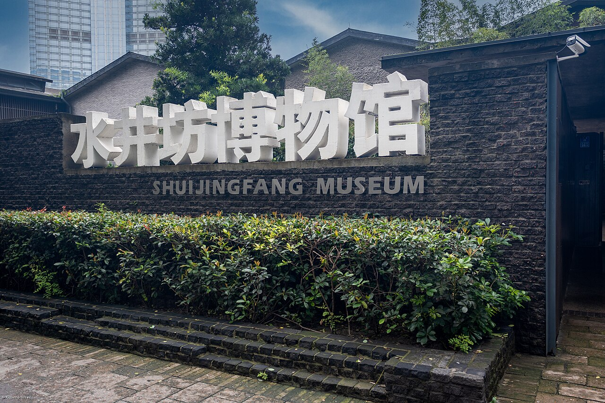

# Shuijingfang Museum

Shuijing Street in Chengdu's Jinjiang District runs near Dongmen Bridge and Hejiang Pavilion, where the Jin River bends. An unassuming building by the street holds China's first scientifically excavated ancient baijiu distillery site. In 1998, workers renovating a factory of the Quanxing distillery hit a brick structure underground; archaeologists followed and uncovered drying halls, cellars, stoves, a distillation base and piles of blue-and-white porcelain shards. Today's Shuijingfang Museum stands on the original site.

Figure: Shuijingfang Museum in Chengdu. Image: xiquinhosilva, CC BY 4.0, via Wikimedia Commons ([source page](https://commons.wikimedia.org/wiki/File:Shujingfang_Museum.jpg)).

## Setting and history

The deposits at the Shuijing Street distillery run from the late Yuan and early Ming to the modern period, with more than 600 years of uninterrupted production. It was discovered in August 1998 and excavated in March–April 1999 by the Chengdu Institute of Cultural Relics and Archaeology and the Sichuan Institute of Cultural Relics and Archaeology. About 1700 square metres of the site have been found, and nearly 280 square metres excavated, revealing 3 drying halls, 8 cellars, 4 stoves, 4 ash pits, plus road base, wooden columns and a brewing-equipment base. Large quantities of blue-and-white porcelain, mostly wine and food vessels, were recovered. In May 2000 it was named one of the "top ten archaeological discoveries of 1999"; in June 2001 the State Council listed it in the fifth batch of national key cultural relics.

The layout is "front shop, back workshop": a wine shop facing the street, with the brewing workshop behind. The drying halls, cellars and stoves belong to the workshop; the street surface and ceramic wine vessels belong to the shop. This shows that a Ming-Qing Chengdu distillery was not only a production unit but part of the city's commercial life. Shuijing Street was near the Jin River and the East Gate wharf, so wine could travel downstream. Porcelain shards marked "Jinjiang Chun" and "Tianhao Chen" link the site to Song-dynasty Chengdu famous wines, the Yuan-Ming "Fushengquan" and the Qing "Quanxingcheng" and today's Shuijingfang brand. The brand story can be told, but the stratigraphy and vessel typology are the hard evidence for dating.

In June 2008 the Shuijingfang traditional brewing technique was listed by the State Council as national intangible cultural heritage. In March 2019 the site was added by the National Cultural Heritage Administration to the Tentative List of Chinese World Cultural Heritage; in December 2019 it was listed by the Ministry of Industry and Information Technology as a third-batch national industrial heritage. On 8 July 2013 the Chengdu Shuijingfang Museum was formally established. It covers 18.5 mu, with a building of 12,149 square metres and 10,299 square metres of exhibition space, a non-state specialist museum built around a national key cultural relic.

On 30 August 2022 the museum suspended public opening because of pandemic control; on 1 October 2024, after upgrading, it fully reopened and resumed ticket charges. This "suspension and reopening" matters for planning: search results still show the 2022 closure notice, but the current status is open. Do not be misled by the old notice.

## The site and what to see

The permanent exhibition has four halls: wine history, the site, the craft and the brand. The core is the site hall, which preserves the Ming, Qing and modern remains in situ: drying halls, cellars, stove pits, ash pits and ash trenches, plus blue-and-white wine and food vessels. Shards in the cases carry marks such as "Chenghua nian zhi", "Da Ming nian zao" and "Tianhao Chen", which are important for dating and kiln identification. Do not only look at "which dynasty"; look at shape, glaze and signs of use.

The craft hall shows the Shuijingfang traditional brewing sequence: starter-making, mixing, loading the steamer, distillation, cooling, pit fermentation and wine collection. The museum's special point is that it is "living": production continues next to the site, workers follow the traditional steps, and steam, spent grain and pit mud are present. It is not a model behind glass but a museum inside a working site. Do not disturb the workers, do not use flash, and do not cross the production barriers.

The building is worth attention too. It was designed by Liu Jiakun's studio, keeping the industrial character of the old workshop and folding in elements of western Sichuan houses; the skylights, steel frames, brick walls and cases are restrained rather than a "fake old street" set. Four permanent units run through the museum: "Jinjiang spring comes to heaven and earth — a short history of Shuijingfang", "Generations of strong aroma fill the hall — 600 years of traces", "Inheriting the old and creating the new — living heritage on site" and "One flame of the heart brews the soul — Shuijingfang today".

## A first visit

Allow 1.5–2 hours. Enter at 19 Shuijing Street, see the wine-history hall first for the Chengdu liquor trade and the "front shop, back workshop" urban context, then the site hall for the drying halls, cellars and porcelain, and finally the craft hall and production area. If a guided tour is running, follow it; the guide is usually included or arranged on site, so ask at the desk.

The order can be reversed: see the production area first for the "living" brewing, then the site hall for the archaeology, then the history hall. That prevents the brand story from dominating and makes the difference between "archaeological evidence" and "brand narrative" clearer. Either way, do not miss the cellars and drying halls in the site hall; they are the material proof of the whole museum.

The tasting usually offers a small glass of raw wine. Non-drivers can sip; drivers should smell only or skip. The museum is not a restaurant, so do not expect a meal; restaurants around Hejiang Pavilion and Lan Kwai Fong are nearby. Children are welcome, but the production area has steam and heat, so keep them close; pushchairs are awkward in the galleries.

## Practical information

**Address**: 19 Shuijing Street (the street range is 19–25), Jinjiang District, Chengdu 610061, China. Near Dongmen Bridge, Hejiang Pavilion and Lan Kwai Fong. Navigate to "Shuijingfang Museum"; parking at the door is limited, so use the Lan Kwai Fong underground car park opposite.

**Transport**: Metro line 2 to Dongmen Bridge, exit B, then about 400 m (5 minutes) on foot; buses 56, 82, 112 and 343 to Hejiang Pavilion, then about 100 m. About 10 minutes by taxi from Chunxi Road and 20 minutes from Chengdu East Station.

**Opening hours**: 09:00–17:30, with last entry and ticket sales at 17:00. Whether it closes on Mondays and whether holidays alter the hours should be checked with official notices. `operating_status` is `verified`, meaning the official site still showed the museum as open on 20 November 2026 and it had fully reopened on 1 October 2024; this does not guarantee that it opens every day. Telephone 028-84436999 or 028-84430666.

**Tickets**: CNY 40 for adults 18 and over; student, senior and child discounts follow the on-site notice; International Museum Day on 18 May may be free. The ticket includes the visit and tasting; whether a guide costs extra depends on the day. Tickets are available via Ctrip, Meituan or on site.

**Visitor restrictions**: No smoking, open flames or drones in the production area; do not touch cellars, fermenting grain or equipment; some areas are closed during production. Wear flat shoes, because the floor may be wet and slippery with spent grain. In summer the workshops are hot, so carry water.

Page verified 20 November 2026; opening hours, tickets and closures are subject to official channels.

## Etiquette and common mistakes

First, do not treat "600 years" as "the museum is 600 years old". The 600 years refer to the site and the brewing tradition; the museum was established in 2013. Second, do not treat "discovered in 1998" as "brewing began in 1998". The site proves centuries of prior production; 1998 is only the start of the archaeological discovery. Third, do not treat the brand hall as the history hall. The brand hall tells the modern company and products; the site hall is the archaeological evidence.

Three more mistakes are common. One is assuming "front shop, back workshop" is only a floor plan. It was also a Ming-Qing business model integrating production and sales, evidenced by the street surface and wine vessels beside the site. Another is treating "national intangible heritage" as a product certification. It refers to the brewing technique, not a guarantee that every bottle tastes good. The third is treating the "World Heritage tentative list" as "already a World Heritage Site". The tentative list is a candidate list; the final decision belongs to UNESCO.

The museum is not right for someone with no interest in archaeology or brewing who only wants a photograph, anyone expecting large interactive installations, or people bringing very young children into the production area. It suits anyone interested in archaeology, industrial heritage and strong-aroma baijiu, and anyone who wants to see Chengdu's liquor culture and riverside urban history together.

## Nearby and routes

The museum is on Shuijing Street. West are Chunxi Road and Taikoo Li; east are Dongmen Bridge and the Jin River; south are Hejiang Pavilion and Lan Kwai Fong; north are Chengdu 339 and the television tower. Put the museum on a "Chunxi Road–Shuijingfang–Hejiang Pavilion–Lan Kwai Fong" route: Taikoo Li in the morning, Sichuan food at midday, the museum in the afternoon, the Jin River at dusk. About half a day with walking and taxis.

For a "Chinese baijiu heritage" theme, add the Luzhou Laojiao cellars and the Fenjiu Museum in Fenyang. They represent a strong-aroma living site, a strong-aroma site and a light-aroma museum. For a deep Chengdu visit, Shuijingfang plus the Chengdu Museum and Jinsha Site Museum are enough for two days; do not try three museums in one day.

Shuijing Street is busy in the evening and at weekends, and Lan Kwai Fong is noisy; keep quiet inside the museum and do not give loud explanations. The riverside is slippery in rain, so take care when walking after the visit.

## See also

- [Strong-aroma baijiu](ref:strong-aroma): the mud-pit, continuous-grain and mixed-steaming process shown at the Shuijingfang site.
- [Baijiu](ref:baijiu): the overall classification and production framework of Chinese baijiu.
- [Luzhou Laojiao cellars](ref:luzhou): another living strong-aroma heritage site in Sichuan, a contrast with Shuijingfang's archaeological site.
- [Fenjiu Museum](ref:fenjiu): a light-aroma baijiu museum in Xinghuacun, Shanxi, another aroma and narrative.
- [Wang Bao He](ref:wang-bao-he): a Shanghai yellow-wine and crab restaurant, another Chinese drinks table.
