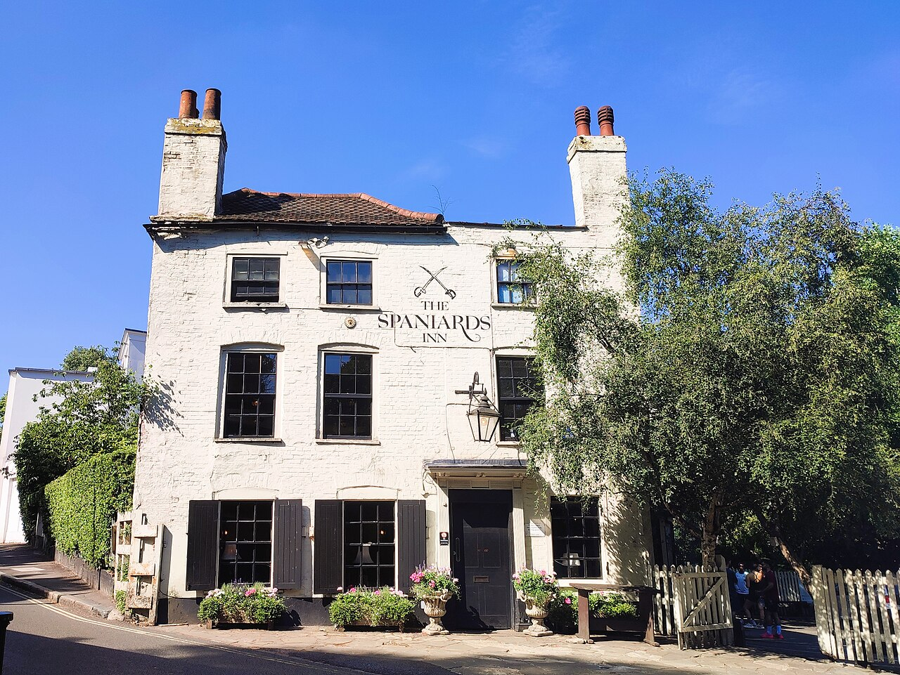

# The Spaniards Inn

Walk north across the southern half of Hampstead Heath and the grass, ponds and trees gradually narrow into a strip beside a lane. A two-storey building with a white facade and dark window frames appears, with a small tollhouse opposite and the open heath on the other side of the road. The location explains The Spaniards Inn: it began as a gate on the road into the bishop's estate and a stop on a turnpike, and it has become one of the London pubs most often written into literary anecdote.

Figure: The Spaniards Inn on the northern edge of Hampstead Heath; the pub dates from 1585, while the present fabric reflects later alterations. Image: Ewan-M, CC BY-SA 4.0, via Wikimedia Commons ([source page](https://commons.wikimedia.org/wiki/File:Spaniard%27s_Inn,_Hampstead,_2026-07-11.jpg)).

## Location and history

The official site and Visit London both date the inn to 1585, when it served as a tollgate and coaching inn on the edge of Hampstead Heath. The main building you see now took shape in the 18th century and is Grade II listed. It stands on the boundary between Barnet and Camden, and Spaniards Road still narrows to a single lane beside the tollhouse of about 1710. Two stories explain the name: one says it came from the Spanish ambassador to the court of James I, the other from two Spanish brothers. Neither has decisive documentary proof. The claim that Dick Turpin's father kept the inn, and the story that Keats wrote "Ode to a Nightingale" in the garden, are local legends and should be qualified as such. During the Gordon Riots of 1780, the landlord is said to have delayed a crowd marching to burn Kenwood House by plying them with drink; the story is widely repeated in local history, though the details vary.

Several threads are worth separating. The tollhouse dates from about 1710 and formed part of the old turnpike system with the inn; a boundary stone of 1755 still stands in the garden. In 1780 the Gordon Riots targeted Kenwood House because its owner, Lord Mansfield, was accused of sympathising with Catholics. The landlord is said to have drawn the crowd into the pub and slowed them with drink until the Horse Guards arrived to find the mob too drunk to continue, saving Kenwood. The outline comes from local history and Visit London, though details differ; the idea that "a pub changed the route of a riot" is the inn's most often cited historical role. In the 19th century Keats walked over the heath from Wentworth Place, and Dickens wrote of tea here in The Pickwick Papers. In the 20th century Bram Stoker's Dracula and the Turpin highwayman legend added a ghost-story layer.

## Space and drinks

The exterior is white with dark window frames; inside are low beams, timber panelling, open fires and several small rooms, giving it more the feel of a country inn than a Covent Garden pub. Its best-known feature is the walled garden: large, with tables spread out, like a courtyard enclosed by trees in summer and a place to retreat from in winter. The drinks list is centred on English cask ale and familiar bottled beers, with wine and spirits; the menu is pub classics such as fish and chips, Scotch egg, monkfish scampi and sticky toffee pudding. Weekend and Sunday lunches need booking. This is neither a drink-only bar nor a fine-dining restaurant; it is a country-style pub for a meal after a walk on the heath.

## How to drink

The best way to use the inn is as part of a Heath walk: come from Hampstead station across the grass, drink in the garden, order a main course, then continue to Kenwood House or Parliament Hill. Choose a bitter or golden ale to go with fish and chips or roast meat; if you only want a drink, the garden usually has more space than the indoor rooms. Weekend afternoons are very busy, while weekday lunchtime and the gap before evening are calmer. In winter, do not rush to sit outside: the small tables by the fire are the inn's real character. In summer the garden is the better choice.

## Practical information

The address is Spaniards Road, Hampstead, London NW3 7JJ. Hampstead station on the Northern line is about a 20-minute walk across the heath; buses stop nearby. There is no large car park, and roadside spaces are limited, so do not drive at weekends. Public hours are commonly Monday 12:00–23:00, Tuesday to Saturday 10:00–23:00 and Sunday 11:30–22:30; holidays and weather can affect the garden, so check the official site. Dogs are welcome in the garden and indoors, subject to the venue's notices; visitors with mobility needs should telephone first to ask which entrance is least steep.

## Etiquette and common misconceptions

First, 1585 is the date the inn began, not the date of every part of the building; the present fabric has been altered many times. Second, Turpin, Keats, Byron and Dickens are often listed together as "regulars," but the evidence varies: Dickens's Pickwick Papers reference is a clearer literary link, while the Turpin and Keats details are largely legend. Third, do not turn the Gordon Riots story into a simple tale of a hero landlord or a conspiracy; the point in local history is that the crowd was delayed and Kenwood was saved. Fourth, this is a working pub, and the garden is not a public park: do not climb the walls, occupy a table only for photographs, or let a dog chase wildlife on the heath.

## Surroundings and routes

The inn sits on the northern edge of Hampstead Heath; south lie Kenwood House, Parliament Hill and the swimming ponds, while Keats House and old Hampstead are to the south-east. Combining it with central London pubs in one day is too rushed; a sensible plan is heath in the morning, the inn in the afternoon, and back to town in the evening. To compare different types of historic London pub, read [Ye Olde Mitre](ref:ye-olde) and [The Lamb & Flag](ref:lamb-flag); [the classic London pub walk](ref:london-route) covers the centre, while the Hampstead stretch deserves its own walk. For the wider role of pubs in the city, read [A city through its pubs](ref:pub-city) and [A history of taverns](ref:taverns).

## Further reading and see also

- [A city through its pubs](ref:pub-city)
- [A history of taverns: from alehouses and inns to bars](ref:taverns)
- [The classic London pub walk](ref:london-route)
- [Ye Olde Mitre](ref:ye-olde)
- [The Lamb & Flag](ref:lamb-flag)

**Short definition:** A 1585 inn on the northern edge of Hampstead Heath, once a tollgate and coaching stop, known for Dickens, Keats, the Turpin legend and a large walled garden.

For The Spaniards Inn, begin with the address, then the current opening status, and finish with what the place is known for; that order keeps the account grounded.

Checked on 2026-11-21 against the Spaniards Inn official page. Normal hours are Monday 12:00–23:00, Tuesday–Saturday 10:00–23:00 and Sunday 11:30–22:30; weather and holidays affect the garden, and the walk across Hampstead Heath from the station takes about 20 minutes. 1585 is the inn's starting year, not the present building's date, and the evidence for Turpin, Keats, Byron and Dickens as regulars varies, as the body explains. The image shows the white exterior and approach road, not guest rooms or the dining room. Garden opening still depends on the day's weather.
