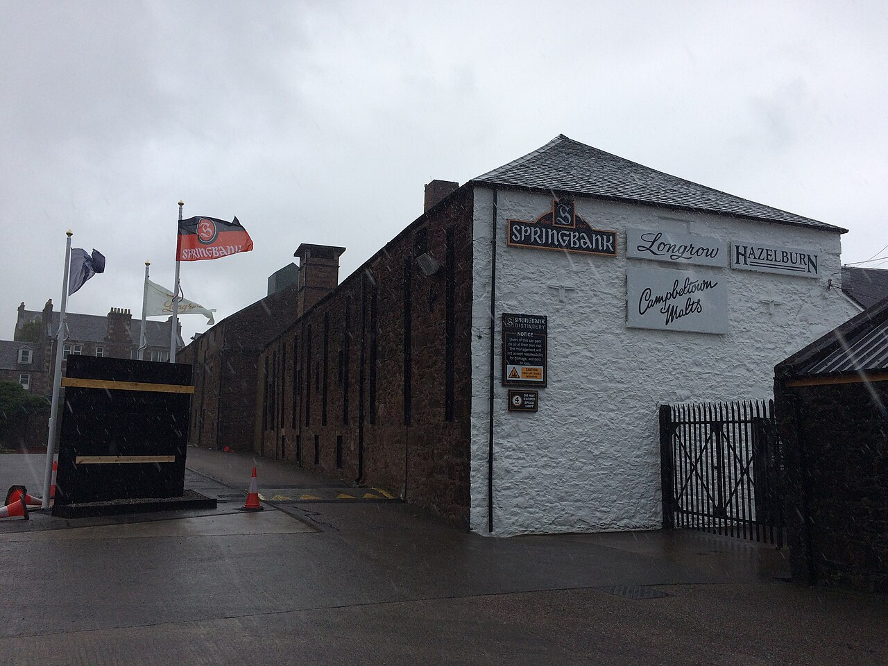

# Springbank Distillery

Springbank sits on Well Close in the centre of Campbeltown, a short turn off Longrow. Mash house, still house, warehouses, bottling line and visitor centre share one block, and local people walk past the door every day. In 1828 Archibald Mitchell took out a licence on ground that had already been used for illicit distillation, and Springbank became the 14th licensed distillery in Campbeltown. It is still owned by the Mitchell family line through J&A Mitchell, one of only three distilleries left in Campbeltown, and one of the few in Scotland that malts, mashes, distils, matures and bottles entirely on site.

Figure: Springbank Distillery. Image: Lirazelf, CC BY-SA 4.0, via Wikimedia Commons ([source page](https://commons.wikimedia.org/wiki/File:Springbank_Distillery,_Campbeltown.jpg)).

## A distillery that keeps its whole line in town

The official process page calls Springbank the most self-contained distillery in Scotland. Barley is floor-malted in the building, dried over a combination of peat and hot air, ground in a 1940s Porteous mill, mashed in a cast-iron mash tun, fermented in six wooden washbacks made of boatskin larch, distilled in three copper stills and bottled on site. The style is explained by the sequence: malting sets phenol levels and enzyme activity, fermentation length builds fruit and esters, still shape and the cut point decide body. Springbank is neither chill-filtered nor coloured, so the whisky can look slightly hazy when cold; that is not a fault. Water comes from the hills around Campbeltown, and the damp, windy climate gives the warehouses a slow temperature cycle that rounds the spirit.

## 1828: from illicit stills to the 14th licence

The Mitchell family came to Campbeltown in the 17th century, and some of them were already maltsters. Archibald Mitchell first worked in partnership at Rieclachan, then built Springbank on the site of his own illicit still; the licence took effect in 1828, making it the town's 14th legal distillery. In 1837 his sons John and William took over, and the business later became J&A Mitchell. In the 19th century [Campbeltown](ref:campbeltown) was reputed to be one of the richest towns in Britain per head. Demand then moved towards lighter blends. Some distilleries cut corners to meet demand, blenders turned away, and one by one the local distilleries closed. By 1934 only Springbank and [Glen Scotia](ref:glen-scotia) were left. Glengyle reopened in 2004, which helped Campbeltown regain recognition as a distinct region. In 2023 the long-serving chairman Hedley G. Wright died and ownership passed into three trust funds, with a family member appointed to the board.

## Floor malting and 2.5 distillation

The [floor malting](ref:malting) is the centrepiece. Barley is steeped, laid out about six inches deep and turned at regular intervals until it germinates; it then goes to the kiln and is dried with peat, hot air or a combination, depending on which malt is being made. The wort is fermented in wooden washbacks for up to 110 hours, longer than at many commercial distilleries. There are three copper stills: wash still, low wines still and spirit still, and the wash still is still heated by a live flame. Springbank is distilled two and a half times. This is not casual: part of the spirit from the second distillation is returned to the next round, producing a style between double and triple distillation. Longrow is distilled twice and Hazelburn three times. New spirit must spend at least three years in oak before it can legally be called [Scotch whisky](ref:scotland).

## Three names, three characters

The Springbank house malt is lightly peated, oily, citric and saline, and it is the benchmark for the Campbeltown style. Longrow was first distilled in 1973, using heavily peated malt and two distillations to produce a smoke profile closer to Islay. Hazelburn was first distilled in 1997, uses no peat and is triple distilled, giving a lighter profile with more fruit, flowers and honey. All three share the same buildings and the same team, yet diverge because of malt treatment and distillation count. That is the most valuable part of a visit: style is not written on the label, it is the result of process choices. For a first visit, taste in the order Springbank, Longrow, Hazelburn, so that the three [single malt](ref:single-malt) process styles are clear before comparing cask types and vintages.

## Booking, route and the visit

Tours must be booked on the official site and normally run Monday to Saturday, with Sunday closed. The Springbank Tour lasts about one hour and cost GBP 18 per person in 2026, including a tasting. The Kilkerran Tour lasts about one hour, costs GBP 14 and visits Glengyle, which is also owned by J&A Mitchell. The Kilkerran Warehouse Tasting lasts about one hour and costs GBP 45. Barley to Bottle runs about 4.5 to 5 hours and costs GBP 280, for visitors who want the full process. Tours sell out quickly in high season and during the Campbeltown whisky festival. The official FAQ asks guests to arrive ten minutes early; groups of more than 12 should email tours@springbank.scot. For a drink without a tour, try the Washback Bar or Cadenhead's Tasting Room on Bolgam Street.

## Details easily missed before and after

The address is Springbank Distillery, Well Close, Campbeltown PA28 6ET. Drivers enter the car park from the lane off Longrow or Glebe Street, and spaces are limited. Campbeltown sits at the end of the Kintyre peninsula; the bus from Glasgow takes several hours, and there is a small airport. The three town distilleries are walkable from one another, so Springbank, [Glen Scotia](ref:glen-scotia) and Glengyle can fit into one day if the tour times do not clash. Floors are wet and warehouses are cold, so bring a jacket. Most importantly, do not taste and drive. The distillery does not publish precise coordinates for citation, so use official channels and local signs for navigation.

[Campbeltown](ref:campbeltown) and [Single Malt Scotch Whisky](ref:single-malt) are the nearest useful comparisons: one clarifies address and space, the other tests operating status.

**At a glance:** Family-owned distillery on Well Close in Campbeltown, founded in 1828 by Archibald Mitchell on the site of an illicit still. One of the few Scotch distilleries that malts, distils and bottles entirely on site; Springbank, Longrow and Hazelburn correspond to 2.5, two and three distillations.

**Key facts.**

| Item | Detail |
| --- | --- |
| In one line | Family-owned distillery on Well Close in Campbeltown, founded in 1828 by Archibald Mitchell on the site of an illicit still. One of the few Scotch distilleries that malts, distils and bottles entirely on site; Springbank… |
| Address | Springbank Distillery, Well Close, Campbeltown PA28 6ET, Scotland, United Kingdom |
| City and country | Campbeltown / United Kingdom |
| Status | verified open |
| Official site | springbank.scot |

**Sources and limits.** The key claims about Springbank Distillery are checked against the following sources: J&A Mitchell & Co. Ltd (the distillery address, brands and current visit entry point; no text copied; tour duration, price and booking method; no text copied). For current products, addresses or opening status, use springbank.scot. Prices, batches and status change; the body is project-written and does not reproduce source text.
