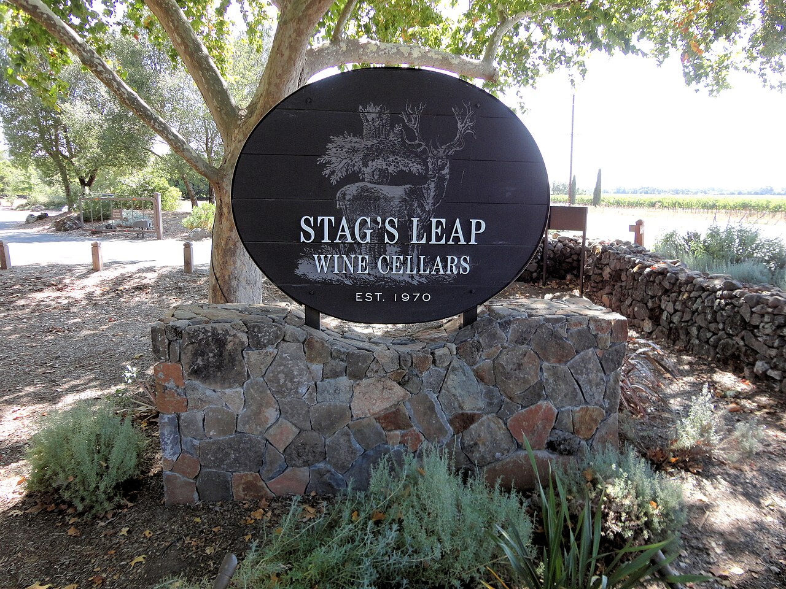

# Stag's Leap Wine Cellars

Silverado Trail runs along Napa’s eastern side, narrow and fast, with estate entrances often after a short climb. Stag’s Leap Wine Cellars is surrounded by oaks and olives, with the volcanic palisades of the Stags Leap District behind. It is famous not for its buildings but for a bottle of 1973 S.L.V. Cabernet Sauvignon. In 1976, in a blind tasting in Paris, it placed first among the reds, with judges drawn from the top of the French wine world. The event later called the Judgment of Paris changed California’s place in the international market. Today the visit is a quiet tasting room, underground caves and two core vineyards, not a victory monument.

Figure: The stone wall and Stag’s Leap Wine Cellars sign at the Silverado Trail entrance. Image: Jim G from Silicon Valley, CA, USA, CC BY 2.0, via Wikimedia Commons ([source page](https://commons.wikimedia.org/wiki/File:Stag%27s_Leap_Wine_Cellars,_Napa_Valley,_California,_USA_(6199529950).jpg)).

## Location and history

Warren Winiarski came to Napa in the 1960s and worked at Chateau Souverain and Robert Mondavi. In 1970 he bought 44 acres in the Stags Leap District, replaced prune, cherry and walnut orchards with Cabernet Sauvignon and Merlot, and named it Stag’s Leap Vineyard, or S.L.V. The first vintage in 1972 was made in a rented facility; 1973 was the first commercial vintage made at the estate. After the 1976 Paris tasting the winery became internationally known. In 1986 Winiarski bought the neighbouring FAY vineyard, nearly doubling the estate. In 1996 the 1973 S.L.V. was placed in the Smithsonian’s National Museum of American History, and cave excavation began. In 2000 Javier Barba’s Arcade entrance and 34,000 square feet of tunnels opened, with a Foucault pendulum inside; Artemis followed in 2001. In 2007 Ste. Michelle Wine Estates and Antinori took over; in 2013 the 1973 S.L.V. was named one of the Smithsonian’s “Objects that Made America”; in 2014 the FAY Outlook & Visitors Center opened; in 2023 Antinori became sole owner.

## Architecture and spaces

The architecture is stone, earth and light. The tasting room and offices are low, with local stone and warm stucco. The caves, designed by Javier Barba, begin with a row of concrete arches that seem to cut into the hill. Inside there is little decoration: vaults, lights and rows of barrels, with a Foucault pendulum marking time and reminding visitors that wine changes slowly in the dark. The FAY Outlook, opened in 2014, is lighter, with glass and steel, looking across the FAY vineyard to the palisades. The real interest is how the buildings separate underground ageing from above-ground landscape: one side is cool, silent and windowless, the other bright, open and explicit about soil and slope.

## The wines and palate

The core is three Cabernets. S.L.V. comes from vines planted in 1970, on a mix of volcanic rock and alluvial fan; the wine is tight and tannic, with black fruit and cedar when young, leather, tobacco and mineral with age. FAY, from the neighbouring vineyard bought in 1986, is more outgoing, with red cherry, cassis and flowers appearing earlier and finer tannin. CASK 23 is a blend of the two, first released in 1985 and named after the cask number of the 1973 wine; it is not a “higher grade” but a marriage of S.L.V. structure and FAY perfume. Artemis is an earlier-drinking Cabernet with direct fruit and softer tannin, aimed at restaurants. Whites and Merlot are small in volume and not the main event. Do not treat CASK 23 as a super-S.L.V.; the three are expressions, not a ladder.

## How to drink

Serve Cabernet at 16–18°C. Young S.L.V. and CASK 23 benefit from one to two hours open; FAY can be shorter. Older bottles need 30–60 minutes and no violent decanting. Pair S.L.V. with roast beef, lamb, game and hard cheese; FAY with duck breast, mushrooms, roast vegetables and cream sauces; CASK 23 with aged beef and truffle. Artemis suits burgers, pizza and barbecue. Avoid very spicy, sweet or vinegar-heavy dishes with high-tannin Cabernet, which will taste drier. If opening all three, start with FAY, then S.L.V., then CASK 23; the reverse order makes FAY look thin.

## Practical information

The address is 5766 Silverado Trail, Napa, CA 94558. The estate is open daily 10:00–16:30, with the last tasting at 16:00; reservations are required, with a maximum of six guests. Telephone 707.261.6410. From Napa city, drive north on Silverado Trail for about 10–15 minutes; the entrance is on the east side, marked by a stone wall and metal lettering. The tasting room and FAY Outlook are wheelchair accessible, with parking inside the gate. Napa is hot at midday in summer, so book morning slots; during harvest (August–October) farm trucks slow the roads. Do not confuse Stag’s Leap Wine Cellars with Stags’ Leap Winery at 6150 Silverado Trail: the names are similar, the history and ownership are not.

## Etiquette and common misreadings

First, the Judgment of Paris is history, not a daily myth; do not ask staff to exaggerate the “defeat of France”. Second, CASK 23 is not automatically the best wine each year; it depends on the blend, and in some vintages S.L.V. or FAY is more compelling. Third, do not confuse the Stags Leap District with the winery; Shafer, Cliff Lede and Odette are also in the district. Fourth, tastings are by reservation, and groups over six should not arrive unannounced. Fifth, the caves are working space: do not touch barrels, use flash or cross barriers. Sixth, Napa alcohol levels are high; do not drive after tasting, book a driver or use a ride service.

## Around and routes

The Stags Leap District sits on Napa’s east side, with Yountville and Oakville to the north and Napa city to the south. Half a day is enough for the tasting and the FAY Outlook view; a full day can add other [Napa Valley](ref:napa) estates, Yountville restaurants and a [United States](ref:usa) wine history museum. Read [Cabernet Sauvignon](ref:cabernet) and [red wine](ref:red) together to understand why the 1976 blind tasting mattered, and [oak ageing](ref:oak) to explain CASK 23’s structure. Do not put Stag’s Leap and Montelena in the same morning: both need reservations and the tasting pace should not be rushed.

## Further reading and see also

- Comparisons: [napa-valley](ref:napa), [usa](ref:usa), [cabernet-sauvignon](ref:cabernet), [red-wine](ref:red), [oak-ageing](ref:oak).
- Background: [napa-valley](ref:napa), [usa](ref:usa).
- This page provides no map; visits, vintages and prices should be checked with official channels.

For Stag's Leap Wine Cellars, begin with the address. Then look at the current opening status, and finally ask what the place is known for. The answers point to different choices, not to a single score.

[Napa Valley](ref:napa) and [Cabernet Sauvignon](ref:cabernet) answer different questions about Stag's Leap Wine Cellars: address and space and operating status. Read them as a pair, not as alternatives.

**At a glance:** A Cabernet Sauvignon estate in Napa Valley’s Stags Leap District, founded in 1970 by Warren Winiarski. Its 1973 S.L.V. Cabernet placed first among reds at the 1976 Judgment of Paris, putting California wine on the international map; the estate’s flagships are S.L.V., FAY and CASK 23, and since 2023 it has been wholly owned by Marchesi Antinori.

**Key facts.**

| Item | Detail |
| --- | --- |
| In one line | A Cabernet Sauvignon estate in Napa Valley’s Stags Leap District, founded in 1970 by Warren Winiarski. Its 1973 S.L.V. Cabernet placed first among reds at the 1976 Judgment of Paris, putting California wine on the intern… |
| Address | 5766 Silverado Trail, Napa, CA 94558, United States |
| City and country | Napa / United States |
| Status | verified open |
| Official site | stagsleapwinecellars.com |

**Sources and limits.** The key claims about Stag's Leap Wine Cellars are checked against the following sources: Stag’s Leap Wine Cellars (5766 Silverado Trail, Napa CA 94558, telephone 707.261.6410 and booked tastings), Stags Leap District Winegrowers Association. For current products, addresses or opening status, use stagsleapwinecellars.com. Prices, batches and status change; the body is project-written and does not reproduce source text.

For Stag's Leap Wine Cellars, this page was last checked in 2026; prices, batches and availability change, so confirm them against the sources below.
