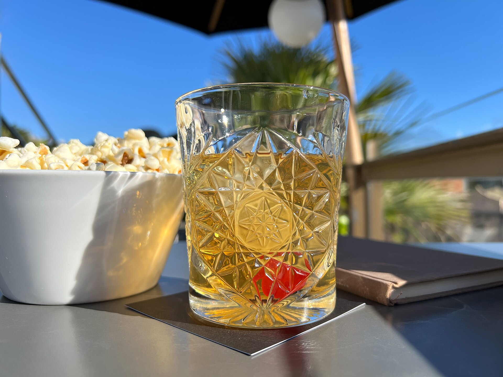

# Star Bar Ginza

Star Bar Ginza stands in a basement in Ginza 1-chome, Tokyo, near Namiki-dori, and its owner-bartender is Hisashi Kishi. It is not the kind of bar that draws people with themed decor or a theatrical mixing show: the room is quiet, the counter is the centre, the drinks are mostly classics, and ice is treated as a craft in its own right. Reading it as a sample of old-school Ginza is closer to the truth than treating it as one stop on a "must-visit Tokyo" list.

> **Quick verdict**
> **In one line:** This entry helps you decide whether Star Bar Ginza deserves a detour, and what to check before visiting.
>
> - **Best for:** Anyone planning a visit to Star Bar Ginza who needs to decide whether it deserves a half-day or a full day.
> - **Not for:** If you want only want a must-visit list and will not check booking, transport or opening hours.
> - **Check first:**
>   - This entry marks the operating status as unknown: the official site is still there, but there is no verifiable information that the bar is open on any given day.
>   - You turn off Namiki-dori into an ordinary commercial building, press the button for the basement, and only then find the bar.

## Ginza 1-chome, by Namiki-dori

You turn off Namiki-dori into an ordinary commercial building, press the button for the basement, and only then find the bar. Time Out Tokyo describes it as a quiet basement spot, with an amber counter and leather stools; the official page calls this the origin of Star Bar, with hand-cut clear ice and a clear ice it names Ninja Ice. The whole bar is non-smoking, which the official page states plainly.

The room is small, mainly counter seating with a few tables. One person, or two or three sitting side by side, fits best; a large group looks out of place and is hard to look after at once. The entrance is not at street level, so finding the building by address is more reliable than looking for a "bar street" atmosphere. This entry gives the address only at the level of "Ginza, Chuo-ku, Tokyo": door numbers and hours belong to official channels, and older media listings may differ from the current site, so check again before setting out.

The charging structure matters more than the menu. The official site states a cover charge of 1100 yen per person, with drinks on top; whether other service charges or tax apply is a matter for the bill and the house. Specialist Ginza bars generally charge this way, and the budget of an ordinary neighbourhood bar does not apply.

## Kishi and the bar's strata of time

Kishi won an international bartending championship in 1996, at the age of 31, according to Time Out Tokyo. The official founder page lists a denser set of posts: owner-bartender, president of the Japan Bartenders Association, Tokyo Meister, Gendai no Meiko, vice-chairman of the Ginza Social Beverage Association, and principal of the Ginza Bartender School. Seen together, he is not merely a famous owner who mixes well in his own room but a practitioner who helps set industry standards and teaches the next generation.

That is the key to reading Star Bar: it is at once a working bar and the front of a teaching system. The house standard, the manner of service and the training of apprentices are three sides of one thing, not something a chain could separate and copy.

There is no verifiable official founding year. The official About Us page says only that the book about the bar was published more than twenty years ago, and that NHK's documentary series Professional: Shigoto no Ryugi filmed there; that proves long existence but not a precise year. This entry therefore gives no founding year and does not sell "old" as a virtue. Age is background, not a reason for the drink to be good.

## The "original" and the "originality" of classic cocktails

The official description of the house line is that classic cocktails are made with Star Bar's own originality. The order of the words matters: classic first, originality second. The reputation was not built on a strangely named new drink but on making clearly structured classics extremely steady; Time Out Tokyo calls the output "almost scientifically precise". The official page also mentions a large stock of old bottles of whisky and rum, which gives classic recipes a longer range of choices.

The difficulty of the classic route sits where you cannot see it: the time and force of [stirring](ref:stirring), the amount of ice, the speed of dilution, the temperature of the glass and the liquid, the small ratios of bitters or syrup. The fewer the moves behind the counter, the more the basics are exposed; the bigger the moves, the more likely they cover an uncertain recipe.

Guests should change their yardstick too. Do not ask first what is "creative"; look instead at whether an [Old Fashioned](ref:oldfashioned) is clean, balanced and clear in the finish, then at whether the second drink has the same temperature and dilution. The good in a classic is not surprise but repeatability. Treat steadiness as a style and the bar becomes legible.

## Three ices

The official site writes ice into the bar's history: Star Bar made ice the protagonist of the bar, and the idea later spread to bars around the world. It uses three kinds at once — hand-cut clear ice, its own natural ice, and ice made by a special machine — which it describes as divided by three modes of heat transfer: radiation, convection and conduction. The most famous is Ninja Ice: so transparent that it seems to vanish in the glass, hence the name, and the official page calls Star Bar its originator.

For the natural ice, the official page says the bar holds the only ice-and-snow manufacturing licence in Kyoto and freezes Kyoto's famous water with a special machine. These are the house's own claims, recorded here without endorsement; what can be checked is the division of labour among three ices and the hand-cut clear ice, which the official pages and Time Out Tokyo corroborate.

Functionally, a large clear block melts slowly and controls dilution; different ice shapes serve different glasses and speeds of drinking. Watching the bartender take, cut and place the ice is the quickest way to understand the bar, but it is not a show: the shape directly changes where the drink goes over the next twenty minutes. Anyone who only wants a photograph will waste the moment.

## An hour at the counter

Ordering here differs from a no-menu bar: a classic list is the frame, and you can also state a preference directly. Do not come in with the "omakase" expectation of High Five, or you will read the reserve as coldness; Star Bar sells accuracy, not surprise. If unsure, order one clearly structured classic and decide the second direction after finishing it.

Pace it one drink at a time, and do not line up glasses across the table. Old-school Ginza bars generally dislike the counter being used as a photo backdrop: lower your voice, do not photograph other guests, do not point a flash into the counter, and avoid shorts and sandals. The so-called silent service is not indifference but a shift of attention from social performance back to the glass; the bartender says little but watches how fast you drink, how much is left and when to add water.

The relationship between a bar and its city is concrete here, as [the bar and the city](ref:pubcity) describes: the temper of one room shapes the night of the street. Star Bar lowers its voice and the shops around it follow; if guests treat the room as a loud party, the first thing damaged is the next seat's evening. Settle the cover charge and drinks on the bill, and pay as billed; tipping is not customary in Japan.

## From counter to classroom: Ginza's training system

That Kishi is principal of the Ginza Bartender School explains Star Bar's influence better than any "famous bar" label. The Ginza counter tradition is carried on two legs: the shop trains by standing beside, correcting and repeating, while the school breaks recipes, temperature, dilution, hygiene and service into teachable units. Together they make "Ginza style" a transferable technique rather than only an atmosphere.

Hidetsugu Ueno also worked at Star Bar before opening [High Five](ref:highfive) in 2008. The relationship between the two bars is not copying but a fork in one tradition: one keeps the classics and the old counter and holds the standard; the other drops a fixed menu and pushes conversational service to its limit. Walking both in one evening explains the layers of Ginza better than ten internet-famous bars.

## Boundaries to confirm before visiting

This entry marks the operating status as unknown: the official site is still there, but there is no verifiable information that the bar is open on any given day. Fixed closing days, last orders, whether reservations are taken, buy-outs and temporary closures belong to official channels; this entry gives no door number and no timetable.

Coordinates are left empty and no map is drawn. Ginza's blocks are dense and building entrances inconspicuous, so use a live map and on-site signs for precise navigation. History, titles and rankings describe a career, not tonight's glass; to test a bar, two of its plainest classics tell you more than one drink with the longest name.

## References

- [STAR BAR GINZA store introduction](https://www.starbar.jp/store-introduction-ginza), STAR BAR, checked for the Ginza 1-chome setting, hand-cut clear ice and the smoking ban.
- [STAR BAR About Us](https://www.starbar.jp/about-us), STAR BAR, checked for the classic cocktail line, three kinds of ice and the 1100 yen cover charge.
- [THE FOUNDER](https://www.starbar.jp/master), STAR BAR, checked for Kishi's posts and his role at the Ginza Bartender School.
- [NINJA ICE](https://www.starbar.jp/ninja-ice), STAR BAR, checked for the naming of Ninja Ice and the three-ice division.
- [Star Bar Ginza](https://www.timeout.com/tokyo/bars-and-pubs/star-bar-ginza), Time Out Tokyo, checked for the Namiki-dori location, the 1996 title and the age of 31.
- [Bar High Five — Staff](https://www.barhighfive.com/staff), Bar High Five, checked for Ueno's time at Star Bar and the 2008 opening.

Page verified on 2026-11-09; door numbers, hours, bookings and prices are subject to official channels.

Further reading: [A Ginjinha](ref:c-extra-1).

## Related images

Image: Related photograph of Old Fashioned. Credit: Capvideo, CC BY 4.0, via Wikimedia Commons ([source page](https://commons.wikimedia.org/wiki/File:Claris_Hotel,_Barcelona,_Smoky_Old-Fashioned_with_Popcorn.jpg)). Related image for Star Bar Ginza.
