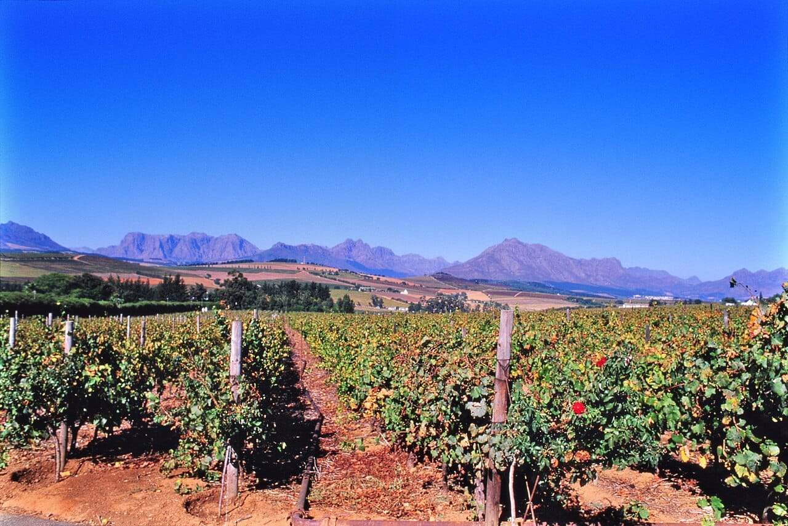
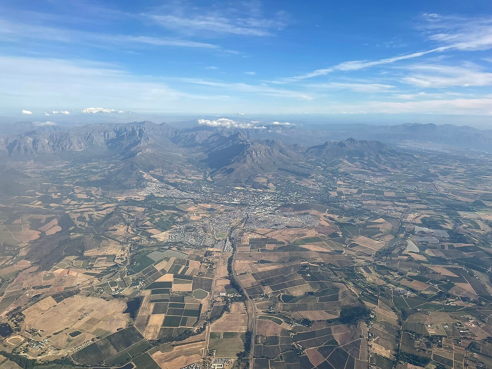

# Stellenbosch

East of Cape Town, the N1 and M12 cross a series of low passes and reach Stellenbosch in about 45 minutes. The centre is Dorp Street under oaks, with white gables, dark wooden windows and stone paving better preserved than in most South African towns; outside, vineyards run along the foot of the Jonkershoek, Simonsberg and Helderberg mountains. This is not “a winery” but a wine destination made of a town, a ward, more than 150 estates and five sub-routes. It is more accurate to read it as a place than as a brand: buildings and museums in the morning, estates in the afternoon, dinner back in town.

Figure: Vineyards and mountains in the Stellenbosch valley. Image: pedrik, CC BY 2.0, via Wikimedia Commons ([source page](https://commons.wikimedia.org/wiki/File:Vineyards_of_Stellenbosch_-_2000-4.jpg)).

## Location and history

In 1679 Cape governor Simon van der Stel named a small island on the Eerste River Stellenbosch. Dutch settlers soon found the soils and climate suitable for agriculture, and vines spread along the mountain foot. The earliest building in the area dates from 1689 at Muratie; by the eighteenth century the centre had Cape Dutch white gables and oak streets, earning the name Eikestad, “town of oaks”. A theological seminary was founded in 1859, and the University of Stellenbosch in 1918, making the town an educational and cultural centre. In 1971 Frans Malan, Niel Joubert and Spatz Sperling, after visiting Burgundy’s Routes des Vins, established South Africa’s first official wine route. Today the route has more than 150 members and five sub-routes and remains the Cape Winelands’ most complete wine tourism network.

## Architecture and spaces

Stellenbosch has three spatial layers. The first is the centre: Dorp Street’s white gables, Dutch and Georgian houses, church, museums and oaks, all at a walkable scale. The second is the estates: most are five to fifteen minutes from town, with long drives, white farmhouses, cellars and lawns, ranging from seventeenth-century farms to contemporary glass tasting rooms. The third is the mountain: the foot of Jonkershoek and Helderberg, with trails, reservoirs and viewpoints forming the natural backdrop. The detail worth attention is the white gable: curved, stepped and decorated pediments are not one style but layers of different periods and family tastes. Do not take one panorama and leave.

## The wines and palate

Stellenbosch is one of South Africa’s most complete wine areas, with a wide range. White wine centres on Chenin Blanc, from fresh unoaked styles to oaked, waxy and apricot-rich versions; Sauvignon Blanc, Semillon and Chenin blends are also common. Reds are led by Cabernet Sauvignon, Cabernet Franc, Merlot and Syrah, with Bordeaux blends as the classic; Pinotage also matters, with plum, smoke and spice. Cap Classique sparkling wine uses Chardonnay and Pinot Noir, from citrus to toasted bread. The sub-routes are defined by landform and style, so “Stellenbosch” is not a single flavour; the same variety can differ completely between the Simonsberg foot and the windy Helderberg.

## How to drink

Serve Chenin Blanc at 9–12°C: unoaked young wines with seafood, salads, chicken and goat cheese; richer oaked versions with roast fish, pork in cream sauce or spiced dishes. Cabernet and Bordeaux blends at 16–18°C with steak, lamb, game and hard cheese; Pinotage at 15–17°C with barbecue, braised meat and smoked dishes. Cap Classique at 6–8°C with oysters, fried food and starters. South African fruit is ripe and alcohol is noticeable, so balance acidity with fat rather than serving warm. At a series of tastings, use the spit bucket; anyone driving should not drink.

## Practical information

Stellenbosch is about 45 kilometres from Cape Town, a 40–50 minute drive, and 30–40 minutes from Cape Town International Airport. The centre is walkable, but estates need a car, taxi or booked driver; the five sub-routes sit at different mountain feet and cannot be linked on foot. Most estates open 9:00–17:00, some close on Sunday; book ahead at weekends and in peak season. The town has hotels, guesthouses and restaurants. Harvest from February to April is busiest; September–October spring blossom and November–March are quieter. For one day, choose one sub-route, two or three estates and a town walk; add more only with two days.

## Etiquette and common misreadings

First, Stellenbosch is a town and a ward, not a single winery; do not ask “where is the Stellenbosch winery”, but choose a sub-route and estate. Second, tastings usually carry a fee, sometimes waived against a purchase; the tasting room is not a free bar. Third, the legal drinking age in South Africa is 18; check whether an estate welcomes children, as some have gardens and restaurants but not all tasting rooms do. Fourth, do not drink and drive; rural roads are narrow, fast and poorly lit at night. Fifth, historic buildings in the centre are homes and businesses; do not enter private yards or photograph private houses. Sixth, do not assume all South African wine is cheap; Stellenbosch has many premium wines at Old World prices.

## Around and routes

Around Stellenbosch, link the [Stellenbosch](ref:stellenbosch) sub-routes, Strand, Paarl and Franschhoek; Cape Town and Table Mountain lie south, the West Coast west. Half a day is enough for Dorp Street, a museum and one estate; a full day can add two sub-routes; two days or more justify the wider [South Africa](ref:south-africa) Cape Winelands. Compare [Chenin Blanc](ref:chenin) with [Cabernet Sauvignon](ref:cabernet) to understand the white and red poles, and use [red wine](ref:red) for tannin and pairing. Do not try to combine Stellenbosch and Cape Town in one rushed day: the road takes longer than it looks.

## Further reading and see also

- Comparisons: [stellenbosch](ref:stellenbosch), [south-africa](ref:south-africa), [chenin-blanc](ref:chenin), [cabernet-sauvignon](ref:cabernet), [red-wine](ref:red).
- Background: [stellenbosch](ref:stellenbosch), [south-africa](ref:south-africa).
- This entry provides no map; visits, vintages and prices should be checked with official channels.

**At a glance:** A historic wine town and ward in the Western Cape, South Africa, named in 1679 by Cape governor Simon van der Stel. The town has oak-lined Dorp Street and Cape Dutch, Georgian and Victorian buildings, while more than 150 wineries and five sub-routes surround it; in 1971 it established South Africa’s first official wine route and remains one of the Cape Winelands’ most complete wine destinations. 

Start with the address. From there, consider the current opening status, then what the place is known for. That is how a practical judgment about Stellenbosch is built.

Read [Stellenbosch](ref:stellenbosch) for the address and space side of Stellenbosch, and [Chenin Blanc](ref:chenin) for the operating status side. Together they locate it.

**Key facts.**

| Item | Detail |
| --- | --- |
| In one line | A historic wine town and ward in the Western Cape, South Africa, named in 1679 by Cape governor Simon van der Stel. The town has oak-lined Dorp Street and Cape Dutch, Georgian and Victorian buildings, while more than 150… |
| Address | Stellenbosch, Western Cape, South Africa |
| City and country | Stellenbosch / South Africa |
| Status | verified open |
| Official site | wineroute.co.za |

**Sources and limits.** The key claims about Stellenbosch are checked against the following sources: Stellenbosch Wine Routes, Visit Stellenbosch, Stellenbosch Tourism. For current products, addresses or opening status, use wineroute.co.za. Prices, batches and status change; the body is project-written and does not reproduce source text.

## Related images

Image: Stellenbosch. Credit: CJJ2501, CC0, via Wikimedia Commons ([source page](https://commons.wikimedia.org/wiki/File:Stellenbosch_aerial_photo_from_north-west_2024-01.jpg)). Related image for Stellenbosch.
