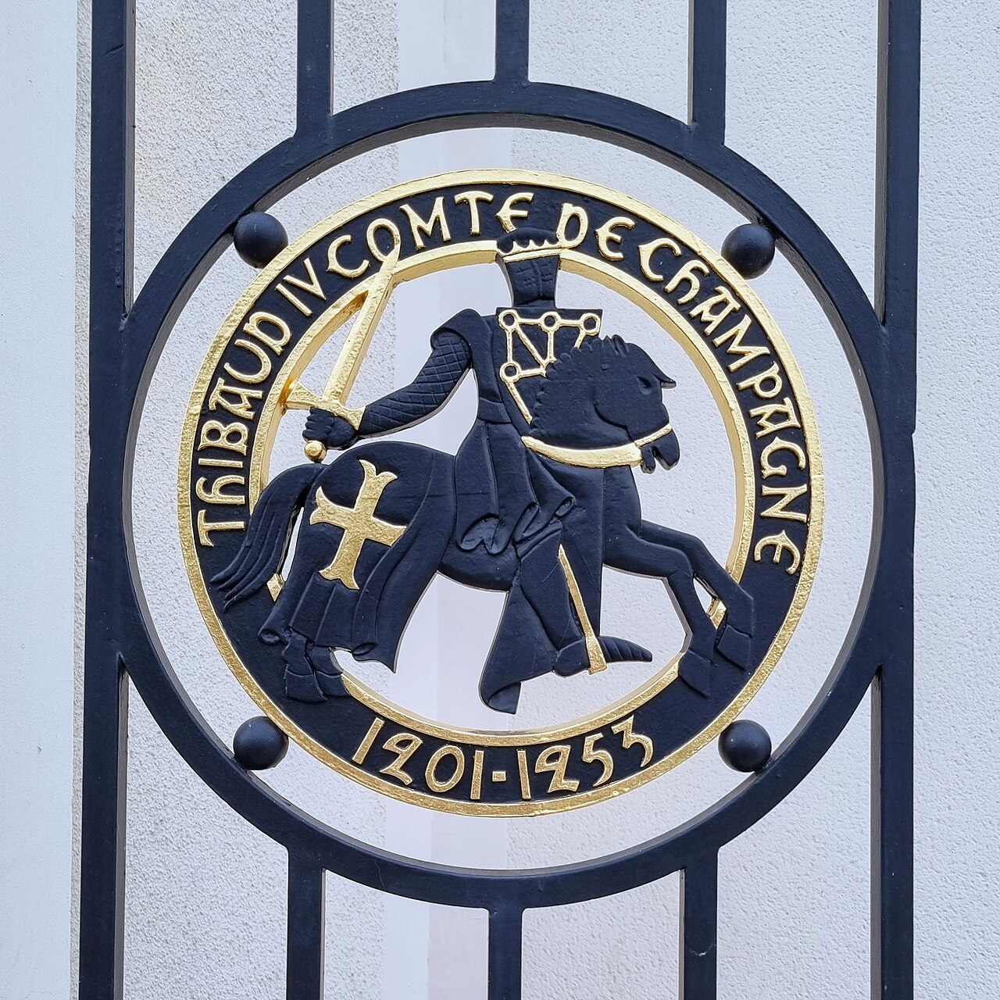

# Champagne Taittinger

In the Saint-Nicaise courtyard in Reims, chalk walls and nineteenth-century buildings sit against one another. This was the Abbey of Saint-Nicaise, destroyed in the French Revolution, but its chalk pits survived; today they belong to Taittinger and age the most precious Comtes de Champagne. Taittinger’s story has two lines: a Reims wine firm that began in 1734, and the Taittinger family that arrived in Champagne in 1932. The two meet at Saint-Nicaise.

Figure: The emblem at the entrance of Taittinger’s Saint-Nicaise site in Reims. Image: UNTERMVIERENBERGE-2, CC0, via Wikimedia Commons ([source page](https://commons.wikimedia.org/wiki/File:F-Marne_(51)-Reims_-_Champagne_Taittinger_001.jpg)).

## Location and history

Taittinger traces its origins to 1734, when Jacques Fourneaux founded the Forest-Fourneaux firm in Reims, one of the earliest Champagne merchants. In 1932 Pierre Taittinger bought Château de la Marquetterie; in 1934 he bought Forest-Fourneaux and renamed it Taittinger. Pierre was wounded and captured in the Second World War, returned to Reims and rebuilt the house; his son François took over in 1960 and made Comtes de Champagne the flagship.

In 2005 the Taittinger family sold the house to Starwood Capital; in 2006 the family bought the shares back. Taittinger remains family-controlled, with Claude Taittinger’s daughters and family members involved. It farms about 288 hectares across 37 crus, with a high share of Chardonnay from the Côte des Blancs, the base of Comtes de Champagne.

## Architecture and spaces

The Saint-Nicaise site is one of Reims’ most important underground Champagne spaces. In the fourth century chalk blocks were cut here for building; 900 years later the pits became the basement of Saint-Nicaise Abbey. The abbey was destroyed in the Revolution, but the galleries, crypts and cellars survived. Taittinger ages wine 18 metres underground, and part of the site belongs to the UNESCO “Champagne hillsides, houses and cellars” listing.

Above ground are nineteenth-century houses, reception, tasting rooms and the Chromatique boutique; below are chalk galleries and cellars. In 2025 the house opened Polychrome, a restaurant built around the idea of blending, with seasonal menus. The visit starts at street level and descends 18 metres; the temperature drops, and the walls still show chalk extraction and abbey traces. This is not a new cellar but a direct exposure of historical layers.

## The wines and palate

Brut Réserve is the entry, Chardonnay-led with Pinot Noir and Meunier, fresh and fine, with citrus and white flowers. Prestige Rosé is Pinot Noir-led, pale salmon, with red berries and blood orange, soft on the palate. Comtes de Champagne is the flagship: first made in 1952, only in good years, 100% Chardonnay from grand cru villages of the Côte des Blancs, aged at least ten years. Its perfume moves from citrus, white flowers and almond to beeswax, cream and mineral; the palate is extremely fine, high in acidity but not sharp. Comtes de Champagne Rosé adds a little red wine, with red berries, spice and toast.

Folies de la Marquetterie is another line, from vines around Château de la Marquetterie, Pinot Noir-led, rounder and more food-friendly. Nocturne is a late-release, semi-dry style, golden, for dessert and blue cheese. Do not treat Comtes de Champagne as “a more expensive Brut”: it is a separate logic of single vintage, single region and long ageing.

## How to drink

Serve Brut Réserve and Prestige Rosé at 8–10°C; Comtes de Champagne at 10–12°C, since too cold suppresses perfume. Use a tulip or wide white-wine glass, not a very narrow flute. Pour in two stages, a little first, then top up after the foam settles. Comtes can be opened 15–20 minutes ahead, but do not decant violently.

Pair Brut Réserve with oysters, fried food, roast chicken and Comté; Prestige Rosé with salmon, strawberries and Mediterranean spice; Comtes de Champagne with lobster, crab, white meat, creamy mushrooms and caviar; Comtes Rosé with duck breast and red-berry desserts. Avoid very sweet or hot dishes; Taittinger’s acidity is clear and needs fat and umami in the food.

## Practical information

Address: 9 Place Saint-Nicaise, 51100 Reims. Visits start at the Saint-Nicaise reception and include four routes of different depth, with cellar tours and tastings; book ahead on the official site in high season and at weekends, and check times, languages and prices there. The cellars are 18 metres underground and cold; bring a layer even in summer. The square around Saint-Nicaise is best covered on foot, with limited short-stay parking in high season; take the tram or a taxi to the entrance, and ask ahead about step-free routes because the cellars have many stone stairs.

TGV from Paris Gare de l’Est to Reims takes about 45 minutes; the station to Saint-Nicaise is a 20-minute walk. By car, use a underground car park near Saint-Nicaise and walk five minutes. Link Reims Cathedral, Saint-Remi and the [Avenue de Champagne](ref:avenue); if adding [Krug](ref:krug) or [Bollinger](ref:bollinger), split the tastings over two days rather than three houses in one.

## Etiquette and common misreadings

First, Comtes de Champagne is not “the next step above the entry”; it is a single-vintage, single-region flagship. Do not judge it by bubble alone. Second, the cellars are not a museum: chalk walls, iron gates and old wine are fragile; do not touch, use flash or cross barriers. Third, tour routes differ in price and content; do not buy the basic ticket and then ask for the private Comtes cellar.

Fourth, Polychrome is a restaurant, not a free rest area for cellar visitors; dining is booked separately, and menu and wine prices are set by the restaurant. Fifth, Champagne is not better the colder it is; 8–10°C reveals more than 4°C. Sixth, the Taittinger family owns the house, but “family secret” is not an explanation of winemaking; Comtes comes from Côte des Blancs Chardonnay, long ageing and strict vintage selection.

## Around and routes

A Reims day can run: cathedral and Saint-Remi in the morning, lunch in town, Taittinger cellars in the afternoon, then the [Avenue de Champagne](ref:avenue) or the [Champagne avenue walk](ref:route) at dusk. To see vineyards, Le Mesnil-sur-Oger, Oger and Avize are about 30 minutes south of Reims and at the heart of Comtes; do not stay only in the city cellars.

For two days, split Taittinger from [Bollinger](ref:bollinger) or [Krug](ref:krug): one day Reims and Saint-Nicaise, one day Aÿ and Épernay. Champagne roads are narrow and villages numerous; leave navigation margin, and never taste before driving.

## Further reading and see also

- Champagne comparisons: [Krug](ref:krug), [Bollinger](ref:bollinger), [Avenue de Champagne](ref:avenue), [Champagne avenue walk](ref:route).
- Background: [Champagne](ref:champagne).
- This page provides no map; tour, restaurant and price information should be checked with official channels.

**At a glance:** A family-owned Champagne house at Saint-Nicaise in Reims, tracing its origins to the Forest-Fourneaux firm of 1734 and taken over by Pierre Taittinger in 1932. It farms about 288 hectares across 37 crus; its cellars lie 18 metres underground within the UNESCO Champagne hillsides, houses and cellars; Comtes de Champagne was first made in 1952.

Champagne Taittinger is best approached through the address, then the current opening status, and then what the place is known for. One check alone will not settle it.
