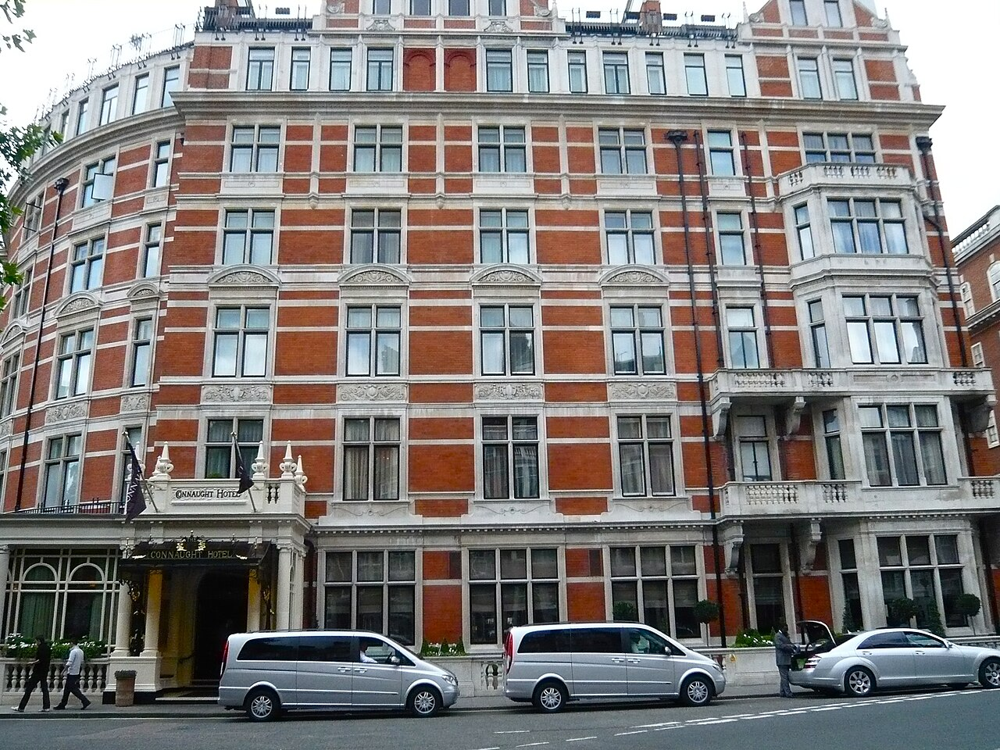
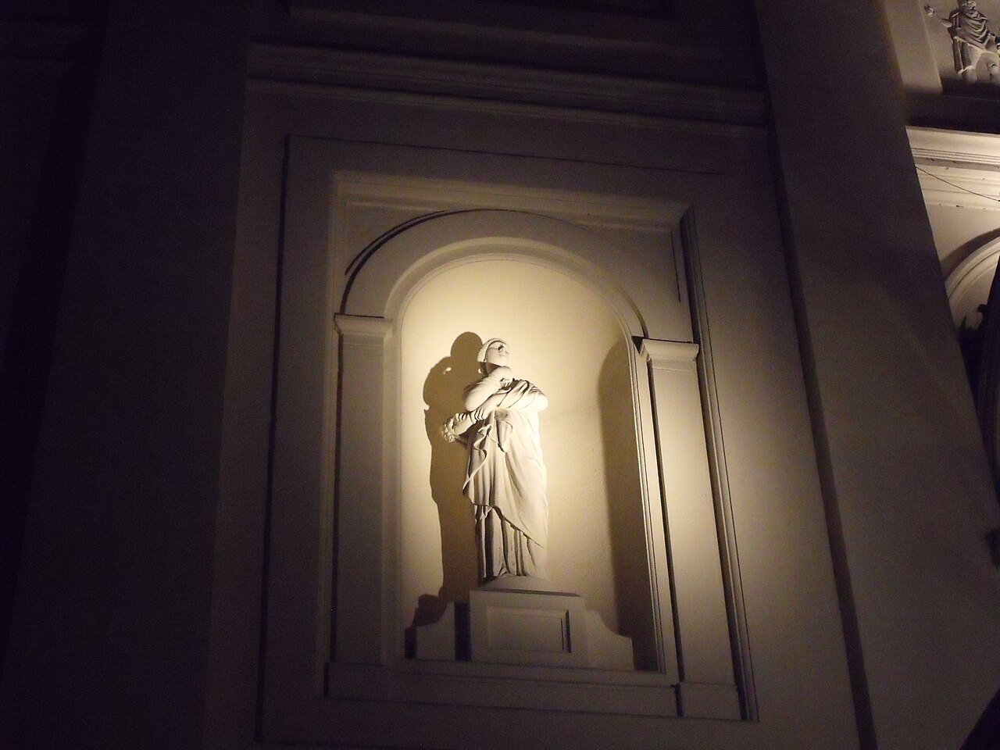

# The Connaught Bar

The Connaught Bar sits inside The Connaught on Carlos Place in Mayfair and opened in 2008. It is not a century-old bar preserved in amber; it belongs to the generation of London hotel bars built to combine hotel resources, strong design and a bartender's own point of view in one room. That framing is more useful than reciting its awards.

Figure: The Connaught Bar. Image: Herry Lawford from Stockbridge, UK, CC BY 2.0, via Wikimedia Commons ([source page](https://commons.wikimedia.org/wiki/File:Mount_St_(3768612442).jpg)).

## Place and history

The Connaught occupies a corner of Mayfair bounded by Carlos Place, Mount Street and Berkeley Square. The bar opened in 2008 as part of a wider renovation, and the hotel's own page still dates its story from that year. The date matters: the room and the menu were designed for contemporary guests, not restored to an imagined original.

David Collins Studio designed the interior, which the hotel describes as blending 1920s English and Irish Cubist art with a modern, elegant edge. Agostino Perrone and Giorgio Bargiani lead the mixing team; Perrone is presented as the bar's central figure for nearly two decades. In 2025 the official page ranked the bar sixth in The World's 50 Best Bars; the 2026 edition of The 50 placed it eighth. Rankings move, but its long run on the list says something about consistency of service and menu rather than a single lucky year.

## The room and the list

The bar is on the hotel's ground floor, with its entrance on Carlos Place. Marble floors, leather sofas, mirrors and low lighting create a formality that tolerates a good jacket but does not demand a tuxedo. It is neither a nightclub driven by volume nor a corner pub driven by crowds; the room is arranged so that people can sit and pay attention to the glass in front of them.

The centrepiece is the Martini trolley. Guests choose gin or vodka, then one of the house bitters — bergamot and ginseng, tonka bean, lavender, coriander seed or cardamom are the usual directions. The bartender "throws" the drink from mixing glass to Martini glass at the table and finishes with expressed lemon peel. This is not a gimmick; it is the bar's signature service, and for a first visit a trolley Martini is close to an initiation.

The list also keeps a "Masterpieces" section of classics and house drinks that have recurred since 2008, including Number 11, Faraway Collins and Mulata Daisy; the Bloody Mary is often cited as another benchmark. Seasonal drinks change, usually by adding fruit, spice or a lower-alcohol option to a classic structure. There are vintage cocktails, wine and spirits, and canapés to go with them. The bar also sells its own distilled Connaught Bar Gin, subject to availability.

## How to drink

For a first visit, the safest sequence is one trolley Martini followed by one house drink. The Martini calibrates the bar: temperature, dilution and bitters tell you how the team works. The second drink can then follow your mood, whether sharp and dry or darker and bitter. If someone in the group does not drink spirits, ask for the seasonal low-alcohol or long option rather than forcing a Martini as a souvenir.

State your preferences before the trolley arrives: gin or vodka, drier or softer, lemon peel, and whether you want citrus or spice in the bitters. The service takes time, the bar takes no reservations, and both bar stools and tables are assigned on arrival. The calmest slots are usually just after the 4pm opening or after 10pm. Do not order four or five drinks at once; a Martini is dense, and by the third glass your palate is already flattening.

Take a sofa at the back if you want conversation. Sit near the bar if you want to watch the mixing, but stay out of the service path. The snacks are small and built for sharing; treating them as a full meal will disappoint.

## Practical information

The address is The Connaught, Carlos Place, London W1K 2AL, United Kingdom, in Mayfair, with the bar entrance on the Carlos Place side. Bond Street (Central and Jubilee lines, plus the Elizabeth line) and Green Park (Jubilee, Piccadilly and Victoria lines) are the nearest Underground stations, five to eight minutes on foot; walking through the Mayfair streets from Green Park is easier to navigate than the tunnels at Bond Street. Buses 2, 8, 19, 22 and 38 stop around Park Lane or Berkeley Square, a few minutes' walk away.

The official page lists Monday to Saturday 16:00–01:00, closed Sunday, with no reservations and all seating assigned on arrival; at busy times guests are queued at the door. Prices sit in the top tier of London hotel bars, and Time Out gives it its highest price band. A few vintage cocktails carry headline prices, but not every drink does. The official page does not publish a hard dress code; smart casual to elegant is the safe reading for a hotel bar, and sportswear or beachwear is out of place. Children are welcome with an adult, but there is no room for pushchairs. Hours may be adjusted over Christmas and for special events, so check the day's official notice. Opening status, prices and bookings are subject to official confirmation. This entry was verified on 2026-11-08.

## Etiquette and common mistakes

The first mistake is treating the Connaught Bar as an old bar. The hotel building has history; the bar itself is a 2008 creation, and its appeal comes from design, service and the list rather than a Victorian fixture. The second is hearing "world's best bar" and assuming anything goes. There is no nightclub door policy, but there is a hotel-bar rhythm: keep your voice down, do not hold a table for a photo shoot, and do not hurry the trolley.

The third is chasing only the most expensive vintage cocktail. Those drinks exist and make good headlines, but most guests order a regular Martini or a seasonal drink; ask about price and size before upgrading the ceremony. Fourth, no reservations means do not arrive with a large group on a Friday night and expect instant seating; splitting up, arriving early or coming another day works better than arguing at the door. Finally, check whether service is already on the bill before adding a tip. Photographs are fine, but keep other guests out of frame and do not lean over the trolley while the bartender is working.

## Around and routes

Walk down Carlos Place to Mount Street for the shops and older buildings, then a few minutes further to Berkeley Square. Bond Street is east, Green Park and Buckingham Palace are south, and the residential streets of Mayfair are west. To compare a hotel bar with a corner pub, visit a pub in Soho or Covent Garden in the afternoon and return here at night; the difference in volume, price and posture is immediate. The bar is closed on Sunday, so do not build a Sunday route around it.

## See also

For a London contrast, read American Bar at The Savoy, which grounds its identity in the hotel-bar tradition from 1893, while the Connaught reads as a twenty-first-century redesign of the same idea. For a smaller, more private Martini service, read Dukes Bar. Together the three show three scales of the London hotel bar: history, design and ritual.

## See also

- [London classic bar walk: three hotel bars and a Fleet Street pub](ref:london-classic-bar-walk)
- [American Bar at The Savoy](ref:american-bar-savoy)
- [Dry Martini](ref:dry-martini)

Further reading: [A Ginjinha](ref:c-extra-1), [À la Mort Subite](ref:c-extra-2).

For The Connaught Bar, begin with the address. Then look at the current opening status, and finally ask what the place is known for. The answers point to different choices, not to a single score.

## Related images

Image: three hotel bars and a Fleet Street pub: Royal Opera House - Bow Street, London - statue (6446853425). Credit: Elliott Brown from Birmingham, United Kingdom, CC BY 2.0, via Wikimedia Commons.. Credit: Elliott Brown from Birmingham, United Kingdom, CC BY 2.0, via Wikimedia Commons ([source page](https://commons.wikimedia.org/w/index.php?curid=22459244)). Related image for The Connaught Bar.
