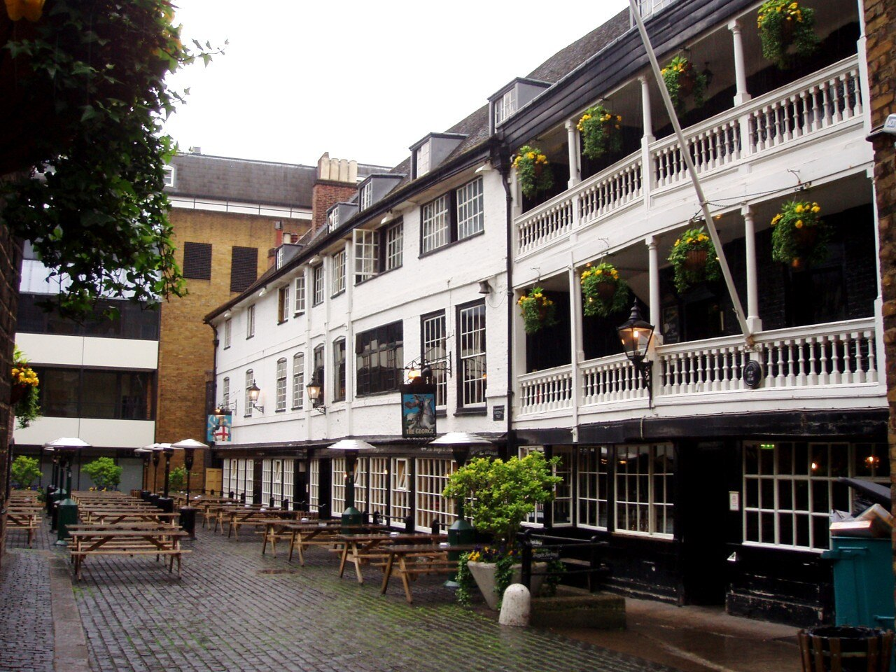

# The George Inn

Figure: The George Inn. Photograph: The George Inn 1. Credit: Ewan Munro from London, UK, CC BY-SA 2.0, via Wikimedia Commons ([source](https://commons.wikimedia.org/w/index.php?curid=6048166)).

## Position: London's last galleried inn

The George Inn stands at 77 Borough High Street on the south bank of the Thames, but its entrance is not a broad frontage: it is a yard that runs in from the street. The National Trust owns it and leases it to Greene King as a working pub, so the place is both a protected historic building and a business that opens every day. The National Trust's description is blunt: this is London's last remaining galleried inn. "Galleried" means that rooms and walkways wrap around three sides of the courtyard on timber galleries, from which travellers could look down on coaches, goods and people in the yard.

"Inn" and "pub" are not synonyms here. A coaching inn once provided lodging, stabling, hot food and drink, and was part of the infrastructure of road travel. The George today keeps only the pub and dining functions; the upper spaces are used for meals or events. Once you understand that, you stop treating the yard as a pure sight and stop wondering why there is no "inn reception". It is still trading, and it is busy, especially at weekends and around match days.

## The building and the yard

The standing building is seventeenth-century. The National Trust states that the original George Inn was destroyed by fire in 1676 and rebuilt afterwards; different sources give 1676 or 1677 for the rebuilding, but both refer to the same post-fire work. The timber galleries, dark beams and narrow stairs you see belong to that period, not to the Middle Ages. The Trust also notes that galleried inns were once common in London, but many comparable buildings were lost in the Second World War, which is why the George is now the sole survivor.

Walking into George Inn Yard from Borough High Street, the eye is caught by the yard itself: galleries enclose a relatively quiet open space, with the pub door on one side. The galleries are good to photograph, but they are building fabric, not a viewing platform; do not climb the railings or stairs, or rest glasses on the rails. By day the yard is a passage and dining space; in the evening it becomes more of a standing social space. If you only want to look at the building, a weekday late morning is best, when the light comes in and the crowd is thinner.

## Literary and theatrical memory

The George's best-known literary link is Dickens. The National Trust says he visited when the building was also a coffee house, and that it is mentioned in Little Dorrit. Note the layers: he visited, the novel mentions it, but that does not mean he wrote there, nor that every scene in the novel can be mapped onto the yard. Treating a literary landmark as a writer's study is the most common visitor mistake.

An older thread is theatre. In the late sixteenth century, Southwark's inn yards were often used by touring companies; the three-sided gallery around an open yard is thought to have influenced London's first purpose-built theatres. The George's site belongs to that tradition, and there is a long-standing story that Shakespeare performed or drank here. Such claims lack contemporary documentation and should be written as "according to tradition", not as fact. What is certain is that Borough High Street was one of the densest inn streets on the south bank, and that the Tabard of The Canterbury Tales stood in this area; the George is the last one left. Set it inside the [history of taverns](ref:taverns) and the yard itself becomes an early form of public performance space.

## What to drink and how to order

The list is led by British beer: cask ales from the Greene King range, session IPA, lager and stout, with seasonal changes. To drink locally, ask what cask ales are on and try a small taste before committing; these beers are about freshness and temperature, not extreme cold. Wine, gin, cocktails and soft drinks are also available for anyone not drinking beer. Food is standard British pub fare: Sunday roast, fish and chips, burgers, pies and vegetarian options. Menus and prices change, so check official channels.

Ordering happens at the bar. Find a table number or remember where you are sitting, then order drinks and food at the bar; if you want a tab, follow the staff's instructions about leaving a card or giving a name. The National Trust advises booking ahead, especially at weekends, for Sunday lunch and around theatre times. You can often walk in and find standing space, but do not assume a table in the yard is free. Families and dogs are welcome, and the outdoor seating at the front of the yard is more comfortable in good weather.

## Practical information and getting there

The address is The George Inn Yard, 77 Borough High Street, Southwark, London SE1 1NH, United Kingdom. The nearest station is London Bridge (Jubilee and Northern lines), about a five-minute walk south along Borough High Street; Borough station (Northern line) is also close. Several buses run along Borough High Street; check Transport for London for routes and times. Borough Market is only two or three minutes away on foot, so the market and the pub pair naturally. The yard is set back from the street, so look for the passage rather than a large pub frontage.

The official page has listed opening hours of roughly 10:00–23:00 Monday to Wednesday, 10:00–01:00 Thursday to Saturday and 10:00–23:00 Sunday, with the kitchen usually serving until about 22:00. Holidays, match days and private events change this, so check the Greene King page or telephone +44 20 7407 2056 before travelling. There is no admission charge; you pay for what you order. You do not need to book to drink, but booking is sensible for a meal. In a historic building, thresholds, stairs and routes to the toilets are uneven, so wheelchair users and families with pushchairs should telephone ahead.

## Etiquette, mistakes and the neighbourhood

There are three common mistakes. First, treating "Shakespeare performed here" as established fact; the more accurate statement is that inn-yard performance was common in the period and the George's site belongs to that tradition, but there is no reliable record of Shakespeare himself. Second, assuming that National Trust ownership makes it a museum: a tenant runs it as a normal pub, selling drink and food and taking bookings, while the fabric is protected. Third, calling the 1676 building "medieval": the standing structure is a post-fire seventeenth-century rebuild, and the medieval inn is gone.

When drinking in the yard, do not use the galleries as climbing frames or lock bicycles to historic timber. Sharing tables is normal at busy times; ask "Is this seat free?" before sitting down. Sunday roast and big-match crowds are heavy, so avoid those windows if you have children or want a quiet conversation. Nearby you can walk to Borough Market, Southwark Cathedral, Shakespeare's Globe, Tate Modern and The Shard. To place the London pub in a wider urban life, read [Pub and city](ref:pub-and-city); for the British beer tradition, read [the United Kingdom](ref:uk). The cask ale here belongs to the wider family of [beer](ref:beer), and a pint followed by the market is the most natural route.

Further reading: [A Ginjinha](ref:c-extra-1).

**Short definition:** A historic inn on Borough High Street in Southwark, owned by the National Trust and run by Greene King; rebuilt after a 1676 fire, it is London's last surviving galleried inn and appears in Dickens's Little Dorrit.

## Related images

Image: Category image for United Kingdom. Credit: Decatur Wine & Spirits, CC BY-SA 3.0, via Wikimedia Commons ([source page](https://commons.wikimedia.org/wiki/File:DecaturGins.jpg)). Related image for The George Inn.
