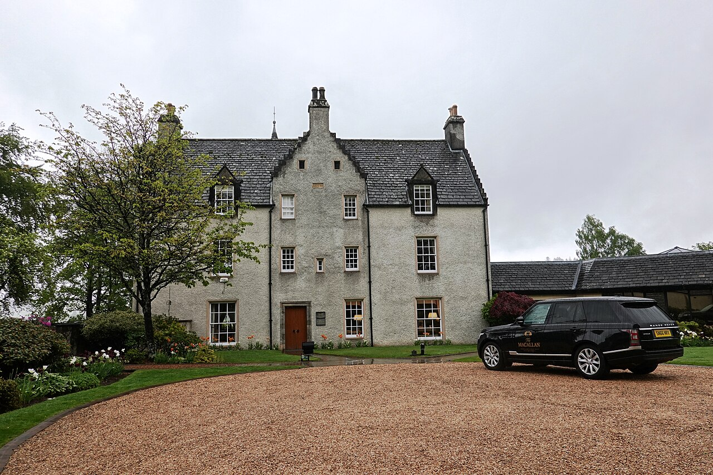

# The Macallan Estate

Leave Craigellachie on the A941, follow the Spey for a short stretch, then turn up a drive that crosses grass and trees before the Macallan estate appears. This is not a roadside distillery in the casual sense: gate, car park, visitor building and production halls are arranged across the Easter Elchies slope, and the roof rises and falls like a piece of ground lifted and put back. The Macallan is one of the world's best-known single malts, but its visit is first of all a designed arrival. Without a booking, the gate usually stays closed.

Figure: Easter Elchies House (built in 1700) on the Macallan estate. Image: יאיר צפורי, CC BY-SA 4.0, via Wikimedia Commons ([source page](https://commons.wikimedia.org/wiki/File:Macallan_Easter_Elchies_House_Built_in_1700.jpg)).

## Place and history

The legal history begins in 1824, when Alexander Reid obtained a licence in the Easter Elchies area. Before that, the Spey valley had a long practice of illicit distillation, with woods, springs and hidden glens providing cover. Easter Elchies House, built in 1700, is a Highland laird's house and the most recognisable image on the label. Keeping "licensed in 1824" apart from "house built in 1700" prevents two very different timelines from collapsing into one phrase about heritage.

The distillery has long been owned by Edrington. In 2012 The Macallan announced a new distillery and visitor experience; construction began in December 2014 and the building opened in 2018, designed by Rogers Stirk Harbour + Partners. Its most conspicuous feature is the turf-covered, undulating roof, while inside mashing, fermentation, distillation, maturation and visitor routes sit under one large enclosure. The old distillery was not erased; it remains beside the new one as part of the estate story. For a first-time visitor, the key point is that today's Macallan is a post-2018 production plant, not a nineteenth-century workshop.

The house style is often reduced to "sherry casks". More precisely, The Macallan has long built its range on oak seasoned with sherry in Jerez, Spain, with European and American oak contributing different things: dried fruit and spice from European oak, vanilla and citrus from American oak. The distillery also emphasises small stills and a narrow cut, giving a thicker, oilier new make. Style is not decided by one cask but by the overlap of malt, distillation, cask source and maturation conditions.

## Architecture and site

Access to the estate is by prior appointment, arranged through the official site. The visitor building holds reception, the restaurant, the bar and the shop; The Macallan Bar is for guests aged 18 and over and operates a Challenge 25 policy, so bring identification. A visit usually starts with the brand and the estate, then moves into production to see the mash, washbacks, stills and cask areas. The new building is broad and well lit, a sharp contrast with the narrow stone rooms of older distilleries. That is not a claim to superiority; it is an engineering choice that allows a large number of visitors to see a working plant.

The stills are the centre of the technical story. Macallan stills are known for being small, described by the distillery as curiously small stills; smaller stills give a higher copper-contact ratio for the volume and allow a more selective cut. The new plant has more stills and far more capacity than the old one, but the distillery still stresses that only a small middle portion of the run is kept, with heads and tails separated. Standing beside the stills and hearing which part of the run is collected explains more about the oily body than the word "sherry" alone.

The estate deserves time of its own. Easter Elchies House stands on the slope, surrounded by grass, trees and the direction of the Spey; the new roof meets the land in a way that architecture-minded visitors come specifically to see. The visitor building includes displays on history, cask samples and bottles, a restaurant for a full meal and a bar for a single glass. This is not merely a place to buy an 18-year-old; it is a destination that combines distillery, estate, architecture and hospitality.

## The range and palate

The range is best read by cask type, age and channel. Sherry Oak is built around sherry-seasoned casks, with 12, 18, 25 and 30 years forming the familiar ladder; flavours move from dried fruit, citrus peel and dark chocolate towards deeper spice, leather and wood. Double Cask combines European and American oak sherry casks, usually giving a rounder texture with more vanilla and honey. Triple Cask and other travel-retail lines adjust the proportions again. Names and packaging vary by market and year, so the back label is a more reliable guide than a remembered series name.

On a first visit, compare two ages in the same series, or the same age in Sherry Oak and Double Cask. The first shows what time does; the second shows the difference between European and American oak. The distillery states that its whisky is natural in colour, with no caramel colouring; that does not mean darker is older, since cask species, toast level and maturation all affect colour. Smell before tasting, sip slowly and use the spittoon if you do not want to finish.

Older bottlings are expensive, and distillery exclusives and single casks are limited. If the budget is finite, learn the base range first and then decide whether a particular age is worth the money. Do not use "sherry cask" as a blanket explanation for every Macallan: within one brand, cask type, age and cut are enough to make two glasses sound like two different regions.

## How to drink

Macallan is not a shot. Look at the colour, then smell: Sherry Oak gives dried fruit, orange peel and dark chocolate; Double Cask gives vanilla, honey and citrus; Triple Cask is lighter and more floral. Take a sip, let it sit on the tongue for two seconds, feel the body and tannin, then swallow or spit. Do not rush to add ice; cold closes the aroma.

If you are ordering, start with the 12-year Sherry Oak or Double Cask, then compare the 18-year in the same series. Two ages within one series show what time does better than jumping between unrelated bottles. Do not look for heavy peat at Macallan; go to Islay’s [Lagavulin](ref:lagavulin), [Laphroaig](ref:laphroaig) or [Ardbeg](ref:ardbeg) for that. To compare fruit and sherry-cask styles, try a base bottling at [Glenfiddich](ref:glenfiddich) and [Glenlivet](ref:glenlivet), then come back to Macallan.

Add water sparingly: two or three drops can open a high-strength or cask-strength dram; a 40% entry-level bottling does not need it. Do not add soda or cola, and avoid heavy chilli, garlic or sweet food before a tasting. If you are driving, smell only; the bar and tastings apply an 18+ rule and Challenge 25 identification checks.

## Practical information

The address is The Macallan Distillery, Easter Elchies, Craigellachie, Moray AB38 9RX, Scotland. By car, follow the A941 north from Craigellachie and take the signed estate road; Elgin, Aberlour and Dufftown are each around half an hour away. Public transport does not reach the door; the nearest stations are Elgin and Keith, followed by a taxi or an organised tour. The estate has parking, but arrival is tied to the booking, so do not turn up at a different time.

The estate works on a book-first basis. The official site separates the distillery experience, the restaurant, the bar and the shop, so confirm what you have reserved: some experiences include production areas and a tasting, others are tasting-only or hospitality-only, and age rules differ. Production floors are wet, with hot and moving equipment, so wear grippy shoes rather than sandals, and bring a layer for the cold buildings. Visitors with mobility needs should explain them in advance; the new building is more accessible than the old distillery, but routes still vary by experience.

Opening hours, prices, sessions and menus change. This page was checked on 2026-11-08; confirm on the official site before travelling. High season and holidays fill up quickly, so book weeks ahead; winter reduces some experiences, though the estate and restaurant may remain open. If you are driving later that day, skip the bar and the tasting, or arrange a separate driver.

## Etiquette and common misunderstandings

This is a production and hospitality site at once. Do not enter the estate without a booking, and do not touch equipment, racks or displays in production areas. Check signs before photographing; stills and some process details may be off-limits. Avoid strong perfume and loud commentary in tastings, and use the spittoon; it is normal practice, not waste. Families should check age policies first, since the bar and some tastings are for adults only.

Anyone driving should not drink. Scotland's limit is stricter than England's, and rural roads are narrow and winding; even one glass can affect judgement. A chauffeur, a designated driver or a tour with transport is the safe arrangement. If nobody drinks, concentrate on the architecture, the estate and the restaurant.

A common misunderstanding is that “sherry cask” makes every Macallan the same. Sherry Oak, Double Cask and Triple Cask differ in cask type and proportion, and age varies; one brand can span a wide range. Another is that darker means older: cask char, wood species and maturation all affect colour, and Macallan adds no caramel colouring. Third, Macallan is not a heavily peated distillery; for peat, Islay is the better destination.

## Around and routes

Nearby, the Speyside Cooperage at Craigellachie shows how casks are made, while Aberlour and Dufftown continue the distillery trail; Elgin has its cathedral, and Glenlivet and Ballindalloch lie south. Combining Macallan with [Glenfiddich](ref:glenfiddich) and [Glenlivet](ref:glenlivet) in one day is possible, but leave enough driving and lunch time between bookings; for a fuller plan, see the [Speyside malt trail](ref:speysideroute).

To switch to peat, head west to Islay and the [Islay whisky trail](ref:islayroute), comparing [Lagavulin](ref:lagavulin), [Laphroaig](ref:laphroaig) and [Ardbeg](ref:ardbeg). Speyside and Islay do not fit into one day: one is inland, the other needs a ferry, and each deserves at least two days.

## Further reading and see also

- For the wider relationship between place and process, read [Place and process](ref:place-and-process); for the basic framework, start with [Scotch whisky](ref:scotch) and [Speyside](ref:speyside).
- Speyside comparisons: [Glenfiddich](ref:glenfiddich), [Glenlivet](ref:glenlivet), [Speyside malt trail](ref:speysideroute).
- Islay comparisons: [Lagavulin](ref:lagavulin), [Laphroaig](ref:laphroaig), [Ardbeg](ref:ardbeg), [Islay whisky trail](ref:islayroute).
- Official sources are listed in the sources block above: the distillery visit page, the new-distillery page, VisitScotland and Edrington’s brand page.
