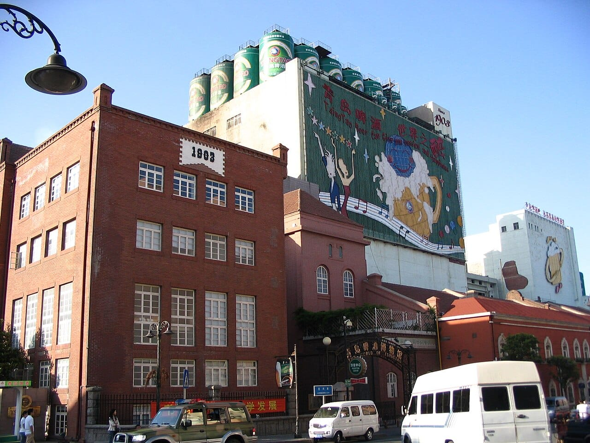

# Tsingtao Beer Museum

The Tsingtao Beer Museum is at 56 Dengzhou Road in Shibei District, Qingdao. It opened on 15 August 2003, the day of Tsingtao Brewery's centenary, on the site of the 1903 German-funded brewery. The museum therefore combines company history, German-era industrial buildings, historic equipment and beer consumption in one place. It is both a national first-class museum and a visitor site inside a working brewery, and that double identity makes it very different from an ordinary exhibition hall.

> **Visit information**
> - Address: 56 Dengzhou Road, Shibei District, Qingdao, Shandong, China.
> - Opening and booking: check the [official page](https://www.tsingtaomuseum.com/) before travelling; hours, tours and booking rules change by season.
> - Getting there and cost: check the official page before booking; this entry does not promise a fixed price.
> - Status: Verified; sources checked: 2026-11-08.

Figure: Tsingtao Beer Museum. Image: M. Weitzel, CC BY-SA 2.5, via Wikimedia Commons ([source page](https://commons.wikimedia.org/wiki/File:Tsingdao_Brewery.jpg)).

> **Quick verdict**
> **In one line:** This entry helps you decide whether Tsingtao Beer Museum deserves a detour, and what to check before visiting.
>
> - **Best for:** Anyone planning a visit to Tsingtao Beer Museum who needs to decide whether it deserves a half-day or a full day.
> - **Not for:** If you want only want a must-visit list and will not check booking, transport or opening hours.
> - **Check first:**
>   - A German-funded brewery was established in Qingdao in 1903 and later developed into Tsingtao Brewery.
>   - The museum occupies a 1903 German-style industrial complex, with about 15,000 square metres of floor area.

> **Decision checklist**
> Run these three checks before you buy or go.
>
> - **Place and history:** A German-funded brewery was established in Qingdao in 1903 and later developed into Tsingtao Brewery.
> - **Why Dengzhou Road:** Dengzhou Road lies in Shibei District's old town, next to the Taidong commercial area.
> - **Exhibits and route:** The museum occupies a 1903 German-style industrial complex, with about 15,000 square metres of floor area.

## Place and history

A German-funded brewery was established in Qingdao in 1903 and later developed into Tsingtao Brewery. Qingdao was then a German leasehold, and German industrial architecture, red-brick workshops and port logistics shaped the city's early industrial landscape. In 2003, for the brewery's centenary, the museum opened on the old Dengzhou Road plant. Its official introduction calls it China's first specialist beer museum. The claim stresses the "specialist beer museum" position, not that it was Qingdao's first museum of any kind.

The museum carries a dense set of labels: national first-class museum, national 4A tourist attraction, nationally protected cultural relic, national industrial-tourism demonstration site, national industrial heritage, national top-ten cultural heritage tourism case and national cultural industry demonstration base. "Nationally protected cultural relic" refers to the early buildings of the Tsingtao Brewery, not the whole working plant; "national first-class museum" is a museum assessment grade, not a beer-quality rating. Keeping these layers apart prevents a promotional label from being mistaken for a single fact.

This is not the same experience as visiting a European monastery brewery or a village pub. European beer visits often centre on brewing tradition and local flavour; the Tsingtao museum is closer to a combination of industrial heritage, brand museum and production-line window. The buildings are exhibits, the old equipment remains in place, and a glass wall reveals the modern automated line. Old and new in one frame is its strongest card.

## Why Dengzhou Road

Dengzhou Road lies in Shibei District's old town, next to the Taidong commercial area. When the German-funded brewery chose the site in 1903, it benefited from land at the edge of the built-up area, water and transport access. More than a century later the plant is surrounded by the city, and the museum has become an industrial relic inside an old urban quarter. This location explains two features of the visit: the red-brick industrial scale contrasts with the narrow streets, and parking is difficult, so metro plus walking beats driving.

Dengzhou Road later developed the "beer street" restaurant scene, and the museum entrance opens onto it. Many visitors conflate the two. The beer street is food and drink consumption; the museum is exhibition and production visitation. They are adjacent but have separate entrances and separate tickets. On a first visit, confirm that you are heading for the museum building, not a beer house along the street.

## Exhibits and route

The museum occupies a 1903 German-style industrial complex, with about 15,000 square metres of floor area. Its official introduction says the collection holds more than 30,000 objects, including archives from the German occupation period; the National Cultural Heritage Administration's 2023 annual report separately records 21 precious objects or sets. Those numbers indicate archives, equipment, packaging and images behind the display, not just a few old machines and posters.

The permanent displays are usually summarised as three zones: the century of history and culture, the production process, and the multi-function experience area. Visitors first pass through a "century memory corridor" and see early equipment such as the old electric motor, mash tun and boiling kettle. These are not objects imported from elsewhere; they are in-situ heritage tied directly to the plant's history. Further on, behind glass, lies the smart production line known as the "lighthouse factory", where traditional wooden fermentation tanks and fully automated filling equipment create a sharp time contrast.

The experience area is the other half of the museum. The official introduction mentions a VR brewing laboratory, a hop-identification system and customised beer-label printing. The first lets visitors simulate malt ratios; the others connect beer flavour with science and with a label you can take home. They work well as a mid-visit break, but do not skip the historical galleries to chase the interactive exhibits.

Follow three threads: German industrial architecture and urban history; the continuous change in brewing technology; and how branding and consumption turned a foreign drink into a symbol of Qingdao. Old equipment, archives, the line behind glass and the interactive stations each serve one of these. Seeing only one thread narrows the museum unnecessarily.

## How to visit

Allow two to three hours. Begin with the century of history and culture to follow the timeline from 1903; move to the production process to see the old motor, mash tun, boiling kettle and the automated line behind glass; finish in the experience area for interaction, tasting or a custom label. With one hour, prioritise the historical galleries and old equipment and skip the experience area.

Entry requires a real-name ticket, normally bought through the museum's official WeChat account, and checked against the original ID card or ticket QR code. The official site also mentions OTA platforms. In peak season, at weekends and on public holidays, buy ahead; the remaining on-site allocation may not be enough.

The best times are the first hour after opening or after 15:00. Tour groups cluster between roughly 10:00 and 15:00, crowding the corridors and the old equipment area. In July and August the museum opens earlier and closes later, so use the edges of the day. The beer street's evening trade does not overlap with museum closing time; do not treat "go to the beer street at night" as "see the museum at night".

Families with children can focus on the old equipment, the glass-walled line and the interactive displays; tasting depends on the ticket and age rules, and minors may not drink. Visitors interested in hops, malt and automated production should allow more time in the process zone rather than stopping only at photo spots.

## Practical information

Address: 56 Dengzhou Road, Shibei District, Qingdao, Shandong, China. Seasonal hours (official site): 1 January to 30 April, 08:30–17:30 (last entry 16:30); 1 May to 30 June and 1 September to 31 October, 08:00–18:30 (last entry 17:30); 1 July to 31 August, 07:30–19:30 (last entry 18:30); 1 November to 31 December, 08:30–17:30 (last entry 16:30). The homepage shows opening every day of the week; holidays and temporary closures follow notices.

Tickets (official ticket page): standard adult admission is 60 yuan, students 50 yuan and seniors 30 yuan, including halls A and B, one glass each of draft and pure beer, and beer nuts. A multi-style tasting ticket is 128 yuan, a speciality-beer ticket 100 yuan, a custom ticket 90 yuan, the three-hall ticket 100 yuan, the four-hall ticket 120 yuan and the theatre-game ticket 120 yuan; the VIP ticket is 269 yuan and must be booked two days ahead. Chinese guiding is 150 yuan per group of up to ten, foreign-language guiding 200 yuan per group (about 50 minutes), and a self-guided audio device 15 yuan. Student tickets are limited to full-time undergraduates and below aged 23 or under.

Free admission covers visitors aged 70 and over; children 1.4 metres and under accompanied by an adult; disabled visitors; active and retired military personnel; high-level talent card holders; and firefighters. Visitors aged 60–69, eligible students and veterans may receive half-price or concession tickets. The purchase page and on-site notice give the full policy; customer service is 400-169-1903.

Book with a real name through the "Tsingtao Beer Museum" WeChat account under "ticket guide — reserve and buy", and present the original ID card or ticket QR code at entry; tickets are also sold on OTA platforms.

By metro, take Line 1 or Line 2 to Taidong station, exit A, walk about 80 metres west along Taidong First Road, then about 550 metres south along Weihai Road and Dengzhou Road. Line 1 Guangrao Road station exit C and Line 2 Lijin Road station exit C also have walking routes. Bus routes 205, 217, 221 and 464 stop at "Tsingtao Beer Museum". Streets in the old town are narrow and parking is limited, so metro plus walking is the better choice.

Page verified 2026-11-08; opening status, prices and reservations are subject to official channels.

## Etiquette and common misconceptions

The first misconception is that "1903" is the museum's opening year. 1903 is the brewery's founding year; the museum opened in 2003 for the centenary. A panel showing 1903 is usually discussing plant history, not museum history.

The second is that "nationally protected cultural relic" means the whole plant is freely open. The protection status mainly covers the early buildings, and the museum route is separate from the production area. Looking at the line through glass is not the same as entering the workshop, which has safety and hygiene rules.

The third is to read "national first-class museum" as a beer grade. It assesses collections, research and public service, not flavour or quality; likewise, "4A tourist attraction" assesses tourism services, not curatorial quality.

The fourth is to assume a ticket includes unlimited tasting. Different tickets cover different things: some include admission only, others include tasting or custom experiences. Read before buying; topping up on site can exceed the budget. Do not drive after tasting; Qingdao's old streets are complex enough without alcohol.

Follow photography notices. Historic equipment, archives and production areas may ban flash or photography altogether. Do not touch equipment, climb barriers or enter closed areas for an "industrial" photograph. At peak times, do not block stairways for pictures; the queue behind you will build up.

This is a poor fit for anyone wanting a quiet art exhibition, no interest in industry or brand history, or only a meal on the beer street. It is not an "artisan beer tasting bar" but a museum built around industrial heritage; a mismatch of expectations will disappoint more than the displays themselves.

## Neighbourhood and routes

The museum opens onto Dengzhou Road, the beer street and the Taidong commercial area. A half-day route: enter at opening, spend two to three hours; eat on Dengzhou Road or in Taidong; visit Signal Hill, the Protestant church and the former governor's residence in the afternoon; finish at Zhanqiao Pier, Zhongshan Road or the waterfront.

For urban history, link the museum with the governor's residence, Signal Hill and the Jiangsu Road church into a "German architecture day". For an easier eat-and-walk day, the museum plus the beer street and Taidong pedestrian street is enough. Do not try to combine the museum with Laoshan and Zhanqiao in one day; travel time will eat the experience.

Closing time changes with the season: last entry is 16:30 in winter and as late as 18:30 in summer. Put the museum early in the itinerary rather than after dinner. The beer street's evening trade runs on a different clock; see the museum first, then eat.

## See also

The Tsingtao Beer Museum grounds the industrial history of [beer](ref:beer) in a specific city: German-style buildings, old equipment and urban consumption together form part of the modern beer story of [China](ref:china). It differs from a European monastery brewery or a village pub visit and is closer to a combination of industrial heritage and brand museum.

Further reading: [Tsingtao Brewery Company Limited](ref:c-extra-1), [Tsingtao Beer](ref:c-extra-2), [A Ginjinha](ref:c-extra-3).
