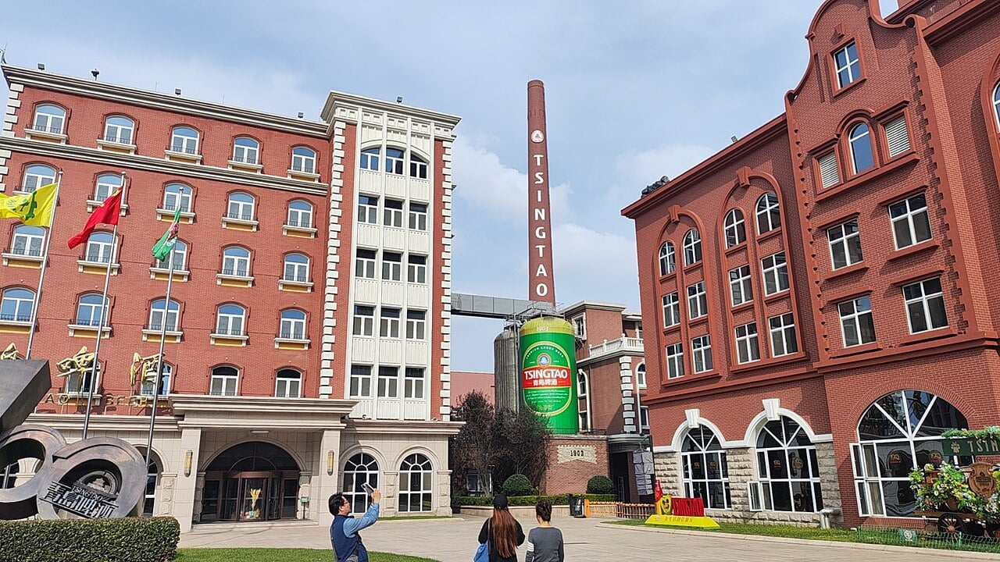

# Tsingtao Brewery (Dengzhou Road plant)

Number 56 Dengzhou Road is where Tsingtao beer was born and where the old plant still works. Visitors often call the whole place "the beer museum", but the museum and the brewery are not two separately ticketed attractions: the museum sits inside the plant, and its route runs from century-old workshops and equipment to a glass corridor beside the production floor. Once you understand that relationship, you know you are looking at a living factory rather than a museum of stopped machines.

Figure: The red-brick courtyard at the Tsingtao Brewery site on Dengzhou Road, with TSINGTAO lettering on the chimney and the green can-shaped installation. Image: Suginami, CC0 1.0, via [source page](https://commons.wikimedia.org/wiki/File:Tsingtao_Brewery_Museum_inside_2024.jpg).

## The plant and the city

In 1903 a German-funded brewery was established in Qingdao, on the site now occupied by the Dengzhou Road plant. Qingdao was then a German leasehold, and the red-brick buildings, pitched roofs, brewing vessels and underground storage spaces carried clear marks of German industrial architecture. The early buildings of the Tsingtao Brewery are now a nationally protected cultural-relic site; that protection covers the early structures, not the whole working plant. The distinction matters: the site is first a production unit and only second a visitor attraction.

Dengzhou Road is now surrounded by the city. The plant is large, the streets are narrow, and the red-brick walls contrast sharply with the older neighbourhood. The Dengzhou Road plant is one of several Tsingtao production sites, but its importance lies less in capacity than in the fact that brewing still happens on the original ground. Standing inside, you can see 1903 buildings, an old electric motor and a modern filling line through glass; that collision of old and new is what makes this site distinctive.

## The relationship with the museum

The Tsingtao Beer Museum opened on 15 August 2003, the centenary of Tsingtao beer, on the site of the 1903 German brewery. It is usually described as two halls: Hall A covers the century of history and old equipment, while Hall B sits next to the production workshop, where visitors look through a glass corridor at brewing and packaging. A 2026 report from the Qingdao municipal SASAC states plainly that the museum stands inside the still-operating plant at 56 Dengzhou Road and that Hall B's glass corridor overlooks the whole brewing and dispatch process.

So "Tsingtao Brewery" and "Tsingtao Beer Museum" are two layers of the same address: the museum is the visitor interface, the plant is the production entity. Without the museum's route and booking, visitors cannot walk into the workshops; conversely, seeing only the museum and ignoring the working plant would reduce an industrial heritage site to a stopped relic. If you only want displays, the museum is enough. If you want to understand that the old plant is still working, linger at the glass corridor in Hall B.

## German lager and production

Tsingtao's underlying style is German lager. Lager uses bottom-fermenting yeast at a relatively low temperature and then undergoes a period of cold storage, or lagering, which gives a cleaner body and a more stable aroma. The ingredients are water, malt, hops and yeast; Qingdao's water, German equipment and the early German brewers together shaped the city's beer. The exact recipe and process parameters are company information, and visitors do not need to ask for ratios. Seeing saccharification, boiling, fermentation and packaging is enough to understand how a glass of lager is made.

The question visitors ask most often is the difference between draft beer and pure-draft beer. Draft, or yuanjiang, tends to retain more yeast and suspended solids, giving a fuller body and pronounced malt aroma; it needs refrigeration and has a short shelf life. Pure draft is filtered and handled aseptically without heat pasteurisation, so it tastes cleaner and keeps longer. The standard museum ticket usually includes one glass of each, though the exact contents depend on the ticket page and the day. Tasting draft first and then pure draft, or the reverse, makes the contrast between full and crisp obvious; but do not treat the tasting as an unlimited bar.

## Visiting

The address is 56 Dengzhou Road, Shibei District, Qingdao. Opening hours change with the season: the official site lists 08:30–17:30 with last entry at 16:30 from January to April and November to December; 08:00–18:30 with last entry at 17:30 from May to June and September to October; and 07:30–19:30 with last entry at 18:30 in July and August. Holidays and temporary closures follow official notices. Allow two to three hours: Hall A for history and old equipment, Hall B for the production corridor, then the tasting area.

Tickets are usually booked in real name through the museum's WeChat account, and can also be bought through OTA platforms. The standard ticket includes Halls A and B plus one glass each of draft and pure-draft beer; tasting tickets, combined tickets and VIP tickets differ in price and content, so read the ticket page. Book ahead at weekends, holidays and in high season. The best times are the first hour after opening or after three in the afternoon, since tour groups cluster between ten and three; in summer the museum opens earlier and closes later, so use the edges of the day.

The plant is not a free-roaming industrial park. Do not leave the visitor route, push open production doors, or touch equipment and pipes. The glass corridor is for looking, not for entering the workshop. Check on-site signs before taking photographs; old equipment, archives and production areas may ban flash or photography. Families with children can focus on the old machines, the glass corridor and the interactive displays; the tasting depends on the ticket and age rules, and minors must not drink.

## Practical notes and manners

By metro, lines 1 and 2 stop at Taidong, from where the museum is walkable; buses also serve the "Tsingtao Beer Museum" stop. Dengzhou Road is narrow and parking is limited, so metro plus walking is easier than driving. If you take a taxi, ask the driver to drop you at the edge of Dengzhou Road rather than at the plant gate. Qingdao's summer sun is strong and the sea breeze can be deceptive while queuing; bring water and sun protection. In winter the museum closes early, so a visit after three in the afternoon may be too late for the full route.

Separate tickets from add-ons: entry includes the visit and the standard tasting, while guided tours, custom labels, theatre games and night tours may cost extra. Check what is included before buying, or you may end up paying twice on site. Do not drive after tasting; the old city has steep roads and one-way streets, and finding your way after a drink is a nuisance. Do not block the plant entrance for photographs, and group visits should be arranged with the museum in advance.

Finally, read "1903" correctly: it is the year the brewery was founded, while the museum opened only in 2003. A panel showing 1903 is usually telling brewery history, not museum history. "National key cultural relic" refers to the early buildings, not to free access to the whole plant; "national first-grade museum" assesses collections, research and public service, not the quality of the beer. Keeping these categories apart stops the marketing language from doing your thinking for you.

## See also

The Dengzhou Road plant grounds the German lager tradition of [beer](ref:lager) in a working old factory and turns [Tsingtao beer](ref:tsingtao-beer) from a brand name into buildings and equipment. For the wider family of styles, return to [beer](ref:beer); for the company behind the label, read the [producer profile](ref:producer) and the entry on [China](ref:china)'s modern industrial history.

Start with the address. From there, consider the current opening status, then what the place is known for. That is how a practical judgment about Tsingtao Brewery (Dengzhou Road plant) is built.

The comparison with [Beer](ref:beer) and [Tsingtao Brewery Company Limited](ref:producer) runs through address and space and operating status. Each answers a different question.
