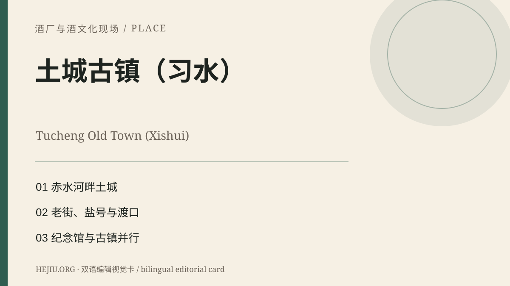
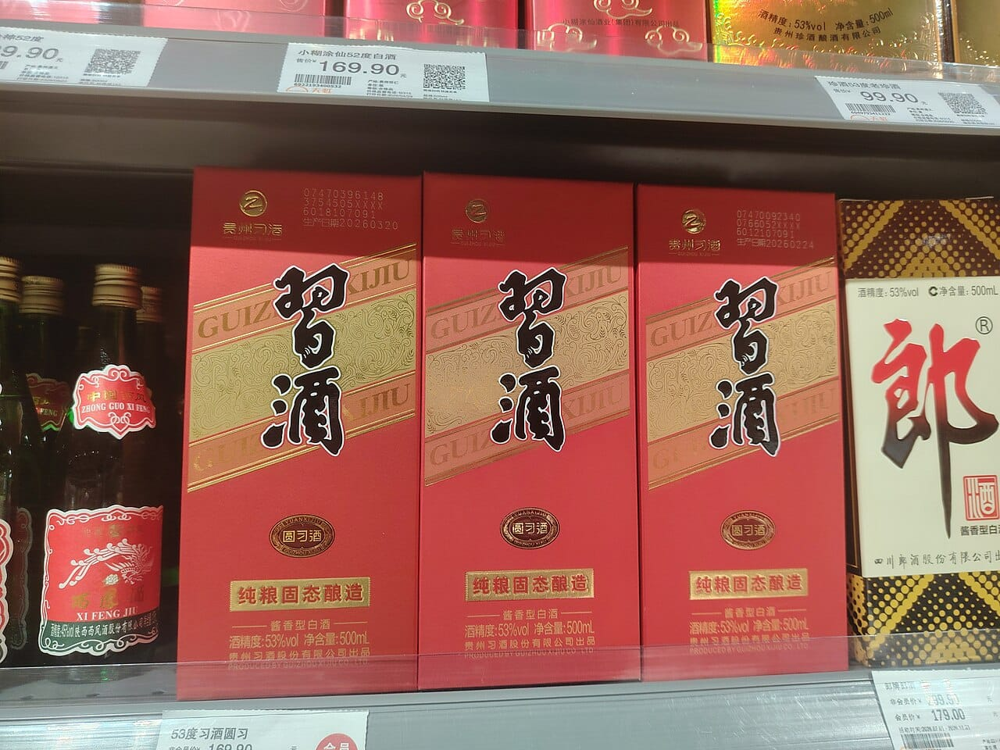

# Tucheng Old Town (Xishui)

Tucheng is not a tourist street living on the “old town” label alone. It began as a salt wharf on the Chishui, became an important ferry and memorial site of the Four Crossings, and now connects with sauce-aroma travel in Xijiu. Read two lines at once: the living line of salt firms, boat guilds, old streets and stilt houses, and the historical line of memorial, ferries and Long March narrative. Seeing only one makes the town thin.

Figure: Tucheng Old Town (Xishui) bilingual editorial card. Project-created bilingual editorial card for topic identification, not a documentary photograph.

> **Quick verdict**
> **Best for:** travellers who want both the Chishui salt town and Four Crossings history; pairs with Xijiu for two days.
> **Not for:** visitors who only want a photo old town and will not walk slopes or see exhibits; Tucheng is historically dense.
> **One line:** see the memorial first for the timeline, then walk the old street for salt transport and daily life; do not reverse the order.

## Old town and memorial at once

Tucheng has three layers. One is the Chishui wharf and old street, where salt firms, boat guilds, shops, stilt houses and stone steps form the texture of transport and daily life. One is the Four Crossings memorial and ferry sites, explaining the military movements around 1935. The third is today’s new town and tourist services, with restaurants, guesthouses and parking wrapped around the first two. The layers belong to different eras but stack on one slope. See the memorial first for the timeline, then walk the old street, and the salt firms and wharves will make sense.

## What the memorial explains

The memorial’s value is not a heroic slogan but clarity about movement, river crossings, diversion and supply. Follow three lines: how forces manoeuvred back and forth across the Chishui, how ferries and boats shaped operations, and how local society was changed by war. Maps and timelines matter more than single objects, so read the map before the vitrines. Follow on-site photo rules and do not use flash on documents or textiles. With children, explain why the river was crossed, how many times and where, then let them find Tucheng on the map.

## Old street, salt firms and wharf

Tucheng’s old street climbs the slope, mixing stone steps, narrow lanes, timber frames and stilt houses. In the salt era, salt firms handled storage, pricing and wholesale, boat guilds handled transport, and wharves handled loading. Today’s shops and guesthouses are later functions. Look at three things: how river-side stilt houses are supported, how a salt firm separates shopfront from warehouse, and how steps and drainage handle the slope. Do not only photograph old door panels; enter open exhibition rooms and look at salt tickets, scales, account books and boat gear to make “salt town” concrete.

## Getting there and time needed

Tucheng lies in western Xishui County on the Chishui River, usually approached from Xishui county town, Chishui or Zunyi. Roads are mountainous, buses are sparse, and self-driving needs time. The memorial and old street take about three hours; adding ferries, nearby exhibits and lunch makes half a day; pairing with Xijiu needs two days. The old town has slopes and stone steps, so wear non-slip shoes; after rain, older people and children should walk slowly. Park where directed and do not drive into narrow lanes. The riverside is humid in summer, so bring water and a hat.

## Pairing with Xijiu

A two-day Xishui loop can run Xijiu Town, Tucheng and Chishui: see the Xijiu plant and valley on day one and sleep in Xishui; reach Tucheng on day two, see the memorial first, then the old street and ferry, and return via Chishui or Zunyi in the afternoon. The reverse works too, but keep the memorial in the morning to avoid tour-group peaks. For food, try Tucheng glutinous-rice balls, Xishui mutton rice noodles, tofu pudding and river fish, keeping sauce-aroma liquor modest. Check production dates and packaging for local products, and avoid unpackaged liquor of unclear origin at mountain stalls.

## Build the timeline before walking the space

Do not start shooting at the old-street archway. Enter the memorial first and use the map and timeline to understand the direction of the Four Crossings; then walk to the ferry and old street and see how salt firms, boat guilds and stilt houses responded to river transport and slope; only then eat and buy local products. This order turns the same stone steps into a transport route rather than a backdrop. With only two hours, the memorial plus one stretch of old street is enough; with children, give them a map task instead of forcing dates. If you do one thing, spend twenty minutes at the memorial map to understand the direction of the Four Crossings and Tucheng’s position before walking the old street; the salt firms and wharf will then make sense on that slope. The steps are many and slippery after rain; do not shuttle back and forth, but walk memorial, ferry and old street in one direction. Eat lunch at the edge of the old street to avoid tour-group peaks, and ask about the return bus early rather than at dusk.

## Check before you go

- See the memorial before the old street
- Wear non-slip shoes for stone steps
- No flash inside the memorial
- Do not drive into narrow old-town lanes
- Check the source of bulk liquor before buying
- Explain the crossing route to children first
- Watch riverside slippery surfaces in rain
- Ask about return buses in advance
- Check talk times at the memorial notice
- Ask prices before bargaining in shops
- Do not stand close to the water at the ferry
- Avoid 10 a.m. entry on tour-group days
- Keep older relatives on the main street
- Hold the rail on wet stone steps
- Check production dates for local products

## Limits and next steps

Tucheng old town is about the salt wharves, the old street and the Red Army's four river crossings, not a distillery. It often pairs with the Xijiu estate as a half-day "two banks of one river" route, but a river crossing and a drive separate them; you cannot link them on foot. The town has many slopes and stone steps, slippery after rain, so grippy shoes help.

Food and lodging are mostly small local shops and guesthouses, tight on holidays; some historic sites need a separate ticket or a booked guide. Do not enter residents' courtyards to photograph, and watch the water level and boats at the wharf.

This page does not present Tucheng as a "baijiu sight". It is for understanding the Chishui's transport and history before returning to the distillery. If wine is your only interest, give the time to the estate; if the town and history interest you, allow at least half a day.

## References

- xsx.gov.cn — official source — https://www.xsx.gov.cn/zjxs/xsgk/jj2023/202605/t20260525_90206553.html (checked 2026-11-25)
- gzxijiu.com — official source — https://www.gzxijiu.com/about/introduction?menuId=r_5uFQaERX42fDKDI7O2B (checked 2026-11-25)
- zunyi.gov.cn — official source — https://www.zunyi.gov.cn/ (checked 2026-11-25)
- Official source — official source —  (checked 2026-11-25)

Related entries: [Xijiu Distillery](ref:distillery), [Xishui Xijiu route](ref:route), [Guizhou](ref:region), [China](ref:regioncn), [History of Chinese wine](ref:history), [sauce-aroma baijiu](ref:style), [First baijiu guide](ref:guide), [Xijiu](ref:brand).

## Related images

Image: Xijiu. Credit: Lhzss8, CC BY-SA 4.0, via Wikimedia Commons ([source page](https://commons.wikimedia.org/wiki/File:%E4%B8%80%E6%AC%BE%E4%B9%A0%E9%85%92.jpg)). Related image for Tucheng Old Town (Xishui).

The administrative division reference is the 2007 edition of GB/T 2260.
