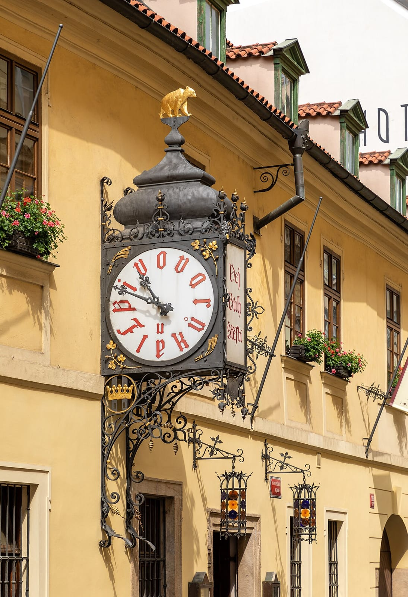

# U Fleků

Figure: U Fleků. Image: Dietmar Rabich, CC BY-SA 4.0, via Wikimedia Commons ([source page](https://commons.wikimedia.org/wiki/File:Prag,_U_Flek%C5%AF_--_2019_--_6735.jpg)).

## Setting and history

U Fleků stands at Křemencova 11 in Prague's New Town, close to Karlovo náměstí and about fifteen minutes on foot from Charles Bridge and the Old Town Square. In 1499 Vít Skřemenec bought the property, and the first record of brewing there dates from that purchase; the brand uses 1499 as its starting point. The building retains older Gothic walls below ground, which Prague's tourist board says were used for drying and roasting malt.

The name comes from the Flekovský family, who bought the property in the eighteenth century. In Czech, "U" means "at the place of", so U Fleků literally means "at Flek's". The nickname is more common than the formal company name, which is why the frontage says "U Fleků" rather than a string of corporate titles. It is often called Prague's oldest beer hall or its longest-running brewery; those claims rest on different measures. A safer description is "a beer hall with a documentary record from 1499 that still brews on the original site".

From the mid-nineteenth century the house settled into a formula of one dark lager plus Czech home cooking. It still supplies its taproom from its own microbrewery, brewing on the premises rather than assembling a list of outside brands. That combination of a single beer, an old building and live music makes it highly visible in the tourist core, and it attracts both the "historic institution" and "tourist trap" labels.

## The rooms and the beer

The building is made up of several halls and a courtyard, with rooms of different sizes, wooden panelling, vaults and old lights, and objects related to brewing and civic life on the walls. The atmosphere varies sharply: inner rooms are quieter, rooms near the courtyard and main passage are livelier, and a tour group can fill an entire hall. If you want a quiet meal, look at the rooms before choosing a seat.

The beer list is almost a single item: Flekovský tmavý ležák 13°, a dark, unfiltered lager. The "13°" is the Czech way of marking original gravity, not alcohol content; check the label or menu for the actual strength. It has pronounced malt sweetness, caramel and toasted bread, low bitterness, fine foam and a warmer serving temperature than ice-cold lager. The beer comes straight from the house brewery, and waiters carry small and large glasses through the rooms on trays.

Food is Czech home cooking: vepřo knedlo zelo (roast pork with sauerkraut and bread dumplings), svíčková (braised beef in cream with cranberries), roast duck, pork knuckle, sausage and potatoes. Portions are large and the seasoning is salty, which suits the dark lager. There are vegetarian and cold items too, but the safest first order remains roast pork or duck with dumplings. Check the menu for current dishes and prices.

## What to order on a first visit

Start with a small dark lager and a plate of roast pork with sauerkraut and dumplings; this combination explains what the place is. If you like it, order another glass; if not, switch to mineral water or a soup. Do not feel obliged to take a large glass just because there is only one beer. Anyone in the group who wants a comparison will find pale lagers and small-brewery seasonals at other Prague beer halls, so plan that for another meal.

Order by saying "tmavé" (dark) and the glass size; the waiter marks it on the table card. Service here is roving: a waiter may pass with a tray and put a beer on your table without asking. If you do not want it, refuse clearly and immediately, or the final bill will include glasses you did not order. Checking the card against the actual number of glasses before paying is the most practical piece of advice for this place.

Live accordion music is common and the atmosphere is loud, sometimes very loud. Choose an inner room to talk, or a seat near the courtyard for the music. Performances are usually supported by tips; whether and how much to give is your decision, not compulsory. In high season and at weekend evenings, tour groups make waiting and table-sharing routine.

## Practical information

**Address:** Křemencova 11, 110 00 Praha 1, Czech Republic.

**Getting there:** take Metro line B to Národní třída and walk about 5–6 minutes, or to Karlovo náměstí and walk about 6–8 minutes; trams also stop at Myslíkova or Karlovo náměstí. The old town is made for walking, but allow more than fifteen minutes from Charles Bridge, and note that the cobbles are hard on wheeled luggage. Check DPP for the day's connections and last trams.

**Opening hours:** Prague City Tourism lists daily 10:00–23:00. Holidays, New Year's Eve and special events alter this. The official U Fleků site returned no readable body on this visit, so the hours could not be second-checked there; confirm on the official site or by phone (+420 602 660 290) on the day.

**Tickets and reservations:** the beer hall has no admission charge; you pay for what you order. The brewery museum and cabaret require advance reservation. Their ticket prices, show times and whether a drink is included were not verified and must be confirmed through official channels. Walk-ins find their own seats; groups should ask in advance.

Prices are at the mid-to-high end for Prague's tourist core: the same beer can cost more here than in a residential district, while portions are large and one main plus two beers usually feeds two. Dress is casual. Many old Prague places still take cash, so confirm before paying by card.

Page verified 8 November 2026; opening status, prices and reservations are subject to the official channels.

## Etiquette and common mistakes

First, the table card is not decoration. The waiter records glasses on it and the bill follows the record; query anything you do not recognise on the spot. Second, ask before sharing a table and do not occupy a whole bench with bags. Third, tipping is not compulsory; rounding up or adding 5%–10% is common, and you state the total including the tip. Fourth, do not bring your own food or drink, and do not take glasses home.

Four myths are common: that 1499 settles the question of the world's oldest brewery (measures differ widely); that "only one beer" means a poor or limited offer; that the roving beer service is a trap (you can refuse, but must be clear); and that this is a quiet place for a date. The rooms and service are built for large tables, groups and a lively dinner.

This place does not suit anyone who dislikes dark lager, anyone sensitive to noise, anyone wanting to work quietly, or anyone in a hurry for a single quick drink. It works best as a full Czech dinner rather than a box-ticking stop.

## Around and routes

Walk south for Karlovo náměstí and the streets of the New Town, or north towards Charles Bridge, the Old Town Square and the astronomical clock; west lies the Vltava and the National Theatre. Put U Fleků in the evening: a Czech meal first, then Charles Bridge at sunset, then the Old Town Square, a route that flows without doubling back.

Prague's evening crowds concentrate on the Old Town Square and Charles Bridge. Křemencova, where U Fleků stands, is a little quieter but still within walking distance, so avoid the peak tour-group dinner slot or arrive early. If you only want one drink, afternoon is easier than evening. To extend the beer theme, Prague has small breweries and beer halls in other districts, so there is no need to crowd them all into the old town.

## See also

- [Beer](ref:beer): where dark lager sits in the family of beer styles.
- [Lager](ref:lager): the technical difference between Czech and German lagers.
- [Pub and city](ref:pub-and-city): how beer halls use seating, menus and hours to organise public life.

Further reading: [A Ginjinha](ref:c-extra-1), [À la Mort Subite](ref:c-extra-2).

Put [Beer](ref:beer)'s address and space next to [Reading a city through its bars](ref:pub-and-city)'s operating status; the difference marks the boundary.

## Related images

Image: Lager. Credit: Lars Curfs ( Grashoofd ), CC BY-SA 3.0 nl, via Wikimedia Commons ([source page](https://commons.wikimedia.org/wiki/File:Bitburger_Glass.JPG)). Related image for U Fleků.
