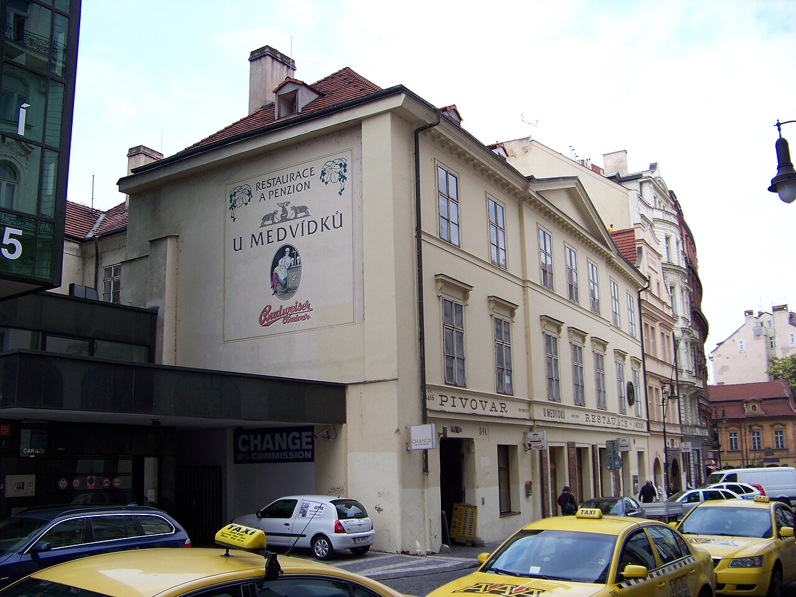

# U Medvídků

Figure: U Medvídků. Image: ŠJů ( cs:ŠJů ), CC BY-SA 3.0, via Wikimedia Commons ([source page](https://commons.wikimedia.org/wiki/File:Na_Per%C5%A1t%C3%BDn%C4%9B_5,_U_Medv%C3%ADdk%C5%AF.jpg)).

## A house in the Old Town, with a 1466 starting point

U Medvídků stands at Na Perštýně 7 on the edge of Prague's Old Town, between Národní třída and Bethlehem Square and about ten minutes on foot from the Old Town Square. The street level holds a restaurant and pub, the upper floors a hotel, the entrance a beer shop, and the yard and cellars a microbrewery. The building dates from the early fifteenth century, and the name comes from an early owner, Jan Nedvídek, who founded a brewery there in 1466, the year the brand cites.

For Praguers it is a place to eat and drink first and a sight second. Its position sits on the border between the tourist route and residential streets: west lies the theatres and shopping of Národní třída, east the cobbled lanes of the Old Town. Paired with [U Fleků](ref:u-fleku) on the same day, it shows two kinds of old Prague pub: one sells a single dark lager, the other makes its microbrewery the main attraction.

## From a large alehouse to a microbrewery

The house brewed until 1898. After that, small breweries could not compete with the new industrial plants, so the owners closed their works and joined the town brewery in Holešovice; Karel Vendulák, the last brewer, became its first director. The building was then converted into one of Prague's first large alehouses, and later housed the city's first cabaret, a tingl-tangl.

In the mid-twentieth century the property was taken over by the state without compensation and gradually decayed. After 1989 it was returned to the original owners' heirs and extensively rebuilt, with a hotel added. The final stage came in 2005, when the old malt house became a "house of beer" containing the shop, a conference hall and the microbrewery. The first brew was finished on 17 November 2004, deliberately fifteen years after the Velvet Revolution.

## Rooms and ordering: pub, restaurant and hotel in one

The entrance opens into a loud restaurant and bar with wooden panelling, vaults and old light fittings. Smaller rooms further in suit conversation, and the courtyard opens in good weather; above are 45 hotel rooms and a theatre hall seating about 100 for cabaret.

Ordering follows Czech pub custom: say the beer and the glass size, the waiter marks it on the table card, and you settle at the end. All beer comes from the house microbrewery and is unfiltered and unpasteurised, so it tastes fuller than industrial lager and depends on freshness. The menu is Czech home cooking: pork knuckle, roast duck, beef in cream with dumplings, sausage and sauerkraut.

## The beer list: from 13 degrees to X-BEER 33

Czech labels state original gravity in degrees, so "13 degrees" is not alcohol strength. Oldgott is a 13-degree semi-dark lager fermented and matured in oak, labelled Barrique, at 5.2% alcohol. Medvídek is a 15-degree pale speciality with a secondary fermentation in oak, at 6.2%. The 1466 is a 14.66-degree unfiltered lager with double hopping, at 6.1%. Medvídkovské bílé is a 12-degree wheat beer at 4.7%, and Blackgott a 14-degree dark speciality at 5.8%.

The showpiece is X-BEER 33, which the brewery calls the strongest beer in the world: a semi-dark lager fermented in oak for 200 days and bottled at 12.6%. Such records move, so treat the phrase as a house signature and a marketing claim rather than a permanent fact. It is sweet and hot, better shared than drunk alone.

## Tours and reservations

The microbrewery is shown as an "interactive beer tour", with dates arranged on request; call +420 736 662 900 or email restaurace@umedvidku.cz. There is no fixed public timetable, so party size, language and duration are settled in conversation. The point is not large tanks but old methods still in use: a 250-litre mash tun, open fermentation vessels, 500-litre oak barrels, natural cooling and manual bottling. Annual output is capped at 300 hectolitres, small enough to feel like a working exhibit.

For drinking and eating, no booking is needed; walk in and find a table. Groups, the beer-tasting menu and theatre performances are better arranged ahead. The [lager](ref:lager) here follows the Czech route of cold, long storage, in contrast with the industrial scale of [Pilsner Urquell](ref:pilsner-urquell-brewery): one guarantees consistency through size, the other builds difference with small vessels and old equipment.

## Practical information and common mistakes

**Address:** Na Perštýně 7, 110 00 Praha 1, Czechia. **Getting there:** Metro line B to Národní třída, about three minutes on foot; trams to Národní třída or Národní divadlo; ten minutes from the Old Town Square. **Hours:** daily 11:30–23:00; holidays may differ. **Cost:** a main course and two house beers is mid-range; tastings and performances are priced separately.

Three common mistakes: reading "13 degrees" as alcohol strength; assuming X-BEER 33 is still the world's strongest beer, a record long passed; and expecting a quiet old pub, when evenings bring groups and performances. Czech pubs also refill without asking, so say clearly when you have had enough. To compare Czech wheat beer, order Medvídkovské bílé: it shares the banana-and-clove profile of German [wheat beer](ref:wheat-beer) but is thinner and more refreshing. In a [Czech](ref:czechia) beer culture centred on lager, the value of this house is that it keeps both the micro scale and the old methods alive. This entry does not list coordinates; use official channels for those.

**In brief:** A historic Prague pub, restaurant and microbrewery on Na Perštýně, with a brewing record going back to 1466 and a 250-litre brewhouse known for oak-aged beer and X-BEER 33.

Begin with the address, move on to the current opening status, and finish with what the place is known for. That order keeps the reading of U Medvídků practical.

Start with [U Fleků](ref:u-fleku) for address and space, then read [Lager](ref:lager) for operating status. Seeing both keeps U Medvídků from being confused with a neighbouring idea.

The Prague pub also houses a small hotel and brewery, and its beer hall dates from the 15th century.

**Key facts.**

| Item | Detail |
| --- | --- |
| In one line | A historic Prague pub, restaurant and microbrewery on Na Perštýně, with a brewing record going back to 1466 and a 250-litre brewhouse known for oak-aged beer and X-BEER 33. |
| Address | Na Perštýně 7, 110 00 Prague 1, Czechia |
| City and country | Prague / Czech Republic |
| Status | verified open |
| Official site | umedvidku.cz |

**Sources and limits.** The key claims about U Medvídků are checked against the following sources: Hotel, restaurace a pivovar U Medvídků (Used to check the daily 11:30–23:00 restaurant hours and the courtyard seating), Prague City Tourism (Used to check walking distances in the Old Town and the surrounding streets). For current products, addresses or opening status, use umedvidku.cz. Prices, batches and status change; the body is project-written and does not reproduce source text.
