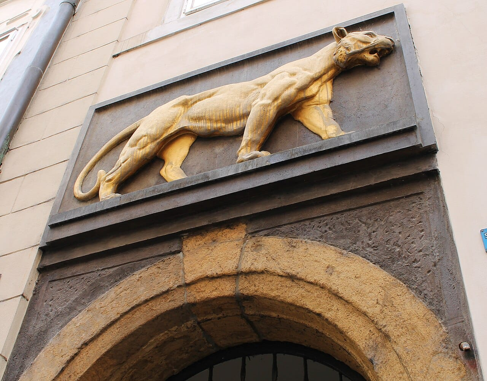

# U Zlatého tygra

From Prague's Old Town Square, walk south and turn into Husova. After a few minutes you reach an old house with a relief of a walking golden tiger above the door. This is U Zlatého tygra ("At the Golden Tiger"), one of Prague's best-known beer halls. It has none of Café Slavia's high windows and mirrors, and no menu designed for tourists. A long table, rows of chairs, photographs on the wall and a steady supply of Pilsner Urquell are most of the experience.

Figure: The golden tiger house sign above the entrance of U Zlatého tygra. Image: Sarah Stierch, CC BY 4.0, via Wikimedia Commons ([source page](https://commons.wikimedia.org/wiki/File:M%C4%9Bstsk%C3%BD_d%C5%AFm_U_zlat%C3%A9ho_tygra_-_Stierch.jpg)).

> **Quick verdict**
> **In one line:** This entry helps you decide whether U Zlatého tygra deserves a detour, and what to check before visiting.
>
> - **Best for:** Anyone planning a visit to U Zlatého tygra who needs to decide whether it deserves a half-day or a full day.
> - **Not for:** If you want only want a must-visit list and will not check booking, transport or opening hours.
> - **Check first:**
>   - The house dates from the fourteenth and fifteenth centuries and was connected to one of Prague's most valuable architectural complexes.
>   - Find a seat yourself.

## Setting and history

The house dates from the fourteenth and fifteenth centuries and was connected to one of Prague's most valuable architectural complexes, the palace of the Lords of Kunštát and Poděbrady. Its earlier names included "At the Black Tiger", "At the Diggers" and "At the Krafts"; the Gothic cellars still show traces of Renaissance and Baroque rebuilding. In the early eighteenth century the house acquired the Golden Tiger sign, and the walking-tiger relief above the door continues that tradition. It is important to separate the age of the house from the age of the beer hall: the building is over 600 years old, while the recorded beer hall is much later.

In the first half of the nineteenth century the house was a meeting place for the Czech national revival. The official history notes that a beer hall appears in a city description in 1816, and that in the 1830s the famous Šochov and Šmiler patriotic café occupied the room. It functioned as a kind of reading room where Mácha, Tyl, Palacký, Sabina and Čelakovský could read European magazines and exchange political and cultural news. Later the café became a pub, with beer drawn from the cellars into dark glazed earthenware jugs. The "literary" character of the Golden Tiger therefore began with a café and reading room, not with beer.

The democratic tradition continued in the twentieth century. After the war, Czech actors, singers and artists gathered on the bench by the wall and at the long tables; the table to the right of the entrance belonged to the "Golden Prague" intelligence club, whose members included painters, sculptors, doctors, economists and arts administrators. The club's life president was the writer Bohumil Hrabal, who usually sat at the back, near the kitchen entrance. Hrabal used the place as a meeting room and as a workshop; his work has been translated into 29 languages, and the beer hall became a point on Prague's literary map.

In January 1994 Václav Havel brought US President Bill Clinton to the Golden Tiger for a beer. The visit was repeated so often afterwards that it became proof that a beer hall could receive a head of state. The official history also preserves an earlier anecdote: the French Prime Minister Herriot came incognito before the war and found the parliament's chamber president, the president of the administrative court, a painter and a manufacturer of funeral lamps at neighbouring tables, then remarked that democracy was not in France but here. The stories are partly legend, but they make the same point: the Golden Tiger is not an "upscale" venue, but a place that puts different classes at the same long table.

## The room and the beer

The room is narrow, old, crowded and loud. A narrow passage leads to long tables and wall benches; photographs of Hrabal, actors, painters and regulars cover the walls. There is no background music and no designed menu. Tables are not allocated by party size, and sharing with strangers is normal. Nod before sitting down and push your chair back when leaving. The toilets are at the back, the floor is old and the light is dim; do not expect a modern bar's polish.

The drinks list is extremely short: Pilsner Urquell 12°, in half-litre glasses, with a thick head and a clean bitterness. A few other drinks and spirits exist, but almost everyone orders Pilsner. The temperature and the pour are controlled by the house, and the waiter keeps bringing glasses until you signal with a gesture or ask for the bill. Do not ask for a "tasting selection" or "the best craft beer"; this is not a craft bar, and a single brand is the point.

Food is Czech beer-hall fare: pork neck with bread and mustard, pickled sausage, sauerkraut, potatoes, toasted bread, cheese and onions. Portions are small and meant to accompany beer. For a full dinner, go to a restaurant nearby; do not order a "complete dinner" at the Golden Tiger. Prices are per glass and per plate, low-to-mid for the Old Town. Cash has long been the habit; cards may now be accepted, but do not assume they are.

## What to order on a first visit

Find a seat yourself. If there is space at a long table, sit down and ask "is this okay?"; do not wait at the door to be seated. The waiter will ask how many beers you want. Say "one" or "two" rather than studying the menu for half an hour. When the beer arrives, take a sip before deciding whether to continue. To stop, push the glass slightly forward or gesture; the waiter will understand. For food, order pork neck or sausage with bread, enough for two people to share.

Timing matters. The pub opens at 15:00; the first two hours are quietest, with more locals and regulars. After 18:00 office workers and tourists mix and the volume rises. After 21:00, close to closing, the atmosphere loosens. Hrabal's table is usually used by regulars or the club; do not sit there for a photograph. If it is empty, ask the waiter first. The Clinton photographs are on the wall, but there is no "presidential special"; do not order one.

On the bill: beer is priced by the glass and food by the plate. The total is written on a slip or given orally, and a tip of about 5%–10% is left on the table. If the house is cash-only, withdraw Czech korunas beforehand; paying in euros costs you on the exchange rate. When sharing a table, do not move another person's glass or put your coat on the neighbouring seat.

## Practical information

**Address**: Husova 17, 110 00 Praha 1, Czechia. About 5 minutes on foot from Old Town Square. The door is on Husova, with the golden tiger relief above it. Look for "U Zlatého tygra" and the narrow entrance.

**Transport**: Metro line A to Můstek or line B to Národní třída, then 8–10 minutes on foot; trams to the Old Town Square area, then walk. Husova is pedestrianised, so cars cannot stop at the door; the nearest drop-off is on Národní or at Old Town Square.

**Opening hours**: Daily 15:00–23:00. Holidays may alter this; check the official site or the notice at the door. `operating_status` is `verified`, meaning the official site still showed the pub as trading on 20 November 2026; this does not guarantee that it opens every day. Telephone +420 222 221 111 for groups or special inquiries.

**Reservations**: The Golden Tiger generally does not take ordinary reservations and works with long tables and sharing. Groups, Hrabal's table and special events can be discussed by telephone. There is no dress code; everyday clothes are fine. Children are welcome, but the room is loud and narrow and pushchairs are awkward.

**Prices**: Beer and beer-hall food are low-to-mid for the Old Town; exact prices are on the menu or given by the waiter. Cash is preferred and card acceptance may be limited; the tip is separate. Do not pay a large euro note and expect a good rate or change.

Page verified 20 November 2026; opening hours, prices and payment methods are subject to official channels.

## Etiquette and common mistakes

First, do not treat the Golden Tiger as a Hrabal museum. It is a working beer hall; regulars are eating, drinking and reading newspapers, not acting as exhibits. Second, do not occupy Hrabal's table for a photograph. The table has a regular and club usage; even when empty, ask first. Third, do not ask for a "multi-beer tasting"; the house is committed to a single Pilsner brand and a very short list. One glass is the point.

Three more mistakes are common. One is confusing the fourteenth-century house with a fourteenth-century beer hall; the building is old, the recorded pub is much later. Another is treating "cash only" as an absolute rule; it has long been the habit, but payment methods can change, so look at the counter sign. The third is thinking that sharing a table is rude. At the Golden Tiger, sharing is the norm; refusing to share is the unusual choice.

The pub is not right for someone who wants a quiet full dinner, does not drink beer, or is sensitive to crowds, noise and old surroundings. It suits an afternoon glass, a plate of beer-hall food and watching local conversation, and anyone who wants to feel Prague's beer-hall culture.

## Nearby and routes

The Golden Tiger is on Husova. North is Old Town Square and the Astronomical Clock; south is Národní and Café Slavia; west is the direction of Charles Bridge. Put it on a "Old Town Square–Husova–Národní" route: a glass at 15:00, Old Town Square at 16:00, dinner or coffee at Slavia at 18:00. About 20 minutes on foot, with no transport needed.

For a beer theme, add U Fleků or another Old Town beer hall. The Golden Tiger is smaller and more local; U Fleků is more tourist-oriented and more theatrical. Do not schedule both on the same evening, or both the palate and the experience will tire.

Husova is narrow and people often stand outside with a drink, so allow space when photographing. In the evening the Old Town is crowded; watch your wallet and phone. If a group has booked the pub or a film crew is working at the door, do not force your way in; come back another day.

## See also

- [Pubs and the city](ref:pub-and-city): how beer halls use long tables, sharing and opening hours to organise public life.
- [Café Slavia](ref:slavia): another Prague site of literary and political memory, useful as a contrast with the Golden Tiger's beer-hall character.
- [Pilsner](ref:pilsner): the beer style the Golden Tiger sells, and the bitterness and foam behind it.
- [Beer](ref:beer): raw materials, fermentation and serving, for understanding beer-hall culture.
- [Café Hawelka](ref:hawelka): a Viennese family café and another version of the "writers' regulars" tradition.
