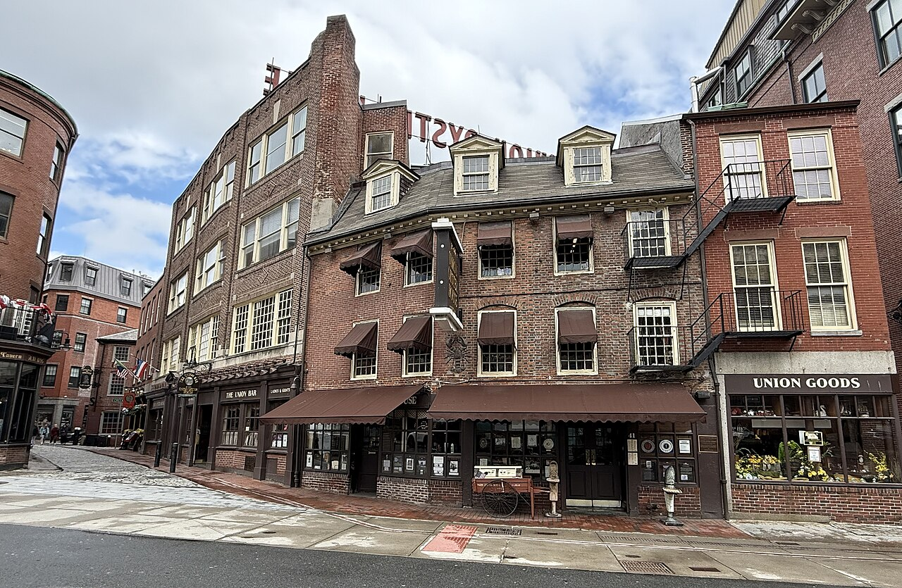

# Union Oyster House

Walk from Faneuil Hall along Union Street and a three-and-a-half-story Georgian brick building appears among the modern storefronts, with an “est. 1826” sign and oyster shells in the window. This is the Union Oyster House. It is often called the longest continuously operating restaurant in the United States, and it is also one of the easiest places on the Freedom Trail to mistake for a tourist set piece until you see the shuckers working, the lobster pots and the bowls of chowder moving through the room.

Figure: The brick facade and entrance of the Union Oyster House on Union Street, Boston; the restaurant opened in 1826 in a building whose history reaches back to the 18th century, so the photograph does not show its 1826 appearance. Image: Seasider53, CC BY 4.0, via Wikimedia Commons ([source page](https://commons.wikimedia.org/wiki/File:Union_Oyster_House_2025.jpg)).

## Location and history

The official history dates the restaurant to 1826, when Capen's dry-goods store gave way to Atwood & Bacon's oyster house. The building is much older than the restaurant. The official site says it has stood on Union Street for more than 250 years but that Boston has no clear municipal record of its construction; the National Park Service and local histories usually trace the main structure to the early 18th century. “1826” is the restaurant's opening year, not the building's birth year.

The building had other lives before oysters. In the years around the American Revolution, Isaiah Thomas printed the Massachusetts Spy here; later it served as a dry-goods and hay business before becoming an oyster house. When it opened in 1826, Boston Harbor still supplied oysters, and Union Street was close to the docks and markets, so oysters, fish and shellfish were the natural business. The semicircular oyster bar that survives today is a remnant of the older style of eating: stand at the bar, order a dozen, eat quickly, and leave.

In the 19th century the restaurant was a meeting point for politics and commerce. Daniel Webster is said to have eaten oysters and drunk brandy here, with the often-repeated detail that he could finish six dozen oysters followed by a glass of spirits. The number is not a documented fact, but the story captures the restaurant's position between Boston's elite and its port workers. In the 20th century the Kennedy family became associated with the place, and the upstairs “Kennedy booth” became a photo stop. The building was designated a National Historic Landmark in 2003; the restaurant marked its 200th anniversary in 2026.

The “American toothpick” story is another well-worn tale. In the 19th century Charles Forster manufactured toothpicks in Maine; according to local lore, he paid Harvard students to eat at the Union Oyster House and demand toothpicks, creating a fashion that spread across the country. The story appears in local histories and restaurant retellings, but the paper trail is incomplete. It is better presented as legend than as a single documented event.

## Space and drinks

The restaurant occupies a narrow, deep old building. The front room is busy; a wooden staircase leads upstairs. The most distinctive space is the semicircular oyster bar: a curved wooden counter ringed with stools, with shuckers working behind it and oysters arranged by origin and size. Upstairs is quieter, with wider tables for full meals; downstairs, near the bar, is better for one or two people eating oysters and drinking quickly.

The menu follows the Boston harbor tradition: oysters and clams, lobster (steamed or boiled), New England clam chowder, fish, lobster rolls and old-fashioned desserts such as Indian pudding. The drinks list is not complicated: beer, wine and classic cocktails, with tap and bottled beer at the bar and a martini or whiskey available. This is not an inventive modern restaurant. Its strength is fresh shellfish, traditional preparation and a room with real history; expecting elaborate plating will lead to disappointment.

## How to drink

When ordering oysters, ask what is available that day, where each variety comes from and how large it is, then decide between a half dozen and a dozen. New England service usually comes with lemon, hot sauce or mignonette; do not add every condiment at once. Taste one plain first, then adjust. For a crisp match, choose a dry white wine, a lager or a pale ale; for chowder and lobster, a richer white wine or an amber beer works better.

For a “history stop,” aim for a weekday afternoon: a half dozen oysters, a bowl of chowder and a beer at the bar, watching the shuckers, is closer to the restaurant's daily life than a formal upstairs dinner. For a full meal, reserve ahead; in tourist season the line can be long, and the bar is usually easier to reach than a table.

## Practical information

The address is 41 Union Street, Boston, MA 02108. It is on the Freedom Trail, a block from Faneuil Hall and Quincy Market; the nearest subway stations are State Street and Government Center. Hours are usually Sunday–Thursday 11:00–21:00 and Friday–Saturday 11:00–22:00, with the bar serving until midnight. Holidays and private events can change that; check the official site.

The restaurant takes reservations, and they are recommended for dinner and groups. The bar and some walk-in seats are first come, first served. The legal drinking age is 21, and ID is required. There is no hard dress code, but the place is a formal restaurant and a historic landmark at once, so business casual works better at dinner. Tipping 18%–20% of the pre-tax bill is standard; add a little more for exceptional shucking service at the bar.

## Etiquette and common misconceptions

The first misconception is that “1826” means the building dates from 1826. The restaurant opened in 1826; the main building reaches back to the 18th century. The second is treating “America's oldest continuously operating restaurant” as completely uncontested. A safer phrasing is “often called the longest continuously operating restaurant in the United States” and noting that it has operated at this Union Street address since 1826. Third, bigger oysters are not automatically better: size, origin and season determine flavor, so ask the bar. Fourth, the Kennedy booth is not an ordinary table; it usually needs a reservation or a minimum, depending on the house rules. Fifth, this is a working restaurant: do not block the serving aisle or hold bar stools for photos without ordering.

## Nearby and routes

Leave the restaurant and walk north to Faneuil Hall and Quincy Market, south to the Rose Kennedy Greenway and the harbor, or west along the Freedom Trail to Boston Common. Pair the Union Oyster House with the [Bell in Hand](ref:bell) on the same Union Street walk: oysters first, a pint after, or the reverse. For the darker side of Boston's port trade, read [The Boston Molasses Flood](ref:molasses); to compare old bars and old restaurants in the Northeast, read [McSorley's Old Ale House](ref:mcsorleys), [A History of Taverns](ref:taverns) and [Understanding a City Through Its Pub](ref:pub-city).

## Further reading and see also

- [Bell in Hand Tavern](ref:bell)
- [McSorley's Old Ale House](ref:mcsorleys)
- [The Boston Molasses Flood](ref:molasses)
- [A History of Taverns: From Alehouses to Bars](ref:taverns)
- [Understanding a City Through Its Pub](ref:pub-city)

Start with [Bell in Hand Tavern](ref:bell) for address and space, then read [The Boston Molasses Flood of 1919: An Industrial-Alcohol Disaster](ref:molasses) for operating status. Seeing both keeps Union Oyster House from being confused with a neighbouring idea.
