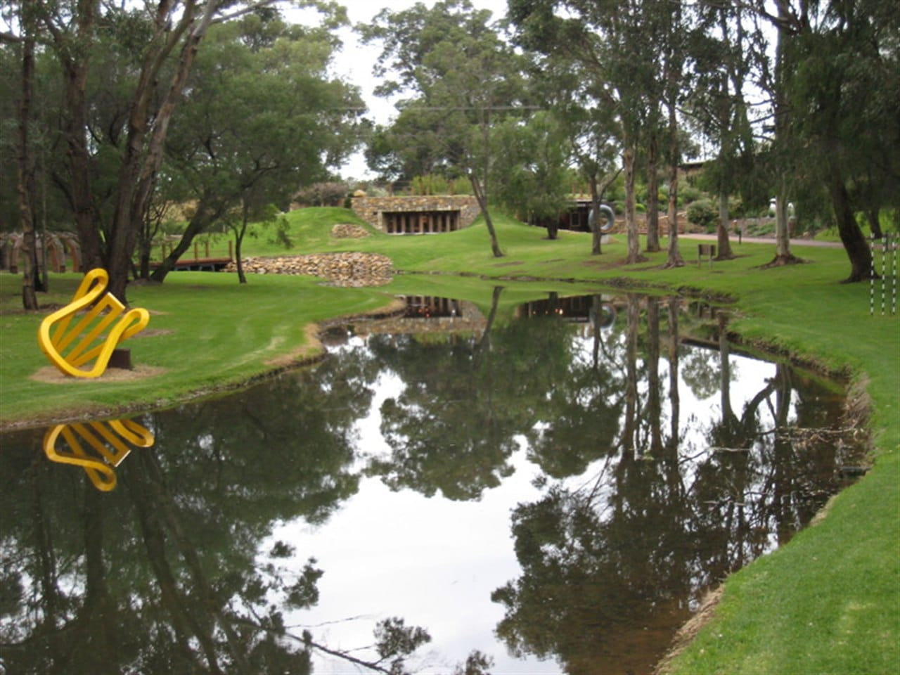

# Vasse Felix

Vasse Felix is Margaret River’s founding wine estate, planted by Tom Cullity at Wilyabrup in 1967. It built its reputation on Cabernet Sauvignon and Chardonnay, and today combines a working winery with a cellar door, restaurant, art gallery and wine museum.

Figure: Vasse Felix: Vasse Felix Winery (Wikimedia Commons). Image: Mark Pegrum, CC BY-SA 2.0, via Wikimedia Commons ([source page](https://commons.wikimedia.org/wiki/File:Vasse_Felix_Winery.jpg)).

> **Quick verdict**
> **In one line:** This entry helps you decide whether Vasse Felix deserves a detour, and what to check before visiting.
>
> - **Best for:** Anyone planning a visit to Vasse Felix who needs to decide whether it deserves a half-day or a full day.
> - **Not for:** If you want only want a must-visit list and will not check booking, transport or opening hours.
> - **Check first:**
>   - Vasse Felix lies in Wilyabrup, in the northern part of the Margaret River region of Western Australia.
>   - The visit centres on the cellar door, restaurant, art gallery and The Vault wine museum.

## Position and history

Vasse Felix lies in Wilyabrup, in the northern part of the Margaret River region of Western Australia, about four kilometres from the Indian Ocean and fifteen minutes from the town of Margaret River. Its address is on Bussell Highway at Cowaramup; visitors turn off Caves Road onto Tom Cullity Drive, named after the founder. Vineyards, fermentation rooms, cellars, restaurant and gallery sit on the same slope, so the visit follows a short but complete chain from grape to table.

In 1967, Dr Thomas Brendan Cullity bought land at Wilyabrup and planted vines. His aim was not a safe commercial bet but a test: could this poor, coastal soil make serious wine? In 1972 Vasse Felix produced Margaret River’s first serious wines, a Cabernet Sauvignon–Malbec and a Riesling. That vintage is treated as the beginning of commercial winemaking in the region, and it turned the local hypothesis into something people could taste.

Recognition followed quickly. In 1973 the Cabernet won gold at the Perth Wine Show; in 1979 it took second place at the New York Trade Fair, and in 1985 it was named best red wine at the London Trade Fair. For a remote region that had started only in the 1960s, these awards were proof to outside capital and consumers. In 1987 the Holmes à Court family took over the estate and gradually focused it on Margaret River’s two strongest card suits: Cabernet Sauvignon and Chardonnay.

This history is often reduced to “founded in 1967”, but three decisions shaped the Vasse Felix of today: proving the region with Cabernet in the 1970s, repositioning the brand under new ownership in the 1980s, and professionalising viticulture and winemaking in the 2000s. Those decisions explain why the range runs from flagship and single-site wines to everyday styles, and why the estate invests so heavily in hospitality and tourism.

## Vineyards and terroir

Vasse Felix works around three specially selected vineyards, with the Home Vineyard planted in 1967 at heart. The site sits on a slope at Wilyabrup, about four kilometres from the sea; ocean breezes lengthen the ripening season, while lean, well-drained gravel loam forces roots deep. The oldest Cabernet Sauvignon and Malbec blocks, known as Tom’s Plots, supply the flagship TOM CULLITY and represent the estate’s most valuable vine material.

The Adams Road Vineyard, planted in 1998 in the warmer Carbunup area, covers about 147 hectares with deep red and sandy loam, gravel and patches of clay. Its role is not to copy the tension of the Home Vineyard but to provide riper, rounder fruit for Filius and the Classic Collection. The contrast between the two sites is a useful reminder that Margaret River is not one uniform region: distance from the sea, aspect and soil can give the same variety two different personalities.

Cabernet Sauvignon dominates the plantings, followed by Malbec, Petit Verdot, Shiraz, Chardonnay, Sauvignon Blanc and Semillon. Vasse Felix also holds old Houghton Cabernet material, a clone that reached Western Australia in the nineteenth century and is grown on its own roots here. That material is known for blackcurrant, berry and fine tannin, and it is a significant part of the region’s Cabernet identity. Vineyard management emphasises soil health, biodiversity and vine longevity, and the estate is certified under Sustainable Winegrowing Australia.

## Winemaking and wines

The Vasse Felix approach is often described as minimal intervention with precise control. Cabernet is typically fermented in small batches with wild yeast, macerated for up to thirty days, basket-pressed and matured in French oak for twelve to eighteen months. The team also experiments with large-format oak, concrete and clay, comparing how different vessels affect oxidation, texture and fruit expression. Not every trial reaches the market, but the experiments help explain why the same site can produce several expressions of Cabernet.

The range falls into three broad tiers. At the top are TOM CULLITY Cabernet Sauvignon–Malbec and the Heytesbury Chardonnay and Cabernet: the first comes from the original 1967 plantings, while Heytesbury is the estate’s long-term statement of the Margaret River classics. Premier sits in the middle, usually with more specific block or clone selection and greater concentration. Filius and the Classic Collection form the entry tier, drawing on warmer sites such as Adams Road for wines designed to be approachable, consistent and restaurant-friendly.

Vasse Felix Chardonnay typically shows citrus, white flowers and hazelnut, with bright acidity and restrained oak. The Cabernet has a spine of blackcurrant, blackberry, cedar and graphite, fine tannin, and a long ageing curve that brings tobacco, leather and cedar spice. The flagship wines are not built on high alcohol or heavy new oak; they rely on ripeness, complete acidity and tannin texture. That is why they can seem less generous when young but often age better than flashier styles.

## Visiting and spaces

The visit centres on the cellar door, restaurant, art gallery and The Vault wine museum. The cellar door is normally open daily from 10 a.m. to 5 p.m.; the restaurant runs from noon to 3 p.m., and the estate closes on Good Friday, Christmas Day and Boxing Day. Tastings, restaurant bookings and tours are best reserved in advance; groups and private tastings need separate arrangements, and waiting times grow in harvest season and at weekends.

The buildings are worth slow looking. The route between fermentation rooms, underground cellar and tasting room shows a working production chain rather than a theme-park set; the gallery and museum collect estate history, labels, old equipment and regional memory. Respect the boundary between working and visitor areas: fermentation rooms, cellars and vineyard blocks are not always open for photographs, and during harvest you should ask staff which areas can be entered.

For a first tasting, start with an entry Chardonnay or Filius Cabernet to establish a baseline, then move to Premier and the flagship wines. That way you can taste the difference made by fruit source, oak and ageing potential instead of being led by the word “flagship”. The restaurant is a good place to put the wine beside local food: Margaret River seafood, lamb, cheese and olive oil all make the structure of the wine easier to read.

## Drinking and pairing

Vasse Felix Cabernet suits red meat and spice: roasted lamb, braised beef, venison, black pepper and rosemary are reliable matches. Its tannin and acidity cut through fat, while blackcurrant and cedar connect with the char on the meat. Chardonnay works with seafood, white meat, cream sauces and mushrooms, but Vasse Felix Chardonnay has real acidity, so very heavy cream sauces need care. Filius is the easier everyday choice; the flagship wines reward planning and cellar space.

Serve Cabernet at about 16–18°C and Chardonnay at about 10–12°C. Too warm and the alcohol and bitterness dominate; too cold and the aroma shuts down. After opening, give Cabernet a small pour and twenty to thirty minutes before judging. Vasse Felix wines rarely need aggressive decanting, and too much air can strip the acidity and fruit. In a restaurant, ask which vineyard and vintage the wine comes from before deciding whether to order a second bottle.

## Practical information

Vasse Felix is about fifteen minutes by car from Margaret River town. From Bussell Highway, turn onto Caves Road and then into Tom Cullity Drive; there is parking, though weekends and event days can be busy. The cellar door, restaurant and gallery fit into half a day; with lunch and a vineyard walk, allow three to four hours. Do not try to squeeze Vasse Felix and Leeuwin Estate or Cape Mentelle into the same half-day: the points look close on a map, but driving, bookings and tasting time add up.

Opening hours, menus, tasting fees and booking rules change, so check the estate website before travelling. If you bring children or older relatives, confirm child seats, step-free access and seating areas in advance; vineyard tracks and stone steps are not always suitable for pushchairs. If the estate is closed or a booking is cancelled, check the website and phone rather than forcing an old itinerary; keep a nearby village or another winery as a backup.

## Etiquette and common misreadings

A winery is not a theme park. Arrive at your booked time, wear shoes that can handle a vineyard, do not photograph working areas, do not touch equipment and do not take tasting glasses home; ask before bringing large groups or young children. Spitting wine into a spit bucket is professional etiquette, not rudeness. If you are driving, keep to one or two tastings or choose bottles to take away.

The most common misreading is to treat Vasse Felix as only a photo stop. It is a working estate: vineyards, fermentation rooms, cellars and restaurant are connected, and visitors should respect the production rhythm. Another mistake is to treat Heytesbury, TOM CULLITY and Filius as the same tier. They represent flagship, single-origin and entry positions, with different prices and ageing potential; “Vasse Felix” alone does not describe what is in the bottle.

## Surroundings and routes

Vasse Felix works well as the first stop on a northern Margaret River route: from the estate you can continue south to Leeuwin Estate, Cape Mentelle or Margaret River town, or north to Cowaramup and the Gracetown coast. With one day, choose Vasse Felix, one contrasting winery and lunch; four stops will make every visit shallow, especially because the buildings, gallery and restaurant deserve time.

To understand the region rather than just the brand, see Vasse Felix for history and flagship style, then visit a smaller family winery for a different business model. Margaret River “style” is not a slogan; it is a set of choices about distance from the sea, soil, clone, yield and oak. Comparing two estates teaches more than memorising ten wine names.

## Further reading and see also

- Related entries: [margaret-river](ref:margaret-river), [australia](ref:australia), [chardonnay](ref:chardonnay), [cabernet-sauvignon](ref:cabernet), [oak-ageing](ref:oak).
- This entry does not provide live prices, menus or opening status; check the estate website and regional association before visiting.
- To compare Vasse Felix tiers, taste one Filius, one Premier and one TOM CULLITY in the same visit and record fruit, acidity, tannin and oak.

## Related images

Image: Renmark South Australia Vineyard. Credit: Feral Arts, CC BY 2.0, via Wikimedia Commons.. Credit: Feral Arts, CC BY 2.0, via Wikimedia Commons ([source page](https://commons.wikimedia.org/w/index.php?curid=9069567)). Related image for Vasse Felix.
