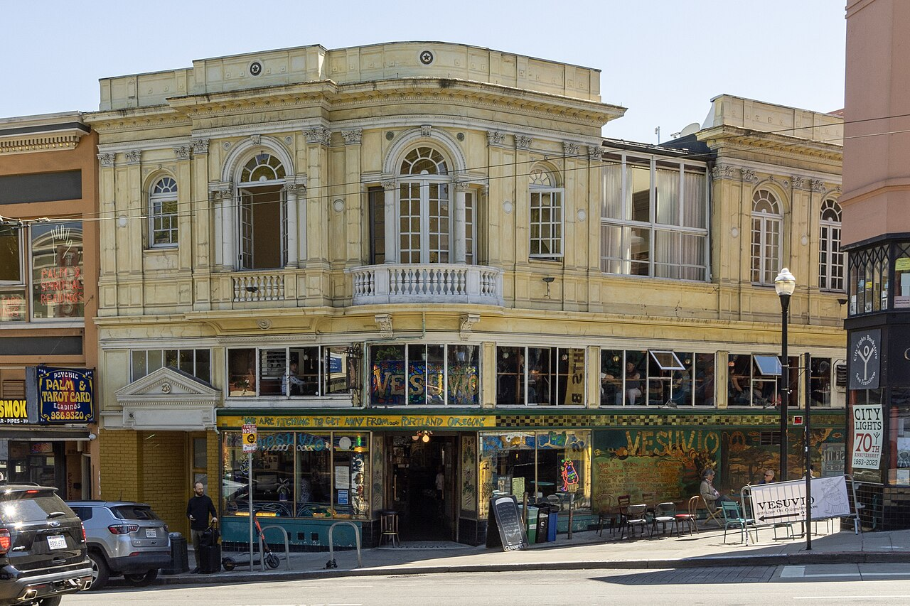

# Vesuvio Café

In San Francisco's North Beach, Columbus Avenue runs between the coffee houses and the strip clubs, and a narrow two-story building carries a painted sign that reads “Vesuvio Café.” The entrance is easy to miss; the bar is narrow, the stairs are steep, and the room often feels full. Across a small alley is City Lights, the bookstore that published Allen Ginsberg's Howl and became the anchor of the Beat literary scene. Vesuvio and City Lights are usually described together, and the alley between them is now named for Jack Kerouac.

Figure: The facade and sign of Vesuvio Café in North Beach, San Francisco; Henri Lenoir opened the bar in 1948, it faces City Lights bookstore across Jack Kerouac Alley, and this is a 2023 view. Image: The wub, CC BY-SA 4.0, via Wikimedia Commons ([source page](https://commons.wikimedia.org/wiki/File:Vesuvio_Cafe,_San_Francisco_2023-07-20.jpg)).

## Location and history

Vesuvio opened in 1948. Its founder, Henri Lenoir, was a French-born artist and bartender who had worked in San Francisco's bohemian bars. He wanted a place where artists and writers could drink without being hurried out; the bar's name came from the volcano, a reference to the idea of creative eruption rather than to Italy. The building itself is older: it was built in 1913 for Italo Zanolini and remodeled in 1918, and it sits at the edge of the Barbary Coast, the old waterfront district.

The Beat connection is the bar's main historical identity. In the 1950s, Beat Generation writers began using the bar as a meeting point. Jack Kerouac, Allen Ginsberg, Gregory Corso, Neal Cassady and Lawrence Ferlinghetti are the names most often associated with Vesuvio. They were not all regulars in the same way, and the intensity of each association differs. Kerouac is the most frequently cited; Ginsberg and Ferlinghetti were more closely tied to City Lights and the publishing side. On 7 October 1955, Ginsberg first read Howl at the Six Gallery; the story that the audience crossed the street to continue the argument at Vesuvio is told in several versions, but the literary route of reading, City Lights and Vesuvio did shape North Beach's cultural identity. The bar was a meeting point, not a headquarters, and the literary history is best told as a network of people and places rather than a single hangout.

City Lights opened in 1953, five years after Vesuvio. Ferlinghetti and Peter Martin founded the bookstore; it became a publisher and a center of the San Francisco Poetry Renaissance. The alley between the two buildings was originally Adler Alley, named for a German barber; in 1988 it was renamed Jack Kerouac Alley. In 2007 the alley was made pedestrian-only, with a mosaic and poetry plaques. The geography now reads as a deliberate literary district, but it grew piece by piece.

Lenoir sold the bar in the 1960s, and it changed hands several times. It remained a bar rather than becoming a museum, which is why it still feels alive: the murals, the wooden booths and the narrow bar are used, not preserved under glass. The Beat history is on the walls, but the business is a working North Beach bar.

## Space and drinks

The ground floor is a long, narrow bar with a wooden counter, stools, booths and murals. A staircase leads to an upstairs room with tables and windows; the space is small and often crowded. The decor mixes Beat-era photographs, paintings, posters and a few taxidermy pieces; the effect is cluttered and warm rather than curated. The bar is not accessible for everyone: the stairs are steep and the ground floor is tight, so visitors with mobility limitations should check before going.

The drink list is broad for a small bar: classic cocktails, beer, wine, coffee drinks and house specialties. The bar is known for drinks named after Beat figures and for a relaxed, slightly literary presentation. It is not a craft-cocktail temple; the strength is the room and the conversation. Food is limited or absent at times, so eat before or after; North Beach has plenty of Italian restaurants nearby.

## How to drink

Order a simple cocktail or a beer, find a spot at the bar or in a booth, and let the room do the work. The bar is best in the afternoon, before the evening crowds, when the light comes through the front windows and the murals are visible. At night it is louder and more social. If you want to visit City Lights, do it before or after the drink; the bookstore closes earlier than the bar.

The stairs are worth climbing once for the view, but do not carry a full drink up if the steps are wet. The bar can be crowded on weekends and during literary events; weekdays are easier. It is a small space, so large groups should split up or go elsewhere.

## Practical information

The address is 255 Columbus Avenue, San Francisco, CA 94133, at the edge of North Beach and Chinatown. The nearest Muni stops are around Columbus and Broadway; parking is difficult. Official hours are Sunday–Thursday 11:00–01:00 and Friday–Saturday 11:00–02:00; holidays and private events can change that.

Vesuvio accepts credit cards. It does not take reservations; seating is first come, first served. The legal drinking age is 21, and ID is required. Dress is casual; the room is small and the floors are old, so avoid anything too formal. Tipping 18%–20% is standard; at the bar, $1–2 per drink works.

## Etiquette and common misconceptions

The first misconception is that Vesuvio was the headquarters of the Beat generation. It was a meeting place within a larger network; City Lights, the coffee houses and the apartments of North Beach were equally important. The second is that every Beat writer drank here regularly; the associations vary by person and period. The third is treating the bar as a museum: it is a working bar with limited space, so do not block the stairs or the service area for photos. The fourth is expecting a quiet literary salon; it is a busy tourist-area bar, and noise levels rise at night. The fifth is ignoring the steep stairs and tight ground floor if mobility is an issue.

## Nearby and routes

Step out of Vesuvio and you are in the middle of North Beach: City Lights across the alley, Italian restaurants on Columbus, the cafés of Washington Square and the bars of Broadway. The bar fits a San Francisco literary route with City Lights and [Buena Vista Café](ref:buena) near the cable car; for the European comparison, read [Café Central](ref:central) in Vienna and the [Saint-Germain literary cafés route](ref:saint-germain) in Paris, and for the wider argument about bars and urban culture, read [Understanding a City Through Its Pub](ref:pub-city). For another writer's bar, see [Bar Hemingway at the Ritz Paris](ref:hemingway).

## Further reading and see also

- [Buena Vista Café](ref:buena)
- [Bar Hemingway at the Ritz Paris](ref:hemingway)
- [Understanding a City Through Its Pub](ref:pub-city)
- [Café Central](ref:central)
- [Saint-Germain Literary Cafés Route](ref:saint-germain)

Begin with the address, move on to the current opening status, and finish with what the place is known for. That order keeps the reading of Vesuvio Café practical.

Start with [Buena Vista Café](ref:buena) for address and space, then read [Reading a city through its bars](ref:pub-city) for operating status. Seeing both keeps Vesuvio Café from being confused with a neighbouring idea.

**Short definition:** A bar in San Francisco's North Beach since 1948, Vesuvio Café is tied to the Beat writers, faces City Lights bookstore across Jack Kerouac Alley, and remains a crowded, narrow, literary-minded bar rather than a quiet museum.

Checked on 2026-11-21: the address at 255 Columbus Avenue, the adjacency to City Lights Books and the drinks list were confirmed on the official site. "Sanctuary" and "birthplace" are used only in the Beat Generation context, not as an official city title. Image credits and licences are given in the captions.

**Key facts.**

| Item | Detail |
| --- | --- |
| In one line | A bar in San Francisco's North Beach since 1948, Vesuvio Café is tied to the Beat writers, faces City Lights bookstore across Jack Kerouac Alley, and remains a crowded, narrow, literary-minded bar rather than a quiet mus… |
| Address | 255 Columbus Avenue, San Francisco, CA 94133, United States |
| City and country | San Francisco / United States |
| Status | verified open |
| Official site | vesuvio.com |

**Sources and limits.** The key claims about Vesuvio Café are checked against the following sources: Vesuvio Café (Used for the address, current hours and the bar's Beat-generation positioning; no text copied; Used for the cocktail list and the house drink names; recipes and prices change), National Trust for Historic Preservation, City Lights (Used only for the bookstore's 1953 founding and its position across Jack Kerouac Alley; not for bar operations). For current products, addresses or opening status, use vesuvio.com. Prices, batches and status change; the body is project-written and does not reproduce source text.
