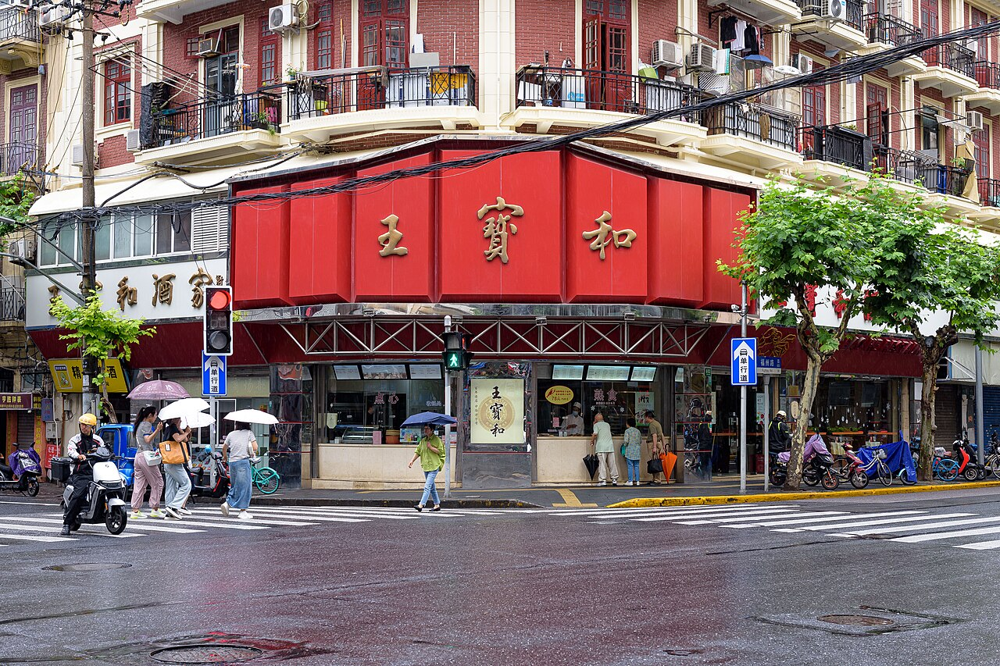
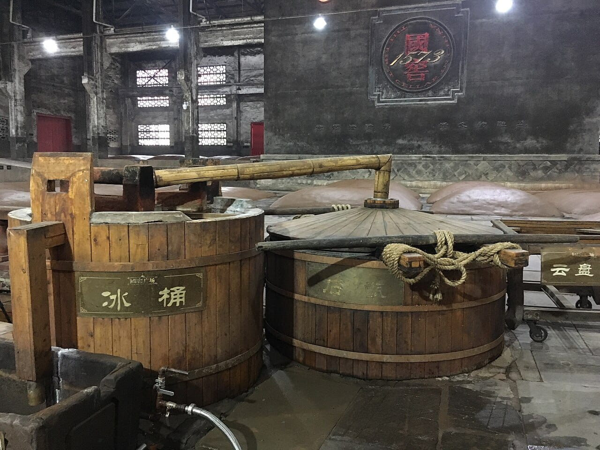

# Wang Bao He

The stretch of Fuzhou Road near Zhejiang Road is one of Shanghai's densest concentrations of old bookshops, old restaurants and time-honoured brands. Number 603 is Wang Bao He, with a facade carrying crab and wine signs, and interiors of Jiangnan-style woodwork, round tables and private rooms. It began in 1744 and is one of Shanghai's earliest restaurants. Today people come for two things: Wang Bao He yellow wine and hairy crabs.

Figure: Wang Bao He on Fuzhou Road, Shanghai. Image: N509FZ, CC BY-SA 4.0, via Wikimedia Commons ([source page](https://commons.wikimedia.org/wiki/File:Wang_Bao_He_Restaurant_(20250610145416).jpg)).

> **Quick verdict**
> **In one line:** This entry helps you decide whether Wang Bao He deserves a detour, and what to check before visiting.
>
> - **Best for:** Anyone planning a visit to Wang Bao He who needs to decide whether it deserves a half-day or a full day.
> - **Not for:** If you want only want a must-visit list and will not check booking, transport or opening hours.
> - **Check first:**
>   - The chronology runs on two tracks, Shaoxing and Shanghai.
>   - First decide between a crab banquet and a la carte.

## Setting and history

The chronology runs on two tracks, Shaoxing and Shanghai. In 1744, the ninth year of the Qianlong reign, Wang Guichen operated the Wang Bao He winery in Lintou Village, Dongpu Town, Shaoxing. In the same year his son Wang Renshan opened a Wang Bao He wine shop on Xiangua Street in Shanghai's Nanshi district. The "same year" matters: Shaoxing is the source of the wine, Shanghai the starting point of the restaurant and sales business, and together they make the "forefather of wine" identity. In 1852, the second year of the Xianfeng reign, the shop moved to Pentang Alley, around today's East Nanjing Road and South Shanxi Road. In 1936 it moved to the present Fuzhou Road and Zhejiang Road site and was renamed Wang Bao He Jiu Jia. So "founded in 1744" refers to the brand and the Shanghai shop, while 1936 is the start of today's address.

By the early twentieth century Wang Bao He's Shaoxing yellow wine was well known. It sold not only wine but a social function: a curved counter, a busy room, wine drunk on site and taken away. Old literary menus listed Wang Bao He among Shanghai's famous wine houses; the fourth-generation Wang Diefu's "Diefu wine" won a prize at the West Lake Exposition; the diplomat Gu Weijun took Wang Bao He wine to France for a banquet; the calligrapher Hu Wensui tasted it and wrote "Do not go home until drunk". These stories show that Wang Bao He was first a wine brand and only later a crab brand.

The crab turning point came in October 1979, when Wang Bao He launched the "chrysanthemum crab banquet". It separated the crab into parts and dishes, building a banquet of cold plates, hot dishes, main courses and dim sum, "one dish, one style, crab from beginning to end". The innovation added "king of crabs" to "forefather of wine". In 2013 Wang Bao He crab-banquet cooking skills were listed as a Shanghai municipal intangible cultural heritage item. Today the brand also includes the Wang Bao He Hotel, the Shanghai Hotel and Wang Bao He Wine; 603 Fuzhou Road remains the restaurant, while 555 Jiujiang Road is the hotel.

## The rooms and the menu

The space mixes an old Shanghai restaurant with Jiangnan water-town style: wood panelling, dark furniture, round tables, screens and private rooms. There are 13 private rooms and about 180 seats. The main hall suits two or three people ordering dishes; the private rooms suit family gatherings and business dinners. It is neither a minimalist internet-famous space nor a cold old state restaurant; the warm tones are deliberately kept, and crab-season advertising appears at the entrance and by the lift.

The menu has two main lines. The first is crab: steamed hairy crab, crab-roe tofu, furong crab powder, crab-powder prawn rolls, crab-roe peony prawns, crab-roe silver-skin snow, crab-powder xiaolongbao, crab-powder two-sided noodles and crab-shell cakes. The crab banquet is priced per person or per table, with dishes varying by season and crab size. The second line is Shanghai benbang and Huaiyang cuisine: scallion-oil chicken, grandmother's red-braised pork, pan-fried ribbonfish, oil-splashed eel, Shanghai wontons, oil-exploded shrimp and pork with eggs. Lunch also has dim sum: crab-powder pork mooncakes, pork mooncakes, crab-powder tangyuan, crab-shell cakes and crab-powder xiaolongbao.

The drinks list centres on Wang Bao He yellow wine: Taidiao, Huadiao, Jinbo, Yuye, Shanniang, Xiangxue and Jiafan, graded by age and sweetness; there is also a "crab-banquet wine" blended for crab. Yellow wine is usually warmed, and in crab season it is paired with ginger vinegar as the Jiangnan way to "counter the cold". Beer, baijiu and soft drinks are also available, but skipping the yellow wine means missing half the point.

## What to order on a first visit

First decide between a crab banquet and a la carte. The banquet suits four or more people who want to try many crab dishes, priced per person with portions scaled to the group. A la carte suits two or three: one steamed crab, one crab dish, one Shanghai dish and one dim sum. For the classics, order steamed hairy crab with ginger vinegar, crab-roe tofu and crab-powder xiaolongbao. For a comfortable meal, order scallion-oil chicken, red-braised pork and pan-fried ribbonfish, with one crab to share.

Crab season is the key. Hairy crabs are fattest from October to December: female crabs in the ninth lunar month, male crabs in the tenth. June to August brings "June yellow" crabs, smaller with thin shells and tender roe, a different pleasure. Outside crab season the crab dishes remain, but freshness and price are not the same; book ahead and ask about the day's size. Lunch dim sum suits anyone who does not want a large meal; dinner is for proper dishes and the crab banquet.

Prices: the crab banquet starts at about CNY 300 per person; a single steamed crab is priced by size and market rate, usually CNY 150–200; benbang dishes run about CNY 100–200 per person. Private rooms may have a minimum spend, so confirm when booking. Service and tea charges follow restaurant rules. In crab season, weekends and holidays should be booked 1–3 days ahead. Cards and mobile payment are accepted, subject to the venue.

## Practical information

**Address**: 603 Fuzhou Road, Huangpu District, Shanghai 200001, China. Near the junction with Zhejiang Road, close to People's Square and East Nanjing Road. Look for the "Wang Bao He" sign and the crab logo.

**Transport**: Metro lines 1, 2 and 8 to People's Square, then about 5 minutes on foot; lines 2 and 10 to East Nanjing Road, then about 8 minutes. Fuzhou Road is a main road, so taxis can stop briefly but traffic is heavy at peak; the metro is easier.

**Opening hours**: Lunch 11:00–13:30, dinner 17:00–21:00; open daily, with possible changes in crab season and holidays. `operating_status` is `verified`, meaning the official site and the Shanghai tourism page still showed the restaurant as trading on 20 November 2026; this does not guarantee that it opens every day. Telephone 021-63223673.

**Reservations**: In crab season, at weekends and for private rooms, book 1–3 days ahead by telephone. Ordinary weekday lunch can be walk-in, but the kitchen closes after 13:30, so late arrivals may miss it. There is no strict dress code; private-room and business guests dress more formally. Children are welcome, but the crab banquet is slow and requires patience.

**Prices**: Crab banquet from about CNY 300 per person; a single steamed crab CNY 150–200, depending on size and season; benbang dishes about CNY 100–200 per person. Minimum spend, service and tea charges are confirmed at booking. Cards and mobile payment are accepted.

Page verified 20 November 2026; opening hours, prices and crab-season arrangements are subject to official channels.

## Etiquette and common mistakes

First, do not treat 1744 as the year the Fuzhou Road site opened; 1744 is the brand and the Shanghai shop, and 1936 is the move to the present address. Second, do not treat the "crab banquet" as "a table of nothing but crab"; it also includes Shanghai dishes and dim sum. It is a crab-centred banquet, not a crab-only meal. Third, do not turn up without a booking on a crab-season weekend; both crabs and tables are limited, and the wait can be long.

Three more mistakes are common. One is assuming older yellow wine is always better. Wang Bao He grades by age and type: Taidiao is sweeter, Huadiao rounder, Jiafan fuller; match the crab and your taste rather than paying for the oldest. Another is treating crab-powder dishes as a substitute for fresh crab. Crab powder is picked meat and roe; its flavour differs from a whole steamed crab, and the two are complements, not replacements. The third is thinking "forefather of wine" means wine only. Wang Bao He is a restaurant where wine and food belong together; the wine is part of the meal, not an afterthought.

Wang Bao He is not right for someone who wants fast food, someone allergic to crab or who dislikes it, or a tight budget that only covers a bowl of noodles. It suits a serious crab-season meal, and anyone who wants to experience an old Shanghai restaurant and yellow-wine culture.

## Nearby and routes

Wang Bao He is on Fuzhou Road. East are East Nanjing Road and the Bund; west are People's Square and the Shanghai Museum; south are Yu Garden and the City God Temple. Put the restaurant on a "People's Square–Fuzhou Road–Bund" walk: museum in the morning, crab or benbang lunch at Wang Bao He, bookshops and East Nanjing Road in the afternoon, the Bund at dusk. About 30 minutes on foot, one metro stop.

Wang Bao He is best approached through the address, then the current opening status, and then what the place is known for. One check alone will not settle it.

Fuzhou Road carries heavy traffic and parking at the door is difficult; in crab season the queue outside is long, so allow space when photographing. If a private event or wedding books the restaurant, walk-in guests may be moved to the main hall or asked to come another day; confirm when booking.

## See also

- [Yellow wine](ref:yellow-wine): Wang Bao He's core drink, its raw materials, fermentation and types.
- [Rice wine](ref:rice-wine): a close relative of yellow wine, and the shared ground of rice-based fermented drinks.
- [Luzhou Laojiao cellars](ref:luzhou): a living strong-aroma baijiu site in Sichuan, a contrast with Jiangnan yellow wine.
- [Shuijingfang Museum](ref:shuijingfang): a Chengdu baijiu site museum, another Chinese drinks-space narrative.
- [Pubs and the city](ref:pub-and-city): how restaurants and taverns use space, menus and opening hours to organise city life.

## Related images

Image: A traditional distillation apparatus at the Luzhou Laojiao distillery. Credit: Xiaomage de, CC BY-SA 4.0, via Wikimedia Commons ([source page](https://commons.wikimedia.org/wiki/File:Traditioneller_chinesischer_Destillationsapparat_in_der_Brennerei_Luzhou_Laojiao.jpg)). Related image for Wang Bao He.
