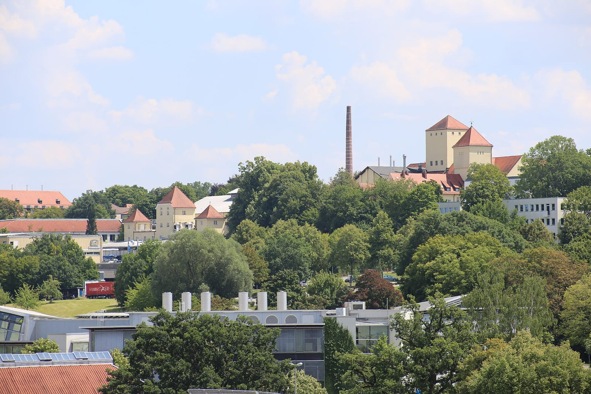

# Weihenstephan Brewery

Figure: Related photograph of Weihenstephan Brewery. Image: Christian Schranner, CC BY-SA 4.0, via Wikimedia Commons ([source page](https://commons.wikimedia.org/wiki/File:%C3%9Cberblick_der_Bayerischen_Staatsbrauerei_Weihenstephan.jpg)).

## A state brewery on the hill above Freising

Weihenstephan sits on the hill of the same name west of Freising in Bavaria, at Alte Akademie 2. The brewery, the Technical University of Munich's Weihenstephan campus, trial gardens and the Bräustüberl below form a small district organised around brewing and food science. The walk from Freising station takes about twenty minutes, and buses stop near the site.

The word "Staatsbrauerei" means state brewery. Weihenstephan belongs to the state of Bavaria, neither a family firm nor a satellite of a multinational group. It shares its hill with teaching and research, and public access is conservative: tours run at fixed times and must be registered in advance. It is a public institution of [Bavaria](ref:bavaria)'s brewing tradition before it is a tourist attraction.

## The year 1040 and the "oldest" claim

In 1040 Abbot Arnold of Freising obtained the right to brew and sell beer from the town, and Weihenstephan uses that year as its starting point; monastic activity on the hill reaches back further. The claim to be the world's oldest brewery rests on continuous brewing at the same site with documentary evidence, not on an unbroken monastic line: in 1803 the secularisation of Bavarian monasteries transferred the brewery to the state.

Claims of this kind are contested, because one writer counts documentary dates, another uninterrupted operation and a third surviving buildings. Treat "oldest" as a well-documented claim rather than a settled argument. For a visitor, the year explains the site: monastic brickwork survives as a small museum, the industrial brewhouse and cellars still work, and one route connects them.

## Visiting: fixed slots and advance booking

Tours must be booked ahead. The official schedule lists Monday at 10:00 in German; Tuesday at 10:00 in English and 13:30 in German; and Wednesday at 10:00 in English. Requests go by email to info@weihenstephaner.de or by telephone on +49 8161 536-0, with a date, slot and party size. Registration counts only once the brewery confirms it. There are no tours on public holidays, and no ad hoc visits outside the listed times.

The meeting point is reception at Alte Akademie 2, a short climb from the car park beside the Bräustüberl. The route begins in the oldest brick part, now a small museum, then moves through mashing, fermentation and storage, and ends with a tasting. Children under six are not admitted; those aged six to nine and under 17 need an adult. Some rooms are reached only by stairs, and the tour is not suitable for visitors with limited mobility. Sturdy shoes are advised. Prices and slots change, so rely on the reply you receive.

## The beer list: wheat and lager, two temperaments

Wheat beer is the signature. Hefeweissbier is cloudy and yeasty, with banana and clove from the yeast, a soft body and a thick head. Dunkelweissbier is darker, with toasted bread and caramel; Kristallweissbier is filtered clear and lighter; Vitus is a strong wheat beer with more body and alcohol. The wheat share is usually above 50%, the structural basis of [wheat beer](ref:wheat-beer) and the reason its aroma sits so far from barley-led lager.

On the lager side, Lagerbier Hell is clean, malt-sweet and lightly bitter; Pilsner is drier and more bitter, with a crisp finish; Korbinian is a dark doppelbock with high gravity, better suited to a cold evening than a quick first round. Both follow the cold route of [lager](ref:lager) fermentation and storage, where yeast and [fermentation](ref:fermentation) temperature decide whether the body stays clean.

## 1516 and 1906: how regulation reaches the glass

The Bavarian purity order of 1516 allowed beer to be made from water, malt and hops, and in 1906 the rule was extended across the German Empire. For a brewery such as Weihenstephan, the rule is not decoration: it limits the available ingredients and makes "malt only, no adjuncts" the default.

Today's German beer law is not identical to the 1516 text, and European Union law lets breweries elsewhere use different ingredients. Treating the purity order as the legal definition of all German beer overstates it; it is better called a historical spine of Bavarian brewing, one that Weihenstephan's range happens to follow. In the glass, the banana of a wheat beer comes from yeast, not an additive, and the cleanliness of a lager comes from cold and time rather than hard filtering.

## The Bräustüberl below, and practical notes

Without entering the brewery, the Bräustüberl at Weihenstephaner Berg 10 is the easiest point of contact. It calls itself the brewery's parent house and opens daily from 10:00 to 23:00; the kitchen runs Tuesday to Saturday 11:30–21:00 and Sunday 11:30–20:00, with the beer garden open in fine weather. It also claims to be the birthplace of Obazda, the Bavarian cheese spread, best ordered with a pretzel and a Hell. It is quieter than Munich's [Hofbräuhaus](ref:hofbrauhaus) and less dominated by tour groups, which makes it a good place to turn a visit into a full Bavarian lunch.

Practical notes: the tour and the pub are separate operations, so a meal does not replace a booking. Holiday and some Monday arrangements change, so check the official site. The S1 from Munich to Freising takes about 30–40 minutes, followed by a walk or a bus uphill. The hill is exposed and colder than the town in winter. This entry does not list coordinates; use official channels for those.

Weihenstephan Brewery is best read by starting with the address, moving to the current opening status, and ending with what the place is known for.

**At a glance:** Bavaria's state brewery on the Weihenstephan hill in Freising, tracing its brewing licence to 1040 and the most frequently cited claimant to the title of world's oldest brewery; tours are booked in advance, while the Bräustüberl below stays open daily.

The brewery sits beside the Weihenstephan monastery and the Technical University of Munich's brewing school; its Helles and Vitus are benchmarks of the Bavarian style.

Its Helles is a clean, pale lager and its Vitus a strong wheat beer, both brewed on the same site.

**Key facts.**

| Item | Detail |
| --- | --- |
| In one line | Bavaria's state brewery on the Weihenstephan hill in Freising, tracing its brewing licence to 1040 and the most frequently cited claimant to the title of world's oldest brewery; tours are booked in advance, while the Brä… |
| Address | Alte Akademie 2, 85354 Freising, Germany |
| City and country | Freising / Germany |
| Status | verified open |
| Official site | weihenstephaner.de |

**Sources and limits.** The key claims about Weihenstephan Brewery are checked against the following sources: Bayerische Staatsbrauerei Weihenstephan, Bräustüberl Weihenstephan, Stadt Freising (Used to check the relationship between the town, its transport and the brewery on the hill west of the centre). For current products, addresses or opening status, use weihenstephaner.de. Prices, batches and status change; the body is project-written and does not reproduce source text.
