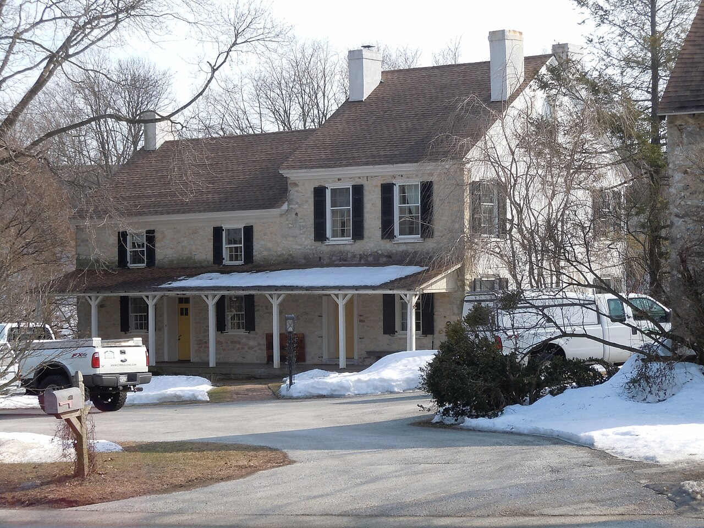
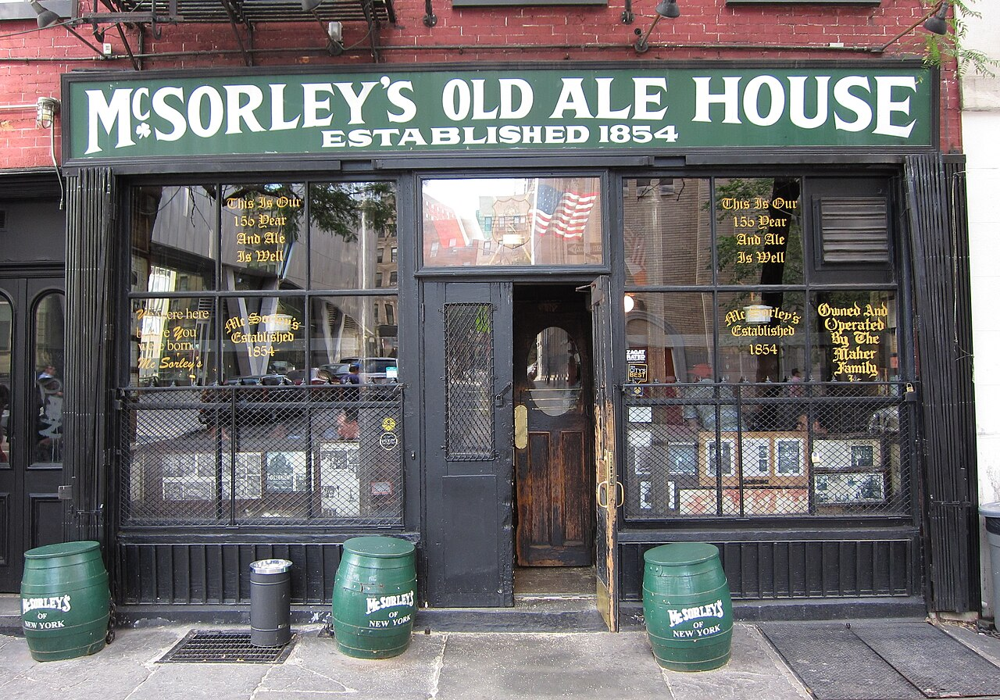

# White Horse Tavern

White Horse Tavern (Báimǎ Jiǔguǎn) stands at 567 Hudson Street in Manhattan’s West Village and opened in 1880. It began as a place where longshoremen from the Hudson River piers drank after work, and in the 1950s it became a gathering point for writers, artists and musicians. Today its most famous label is “Dylan Thomas’s last stop”: on 3 November 1953 the Welsh poet drank here, and he died a few days later. The story that he downed eighteen whiskies that night is repeated everywhere, but witnesses put the number anywhere from six to eight. Eighteen is legend, not a verified count.

Figure: White Horse Tavern. Photograph: White Horse Tavern PA. Credit: Smallbones, CC0, via Wikimedia Commons ([source](https://commons.wikimedia.org/w/index.php?curid=13351900)).

## Place and history

The White Horse opened in 1880 to serve the dockworkers and sailors of the nearby Hudson piers, a classic neighbourhood tavern. In the 1950s, when West Village rents still allowed writers, painters and musicians to live close together, Dylan Thomas, Jack Kerouac, Allen Ginsberg and James Baldwin became part of its story. The house calls itself “New York’s second-oldest bar,” while McSorley’s calls itself the city’s oldest continuously operated saloon. Each claim uses a different measure—building age, continuous operation, or brand narrative—so it helps to ask which one is being used. The November 1953 visit turned the White Horse from a neighbourhood bar into a literary landmark. Reducing it to “the bar where a poet drank himself to death” is both inaccurate and unkind.

## The room and the drinks

The White Horse keeps its original woodwork, tin ceiling, long bar and old photographs. It is roomier than McSorley’s but still an old tavern, not a craft-beer destination. The drinks list runs from beer and whiskey to simple cocktails, and the kitchen serves bar food. This is neither an ale-only house nor a modern cocktail laboratory. You can order a draft beer, a whiskey, or ask what is good that day. Food tends toward burgers, fries, soup and snacks—enough to steady you, not a formal dinner. Prices are mid-range for the West Village and may rise in tourist season and on weekend nights.

## How to order on a first visit

On your first visit, look at the list along the bar before choosing a seat at the bar or a table against the wall. Sit at the bar for the old-tavern atmosphere; take a corner for conversation. Start with a draft beer. If you want whiskey, name a brand or a style rather than saying “like Dylan Thomas.” If you are hungry, order something simple with the drink; drinking on an empty stomach is a poor plan in any historic bar. Early evening on a weekday is the most comfortable time: locals are still there and tourists have not filled the room. Weekend nights are crowded and a bad fit for a quiet first date.

## Practical information

The address is 567 Hudson Street, New York, NY 10014, USA, in the West Village near Hudson Street and West 11th Street; the coordinates are 40.73571, -74.00620. The 1 train to Christopher Street–Sheridan Square is about a 3-minute walk, and Washington Square Park is about fifteen minutes away.

The official page lists hours of 12 pm to midnight Monday to Wednesday, 12 pm to 2:30 am on Thursday, 12 pm to 3:30 am on Friday and Saturday, and 11 am to midnight on Sunday; holidays can change them, so check official channels. `operating_status` is `verified`, meaning the official site and contact page were live on 2026-11-08 with no closure notice. There is no cover charge. The official site offers a Resy booking link, but most seating remains first-come and on-site, with queues at weekends and in high season. The telephone is (212) 989-3956. Dress is casual; there is no formal code. Bring a card and a little cash. Expect West Village bar prices. The building has low ceilings and narrow passages, so visitors with limited mobility should confirm the entrance and aisle first. Page verified 2026-11-08; opening status, prices and reservations are subject to official channels.

## Etiquette and common mistakes

This is a neighbourhood bar first and a literary landmark second. Do not pose in front of the bar for a long time, and do not block staff access while taking photographs. Interior photos are fine, but keep other customers’ faces out of frame, and ask before photographing the staff. Tip according to American bar custom and check the tip line when paying by card. The biggest mistake is romanticising Dylan Thomas’s story: he was already seriously ill, and the eighteen-whisky count is not reliable evidence. Turning “drinking to the last moment” into a selling point simplifies both the poet and the problem of alcohol. Another mistake is treating the house’s “second-oldest” claim as an absolute fact; New York’s “oldest” titles have several methods. Famous visits are background, not a guarantee of today’s service.

## When not to come

The White Horse is wrong for a full cocktail programme, a quiet conversation, a refined dinner or a late-night family outing. Large groups struggle to find contiguous seats on weekend nights; visitors with accessibility needs should check the door and aisle first. Anyone who dislikes the “literary bar” narrative, or who only wants a cheap drink, may find it too crowded with tourists. If famous stories make you drink more than you intended, treat the visit as an ordinary bar stop rather than a pilgrimage.

## Nearby and around

Two blocks west of the White Horse is Hudson River Park; east are Christopher Street, the Stonewall Inn and Washington Square Park. The restaurants and record shops around Bleecker Street are also worth a wander. To compare New York’s two old taverns, continue to [McSorley’s Old Ale House](ref:mcsorleys) in the East Village; the two are about two miles apart, so take the subway. McSorley’s sells only ale and is much narrower; the White Horse has a broader drinks list and a heavier literary myth. Seeing them together shows that “old” does not imply one way of running a bar.

## See also

The beer here belongs to the wider family of [beer](ref:beer) styles; placed back in the story of [Pub and city](ref:pub-and-city), it becomes easier to see how such spaces structure hospitality. For another model of the “ale-only” old tavern, read [McSorley’s Old Ale House](ref:mcsorleys).

Further reading: [A Ginjinha](ref:c-extra-1).

**Short definition:** A historic tavern in Greenwich Village, New York, opened in 1880 and associated with Dylan Thomas and other writers.

White Horse Tavern is best approached through the address, then the current opening status, and then what the place is known for. One check alone will not settle it.

Setting [Beer](ref:beer)'s address and space beside [McSorley’s Old Ale House](ref:mcsorleys)'s operating status makes the boundary between them visible.

## Related images

Image: McSorley’s Old Ale House. Credit: Leonard J. DeFrancisci, CC BY-SA 3.0, via Wikimedia Commons ([source page](https://commons.wikimedia.org/wiki/File:McSorley%27s_Old_Ale_House_001_crop.jpg)). Related image for White Horse Tavern.
