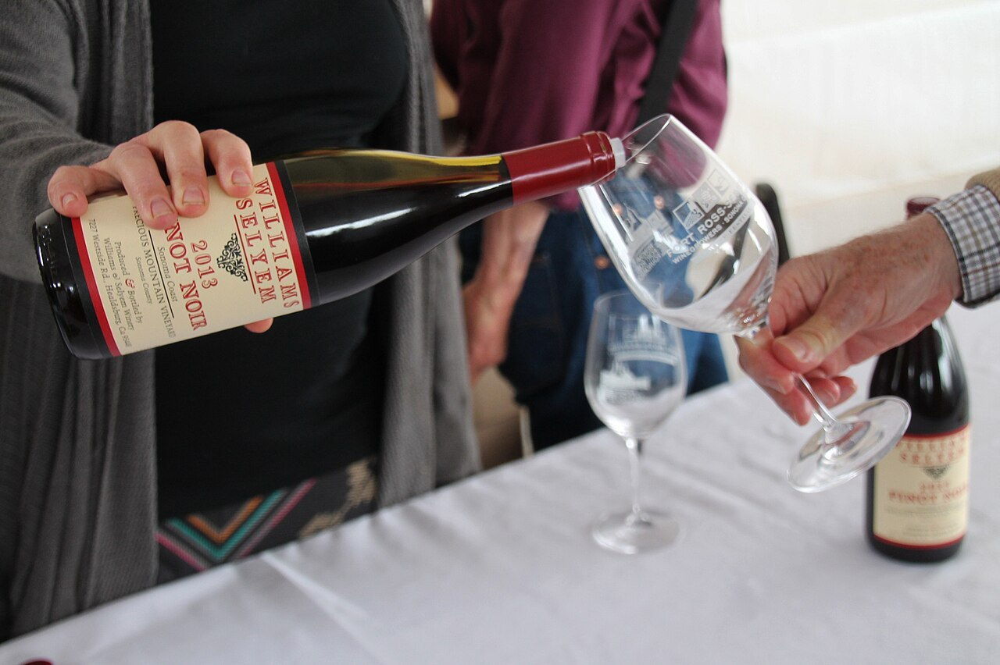

# Williams Selyem

Williams Selyem is one of the starting points of American garage-wine Pinot Noir: in 1978 Burt Williams, a San Francisco Chronicle pressman, and Ed Selyem, an accountant, began making wine in a Forestville garage with borrowed equipment, then helped put Russian River Valley on the world Pinot map; today the estate is still on Westside Road, keeping a small, slow rhythm through appointments and allocations.

Figure: Williams Selyem. Photograph: File:Williams Selyem wine at Fort Ross State Historic Park - Jenner, California - Stierch.jpg. Credit: Sarah Stierch, CC BY 4.0, via Wikimedia Commons ([source](https://commons.wikimedia.org/w/index.php?curid=44884501)).

## Position and history

Williams Selyem is in Sonoma County’s Russian River Valley, at 7227 Westside Road west of Healdsburg. Burt Williams worked nights as a pressman at the San Francisco Chronicle; Ed Selyem bought wine and kept books at Speer’s Market. Both loved Burgundy but could not afford to drink it often, so they decided to try making their own. In 1979 they fermented Zinfandel from the Martinelli family’s Jackass Hill in Burt’s garage, using a converted dairy tank, and called the winery Hacienda del Rio.

The first commercial vintage was bottled in 1982. In 1983 a cease-and-desist letter from Sonoma’s Hacienda Winery forced them to drop “Hacienda”, so they combined their surnames into Williams Selyem and moved to a leased two-car garage in Fulton. In 1984 the first Williams Selyem label appeared, along with the first vineyard-designate Pinot Noir from Rochioli — an early example of the California single-vineyard movement.

The 1985 Rochioli Pinot won the Sweepstakes Prize at the 1987 California State Fair, beating 2,316 wines, and Bon Appétit named the 1982 Hacienda del Rio Pinot the best California wine of the year. Demand outran supply, and the estate created its waiting list, at times two to three years long. In 1989 the team moved to Allen Ranch on Westside Road and Burt and Ed quit their day jobs; in 1995 Williams Selyem was served at the White House.

In 1998 Burt and Ed sold the winery to long-time customers John and Kathe Dyson; Burt’s last vintage was 1997 and Bob Cabral took over as winemaker. The Dysons bought the Drake property in Guerneville and in 2001 acquired land from the Litton family, creating Litton Estate. In 2021 the Dyson family sold a minority stake to Burgundy’s Faiveley family; in 2025 the estate marked its 45th vintage.

## Vineyards and terroir

For Williams Selyem, begin with the address. Then look at the current opening status, and finally ask what the place is known for. The answers point to different choices, not to a single score.

Russian River Valley is defined by Goldridge sandy loam and Pacific fog: warm summer days, fog rolling in at dusk, cool nights, slow ripening, high acidity and thin skins. Westside Road, close to the river and not far from the coast, is classic Pinot country; farther west in Occidental and Freestone the climate is colder, the fruit leaner and the spice and earth notes more pronounced.

The estate’s own sites now include Drake, Litton and Lewis MacGregor. In 2004 Litton Estate planted about two acres of a “Mass Selection” block mixing eighteen Pinot clones, imitating old-world field blends; the 2007 Litton Estate Pinot received 100 points from Wine Enthusiast, the first North American Pinot to earn a perfect score from a major wine publication.

## Winemaking and style

Williams Selyem’s winemaking is light from start to finish: Pinot is foot-trodden, fermented in shallow, wide dairy tanks that increase skin-to-juice contact without over-extraction; temperatures are kept low, pressing is gentle and new oak is restrained, so fruit and texture lead rather than barrel flavour. The estate still keeps the dairy tanks and foot-treading of the Burt and Ed era, with cleaner equipment and tighter temperature control.

Classic vintages show cherry, raspberry, wild strawberry, dried flowers, earth and spice, with fine tannin, clear acidity and moderate alcohol; Chardonnay shows lemon, white peach, hazelnut and wet stone with restrained oak. Zinfandel from Papera and other sites is the estate’s main non-Pinot red, sweeter and riper in fruit but still held by acidity.

The allocation system is not a marketing gimmick but the result of tiny production and a direct-to-consumer ethos. Most wine goes to the mailing list, a small amount to restaurants; to buy a particular single-vineyard bottling you usually wait on the list rather than walk in and find it on a shelf.

## Visiting and spaces

Visits are by appointment and places are few; the usual format is a seated tasting of current releases, occasionally with a library vintage. The estate does not host large groups, does not run a walk-in standing tasting, and does not encourage treating the visit as “taste everything then buy”.

The Westside Road winery is low-key, surrounded by vines and oaks; the tasting room is small and the focus is wine and conversation, not architecture. Confirmation comes with directions and parking instructions; from Healdsburg it is about fifteen minutes, and the Westside Road exit off 101 leads to a narrow, winding road that needs slow driving at night.

If you want to see vineyards, ask when booking whether an estate walk is available; the estate blocks and the tasting room are not always in the same place, and last-minute requests usually cannot be arranged. Children, pets and accessibility needs should be raised at booking so the team can decide based on space and staffing.

## Drinking and pairing

Pinot Noir is best at 14–16°C, opened twenty to forty minutes ahead; do not decant older bottles for long — pour a glass, wait a few minutes, then decide. Chardonnay is best at 10–12°C; over-chilling hides the hazelnut and white peach, while Zinfandel likes 16–18°C with grilled and spiced food.

For food, Pinot suits roast duck, mushrooms, salmon, roast chicken, veal and soft cheese; its acidity and fine tannin do not handle heavy chilli, thick sauces or charcoal-grilled steak. Chardonnay suits lobster, creamy pasta, roasted fish and poultry; Zinfandel suits barbecue, ribs, Mexican food and tomato-based dishes.

Williams Selyem is not a “pour it straight from the fridge” wine; give it temperature and air and the perfume opens. With one bottle, choose a Russian River Valley Pinot with duck or mushrooms; with two single vineyards, start with the cooler site and move to the warmer one to see how ripeness and spice shift.

## Practical information

From San Francisco, take 101 north to Healdsburg, about two hours; from Healdsburg to Westside Road about fifteen minutes. Tastings run ninety to 120 minutes, by appointment, and weekends and release seasons fill quickly; do not turn up without a booking, as there is no walk-in service.

The estate does not serve a full meal, only bites with the tasting; lunch back in Healdsburg is the sensible plan. Purchases depend on allocation and on-site stock, and popular single vineyards often sell out early; check your state’s shipping rules before ordering, and allow extra for international delivery. The road is narrow, so do not rush to the next stop.

## Etiquette and common misreadings

Williams Selyem is a small producer’s tasting room, not a big winery visitor centre. Arrive at your booked time and do not bring unregistered guests; spitting into a spit bucket is professional, and drivers should keep to one or two tastes. Do not ask to tour the fermentation room or compare the estate with another producer’s flagship; the rhythm here is small, focused and slow.

The most common misreading is to treat Williams Selyem as “just another Russian River Valley Pinot”. Production is small and the channel narrow, and many wines never reach open retail; another mistake is to assume a garage origin means rustic winemaking. The light extraction and low new oak are deliberate choices, not limited equipment. And “single vineyard” is not a marketing word here: the labels follow specific growers and blocks, and vintages differ enormously.

## Surroundings and routes

Williams Selyem works as the core of a Westside Road half-day: drive from Healdsburg in the morning, taste here, return to town for lunch, then visit one contrasting winery in Dry Creek or Alexander Valley. Rochioli, Hartford and Gary Farrell are also on Westside Road, but each needs an appointment, so two estates a day is the realistic maximum.

With half a day, choose Williams Selyem plus Healdsburg and skip a third stop; the tasting alone takes ninety minutes and the road needs buffer. With a full day, split Russian River Valley and Sonoma Coast: Pinot in the morning, then drive to Occidental or Freestone for the colder coastal belt before returning to 101.

## Further reading and see also

- Related entries: [sonoma](ref:sonoma), [usa](ref:usa), [pinot-noir](ref:pinot), [oak-ageing](ref:oak), [region](ref:region).
- This page does not provide live allocation, stock or opening status; check the estate website and your booking confirmation before visiting.
- To understand the estate, compare a Russian River Valley bottling with a single vineyard, then set one against a Burgundy Premier Cru to see where “transparent fruit” ends and “earth and spice” begins.

**Short definition:** A pioneer Pinot Noir winery in the Russian River Valley, Sonoma County, founded by Burt Williams and Ed Selyem in a garage in 1981; known for low yields, old vines and a fine style, with visits by appointment. 
