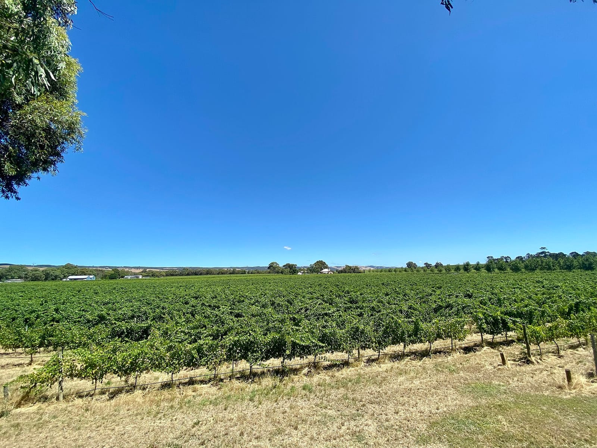
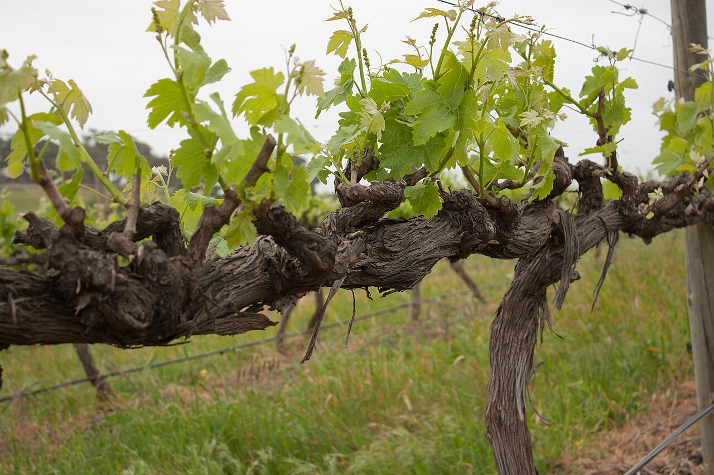

# Wirra Wirra

Wirra Wirra is one of McLaren Vale’s great storytellers: Robert Strangways Wigley, a former state cricketer, built the ironstone cellars in 1894; the site fell derelict after 1936; in 1969 cousins Greg and Roger Trott brought the ruins back to life and made the first Church Block in 1972. Today it still embodies the Australian idea of serious winemaking with a sense of fun.

Figure: Related photograph of Wirra Wirra. Image: No Swan So Fine, CC BY-SA 4.0, via Wikimedia Commons ([source page](https://commons.wikimedia.org/wiki/File:Wirra_Wirra_Vineyards,_Strout_Road,_McLaren_Vale_07.jpg)).

> **Quick verdict**
> **In one line:** This entry helps you decide whether Wirra Wirra deserves a detour, and what to check before visiting.
>
> - **Best for:** Anyone planning a visit to Wirra Wirra who needs to decide whether it deserves a half-day or a full day.
> - **Not for:** If you want only want a must-visit list and will not check booking, transport or opening hours.
> - **Check first:**
>   - Wirra Wirra sits on the Strout Road slope at the edge of McLaren Vale township, about forty-five minutes from Adelaide.
>   - The cellar door sits inside the 1894 ironstone cellars, so the visit is also a walk through regional history: old fermenters, bluestone walls.

## Position and history

Wirra Wirra sits on the Strout Road slope at the edge of McLaren Vale township, about forty-five minutes from Adelaide. The entrance is not grand: a lawn, an old ironstone and bluestone cellar, a bell tower, and the trebuchet Greg Trott could not stop thinking about. Step inside, though, and the character is clear: history weighs a lot, but the pose is light.

In 1894 Robert Strangways Wigley bought 240 acres at McLaren Vale and began the estate. He was a South Australian cricketer and a noted eccentric: he studied law and architecture, loved practical jokes, and reportedly refused to sell wine to customers he disliked. The cellar was built to a split-level design by Dr A.C. Kelly, with ironstone and bluestone structure advanced for an 1890s winery. Wigley and Alec Johnston made the first wine in 1897; by 1901 the estate had about 100 acres of vines and was a significant McLaren Vale producer.

After Wigley died in the 1920s, the winery declined, closed in 1936, and the ironstone cellars stood roofless for more than four decades, with only a stubborn slate fermenter left inside. In 1969 Greg Trott and his cousin Roger bought the ruin and seven surrounding acres, then spent three years hauling stone, repairing walls and gathering equipment. They did not wait for the building to be finished: the first wine was made in the open air among the ruins, with an old Bagshaw crusher, a pump and a second-hand French press.

Greg Trott died in 2005, but his character is everywhere: the tower, Trott’s Bell rung at six each evening, the jokes on the labels, the trebuchet on the lawn, and the house rule of doing the work seriously while not taking yourself too seriously. Ownership has changed over time and the estate is now held by several families and investors, but daily life still revolves around McLaren Vale fruit and the old cellars.

## Vineyards and terroir

Wirra Wirra farms about 51 hectares across McLaren Vale and the Adelaide Hills, with core sites including Scrubby Rise, Chook Block, ’73 Block and Nocowie. McLaren Vale has a Mediterranean climate: wet winters, hot dry summers, and sea breezes with cool nights that help Shiraz retain acidity. Soils range from sandy loam in the north to clay and limestone in the south, with big differences in drainage and water-holding capacity.

Scrubby Rise was planted in 1972. The name is pure Greg Trott humour: the ground is flat and has almost no scrub, so he called it “Scrubby Rise”. Ancient rock lies below, and vines on lean soil ripen slowly with concentrated flavour. Chook Block and ’73 Block hold the estate’s oldest and most prized Shiraz and Cabernet material, with some blocks now farmed biodynamically.

Vineyard management emphasises soil health, biodiversity and low inputs, and several core sites are certified organic or biodynamic. The challenge in McLaren Vale is not cold but heat, drought, harvest rain and frost; sea breezes soften summer heat but can also damage flowering and ripening. Shade, cover crops and water management are used to slow ripening rather than push yields up with irrigation.

## Winemaking and wines

The range has several lines. Church Block is the best-known everyday flagship: in 1972 Greg Trott made the first version from Grenache and Shiraz grown next to the Bethany chapel opposite the winery. It later evolved into the classic Cabernet Sauvignon, Shiraz and Merlot blend, with ripe fruit and smooth tannin, suited to restaurants and everyday tables. RSW Shiraz, named after Robert Strangways Wigley, was first released in 1992 and is the estate flagship, usually matured for 18–22 months in French oak, concentrated and ageworthy.

The Angelus is a single-site Cabernet named after the estate bell; Chook Block and ’73 Block represent older, more limited Shiraz and Cabernet sites. Scrubby Rise covers easy-going red and white; Woodhenge, Catapult, The 12th Man, Dead Ringer and Holy Thirst each represent a different site, blend or brand story. The range is large but clearly tiered: flagship, single site and everyday.

Red wines are generally fermented in stainless steel or open fermenters, with some whole-cluster inclusion, then pressed and matured in French oak. Whites emphasise freshness and fruit rather than heavy oak. The “serious” side shows in fermentation control, barrel selection and blending; the “fun” side shows in the names, the house motto and the visitor experience. The two are not in conflict; together they are the brand.

## Visiting and spaces

The cellar door sits inside the 1894 ironstone cellars, so the visit is also a walk through regional history: old fermenters, bluestone walls, the tower and a tasting room deep in the building. Several tasting experiences are offered, from the standard range to private tastings and cellar tours; booking ahead is wise, especially at weekends and on event days.

The site is more than a tasting room. Harry’s Deli uses local produce and estate vegetables for simple meals, making it easy to combine tasting and lunch. The trebuchet on the lawn is the physical version of one of Greg Trott’s unfinished dreams; it was eventually built and is now the estate’s most recognisable photo stop. Trott’s Bell is rung at six each evening, a tradition that memorialises “those who have died in vain” and reminds visitors that this is a winery with a personality, not a standardised visitor centre.

## Drinking and pairing

Church Block is best at 16–18°C, ready after twenty to thirty minutes in the glass. Its ripe fruit and smooth tannin suit roast lamb, braised beef, sausages, pizza and Chinese braised pork. RSW Shiraz is more concentrated and suits Wagyu, venison, pepper steak and hard cheese; open it an hour ahead when young, and give aged bottles only a short spell of air. The Angelus Cabernet works with roast leg of lamb, oxtail and mushroom dishes.

Wirra Wirra Shiraz usually shows blackberry, plum, black pepper and mocha, with relatively high alcohol, so chilli can amplify heat and bitterness. For barbecue, the riper, softer Church Block is easier than flagship RSW; for heavy red meat, RSW has the structure. Whites such as The 12th Man Chardonnay suit seafood, white meat and cream sauces at about 10–12°C.

## Practical information

From Adelaide, take the Southern Expressway to McLaren Vale and turn onto Strout Road; allow about forty-five minutes from the city and five to ten minutes from the township. There is parking, though weekends and event days are busy. Tasting plus lunch needs about three hours; if you add d’Arenberg and another nearby estate, stop at one more, not three.

Opening hours, tasting fees, menus and events change, so check the estate website before travelling. With children or older relatives, confirm child seats, step-free access and seating; the old cellars have stone steps and uneven floors that are not suitable for every pushchair. If the estate is closed for a private event, check the website and phone, and keep McLaren Vale township or another winery as a backup.

## Etiquette and common misreadings

A winery is not a theme park. Arrive at your booked time, wear shoes that can handle grass and stone, do not photograph working areas, do not touch equipment and do not take tasting glasses home; ask before bringing large groups or young children. Spitting into a spit bucket is professional etiquette, not rudeness. If you are driving, keep to one or two tastings or buy a bottle to take away.

The most common misreading is to treat Wirra Wirra as only “the Church Block winery”. Church Block is the entry, but RSW, The Angelus, Chook Block and the old-vine Shiraz show the estate’s ceiling and the site’s character; one blend alone cannot explain why the winery matters in McLaren Vale. Another mistake is to read “fun” as unprofessional: the jokes and trebuchet are brand personality, while fermentation, barrel selection and blending remain serious work.

## Surroundings and routes

Wirra Wirra works as the core of a McLaren Vale day: continue to d’Arenberg, Coriole or Samuel’s Gorge, or return to the township for lunch. With half a day, choose Wirra Wirra, one contrasting winery and lunch, and do not cross to the Adelaide Hills. With a full day, add McLaren Vale and Willunga, but allow for driving and bookings.

The best way to understand Wirra Wirra is to compare Church Block with RSW on the same trip, recording fruit concentration, tannin, oak and ageing potential. Then add The Angelus or Chook Block to compare Cabernet with old-vine Shiraz. Once those differences are clear, comparisons with other McLaren Vale estates become much easier.

## Further reading and see also

- Related entries: [mclaren-vale](ref:mclaren-vale), [australia](ref:australia), [red-wine](ref:church-block), [syrah](ref:shiraz), [cabernet-sauvignon](ref:cabernet).
- This entry does not provide live prices, menus, tasting fees or opening status; check the estate website and Wine Australia before visiting.
- To understand how Church Block evolved, ask about the blend proportions in the vintage you taste and compare it with a bottle of Original Blend Grenache Shiraz.

## Related images

Image: McLaren Vale: Trellised vines, Coriole Vineyard, McLaren Vale South Australia (6177503952) (Wikimedia Commons). Credit: Rexness from Melbourne, Australia, CC BY-SA 2.0, via Wikimedia Commons ([source page](https://commons.wikimedia.org/wiki/File:Trellised_vines,_Coriole_Vineyard,_McLaren_Vale_South_Australia_(6177503952).jpg)). Related image for Wirra Wirra.
